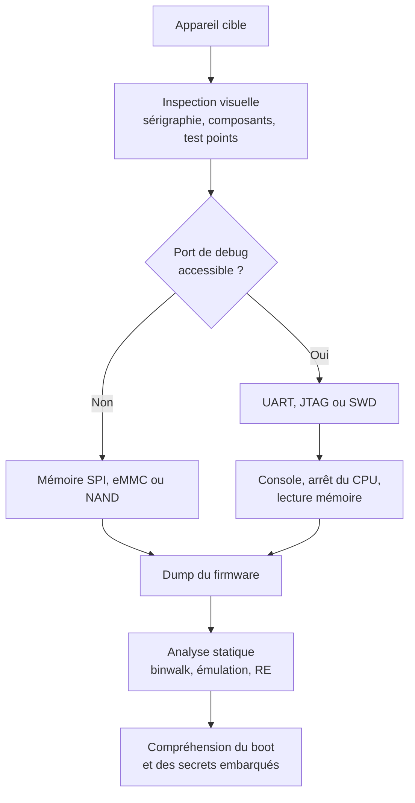

# Hardware Hacking

Le hardware hacking regroupe les techniques qui consistent à obtenir un accès, des données ou du contrôle en agissant sur le support physique d'un système plutôt que sur ses interfaces logicielles. L'accès à la carte permet de lire la mémoire flash, d'interrompre le démarrage, d'observer un bus ou de mesurer la consommation d'un microcontrôleur pendant qu'il manipule une clé.

Ce décalage change le modèle de menace. Un serveur durci reste vulnérable si un port UART oublié donne un shell de bootloader. Une serrure électronique résiste au crochetage mais accepte un code rejoué par radio. La sécurité physique définit donc ultimement ce qu'un attaquant peut extraire d'un appareil qu'il tient entre les mains. L'accès aux locaux est traité dans [[Physical Security]] ; l'analyse du firmware extrait dans [[Firmware Analysis]].

## Modèle de menace et cadre d'intervention

Toutes les capacités ne se valent pas : un attaquant opportuniste dispose de quelques minutes avec un appareil volé, un attaquant financé d'un laboratoire et du temps pour dessouder une puce BGA, un acteur de la chaîne logistique d'un accès en fabrication. La conception doit être évaluée contre ces extrêmes, et non contre le seul premier.

Deux règles précèdent toute manipulation : ne jamais travailler sous tension sans comprendre la topologie d'alimentation, et vérifier la tension logique avant de connecter un adaptateur — un UART en 1,8 V attaqué en 3,3 V détruit parfois le SoC. La masse se vérifie par continuité avec le blindage ou le plan de masse.

## Reconnaissance de la carte

L'inspection commence sans instrument. Les sérigraphies révèlent les références, les connecteurs non peuplés, les points de test et parfois les noms de signaux (`TX`, `RX`, `TCK`, `SWDIO`).

Les documents constructeur sont la seconde source. Un datasheet de SoC indique les broches de debug, les tensions, les modes de démarrage et les fusibles ; un schematic de carte de développement montre souvent les mêmes signaux. Le type de package oriente vers la méthode d'extraction : une SOIC-8 se clipser, une BGA-153 se replace difficilement.

Le multimètre mesure continuité vers la masse, tension d'alimentation et niveau logique au repos. Un point qui reste à 3,3 V et oscille au démarrage ressemble à une ligne TX ; un point qui reste haut sans bouger peut être un RX en attente. L'analyseur logique capture les trames et mesure le débit réel.



> [!warning] Piège
> Un connecteur non peuplé n'est pas forcément un port de debug. Les cartes industrielles laissent des pads pour des variantes de production, des antennes ou des tests. Injecter un signal sur un pad relié à une clock ou à un reset peut empêcher le démarrage, voire endommager le régulateur. La continuité et le datasheet priment sur la forme du pad.

## UART

L'UART est la porte d'entrée la plus fréquente. Quatre signaux suffisent : masse, TX, RX et éventuellement VCC. En pratique, on ne connecte que TX, RX et GND ; alimenter la carte par l'adaptateur crée des conflits. Le débit le plus courant est 115 200 bit/s en 8N1.

```bash
# Identifier le port série de l'adaptateur
dmesg | tail -20
ls -l /dev/ttyUSB*

# Ouvrir une console à 115200 8N1
picocom -b 115200 /dev/ttyUSB0
# ou
screen /dev/ttyUSB0 115200
```

Un shell U-Boot est un accès de premier ordre : il permet de lire la mémoire, de modifier les variables d'environnement, de désactiver la vérification de signature ou de charger une image par TFTP.

```text
printenv
bdinfo
sf probe 0
sf read 0x80000000 0x0 0x1000000
md.b 0x80000000 0x40
```

Un shell Linux embarqué donne accès à `/proc`, aux scripts de démarrage et parfois à des clés privées. Le mot de passe root est souvent absent ou récupérable avec `init=/bin/sh` dans les arguments du noyau. L'UART transforme ainsi une analyse hors ligne en interaction directe avec le système.

## JTAG et SWD

JTAG (IEEE 1149.1) est un bus de test à quatre ou cinq signaux : `TCK`, `TMS`, `TDI`, `TDO`, et souvent `TRST`. Il donne accès au TAP, permet d'arrêter le CPU, de lire et d'écrire la mémoire, de poser des breakpoints matériels et de programmer la flash. Sur ARM, SWD remplace souvent JTAG avec seulement `SWCLK` et `SWDIO`.

| Interface | Signaux | Forces | Limites |
|---|---|---|---|
| JTAG | TCK, TMS, TDI, TDO, TRST | Chaîne de TAP, boundary scan, debug complet | Plus de broches, chaîne complexe |
| SWD | SWCLK, SWDIO, GND | Deux fils, debug ARM efficace | ARM uniquement, pas de boundary scan |

```bash
# OpenOCD : identifier la chaîne et lire la flash
openocd -f interface/ftdi/ft2232.cfg -f target/stm32f4x.cfg \
  -c "init; scan_chain; halt; dump_image firmware.bin 0x08000000 0x100000; resume; shutdown"
```

La reconnaissance des broches se fait avec un `jtagulator`, un analyseur logique, ou par force brute de combinaisons sur les pads. La lecture de l'`IDCODE` confirme le fabricant et la famille. Sur les MCU modernes, la protection de lecture (RDP sur STM32, eFuse de debug) bloque l'accès ; elle se contourne parfois par glitching, parfois pas du tout.

> [!important] Idée clé
> JTAG et SWD ne sont pas seulement des ports de programmation : ce sont des ports de **contrôle du CPU**. Un attaquant qui les atteint peut lire la mémoire pendant que le système tourne, récupérer une clé déchiffrée en RAM, ou poser un breakpoint après la vérification de signature. La protection consiste donc à graver un fusible de debug irréversible et à chiffrer les secrets au repos, pas à cacher le port.

## SPI, I2C, eMMC et NAND

La mémoire non volatile est souvent la cible la plus directe. Une flash SPI NOR en SOIC-8 se lit avec un clip et un programmateur CH341A, sans dessoudage. En circuit, le SoC peut piloter le bus et perturber la lecture ; il faut alors maintenir le CPU en reset ou dessouder la puce. Les flash 1,8 V exigent un adaptateur adapté, sous peine de destruction.

```bash
flashrom -p ch341a_spi --flash-name
flashrom -p ch341a_spi -r firmware.bin
flashrom -p ch341a_spi -v firmware.bin
```

L'I2C concerne plutôt les EEPROM de configuration, les capteurs et les secure elements. Un Bus Pirate ou un adaptateur USB-I2C suffit à scanner le bus et à lire une EEPROM non protégée. Les adresses 7 bits usuelles (0x50 pour une EEPROM, 0x48 pour un capteur) accélèrent l'identification.

L'eMMC combine un contrôleur et de la mémoire NAND. Deux voies existent : dessouder et lire avec un adaptateur eMMC vers SD, ou accéder aux broches de test. Les partitions `boot0`, `boot1` et `user` sont distinctes ; les données de RPMB sont authentifiées et ne se lisent pas sans clé. Une lecture brute se fait avec `dd` ou `mmc-utils` une fois la puce montée sur un lecteur.

La NAND brute est plus difficile : blocs défectueux, ECC et parfois scramble propre au contrôleur. `nanddump` et `nandtest` travaillent sur une interface MTD ; sur une puce dessoudée, un programmeur NAND dédié est nécessaire. Le chip-off reste l'option de dernier recours, destructive pour la carte.

| Mémoire | Accès typique | Difficulté | Point bloquant |
|---|---|---|---|
| SPI NOR | Clip SOIC-8, CH341A, flashrom | Faible | Tension 1,8 V, bus occupé |
| I2C EEPROM | Bus Pirate, adaptateur USB | Faible | Write-protect, adresse |
| eMMC | Adaptateur eMMC-SD, `dd` | Moyenne | BGA, RPMB, chiffrement |
| NAND brute | Programmateur, MTD, ECC | Élevée | Bad blocks, scramble, BGA |

## Du dump à l'analyse

Un dump brut n'est pas un firmware exploitable. Il faut identifier le conteneur, extraire les systèmes de fichiers et repérer les zones chiffrées. `binwalk` reconnaît les en-têtes U-Boot, les images kernel, les archives SquashFS, JFFS2 et UBIFS. L'entropie révèle les zones chiffrées ou compressées ; une zone uniformément haute sans signature connue indique souvent un chiffrement.

Les secrets sont souvent dans les zones les moins protégées : variables d'environnement U-Boot, scripts de démarrage, certificats, clés SSH privées, identifiants de test. Le mode debug peut aussi exposer la clé de déchiffrement, stockée en OTP ou dérivée d'un identifiant unique. La chaîne complète est traitée dans [[Firmware Analysis]] et [[Reverse Engineering]].

## RFID et NFC

Les systèmes de contrôle d'accès sans contact reposent sur des fréquences et des protocoles documentés. La sécurité varie : certaines cartes n'émettent qu'un identifiant fixe, d'autres implémentent un challenge-réponse.

| Bande | Fréquence | Exemples | Sécurité typique |
|---|---|---|---|
| LF | 125 kHz | EM4100, HID Prox | Identifiant fixe, clonage trivial |
| HF | 13,56 MHz | MIFARE Classic, DESFire, iCLASS | Classic cassé, DESFire correct |
| UHF | 860-960 MHz | EPC Gen2, badges longue portée | Variable, lecture à distance |

Le Proxmark3 lit, émule et clone les cartes, et implémente les attaques contre MIFARE Classic : `darkside`, `nested`, `hardnested`. Une Classic 1K se dump souvent en quelques minutes ; une DESFire EV2/EV3 correctement configurée résiste si les clés ne sont pas faibles.

```bash
pm3 --> hf search
pm3 --> hf mf autopwn
pm3 --> hf mf dump
pm3 --> hf mf restore
pm3 --> hf mfdes info
```

Le clonage n'est pas la seule attaque. Le relais NFC place deux dispositifs, l'un près de la carte victime, l'autre près du lecteur, et transmet les échanges en temps réel. La latence du protocole ISO 14443 rend l'exercice délicat. La défense repose sur des cartes à challenge-réponse et des lecteurs vérifiant la distance.

## SDR, replay et codes roulants

La radio logicielle transforme un récepteur ou un émetteur en instrument d'analyse. Un RTL-SDR couvre environ 24 MHz à 1,7 GHz en réception ; un HackRF couvre 1 MHz à 6 GHz en half-duplex ; un YARD Stick One ou un Flipper Zero ciblent les bandes sub-GHz. Les télécommandes domestiques utilisent souvent 315, 433,92 ou 868 MHz en ASK/OOK ou FSK.

```bash
rtl_433 -f 433.92M -A
rtl_sdr -f 433.92M -s 2048000 capture.iq
```

L'analyse se fait dans Universal Radio Hacker ou Inspectrum : on isole la rafale, on mesure les impulsions, on décode le PWM ou le Manchester, puis on reconstruit la trame. Une trame fixe se rejoue telle quelle, ce qui concerne de nombreuses télécommandes de portail ou de prises connectées bas de gamme.

Les codes roulants compliquent le rejeu. Un émetteur KeeLoq/HCS301 envoie un compteur qui change à chaque appui, et le récepteur n'accepte qu'une fenêtre autour du dernier vu. L'attaque RollJam combine un brouilleur et deux enregistreurs : elle capture deux trames consécutives, en laisse passer une pour que la victime croie avoir réussi, et conserve l'autre pour un usage ultérieur. Les récepteurs qui acceptent un compteur ancien dans une fenêtre large restent vulnérables.

Les véhicules sans clé ajoutent une couche de relais UHF : deux attaquants prolongent la portée entre la clé et la voiture, que les constructeurs protègent par des clés à mouvement et de l'UWB.

> [!warning] Piège
> Rejouer une trame capturée sur un équipement qui ne vous appartient pas n'est pas un test de sécurité : c'est une intrusion. Même en laboratoire, un émetteur mal configuré peut brouiller des bandes voisines et perturber des systèmes critiques. La manipulation radio se fait en cage de Faraday ou avec une charge factice.

## Glitching et side-channel

Le glitching provoque une faute transitoire pour contourner une décision de sécurité. Trois familles existent : la faute de tension, la faute d'horloge et la faute électromagnétique. La cible typique est une comparaison de signature, un mot de passe ou un saut conditionnel qui protège l'accès à la flash.

Le paramétrage est empirique. On balaye un délai (`offset`), une largeur d'impulsion (`width`), parfois une tension et une température. Une faute bien placée transforme un `jne` en `je` ou fait retourner `0` à une fonction de vérification. Les cartes ChipWhisperer automatisent la capture et le balayage.

> [!abstract] Définition — Glitch
> Un glitch est une perturbation physique brève et contrôlée de l'alimentation, de l'horloge ou du champ électromagnétique d'un circuit, destinée à faire exécuter une instruction erronée à un moment précis. Ce n'est pas une injection de code : c'est une corruption temporelle du calcul, exploitée pour sauter une vérification ou faire fuiter un secret.

Le side-channel exploite l'information émise pendant le calcul : consommation, rayonnement, temps d'exécution, accès au cache. L'analyse de puissance simple (SPA) distingue les opérations ; l'analyse par corrélation (CPA) retrouve une clé AES en corrélant des milliers de traces avec un modèle de consommation — pour chaque octet candidat, on estime le poids de Hamming d'une valeur intermédiaire et on corrèle. L'EMA mesure le champ proche avec une sonde, souvent plus efficace qu'une mesure sur l'alimentation.

Les contremesures sont le masquage, le hiding (bruit, consommation constante), le chiffrement à double rail, les délais aléatoires et la vérification redondante. Le test TVLA compare statistiquement deux jeux de traces pour détecter une fuite avant certification.

## Secure boot et TPM

La chaîne de démarrage est le point où le matériel et le logiciel se rencontrent. Un secure boot correct commence dans une ROM immuable, vérifie la signature du bootloader suivant avec une clé publique gravée en OTP ou en eFuse, puis continue jusqu'au noyau. Chaque maillon doit vérifier le suivant ; un maillon qui fait confiance à un fichier non signé annule les précédents.

Sur PC, l'UEFI Secure Boot utilise une base `db`, une base de révocation `dbx`, et des clés `KEK`/`PK`. Sur ARM embarqué, la chaîne est souvent propriétaire, avec des fusibles de debug et des compteurs anti-rollback qui empêchent de réinstaller une version vulnérable.

```text
Chaîne typique :
BootROM (immuable) → Bootloader signé → Noyau signé → Rootfs vérifié
       |                    |                  |
   clé en OTP          anti-rollback       dm-verity / IMA
```

Le TPM 2.0 apporte la mesure et le scellement. Au démarrage, chaque composant étend un registre de plateforme (PCR) avec le hash de ce qu'il charge. Une clé peut être scellée sur une valeur de PCR : elle n'est libérée que si la chaîne mesurée est identique. C'est le mécanisme qui protège BitLocker contre une modification du bootloader, et celui qui permet l'attestation à distance.

```bash
tpm2_pcrread sha256:0,1,2,7
tpm2_create -C primary.ctx -u key.pub -r key.priv -i secret.bin -p "pcr:sha256:0,7"
tpm2_unseal -c key.ctx -o secret.out
```

Les attaques contre cette chaîne sont rarement cryptographiques. Elles visent le reset (couper l'alimentation pendant une vérification), l'écoute du bus TPM discret avec un analyseur logique, le remplacement du firmware par une version signée mais vulnérable, ou l'exploitation d'un debug laissé actif. Le cold boot et les attaques DMA (Thunderbolt, PCIe) ciblent la mémoire plutôt que la chaîne de boot.

> [!abstract] Définition — Racine de confiance
> La racine de confiance (root of trust) est le premier composant dont l'exécution est considérée comme certaine, parce qu'elle est immuable ou vérifiée par un mécanisme matériel. Toute la chaîne de sécurité en dépend : si la racine est compromise, les signatures vérifiées en aval ne prouvent plus rien.

## Défense

La défense matérielle se pense dès la conception. Les fusibles de debug doivent être gravés en production, les ports JTAG/SWD désactivés ou inaccessibles, les points de test supprimés. Le firmware doit être chiffré avec une clé unique par appareil, dérivée d'un secret en OTP, et les mises à jour signées avec un anti-rollback.

| Menace | Contrôle |
|---|---|
| Lecture de flash | Chiffrement au repos, clé en OTP, secure element |
| Console UART | Désactivation en production, authentification, logs |
| JTAG/SWD | eFuse de debug, readout protection, retrait des pads |
| Glitching | Détecteurs de tension, redondance, délais aléatoires |
| Side-channel | Masquage, hiding, TVLA, certification |
| Replay radio | Challenge-réponse, compteurs, fenêtre temporelle |
| Implant de supply chain | Provenance, inspection, attestation, X-ray |

La chaîne d'approvisionnement est un vecteur à part entière. Les composants contrefaits et les implants ajoutés en transit ne se détectent pas par un scan logiciel. L'inspection par rayons X, la comparaison avec un échantillon de référence et la traçabilité des lots sont les seuls contrôles réalistes ; les normes matérielles (Common Criteria, FIPS 140-3) donnent un cadre, pas une garantie.

## Limites et détection

Le hardware hacking est limité par l'irréversibilité : une puce dessoudée, un fusible gravé ne se remettent pas en état. Le temps de laboratoire et la compétence créent une barrière qui protège surtout contre les attaquants opportunistes ; un adversaire déterminé contourne souvent une protection en quelques heures si elle n'a pas été conçue en profondeur.

La détection repose sur trois piliers : l'attestation, la surveillance physique (scellés, mésh) et la comparaison hors ligne (hash de firmware, golden samples). Aucun ne fonctionne seul : une attestation dont la clé est lue par UART ne prouve rien, et un hash calculé par un firmware compromis ne prouve rien. La sécurité matérielle reste indissociable des autres couches — un secure boot solide avec une mise à jour en HTTP laisse entrer un firmware malveillant. Voir [[Physical Security]], [[Firmware Analysis]] et [[Binary Exploitation]].

## Questions de révision

> [!quiz] Quelle est la différence entre JTAG et SWD ?
> JTAG est un bus de test à quatre ou cinq fils avec chaîne de TAP et boundary scan ; SWD est une variante ARM à deux fils (SWCLK, SWDIO).

> [!quiz] Qu'est-ce qu'un code roulant, et pourquoi le rejeu simple échoue-t-il ?
> Un code roulant change à chaque appui et le récepteur n'accepte qu'une fenêtre de valeurs. Une trame rejouée est rejetée comme ancienne.
