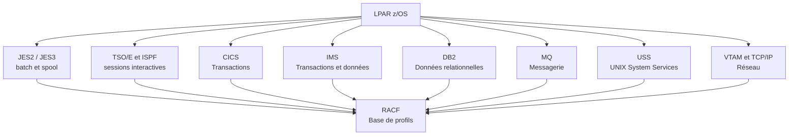

# Mainframe Security

Le mainframe n'est pas un vestige. Les transactions bancaires, les règlements d'assurance, les dossiers fiscaux et une partie des chaînes logistiques mondiales s'exécutent encore sur z/OS. La plateforme est souvent présentée comme intrinsèquement sûre parce qu'elle est ancienne, centralisée et peu connectée. Cette réputation repose sur un malentendu : z/OS est sûr si RACF, APF, les tâches démarrées, CICS, DB2 et USS sont correctement configurés. Une seule entrée APF mal protégée, un profil RACF trop permissif ou un identifiant par défaut suffit à donner à un attaquant un accès équivalent à celui d'un administrateur système.

La sécurité du mainframe est donc un exercice de configuration et d'audit, pas de patch miracle. Elle exige de comprendre les frontières entre les adresses, les sous-systèmes et les classes RACF, puis de vérifier que chaque frontière est réellement appliquée.

> [!abstract] Définition — RACF
> RACF (Resource Access Control Facility) est le gestionnaire d'accès de z/OS. Il stocke des profils dans une base de données, les rattache à des classes de ressources et évalue chaque demande d'accès selon l'identité de l'utilisateur, le groupe, le profil et la liste d'accès. RACF ne protège que ce qu'on lui demande de protéger : une ressource sans profil reste accessible selon les règles par défaut.

## Architecture et frontières de sécurité

Un système z/OS s'exécute dans une ou plusieurs LPAR, elles-mêmes virtualisées par PR/SM. Chaque LPAR héberge un ou plusieurs address spaces : JES2 ou JES3 pour le batch, TSO/E pour les sessions interactives, CICS et IMS pour les transactions, DB2 et MQ pour les données et la messagerie, USS pour l'environnement UNIX, VTAM et TCP/IP pour le réseau. Un sysplex peut regrouper plusieurs systèmes et partager des ressources via le Coupling Facility.



La frontière principale n'est pas le réseau mais l'identité : un travail JCL, une transaction CICS ou une requête DB2 s'exécute toujours sous un identifiant. La question est de savoir quel identifiant, avec quels attributs RACF, et quelles ressources il peut atteindre.

## RACF : profils, classes et attributs

RACF organise les ressources en classes. Chaque classe contient des profils, et chaque profil porte une liste d'accès qui associe des identifiants ou des groupes à des autorisations. Les commandes de base sont `RDEFINE`, `PERMIT`, `CONNECT`, `ALTUSER`, `LISTUSER`, `SEARCH` et `SETROPTS`.

```jcl
//RACF     EXEC PGM=IKJEFT01
//SYSTSPRT DD SYSOUT=*
//SYSTSIN  DD *
  LISTUSER IBMUSER
  SEARCH CLASS=DATASET MASK=SYS1.**
  LISTGRP SYS1
/*
```

Les classes les plus sensibles sont les suivantes.

| Classe | Objet protégé | Risque si mal configurée |
|---|---|---|
| `DATASET` | Datasets et volumes | Lecture de jeux de données sensibles, modification de bibliothèques système |
| `FACILITY` | Fonctions système et services | Contournement de contrôles, accès à des fonctions privilégiées |
| `OPERCMDS` | Commandes opérateur | Arrêt du système, modification de paramètres, perturbation des services |
| `SURROGAT` | Substitution d'identité | Exécution sous un identifiant plus privilégié |
| `STARTED` | Tâches démarrées | Exécution d'un programme arbitraire sous un identifiant système |
| `PROGRAM` | Programmes APF | Contournement de RACF par un programme autorisé |
| `UNIXPRIV` | Privilèges USS | Élévation de privilèges dans l'environnement UNIX |
| `TSOAUTH` | Autorisations TSO | Accès à des commandes interactives sensibles |
| `JESJOBS` | Soumission et gestion des jobs | Lecture, modification ou soumission de travaux |
| `JESSPOOL` | Fichiers de spool | Lecture de sorties contenant des secrets |
| `CONSOLE` | Consoles | Commandes opérateur et contrôle du système |
| `SERVAUTH` | Services réseau | Accès à des services TCP/IP ou à des ports |

Les attributs utilisateur sont aussi importants que les profils. `SPECIAL` permet de modifier RACF sans contrôle complet ; `OPERATIONS` donne des pouvoirs opérateur étendus ; `AUDITOR` et `ROAUDIT` permettent de lire et de modifier l'audit ; `TRUSTED` autorise l'utilisation de programmes écrits en assembleur pour manipuler RACF ; `CLAUTH` autorise la création de profils dans une classe ; `GROUP` donne la gestion d'un groupe. Ces attributs doivent être réservés à un très petit nombre de comptes, nominatifs et surveillés.

La base RACF elle-même est une ressource critique. Elle doit être sauvegardée, protégée en écriture et auditée. Les exits RACF, les profils de classe `FACILITY` et les options globales (`SETROPTS`) déterminent le comportement de l'ensemble du système. Une modification de `SETROPTS` peut désactiver une protection sans qu'aucun profil ne soit modifié.

## APF, programmes autorisés et tâches démarrées

APF (Authorized Program Facility) identifie les bibliothèques dont les programmes peuvent s'exécuter en mode autorisé, avec des privilèges proches du système. Un programme APF peut contourner RACF, accéder à la mémoire noyau et modifier des structures critiques. La liste APF est donc une frontière de sécurité majeure.

```jcl
//APF      EXEC PGM=IKJEFT01
//SYSTSIN  DD *
  SETPROG APF,LIST
  SETPROG APF,ADD,DSNAME=SYS1.LINKLIB,VOLUME=SYSRES
/*
```

Les bonnes pratiques consistent à limiter la liste APF au strict nécessaire, à protéger les bibliothèques APF avec des profils `DATASET` et `PROGRAM`, à vérifier régulièrement les ajouts et à interdire l'écriture par des utilisateurs non administrateurs. Un attaquant qui peut écrire dans une bibliothèque APF peut y placer un programme autorisé et obtenir une élévation de privilèges durable.

Les tâches démarrées sont des address spaces lancés au démarrage ou à la demande, souvent avec des identifiants puissants. La classe `STARTED` associe un nom de tâche à un profil et à un utilisateur. Une tâche démarrée mal protégée peut être remplacée par un programme attaquant, ou détournée pour exécuter du code sous un identifiant système.

```jcl
//STARTED  EXEC PGM=IKJEFT01
//SYSTSIN  DD *
  RDEFINE STARTED TCP.* STDATA(USER(TCPUSER) GROUP(TCPGRP) TRUSTED(NO))
  SETROPTS RACLIST(STARTED) REFRESH
/*
```

## JCL, batch et spool

JCL décrit les travaux batch : `JOB`, `EXEC`, `DD`, `PROC`, `SET`, `IF`, `OUTPUT`. Les paramètres `USER=`, `PASSWORD=`, `NOTIFY`, `TYPRUN`, `CLASS`, `MSGCLASS`, `STEPLIB`, `JOBLIB`, `PROCLIB`, `DEST` et `XMIT` ont tous un impact sécurité.

Un attaquant peut injecter des cartes JCL dans un fichier de paramètres, un proclib ou un spool, puis soumettre un travail qui lit un dataset sensible, écrit dans une bibliothèque système ou exécute un programme autorisé. Les bibliothèques `PROCLIB` et `STEPLIB` doivent être protégées, et les substitutions de `STEPLIB` doivent être contrôlées.

Le spool JES contient les sorties de jobs, parfois des données de production, des journaux ou des secrets. Les classes `JESSPOOL` et `JESJOBS` doivent restreindre la lecture, la modification et la purge des sorties. SDSF, qui permet de consulter et de manipuler le spool, doit être réservé aux opérateurs et aux équipes autorisées.

## CICS, IMS, DB2 et MQ

CICS est un moniteur transactionnel. Une transaction s'exécute sous un identifiant CICS, avec des options de sécurité définies dans le SIT (`SEC=YES`, `XUSER`, `ESM`). Les transactions `CEMT`, `CEDA`, `CESN`, `CESF` et les commandes `SPOOL`, `TDQ`, `TSQ` peuvent exposer des ressources ou modifier la configuration. Les programmes CICS utilisent `LINK`, `XCTL`, `START`, `RETURN` et `HANDLE ABEND` ; une transaction mal conçue peut permettre à un utilisateur d'exécuter un programme avec les privilèges d'un autre.

IMS repose sur des DBD, des PSB et des PCB. La sécurité IMS s'appuie sur RACF et sur des profils de classe `IMS`. Une transaction IMS peut accéder à des segments de base de données selon le PCB ; une autorisation excessive donne accès à des données hors du périmètre fonctionnel.

DB2 utilise des autorisations SQL (`GRANT`, `REVOKE`), des rôles, des plans et des packages. Les autorisations `SYSADM`, `DBADM`, `DATAACCESS` et `ACCESSCTRL` sont critiques. Le `BIND` d'un plan ou d'un package peut figer des autorisations ; une modification de package peut changer le comportement d'une application sans changer le code source. La classe `DB2` de RACF et le Resource Limit Facility (RLF) complètent le contrôle.

MQ expose des queue managers, des queues et des canaux. Les contrôles `CHLAUTH`, `SSLPEER` et `MCAUSER` déterminent quels partenaires peuvent se connecter et sous quel identifiant. Un canal MQ ouvert sans authentification permet de lire ou d'écrire des messages métier, voire de déclencher des traitements.

## USS et le monde UNIX

USS (UNIX System Services) ajoute un système de fichiers hiérarchique, des processus, des sockets et des utilitaires UNIX à z/OS. Chaque utilisateur possède un segment `OMVS` avec un UID et un GID. Les privilèges UNIX sont contrôlés par RACF via `BPX.SUPERUSER`, `UNIXPRIV` et les profils de fichiers.

Les risques sont classiques : fichiers `setuid` ou `setgid`, répertoires inscriptibles, scripts lancés par des tâches démarrées, permissions trop larges, `sudo` mal configuré, variables d'environnement non contrôlées. Un attaquant qui obtient un shell USS peut pivoter vers les datasets, les jobs et les sous-systèmes.

```bash
# Vérifier les privilèges USS et les fichiers setuid
tsocmd "LISTUSER IBMUSER OMVS"
find / -perm -4000 -type f 2>/dev/null
```

## Chiffrement et protection des données

z/OS propose ICSF (Integrated Cryptographic Service Facility) et CPACF (Central Processor Assist for Cryptographic Functions) pour le chiffrement matériel. Les clés sont stockées dans des datasets CKDS, PKDS et TKDS. Les services cryptographiques sont protégés par les classes `CSFSERV` et `CRYPTOZ`.

Le chiffrement des datasets peut être appliqué de manière sélective ou pervasive. AT-TLS protège les flux TCP/IP, IPsec protège les communications réseau, et SSH/TLS protègent les accès administratifs. Le chiffrement ne remplace pas le contrôle d'accès : une clé accessible à un utilisateur non autorisé annule la protection.

## Chemins d'attaque

| Chemin | Prérequis | Impact | Détection |
|---|---|---|---|
| Identifiants par défaut | Compte `IBMUSER`, `SYS1`, `START1` ou mot de passe faible | Accès initial, élévation | Échecs d'authentification, connexions inhabituelles |
| Profil RACF permissif | `UACC(READ)` ou `UACC(ALTER)` sur un dataset sensible | Lecture ou modification de données | Audit `DATASET`, revue des profils |
| Attribut `SPECIAL` | Compte compromise avec `SPECIAL` | Contrôle total de RACF | Changements RACF, `SETROPTS` |
| Bibliothèque APF inscriptible | Écriture dans une bibliothèque APF | Exécution autorisée, contournement RACF | `SETPROG APF`, SMF 80 |
| Tâche démarrée détournée | Écriture dans un proclib ou un programme | Exécution sous identifiant système | SMF 30, `STARTED` |
| JCL injection | Écriture dans un proclib ou un spool | Lecture de datasets, exécution | SMF 30, 14/15 |
| Transaction CICS | Autorisation excessive ou transaction vulnérable | Accès aux données, exécution | SMF 110, journaux CICS |
| `SURROGAT` | Profil trop large | Substitution d'identité | SMF 80, audit RACF |
| `OPERCMDS` | Profil trop large | Commandes opérateur | SMF 80, console |
| USS `BPX.SUPERUSER` | Profil `FACILITY` mal configuré | Root UNIX | SMF 92, journaux USS |
| Dataset exposé | `UACC` ou profil absent | Fuite de données | Revue RACF, SMF 14/15 |
| NJE ou FTP | Service exposé, authentification faible | Transfert de fichiers, pivot | SMF 118-120, journaux réseau |

## Détection

SMF (System Management Facilities) est la source principale d'audit. Les enregistrements 80 à 83 couvrent RACF, le 92 couvre USS, le 30 les jobs, les 14 et 15 les datasets, le 101 DB2, le 110 CICS, le 116 IMS et les 118 à 120 TCP/IP. Les enregistrements doivent être collectés, protégés et envoyés vers un SIEM ou un analyseur dédié.

```jcl
//SMFDUMP  EXEC PGM=IFASMFDP
//SYSPRINT DD SYSOUT=*
//ADUIN    DD DSN=SYS1.MAN1,DISP=SHR
//ADUOUT   DD DSN=ARCHIVE.SMF.DAILY(+1),DISP=(NEW,CATLG)
//SYSIN    DD *
  INDD(ADUIN,OPTIONS(DUMP))
  OUTDD(ADUOUT,TYPE(80:83,92,30,14,15))
/*
```

Les cas d'usage prioritaires sont les modifications de profils RACF, l'attribution de `SPECIAL`, `OPERATIONS` ou `AUDITOR`, les changements APF, les modifications de tâches démarrées, les accès aux datasets sensibles, les connexions échouées répétées, les commandes opérateur, les changements de configuration CICS, les `GRANT` DB2, les accès USS privilégiés et les transferts réseau.

La difficulté est le volume et la normalisation. Les journaux SMF sont en format binaire ; il faut les convertir, les enrichir avec l'identité, la ressource et le résultat, puis les corréler avec les journaux réseau et les applications. Un tableau de bord doit distinguer les changements légitimes des dérives.

## Durcissement

Le durcissement commence par l'inventaire : LPAR, sous-systèmes, tâches démarrées, bibliothèques APF, profils RACF, connexions réseau, comptes. Ensuite :

- supprimer ou verrouiller les identifiants par défaut et les comptes non nominatifs ;
- appliquer une politique de mot de passe et déployer MFA pour les accès administratifs ;
- restreindre `SPECIAL`, `OPERATIONS`, `AUDITOR`, `ROAUDIT`, `TRUSTED` et `CLAUTH` ;
- protéger les bibliothèques APF et les programmes autorisés ;
- verrouiller les tâches démarrées et les proclibs ;
- appliquer le moindre privilège sur les datasets, CICS, IMS, DB2 et MQ ;
- contrôler USS : `setuid`, permissions, `BPX.SUPERUSER`, `UNIXPRIV` ;
- chiffrer les données sensibles et les flux ;
- appliquer les APAR sécurité IBM et maintenir les sous-systèmes ;
- séparer les rôles d'administration, d'audit et d'exploitation ;
- tester les sauvegardes RACF et les procédures de restauration.

La conformité PCI DSS, SOX, NIS2 ou DORA impose souvent une preuve documentée de ces contrôles. L'audit ne doit pas seulement vérifier l'existence d'un profil : il doit vérifier son contenu, son universal access, ses listes d'accès et son historique de modification.

## Limites et angles morts

Le mainframe est rarement compromis par une vulnérabilité zero-day. Les incidents viennent de configurations héritées, de comptes de service partagés, de bibliothèques oubliées et d'une méconnaissance des équipes sécurité. Les outils modernes couvrent mal SMF et RACF ; il faut souvent construire ses propres analyses. Enfin, la disponibilité prime : une réponse à incident trop agressive peut arrêter des traitements critiques. Toute action doit être coordonnée avec l'exploitation et l'ingénierie.

> [!quiz] Pourquoi une bibliothèque APF inscriptible est-elle plus dangereuse qu'un simple droit d'écriture sur un dataset ?
> Parce qu'un programme placé dans une bibliothèque APF s'exécute en mode autorisé et peut contourner RACF, accéder à la mémoire système et modifier des structures critiques. Le droit d'écriture sur un dataset ne donne pas, à lui seul, ce niveau de privilège.

> [!quiz] Quel enregistrement SMF permet de détecter une modification de profil RACF ?
> Les enregistrements SMF 80 à 83, selon le type d'événement RACF. Ils doivent être collectés et corrélés avec l'identité de l'auteur et la ressource modifiée.

> [!abstract] Définition — APF
> APF (Authorized Program Facility) est le mécanisme qui autorise certains programmes à s'exécuter avec des privilèges système. La liste APF et les bibliothèques qu'elle contient sont des actifs de sécurité critiques : toute écriture non contrôlée dans une bibliothèque APF peut mener à une compromission totale.
