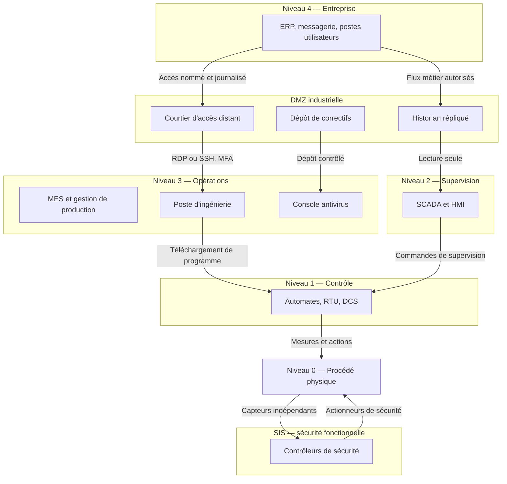
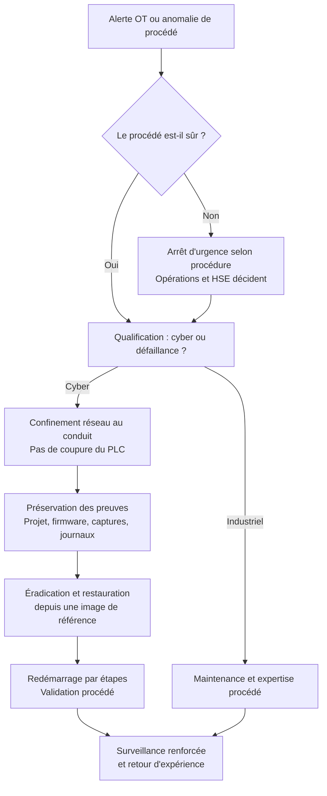

# OT Security avancé

La note [[ICS-SCADA Security]] couvre les fondamentaux : composants, niveaux de Purdue, protocoles, grands incidents. Cette note suppose ces acquis et traite l'ingénierie de la sécurité OT : comment concevoir des zones et des conduits défendables, lire un protocole industriel au niveau de la trame, inventorier sans arrêter la production, détecter une commande illégitime et répondre sans aggraver le risque physique.

Le point de départ est un décalage de nature. En OT, la sécurité de l'information n'est pas le premier objectif : la sécurité des personnes, la disponibilité du procédé et l'intégrité des ordres priment sur la confidentialité. Une note de patch qui redémarre un automate peut arrêter une ligne, un scan de découverte peut figer un contrôleur, et une fausse alerte peut pousser un opérateur à une manœuvre dangereuse. La sécurité OT est donc une discipline de compromis explicites, où chaque contrôle doit être justifié par le risque qu'il réduit et par le risque qu'il introduit.

> [!abstract] Définition — Sûreté fonctionnelle
> La sûreté fonctionnelle (functional safety) est la capacité d'un système à maintenir le procédé dans un état sûr, y compris en cas de défaillance. Elle est portée par des systèmes instrumentés de sécurité (SIS), dimensionnés selon IEC 61508/61511 et un niveau d'intégrité de sécurité (SIL). La cybersécurité ne doit jamais dégrader cette fonction : un SIS se protège, ne se scanne pas et ne se met pas à jour depuis le réseau IT.

## IT et OT : deux régimes de risque

| Dimension | IT classique | OT industriel |
|---|---|---|
| Priorité | Confidentialité, intégrité, disponibilité | Sûreté, disponibilité, intégrité, confidentialité |
| Patch | Cycle mensuel, redémarrage banal | Fenêtre d'arrêt, validation constructeur, parfois jamais |
| Cycle de vie | Trois à cinq ans | Quinze à trente ans |
| Changement | Agile, rollback fréquent | Change control strict, essais sur banc |
| Agents de sécurité | EDR généralisé | Agents souvent interdits ou non supportés |
| Protocoles | IP standards, chiffrés | Propriétaires, temps réel, souvent en clair |
| Topologie | Maillée, redondante | Cellules et îlots, profondeur défensive |
| Impact d'incident | Perte de données, image | Arrêt de production, dommage physique, atteinte aux personnes |
| Métrique | MTTD, MTTR | Disponibilité, sécurité, conformité réglementaire |

La confidentialité n'est pas pour autant secondaire : recettes, plans de production, courbes de consommation et données de maintenance ont une valeur industrielle et stratégique. Mais le risque dominant reste l'intégrité : une valeur de mesure falsifiée ou une consigne modifiée produit une action physique. C'est la raison pour laquelle les attaques OT les plus dangereuses ne détruisent pas directement un équipement : elles manipulent la vue que les opérateurs ont du procédé, ou neutralisent la couche qui doit arrêter le procédé.

La distinction entre safety et security structure l'architecture. Un SIS est conçu pour agir quand le contrôle-commande échoue ; il doit rester indépendant, avec ses propres capteurs, ses propres actionneurs et son propre réseau. Le connecter au DCS pour « remonter les alarmes » annule cette indépendance et crée un chemin d'attaque direct vers la dernière ligne de défense. TRITON l'a démontré.

## Modèles de référence : Purdue, ISA-95 et IEC 62443

### Niveaux, zones et conduits

ISA-95 (IEC 62264) décrit l'intégration entre l'entreprise et la fabrication selon cinq niveaux : 0 pour le procédé physique, 1 pour le contrôle de base, 2 pour la supervision, 3 pour les opérations de fabrication et 4 pour la planification et la logistique. Le modèle Purdue, issu de la Purdue Enterprise Reference Architecture, ajoute une frontière de DMZ industrielle entre les niveaux 3 et 4, et un niveau 5 pour l'Internet et le cloud. Il reste un modèle conceptuel de confiance, pas une topologie obligatoire : un réseau OT plat, un historian dans le cloud ou un accès distant par modem le contournent sans le dire.

IEC 62443 apporte le modèle normatif : les actifs sont regroupés en **zones** homogènes du point de vue du risque, et les communications entre zones passent par des **conduits** contrôlés. Chaque zone reçoit un niveau de sécurité cible (SL-T), distinct du niveau atteint (SL-A) et du niveau maximal qu'un composant peut offrir (SL-C). Un conduit n'est pas seulement une règle de pare-feu : c'est un point unique où l'on applique filtrage, inspection protocolaire, authentification, journalisation et limitation de débit.

> [!abstract] Définition — Zone et conduit
> Une zone est un ensemble d'actifs partageant les mêmes exigences de sécurité et le même niveau de confiance. Un conduit est le chemin autorisé entre deux zones, avec les flux, les protocoles et les utilisateurs explicitement admis. La paire zone/conduit remplace la notion floue de « réseau interne » par une frontière vérifiable et documentée.



### Les niveaux de sécurité IEC 62443

IEC 62443 définit sept exigences fondamentales (FR) : identification et authentification (IAC), contrôle d'usage (UC), intégrité du système (SI), confidentialité des données (DC), flux de données restreint (RDF), réactivité aux événements (RE) et disponibilité des ressources (RA). Chaque exigence se décline en exigences système (SR) et en renforcements (RE), notés SL 1 à 4.

| Niveau | Adversaire visé | Exemple de capacité |
|---|---|---|
| SL 1 | Accident, erreur humaine, violation involontaire | Protection contre un opérateur qui se trompe de registre |
| SL 2 | Attaquant peu motivé, moyens simples | Script kiddie, accès opportuniste, mot de passe par défaut |
| SL 3 | Attaquant sophistiqué, ressources modérées | Groupe criminel, insider déterminé, outillage développé |
| SL 4 | Acteur étatique, ressources étendues | Attaque de type Stuxnet, moyens humains et financiers importants |

Les parties utiles à un programme sont 62443-2-1 (système de management de la cybersécurité IACS), 62443-2-3 (gestion des correctifs), 62443-3-2 (analyse de risque et conception des zones et conduits), 62443-3-3 (exigences système), 62443-4-1 (développement sécurisé des produits) et 62443-4-2 (exigences des composants). La certification d'un composant ne certifie pas l'architecture : un automate certifié SL 2 dans une zone SL 3 reste un point faible si le conduit qui le relie est trop permissif.

## Protocoles industriels en profondeur

Les protocoles industriels ont été conçus pour la robustesse et le déterminisme, pas pour l'adversité. La plupart n'ont ni authentification, ni intégrité, ni confidentialité ; certains n'ont même pas de notion de session. Leur analyse au niveau de la trame est indispensable : une règle de pare-feu qui autorise le port 502 autorise toutes les fonctions Modbus, y compris l'écriture.

| Protocole | Transport et port | Authentification | Intégrité | Confidentialité | Usage dominant |
|---|---|---|---|---|---|
| Modbus/TCP | TCP 502 | Aucune | Aucune | Aucune | Automatisation générale, bâtiment |
| DNP3 | TCP/UDP 20000 | SAv5 optionnelle | SAv5 optionnelle | Aucune | Électricité, eau |
| OPC UA | TCP 4840 | Certificats X.509 | Signature | Chiffrement | Interopérabilité, supervision |
| OPC Classic | DCOM 135 et ports dynamiques | Windows | Limitée | Aucune | Legacy Windows |
| PROFINET | Ethernet L2, EtherType 0x8892 | Aucune | Aucune | Aucune | Automatisation machine |
| EtherNet/IP | TCP 44818, UDP 2222 | CIP Security optionnelle | Optionnelle | Optionnelle | Automatisation, robotique |
| S7comm | TCP 102, ISO-TSAP | Protection niveau automate | Faible | Aucune | Siemens S7-300/400 |
| IEC 60870-5-104 | TCP 2404 | Aucune | Aucune | TLS via IEC 62351 | Téléconduite électrique |
| BACnet | UDP 47808 | Aucune | Aucune | BACnet/SC | Bâtiment, HVAC |
| HART-IP | TCP/UDP 5094 | Aucune | Aucune | Aucune | Instrumentation de procédé |

### Modbus/TCP et DNP3

Modbus/TCP encapsule une PDU Modbus dans un en-tête MBAP de sept octets : identifiant de transaction, identifiant de protocole (zéro), longueur, identifiant d'unité. La fonction suit immédiatement. Les fonctions 1 à 4 lisent, 5 et 6 écrivent un bit ou un registre, 15 et 16 écrivent en bloc, 22 masque un registre et 23 lit et écrit dans la même transaction. Aucun champ ne porte d'identité : l'adresse IP source est la seule « authentification ».

```text
00 01 00 00 00 06 01 06 00 64 00 00
 |  |  |  |  |  |  |  |  |     |
 |  |  |  |  |  |  |  |  +----- valeur 0
 |  |  |  |  |  |  |  +-------- registre 100
 |  |  |  |  |  |  +----------- fonction 06, écriture d'un registre
 |  |  |  |  |  +-------------- unité 1
 |  |  |  |  +----------------- longueur 6
 |  |  |  +-------------------- protocole 0, Modbus
 |  |  +----------------------- identifiant de transaction
 +--+-------------------------- identifiant de transaction
```

DNP3 ajoute une couche applicative plus riche, avec des objets indexés, des réponses non sollicitées et le mécanisme select-before-operate pour les commandes. La sécurité SAv5 peut authentifier les messages avec une clé pré-partagée ou des certificats, mais elle est rarement activée et souvent limitée aux points critiques. Un attaquant qui atteint le port 20000 peut lire les états, acquitter des alarmes ou manœuvrer un disjoncteur.

### OPC UA et OPC Classic

OPC UA est le seul protocole de la liste conçu avec un modèle de sécurité complet : canal sécurisé asymétrique, certificats d'instance applicative, liste de confiance, jetons utilisateur (anonyme, mot de passe, certificat), signature et chiffrement des messages. Le diable est dans la configuration : politique `None`, jeton anonyme, acceptation automatique de certificats inconnus, certificats auto-signés sans cycle de vie, ou serveur exposé au niveau 4. Un serveur OPC UA mal configuré devient une passerelle légitime entre IT et OT.

OPC Classic repose sur DCOM, le port 135 et une plage de ports dynamiques, avec une authentification Windows et une integrity faible. Il survit dans de nombreuses installations et constitue souvent le maillon oublié d'un inventaire pourtant centré sur OPC UA.

### PROFINET, EtherNet/IP et S7comm

PROFINET fonctionne directement au niveau 2, avec des cycles temps réel et le protocole DCP pour attribuer noms et adresses IP sans authentification. Un injecteur sur le segment peut renommer un équipement ou usurper son nom. PROFIsafe protège l'intégrité fonctionnelle des messages de sécurité, pas l'identité de l'émetteur : ce n'est pas un contrôle de sécurité au sens IEC 62443.

EtherNet/IP transporte CIP en explicite (TCP 44818) et en implicite (UDP 2222). La découverte `List Identity` révèle fabricant, type, révision et nom, ce qui en fait un outil d'inventaire autant qu'une fuite. CIP Security ajoute TLS/DTLS et des certificats, mais reste peu déployé.

S7comm, sur ISO-TSAP (TCP 102), expose des fonctions de lecture et d'écriture de variables, de téléchargement de blocs, de mise en mode RUN/PROGRAM et d'arrêt de l'automate. Les S7-1200/1500 utilisent S7comm-plus et des niveaux de protection, mais un automate configuré en accès libre reste commandable par quiconque atteint le port 102.

### IEC 60870-5-104, BACnet et HART-IP

IEC 60870-5-104 utilise l'APCI sur TCP 2404 et des ASDU typés : mesures, simples et doubles commandes, consignes. Le champ « cause de transmission » et les timers t0/t1/t2/t3 rythment les échanges. Les commandes de disjoncteur sont des messages courts, non authentifiés, faciles à rejouer ; IEC 62351-3 peut apporter TLS, mais la migration est lente.

BACnet, sur UDP 47808, expose des objets et des propriétés avec les services `Who-Is`, `I-Am`, `ReadProperty` et `WriteProperty`. Dans un bâtiment, une écriture de consigne de température ou d'état de pompe a un effet physique immédiat. BACnet/SC corrige le modèle avec TLS 1.3 et des certificats, mais seulement si tous les équipements le supportent.

HART-IP encapsule les commandes HART sur TCP/UDP 5094. Il donne accès aux variables de procédé et à la configuration des transmetteurs, souvent sans authentification, et constitue une porte d'entrée discrète vers l'instrumentation.

## Segmentation, conduits et accès distant

### DMZ, diodes et filtrage applicatif

La DMZ industrielle n'est pas un simple réseau tampon : c'est l'ensemble des services qui doivent voir les deux mondes sans créer de route directe. On y place un historian répliqué, un dépôt de correctifs, une console antivirus, un serveur de rebonds et un courtier d'accès distant. Le historian de production reste au niveau 3 ; seule sa copie est exposée au niveau 4, en lecture.

Le filtrage doit être protocolaire, pas seulement portuaire. Un pare-feu OT autorise une direction, une fonction et parfois une plage de registres : par exemple, le SCADA peut lire les registres 40001 à 40100 du PLC A, mais seul le poste d'ingénierie peut écrire, et uniquement pendant une fenêtre de maintenance. Les pare-feux « any/502 » ou « any/102 » sont des passoires.

La diode de données impose un sens unique physique, généralement OT vers IT, pour les journaux et les mesures. Elle casse le protocole et empêche toute réponse. Pour l'accès distant, elle ne suffit pas : il faut un chemin séparé, nommé, avec approbation et journalisation, ou une solution de courtage de session qui ouvre la porte à la demande et la referme.

### Accès distant et zero trust OT

L'accès distant est le premier vecteur des incidents OT modernes : comptes fournisseurs partagés, VPN sans MFA, modems cellulaires oubliés, prises de contrôle à distance d'un intégrateur. Le contrôle attendu combine un bastion, une authentification multifacteur, des comptes nominatifs et temporaires, un enregistrement de session, une restriction d'adresse source et une revue des connexions hors horaires.

Le zero trust OT ne remplace pas Purdue : il rend explicites l'identité de l'équipement, l'autorisation de la flux et la vérification continue. Les automates ne portent pas d'agent ; l'application se fait donc au niveau du réseau, par 802.1X ou MAB, NAC, microsegmentation et conduits. MAB est usurpable par adresse MAC, ce qui impose de le compléter par du contrôle de port et de la surveillance.

| Contrôle | Ce qu'il réduit | Limite principale |
|---|---|---|
| DMZ industrielle | Chemin direct IT vers contrôle | Contournement par modem ou clé USB |
| Pare-feu OT avec DPI | Commandes et fonctions non autorisées | Chiffrement et protocoles propriétaires |
| Diode unidirectionnelle | Exfiltration et rebond vers OT | Ne protège pas l'accès distant |
| Bastion et courtage | Vol de compte fournisseur | Dépend de la qualité du MFA |
| Microsegmentation | Mouvement latéral dans l'usine | Complexité et inventaire incomplet |
| NAC 802.1X/MAB | Équipements non autorisés | Usurpation de MAC, équipements legacy |

## Inventaire et gestion des vulnérabilités

### Découverte passive et fingerprinting

L'inventaire est le socle de tout le reste : sans liste fiable des actifs, aucun conduit, aucune exception de patch et aucune règle de détection ne tient. La découverte passive s'appuie sur un TAP ou un miroir SPAN, analyse les protocoles industriels et extrait l'identité des équipements sans envoyer de paquets. Elle voit ce qui circule : un automate isolé qui ne parle à personne reste invisible.

Le fingerprinting combine plusieurs signaux : adresse MAC et OUI, pile TCP/IP, bannière de service, objets d'identité du protocole. En S7, la lecture des données système (SZL) donne la référence de commande, la version firmware et parfois le numéro de série. En CIP, l'objet Identity fournit fabricant, type d'appareil, code produit et révision. En OPC UA, `ServerStatus` et le profil du serveur révèlent la pile logicielle. En Modbus, la fonction 43/14 (Read Device Identification) est plus sûre qu'une écriture, mais reste active.

Le scan actif doit être exceptionnel, documenté et validé par l'exploitant : certains contrôleurs ne supportent pas un SYN inattendu, une rafale de broadcasts ou une requête S7 mal formée. Une campagne active se fait sur banc, puis en production dans une fenêtre d'arrêt, avec une liste d'adresses limitée et un retour arrière.

| Champ d'inventaire | Usage |
|---|---|
| Constructeur, modèle, numéro de série | Identification et recherche de CVE |
| Version firmware et OS | Niveau de correctif, fin de vie |
| Protocoles et ports | Cartographie des conduits |
| Niveau Purdue et zone | Application des politiques |
| Propriétaire et criticité | Priorisation et réponse |
| Serveur de supervision et EWS associés | Chemin de compromission |
| Date de fin de support | Plan de remplacement |
| Exception de patch | Risque accepté et date de revue |

### CVE, SSVC et correctifs compensatoires

Les CVE OT sont publiées par les constructeurs, le NVD et les avis CISA ICS. Le score CVSS seul est trompeur : une vulnérabilité critique sur un automate non routable, sans accès physique, n'a pas la même urgence qu'une vulnérabilité moyenne sur un poste d'ingénierie exposé. Les praticiens utilisent donc une logique de décision plus contextuelle, proche de SSVC : exploitabilité, impact technique, impact métier, exposition, puis décision de suivre, suivre de près, traiter ou agir.

Le patch management OT est un processus de gestion du changement, pas une campagne de déploiement. Il faut vérifier la compatibilité constructeur, tester sur banc avec le programme réel, prévoir le retour arrière, planifier une fenêtre avec l'exploitation et conserver une image de référence. Quand le patch est impossible, on applique des compensations : ACL, virtual patching par IPS, désactivation de services, durcissement du poste d'ingénierie, application allowlisting, isolement réseau. Chaque exception doit avoir un propriétaire, une justification, une date d'expiration et une revue.

La fin de vie est un cas particulier : un automate dont le firmware n'est plus maintenu ne sera jamais corrigé. La seule réponse réaliste est la segmentation, la réduction de la surface, la surveillance comportementale et un plan de remplacement budgété. Entasser des équipements EOL derrière un pare-feu n'est pas une stratégie, c'est un report.

## Détection

### Capteurs et sources

Un capteur OT se place aux frontières de zone, sur les conduits critiques et autour des systèmes d'ingénierie. Le TAP passif est préférable au miroir SPAN : il ne perd pas de paquets sous charge, ne dépend pas du switch et peut être rendu unidirectionnel pour éviter tout paquet vers l'OT. Le chiffrement et les liaisons série restent des angles morts ; il faut alors corréler avec les journaux des applications et des postes.

| Source | Ce qu'elle révèle | Angle mort |
|---|---|---|
| TAP/SPAN et IDS OT | Commandes, scans, anomalies de protocole | Trafic chiffré, série |
| Journaux du pare-feu OT | Flux refusés, nouvelles connexions | DPI absent |
| Windows des HMI et EWS | Processus, USB, connexions, RDP | Postes non intégrés |
| Historian | Écarts entre consigne et mesure | Données déjà agrégées |
| Automates | Mode, défauts, journal local | Rétention très courte |
| Accès distant | Authentification, session, source | Comptes partagés |
| Contrôle d'accès physique | Présence en zone critique | Couverture partielle |

### Commandes, ingénierie et accès distant

La détection la plus utile en OT n'est pas la signature d'un malware connu, mais la surveillance des commandes légitimes utilisées hors contexte. Une écriture Modbus depuis un poste qui n'est pas la HMI, une commande de disjoncteur hors séquence, un changement de consigne en dehors d'une fenêtre de production, un téléchargement de programme sans ticket : ces événements sont rares et fortement signaux.

Le suivi de l'ingénierie est un pilier à part. On calcule l'empreinte des projets sur les postes d'ingénierie, on compare le programme en ligne et la sauvegarde de référence, on journalise les téléchargements, les passages en mode PROGRAM et les mises à jour firmware. Un automate dont le programme a changé sans changement documenté est un incident, même si le procédé fonctionne.

```suricata
alert modbus !$HMI_HOST any -> $PLC_HOST 502 (msg:"OT - ecriture Modbus hors HMI"; flow:to_server,established; content:"|00 00|"; offset:2; depth:2; content:"|06|"; offset:7; depth:1; threshold:type limit, track by_src, count 1, seconds 60; sid:6244301; rev:1;)
```

```spl
index=ot sourcetype="vpn:auth" action=success
| stats earliest(_time) as debut latest(_time) as fin values(src_country) as pays by user
| eval duree_min=round((fin-debut)/60,1)
| where duree_min > 240 OR pays != "FR"
```

### MITRE ATT&CK for ICS

MITRE ATT&CK for ICS fournit un langage commun entre l'ingénierie, le SOC et la direction. Il ne remplace pas une matrice de risque, mais il aide à formuler des cas d'usage et à mesurer la couverture.

| Tactique | Exemple OT | Observable |
|---|---|---|
| Initial Access | Clé USB, accès fournisseur, service exposé | Montages USB, VPN, connexions entrantes |
| Execution | Script sur HMI, téléchargement automate | Ligne de commande, événement d'ingénierie |
| Persistence | Firmware modifié, logique malveillante | Écart de checksum, programme non documenté |
| Privilege Escalation | Compte d'ingénierie, mode automate | Changement de rôle, mode PROGRAM |
| Evasion | Alarme masquée, valeur rejouée | Écart historian/automate |
| Discovery | Scan réseau, énumération de protocole | Broadcasts, requêtes d'identité |
| Lateral Movement | RDP vers EWS, SMB | Journaux Windows, flux internes |
| Collection | Lecture massive de projets ou de mesures | Volume anormal, accès hors rôle |
| Command and Control | Balise périodique, tunnel | Flux réguliers, domaines rares |
| Inhibit Response Function | SIS contourné, alarme désactivée | Mode SIS, acquittements |
| Impair Process Control | Commande ou consigne non autorisée | Whitelist de commandes |
| Impact | Arrêt, destruction, manipulation | État automate, perte de vue |

### Limites de la détection

La détection OT est structurellement incomplète. Un capteur ne voit que le trafic qui passe devant lui ; un automate peut être reprogrammé localement, par USB ou par un poste d'ingénierie non instrumenté. Les protocoles chiffrés, les liaisons radio et les équipements anciens échappent aux sondes. Les changements de consigne légitimes sont nombreux, ce qui produit des faux positifs et pousse à désactiver les règles.

La réponse est une défense en profondeur de la détection : réseau, postes, applications, historian, journaux d'ingénierie, contrôle d'accès physique et renseignement sur les menaces. Une alerte isolée vaut peu ; une corrélation entre un accès VPN inhabituel, une connexion RDP vers l'EWS et un téléchargement de programme vaut une enquête.

## Réponse à incident OT

### Safety first

En OT, la première question n'est jamais « comment isoler la machine ? » mais « le procédé est-il sûr ? ». Couper l'alimentation d'un automate peut provoquer une surpression, une surchauffe ou un mouvement non contrôlé. Le confinement se fait au niveau réseau, par ACL ou déconnexion du conduit, en laissant le contrôleur poursuivre son cycle. L'arrêt, s'il est nécessaire, est décidé par l'exploitation et l'ingénierie, selon la procédure de sécurité.

| Réflexe | Risque | Alternative |
|---|---|---|
| Éteindre le PLC | Mouvement ou arrêt non contrôlé | Isoler le conduit, laisser le cycle tourner |
| Lancer un scan complet | Blocage d'un contrôleur | Capture passive et requêtes ciblées |
| Restaurer immédiatement | Écrasement des preuves | Image, hash, analyse avant restauration |
| Changer le mot de passe de tout le monde | Rupture d'exploitation | Comptes ciblés, coordination |
| Ignorer le SIS | Perte de la dernière barrière | Vérifier son état sans le modifier |

La cellule de crise associe sécurité, exploitation, ingénierie, maintenance et, si nécessaire, HSE et autorité réglementaire. Un incident OT peut déclencher NIS2 : alerte précoce sous 24 heures, notification sous 72 heures, rapport final sous un mois. La chronologie et les décisions doivent être documentées dès le début.

### Forensique sur automates

L'automate n'est pas un disque : la mémoire est limitée, l'horloge dérive, les journaux sont courts et l'accès peut modifier l'état. Les preuves utiles sont le programme chargé, le firmware, la configuration, les captures réseau, les journaux du historian et l'image du poste d'ingénierie. Le téléchargement du programme se fait avec l'outil constructeur, parfois en mode arrêt : il faut mesurer le risque avant.



La restauration part d'une image de référence vérifiée, jamais d'un fichier trouvé sur le poste compromis. Le redémarrage est progressif, avec validation des mesures, des séquences et des asservissements. Une surveillance renforcée suit pendant plusieurs semaines : un attaquant qui a persisté revient souvent après la reprise.

## Études de cas

| Cas | Vecteur | Cible | Leçon |
|---|---|---|---|
| Stuxnet, 2010 | USB, failles Windows, projet Step 7 | Automates Siemens et centrifugeuses | L'air gap se contourne ; l'intégrité du programme est critique |
| TRITON, 2017 | Poste d'ingénierie, protocole TriStation | Contrôleurs de sécurité Triconex | Le SIS est une cible ; la sûreté peut être l'objectif |
| Ukraine, 2015-2022 | VPN, phishing, protocoles IEC | Réseau électrique, HMI, disjoncteurs | Les protocoles natifs suffisent à produire un impact |
| Colonial Pipeline, 2021 | VPN sans MFA, rançongiciel IT | Pipeline et facturation | Un incident IT peut arrêter un actif OT |

Stuxnet reste l'archétype de l'attaque en profondeur : plusieurs zero-days, une propagation par clé USB et réseau, une compromission du projet Siemens, puis une manipulation des fréquences de convertisseurs et un rejeu des valeurs normales vers la supervision. Sa sophistication n'est pas le point le plus important ; le point est que l'attaque a modifié la logique du contrôleur et la vue de l'opérateur en même temps.

TRITON a visé non pas le procédé, mais le système censé l'arrêter. Le malware a utilisé le protocole TriStation, souvent sans authentification, pour envoyer les contrôleurs de sécurité en mode programme et provoquer un arrêt. L'intention probable était de désactiver la protection avant une manœuvre physique. La leçon d'architecture est radicale : un SIS ne partage ni réseau, ni compte, ni poste d'ingénierie avec le contrôle-commande.

Les attaques ukrainiennes ont montré la puissance des protocoles industriels eux-mêmes : IEC 101/104, IEC 61850, OPC, commandes directes aux disjoncteurs, combinées à des wipers et à une prise de contrôle des HMI. Elles ont aussi montré la valeur de la préparation : rétablissement manuel, segmentation, formation des opérateurs.

Colonial Pipeline n'était pas une attaque OT : c'était un rançongiciel sur l'IT, avec un compte VPN réutilisé et sans MFA. L'opérateur a arrêté le pipeline par précaution, ce qui a transformé un incident informatique en crise énergétique. La dépendance entre facturation, supervision et exploitation est un risque OT à part entière.

## Cadres, conformité et programme

| Cadre | Périmètre | Usage pratique |
|---|---|---|
| IEC 62443 | Zones, conduits, exigences système et composants | Architecture, certification, maturité |
| NIST SP 800-82 | Guide de sécurité des systèmes industriels | Référentiel de contrôles et de programme |
| NIST CSF 2.0 | Gouvernance, identifier, protéger, détecter, répondre, rétablir | Langage de pilotage pour la direction |
| ISO/IEC 27001 | Système de management de la sécurité | Gouvernance et preuves, à compléter par l'OT |
| NIS2 | Entités essentielles et importantes | Obligations, notification, gouvernance |
| DORA | Entités financières et prestataires TIC | Résilience, tests, tiers |
| NERC CIP | Réseau électrique nord-américain | Exigences prescriptives et audit |
| IEC 61511 | Sûreté fonctionnelle des procédés | Conception et exploitation des SIS |

Un programme OT crédible tient en six boucles : gouvernance et propriétaires d'actifs, analyse de risque par zone, architecture et conduits, inventaire et vulnérabilités, détection et réponse, compétences et exercices. Les indicateurs doivent être mesurables : couverture de l'inventaire, pourcentage de conduits documentés, délai de patch critique, nombre d'exceptions expirées, couverture des capteurs, délai de qualification d'un incident, taux de comptes d'accès distant nominatifs et MFA.

La conformité ne doit pas devenir le but. Une certification IEC 62443 ou ISO 27001 atteste d'un processus, pas de la résistance d'une usine. Les audits les plus utiles sont ceux qui testent un scénario : un fournisseur compromis, une clé USB dans l'atelier, un poste d'ingénierie perdu, un accès VPN volé. Un exercice qui oblige l'exploitation et la sécurité à décider ensemble vaut plus qu'un classeur de politiques.

Ces principes se transposent aux systèmes cyber-physiques voisins : [[Sécurité maritime et portuaire]], [[Sécurité automobile]] et [[Sécurité aéronautique]] partagent la contrainte de disponibilité, la durée de vie longue et la difficulté du patch.

## Questions de révision

> [!quiz] Pourquoi une écriture dans une bibliothèque APF est-elle plus grave qu'une simple modification de fichier ?
> Parce qu'un programme chargé depuis une bibliothèque APF s'exécute en état superviseur et contourne les contrôles RACF. Un attaquant qui peut remplacer ou ajouter un module dans une telle bibliothèque obtient l'équivalent d'un accès noyau sur le système.

> [!quiz] Un scan réseau actif est-il acceptable pour inventorier un réseau OT ?
> Seulement de manière exceptionnelle, ciblée et validée par l'exploitant. Certains automates et équipements anciens réagissent mal aux paquets inattendus. La découverte passive est la méthode par défaut ; l'actif se réserve à une fenêtre d'arrêt, avec un banc de test et une liste d'adresses limitée.

> [!quiz] Pourquoi le CVSS ne suffit-il pas à prioriser une vulnérabilité OT ?
> Parce qu'il ne décrit ni l'exposition réelle (zone, conduit, accès physique), ni l'impact sur le procédé et la sécurité des personnes, ni l'existence de compensations. Une faille critique sur un automate non routable peut être moins urgente qu'une faille moyenne sur un poste d'ingénierie exposé.
