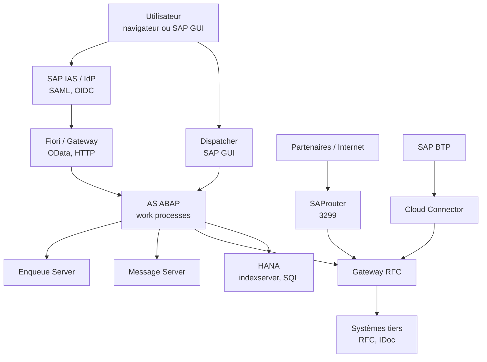
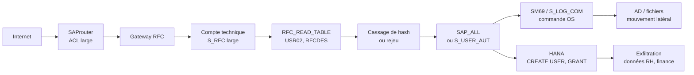

# Sécurité SAP et ERP

Un ERP n'est pas une application parmi d'autres : c'est le registre comptable, social, logistique et commercial de l'entreprise. Sa compromission ne se mesure pas en serveurs perdus mais en paiements détournés, en états financiers falsifiés, en bulletins de paie exfiltrés et en arrêt de la chaîne d'approvisionnement. Or SAP est massivement exposé : interfaces RFC historiques, SAProuter souvent placé sur Internet, populations d'utilisateurs étendues aux partenaires, et personnalisations ABAP qui échappent aux contrôles de l'éditeur.

La sécurité SAP se joue donc moins sur la vulnérabilité du moment que sur trois invariants : maîtriser les habilitations, réduire la surface network-facing, et prouver ce qui s'est passé. Un correctif manquant est dangereux ; une autorisation `SAP_ALL` accordée à un compte de service l'est davantage, parce qu'elle transforme une erreur de configuration en prise de contrôle durable.

> [!abstract] Définition — ERP
> Un ERP (Enterprise Resource Planning) est un système d'information intégré qui partage un référentiel unique entre les processus d'une organisation : finance, achats, ventes, production, ressources humaines. Dans SAP, ce référentiel est porté par une base (HANA le plus souvent), un serveur d'application (NetWeaver ABAP ou Java) et un modèle d'habilitation. La sécurité de l'ERP couvre donc la plateforme, les interfaces et surtout les droits métier qui autorisent les écritures.

## Paysage SAP et topologie

Un paysage sépare développement (DEV), recette (QAT) et production (PRD), chacun identifié par un SID. Les objets voyagent par le Transport Management System : qui contrôle les transports contrôle le code exécuté en production, indépendamment des habilitations.

Le **mandant** (client) subdivise une instance avec ses données et ses utilisateurs. Un mandant de test dans l'instance de production expose des données réelles : l'ouverture de mandant (`SCC4`) et les copies sont des points d'audit.

| Composant | Rôle | Exposition typique |
|---|---|---|
| NetWeaver AS ABAP | Serveur d'application, work processes, dispatcher | 3200+nn, 3300+nn |
| NetWeaver AS Java | Applications Java, portails historiques | 5nn00, 5nn01 |
| S/4HANA | ERP sur base HANA, Fiori intégré | 443, 3200+nn, 3nn15 |
| HANA | Base de données en mémoire, SQL, calcul | 3nn13, 3nn15, 3nn17 |
| SAProuter | Proxy applicatif de connexions SAP | 3299 |
| Message Server | Load balancing, annuaire des serveurs | 36nn |
| Enqueue Server | Verrous et cohérence transactionnelle | 32nn |
| Gateway | Communication RFC entre systèmes | 33nn |
| ICM | Serveur HTTP/HTTPS, services web | 80nn, 443nn |
| Solution Manager | Supervision, EarlyWatch, correction | 8000, 443 |
| SAP BTP | Plateforme cloud, intégration, extension | Internet, OAuth2 |
| IAS / IPS | Fédération d'identité et provisionnement cloud | Internet |
| Cloud Connector | Tunnel inverse vers le système on-premise | Sortant 443 |



Le **Cloud Connector** établit un tunnel sortant vers BTP et publie des ressources internes sous forme de virtual hosts. Une liste trop large expose le cœur SAP avec la seule authentification configurée côté BTP.

## Authentification et fédération

SAP empile plusieurs mécanismes, souvent coexistent dans la même instance.

| Mécanisme | Principe | Risque principal |
|---|---|---|
| Mot de passe | Vérification dans `USR02` | Pulvérisation, comptes par défaut |
| Logon ticket | Cookie `MYSAPSSO2` signé par le système émetteur | Rejeu, confiance trop large entre systèmes |
| SAML 2.0 | Assertion signée par un IdP, mappée à un utilisateur SAP | Signature non vérifiée, mapping permissif |
| Kerberos / SPNEGO | Ticket AD présenté via SNC | SPN mal configuré, délégation excessive |
| Certificat X.509 | Authentification mutuelle TLS ou SNC | Autorité de certification trop large |
| MFA | Facteur supplémentaire via IAS ou reverse proxy | Contournement par accès direct au port SAP |

Le **logon ticket** repose sur une relation de confiance : le système cible accepte un ticket signé par un système de confiance sans redemander de mot de passe. Si la clé ou la liste de confiance est mal protégée, un ticket est forgeable ; `VUSREXTID` et les paramètres de confiance sont des objets sensibles.

**SAML** déplace le risque vers l'assertion : signature, audience, validité et mapping du `NameID`. Un IdP qui accepte un mot de passe simple devient le maillon faible de l'ERP. **Kerberos** exige des SPN corrects et une délégation contrainte. **IAS** porte l'authentification et le MFA vers BTP ; **IPS** synchronise utilisateurs et groupes, et un mapping de groupe erroné attribue un rôle métier à toute une population.

> [!abstract] Définition — SNC
> Secure Network Communications est la couche de sécurité de SAP pour les connexions SAP GUI, RFC et CPIC. Elle fournit l'authentification mutuelle, l'intégrité et la confidentialité via un mécanisme externe (Kerberos, certificats X.509, fournisseur cryptographique). SNC ne remplace pas les autorisations : il protège le canal et l'identité, pas ce que l'utilisateur a le droit de faire.

## Autorisations, rôles et séparation des tâches

Le modèle SAP est un contrôle d'accès par objets. Chaque transaction, programme ou appel RFC exécute un `AUTHORITY-CHECK` sur un **objet d'autorisation** composé de champs. L'utilisateur reçoit des **profils** générés à partir de **rôles** ; les valeurs de champs sont stockées dans `AGR_1251` et `USR04`. Un rôle composite agrège plusieurs rôles.

```abap
AUTHORITY-CHECK OBJECT 'S_RFC'
  ID 'RFC_TYPE' FIELD 'FUGR'
  ID 'RFC_NAME' FIELD 'ZFI_PAYMENT'
  ID 'ACTVT'    FIELD '16'.
IF sy-subrc <> 0.
  MESSAGE e001(00) WITH 'Appel RFC non autorisé'.
ENDIF.
```

Le contrôle n'est efficace que s'il est présent et correctement renseigné. Les programmes Z, modules RFC et services OData internes omettent fréquemment l'`AUTHORITY-CHECK`, ou le placent après l'action sensible. **SU24** maintient les valeurs par défaut des objets, **SU53** affiche le dernier échec, **SUIM** interroge les affectations, **SU01** administre les comptes.

| Objet | Portée | Abus typique |
|---|---|---|
| `S_DEVELOP` | Workbench, debug, génération | Modifier ou remplacer du code en mémoire |
| `S_RFC` | Modules de fonction appelables | Appeler `RFC_READ_TABLE` ou un Z non contrôlé |
| `S_TCODE` | Transactions | Ouvrir SM69, SE38, SE16, SM30 |
| `S_TABU_DIS` | Accès tables par groupe | Lire `USR02`, `RFCDES`, `AGR_1251` |
| `S_DATASET` | Fichiers côté application | Lire ou écrire sur le système de fichiers |
| `S_LOG_COM` | Commandes externes | Exécuter une commande OS via SM69 |
| `S_BTCH_ADM` | Administration des jobs | Planifier un programme arbitraire |
| `S_USER_GRP` | Gestion des utilisateurs | Créer un compte ou changer un mot de passe |
| `S_USER_AUT` | Gestion des autorisations | S'attribuer `SAP_ALL` |
| `S_ADMI_FCD` | Fonctions d'administration | Consulter sessions, logs, traces |

Les profils `SAP_ALL` et `SAP_NEW` concentrent tous les droits. `SAP_ALL` ne devrait exister qu'en situation de rupture de glace, sur un compte nominatif, avec alerte. `SAP_NEW` est destiné à absorber les nouveaux contrôles après une montée de version : le conserver en production revient à désactiver les contrôles ajoutés par l'éditeur.

La **séparation des tâches** (SoD) est le contrôle métier central. Elle interdit qu'un même utilisateur cumule des droits permettant de créer, approuver et payer, ou de modifier un fournisseur et d'émettre un virement.

| Conflit SoD | Risque |
|---|---|
| Créer un fournisseur / saisir une facture / payer | Paiement frauduleux |
| Créer une commande / approuver la commande | Engagement non contrôlé |
| Gérer les utilisateurs / attribuer les rôles | Élévation de privilèges |
| Saisir une écriture / approuver la clôture | Falsification comptable |
| Modifier un prix / valider une remise | Perte financière |
| Maintenir les paramètres / exécuter la paie | Fraude sociale |

**SAP GRC Access Control** industrialise ces contrôles : analyse des risques (ARA), gestion des demandes et approbations (ARM), révision périodique des accès (BRM), provisionnement (EAM). L'outil ne remplace pas la règle : une matrice SoD mal calibrée produit des milliers de faux positifs ou, pire, des conflits non détectés.

## Surface d'attaque

Chaque composant expose un protocole et une logique d'authentification distincts.

**SAProuter** est un proxy de connexions SAP, historiquement placé en DMZ ou sur Internet pour les partenaires. Il route une chaîne de sauts (`/H/host/S/service/H/...`) et applique une ACL (`saprouttab`). Une ACL permissive permet d'atteindre le message server, le gateway ou le dispatcher de tout le paysage. Un SAProuter mal segmenté est une porte d'entrée vers l'ensemble du SI SAP.

**Le dispatcher et le GUI** exposent le port 3200+nn. Le handshake SAP GUI négocie les versions de protocole et le chiffrement ; les vieilles configurations acceptent encore des échanges non chiffrés. Un attaquant qui obtient un identifiant valide peut énumérer les mandants, les utilisateurs et les transactions disponibles.

**Le gateway** (33nn) exécute les appels RFC. Il enregistre des programmes serveurs (`sapxpg`, `tp`, `RSPO`) et applique des ACL `secinfo`, `reginfo`, `prxyinfo`. Sans `gw/acl_mode=1`, l'ACL n'est pas appliquée. Le gateway est aussi le point d'entrée des **callbacks RFC** : un serveur distant peut rappeler un module de fonction sur le système appelant, avec l'identité de la destination.

**Le message server** (36nn) distribue les connexions et publie la liste des serveurs d'application. Une ACL absente ou trop large permet l'énumération et le contournement du load balancer. **L'ICM** (80nn/443nn) porte HTTP, HTTPS, services web, OData et parfois des services de gestion. Il expose l'application à des vulnérabilités web classiques : smuggling, XXE, SSRF, désérialisation, traversée de répertoire.

**RFC, BAPI et IDoc** sont les interfaces les plus dangereuses, car elles sont conçues pour l'automatisation et souvent protégées par un simple compte technique. `RFC_READ_TABLE` lit n'importe quelle table si `S_RFC` l'autorise ; les BAPI métier permettent des écritures massives ; les IDoc traitent des messages entrants avec des contrôles de confiance variables.

**Fiori et Gateway** ajoutent OData, SAPUI5 et des services exposés. Les services `/sap/opu/odata/...` doivent être activés et autorisés individuellement ; un service oublié reste accessible. Les scénarios SSRF via le gateway, ou l'abus de `$expand` et de `$filter`, sont documentés.

**HANA** est une base autonome avec ses propres utilisateurs et privilèges. Les comptes `SYSTEM`, `SYS`, `_SYS_REPO`, `_SYS_STATISTICS` et les privilèges `CATALOG READ`, `SELECT` sur les vues système, `CREATE USER`, `GRANT ROLE` constituent la cible. Une injection SQL dans une application XS ou un service OData peut atteindre la base sans passer par les autorisations ABAP.

**L'OS et la base sous-jacente** restent dans le périmètre : utilisateurs `sapadm`, `<sid>adm`, `orasid`, `db2<sid>`, répertoires `/usr/sap`, `/sapmnt`, `/usr/sap/trans`, scripts de démarrage, `sapcontrol`. Un accès OS via une commande SAP annule toute la séparation applicative.

## Chemins d'attaque



Les scénarios se chaînent presque toujours de la même façon : une interface exposée fournit un premier identifiant, une autorisation trop large fournit l'élévation, une fonctionnalité légitime fournit l'exécution.

- **Notes de sécurité manquantes** : SAP publie un Patch Day mensuel. Les vulnérabilités critiques du noyau NetWeaver, de l'ICM ou de Solution Manager permettent souvent l'exécution de code sans authentification. CVE-2020-6207 (Solution Manager) et CVE-2022-22536 (HTTP Request Smuggling dans l'ICM) illustrent l'impact d'un retard de correctif.
- **Contrôles d'autorisation absents** : un module Z RFC qui lit une table sans `AUTHORITY-CHECK`, ou un service OData activé sans contrôle, contourne tout le modèle de rôles.
- **RFC callback** : une destination RFC sortante peut être détournée pour rappeler un module côté SAP. La parade est `rfc/callback_security_method=3` et l'activation de SNC.
- **Injection de commandes OS** : SM69, `SXPG_COMMAND_EXECUTE` et certains programmes standard permettent d'exécuter des commandes si `S_LOG_COM` est accordé. Le passage par `CALL SYSTEM` dans un Z aggrave le risque.
- **Traversée de répertoire et désérialisation** : composants Java historiques, services de fichiers et uploads Fiori. CVE-2018-2380 (SAP CRM) en est un exemple.
- **SAProuter ouvert** : ACL `PERMIT *` ou routage vers des hôtes non prévus. Un scan de 3299 révèle souvent des paysages entiers.
- **Identifiants par défaut** : `DDIC`, `SAP*`, `EARLYWATCH` et comptes techniques livrés avec des mots de passe documentés. `SAP*` peut redevenir actif si tous les administrateurs sont verrouillés et si `login/no_automatic_user_sapstar` n'est pas positionné.
- **Défauts de configuration HANA** : `SYSTEM` actif, mots de passe faibles, privilèges excessifs, audit désactivé.
- **Mouvement latéral vers AD** : SNC Kerberos, destinations RFC utilisant un compte AD, ou réutilisation d'un mot de passe administrateur. La compromission SAP devient alors une compromission du domaine.

## Outils

| Outil | Usage |
|---|---|
| `nmap` | Découverte des ports SAP, bannières, services |
| `sapnmap` | Script de découverte spécialisé SAP |
| `pysap` | Bibliothèque Python pour SAP Diag, NI, RFC |
| SAP GUI | Accès légitime, transactions, debugging |
| PowerSAP | Énumération et abus via RFC et PowerShell |
| `saprouter` | Test de routage et de chaînes de sauts |
| `hdbcli` / `hdbsql` | Requêtes HANA, inspection des privilèges |
| SAP Note Assistant | Application des correctifs |
| EarlyWatch Alert | Contrôle de configuration et performance |
| Code Vulnerability Analyzer | Analyse statique ABAP |

```bash
nmap -Pn -sV -p 3299,3200,3300,3600,8000,44300 10.0.0.10
nmap -Pn -p 3299 --script sap-info 10.0.0.10

# Requête HANA : utilisateurs et rôles effectifs
hdbsql -i 00 -n 10.0.0.20:30013 -u SYSTEM -p '***' \
  "SELECT USER_NAME, USER_DEACTIVATED FROM SYS.USERS"
```

Côté défensif, la même boîte à outils sert à prouver l'exposition : un scan de SAProuter, une revue des ACL gateway et un inventaire des destinations RFC valent souvent mieux qu'un audit documentaire.

## Détection

Le **Security Audit Log** est la source native. **SM19** configure les classes d'événements, les utilisateurs surveillés et les filtres ; **SM20** analyse ; **SM18** purge. Les paramètres `rsau/enable=1`, `rsau/local/file`, `rsau/max_diskspace/local` et `rsau/selection_slots` conditionnent la collecte. Sans slots suffisants, les événements sont perdus.

Les classes utiles couvrent les connexions, les échecs d'autorisation, les changements d'utilisateur et de rôle, les appels RFC, le debug, les changements de table et les fonctions d'administration. La table `RSAUDITLOG` peut être interrogée directement, mais l'analyse doit se faire hors du système compromis.

```sql
SELECT DISTINCT mandt, userid, eventid, tcode, repid, timestamp
FROM RSAUDITLOG
WHERE eventid IN ('AUD4', 'AUD6', 'AUW', 'AUD8')
  AND timestamp > ADD_SECONDS(CURRENT_TIMESTAMP, -86400)
ORDER BY timestamp DESC;
```

**HANA** possède son propre audit trail. Il faut l'activer explicitement, définir des politiques et surveiller les changements de privilèges.

```sql
ALTER SYSTEM ALTER CONFIGURATION ('auditing.cfg', 'SYSTEM')
  SET ('global', 'auditing_active') = 'true' WITH RECONFIGURE;

CREATE AUDIT POLICY audit_admin
  AUDITING CREATE USER, DROP USER, GRANT ROLE, REVOKE ROLE, GRANT PRIVILEGE;

SELECT * FROM AUDIT_TRAIL WHERE EVENT_STATUS = 'SUCCESSFUL' ORDER BY TIMESTAMP DESC;
```

Les **journaux OS** (`/usr/sap/<SID>/*/work`, `dev_rfc`, `dev_icm`, `dev_disp`, syslog) complètent la vision : erreurs RFC, connexions refusées, commandes externes, démarrages. Les journaux de la base (Oracle, DB2, MSSQL) apportent les connexions et les erreurs SQL. Le **SIEM** corrèle ces sources avec l'AD, le réseau et le cloud.

| Cas d'usage | Source | Signal |
|---|---|---|
| Création ou réactivation d'utilisateur | SM20, `USR02` | Compte créé hors fenêtre de changement |
| Attribution de `SAP_ALL` | SM20, `AGR_USERS` | Profil complet sur un compte nominatif |
| Changement de rôle ou de profil | SM20, `AGR_1251` | Élargissement de `S_DEVELOP` ou `S_RFC` |
| Appel RFC anormal | `dev_rfc`, SM20 | Module rare, volume inhabituel, source inattendue |
| Connexion SAProuter | Logs SAProuter, pare-feu | Nouvelle source, route vers un hôte non autorisé |
| Debug actif en production | SM20, `S_DEVELOP` | Activation hors maintenance |
| Commande OS | SM20, syslog, `dev_rfc` | `S_LOG_COM` utilisé hors job connu |
| Accès HANA massif | Audit HANA | `SELECT` massif, nouvelle IP, `SYSTEM` |
| Verrouillage de compte | SM20 | Rafale d'échecs, pulvérisation |

La corrélation est décisive : une connexion depuis une IP inhabituelle suivie d'une attribution de rôle puis d'un export de table ne doit pas être trois alertes isolées. Les règles de [[Detection Engineering]] et les modèles [[Sigma]] s'appliquent mal aux journaux SAP propriétaires ; il faut écrire des règles dédiées, avec une normalisation des champs `user`, `src_ip`, `tcode`, `object`.

## Durcissement et conformité

| Domaine | Mesure |
|---|---|
| Correctifs | Patch Day appliqué, notes critiques, kernel et SPS à jour |
| Réseau | SAProuter en DMZ, ACL nominatives, pas d'accès direct Internet |
| Gateway | `gw/acl_mode=1`, `secinfo`/`reginfo`/`prxyinfo` revus |
| Message Server | ACL explicite, pas d'exposition hors du paysage |
| SNC / TLS | `snc/enable=1`, protection en intégrité et confidentialité, TLS 1.2+ |
| Comptes | `DDIC` et `SAP*` désactivés, `EARLYWATCH` restreint, MFA pour admins |
| Mots de passe | Longueur, expiration, verrouillage, pas de réutilisation |
| Autorisations | Moindre privilège, `SAP_ALL` interdit, revue trimestrielle |
| SoD | Matrice maintenue, conflits acceptés formellement, GRC |
| Audit | `rsau` actif, rétention suffisante, export SIEM |
| HANA | `SYSTEM` verrouillé, audit actif, privilèges revus |
| OS / DB | Comptes nominatifs, sudo restreint, répertoires de transport protégés |
| Cloud | IAS/IPS, Cloud Connector minimal, RISE avec responsabilités écrites |

Le **cloud** ne change pas le modèle : RISE with SAP confie l'infrastructure et certaines opérations à SAP, mais le client conserve les habilitations, les données, les interfaces et souvent le patch applicatif. BTP ajoute une frontière d'identité (IAS), un provisionnement (IPS) et un tunnel (Cloud Connector) qu'il faut traiter comme des composants de production. Une ressource Cloud Connector exposée sans contrôle revient à publier un RFC interne sur Internet.

La conformité recoupe plusieurs cadres : RGPD pour les données RH et clients, SOX pour les contrôles financiers et la séparation des tâches, [[NIS2 et DORA]] pour les entités critiques et financières, PCI DSS si des données de carte transitent. Les preuves attendues sont toujours les mêmes : matrice d'habilitations, revues d'accès, journaux, tickets de correctifs, procédures de changement.

## Limites

Le Security Audit Log n'est pas infalsifiable : un administrateur SAP disposant des droits adéquats peut modifier la configuration ou purger les journaux. Il faut exporter en temps réel vers un système séparé, avec une rétention immuable. HANA audit souffre des mêmes limites si le compte `SYSTEM` est compromis.

La détection comportementale est difficile : un utilisateur métier qui consulte dix fois plus de clients un vendredi reste dans ses droits. Les faux positifs dus aux jobs, aux interfaces et aux corrections massives sont nombreux. Sans inventaire des flux légitimes, toute règle devient bruyante.

Le durcissement applicatif ne protège pas d'un accès OS ni d'une base compromise. Inversement, un OS parfaitement patché ne protège pas d'un `SAP_ALL` accordé à un compte de service. La sécurité SAP est une chaîne : identité, autorisation, interface, plateforme, données.

> [!quiz] `SAP_ALL` est-il un rôle comme un autre ?
> Non. C'est un profil qui accorde l'ensemble des autorisations connues, y compris les objets d'administration et de développement. Il doit être réservé à une procédure de rupture de glace, nominative, alertée et temporaire. Sa présence permanente sur un compte technique ou un compte de service annule la séparation des tâches.

> [!quiz] Le chiffrement SNC protège-t-il contre un utilisateur qui dispose d'un rôle trop large ?
> Non. SNC protège le canal et authentifie les parties ; il n'évalue pas les autorisations métier. Un utilisateur légitime avec les mauvais droits peut faire exactement ce que son rôle permet, sur un canal chiffré. La parade est la revue des rôles et la séparation des tâches.

> [!quiz] Pourquoi une ACL SAProuter est-elle un contrôle de sécurité majeur ?
> Parce que SAProuter relaie des connexions vers les systèmes internes. Une ACL permissive permet de découvrir et d'atteindre des dispatchers, gateways ou message servers qui ne devraient jamais être joignables depuis Internet. L'ACL doit nommer les hôtes et services autorisés, et être revue à chaque changement de paysage.
