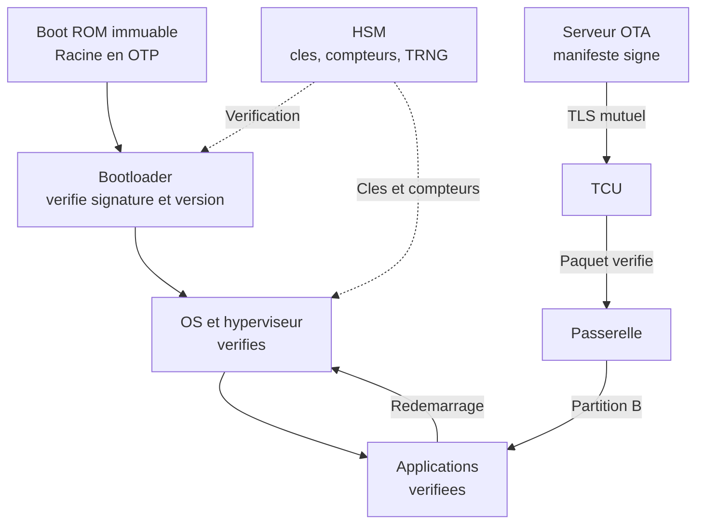

# Sécurité automobile

Une automobile récente réunit 70 à 150 calculateurs, une dizaine de bus et des dizaines de millions de lignes de code. La télématique, l'infodivertissement et les applications mobiles exposent ce système cyber-physique à Internet et au cloud du constructeur, tandis que les bus internes restent majoritairement diffusants et sans authentification. La conséquence d'une trame forgée n'est pas une erreur logicielle mais un mouvement : couple, freinage, direction, ouverture.

La cybersécurité automobile est devenue une condition d'homologation : le règlement ONU R155 impose un système de management de la cybersécurité, le R156 un système de management des mises à jour, et ISO/SAE 21434 structure l'ingénierie du risque. Elle complète [[OT Security avancé]] pour la conséquence physique et [[Sécurité Réseau]] pour la segmentation, en insistant sur ce qui est propre au véhicule : des calculateurs que l'on ne peut ni patcher à volonté ni instrumenter d'un agent.

## Architecture électrique et électronique

L'architecture classique organise les calculateurs par domaines : groupe motopropulseur (contrôle moteur, boîte, BMS), châssis (ABS/ESC, freinage, direction), caisse (ouvrants, éclairage, climatisation), ADAS (caméras, radars, lidars, fusion), infodivertissement, télématique et énergie. Une passerelle centrale relie ces domaines et filtre les trames. Les plateformes récentes migrent vers une architecture zonale : contrôleurs de zone, calculateurs centraux, hyperviseurs et mises à jour OTA. Le logiciel devient une plateforme, avec des contraintes temps réel qui interdisent les redémarrages intempestifs.

| Domaine | Calculateurs | Criticité | Bus |
|---|---|---|---|
| Groupe motopropulseur | Moteur, boîte, BMS, onduleur | Sûreté | CAN, CAN FD |
| Châssis | ABS/ESC, frein, direction | Sûreté immédiate | CAN FD, FlexRay |
| Caisse | BCM, ouvrants, HVAC | Confort, vol | CAN, LIN |
| ADAS | Caméra, radar, lidar, fusion | Sûreté, perception | Ethernet, CAN FD |
| Infodivertissement | IVI, cluster, audio | Données, rebond | Ethernet, USB, radio |
| Télématique | TCU, eCall, modem | Exposition externe | Ethernet, CAN |

La surface d'attaque se lit par proximité. L'accès physique passe par l'OBD-II, l'USB, la prise de charge et les faisceaux accessibles derrière un phare. La proximité radio couvre Bluetooth, Wi-Fi, BLE, UWB, télécommandes et capteurs de pneus. La distance longue passe par le modem, le GNSS, les API du constructeur et les applications mobiles. S'y ajoutent la chaîne d'approvisionnement et les outils d'atelier.

## Bus et protocoles

### CAN et CAN FD

Le CAN reste le squelette du véhicule : bus différentiel, 125 kbit/s à 1 Mbit/s, jusqu'à 5 à 8 Mbit/s en phase de données CAN FD. Chaque trame porte un identifiant sur 11 ou 29 bits qui encode le contenu et la priorité d'arbitrage : plus l'identifiant est bas, plus la trame gagne. Il n'existe ni adresse source, ni destination, ni session, ni authenticité. Tous les calculateurs voient tout et peuvent émettre avec l'identifiant d'un autre. Le CRC protège des erreurs de transmission, pas d'un émetteur malveillant.

```text
Trame CAN classique
+-----+------------+-----+--------+-----------+-----+-----+
| SOF | ID 11 bits | RTR | IDE/r0 | DLC 0-8   | ... | CRC |
+-----+------------+-----+--------+-----------+-----+-----+
        priorite          longueur   donnees

Exemple : 0x1A0  [8]  00 00 12 34 00 00 00 00
```

CAN FD allonge la charge utile à 64 octets et renforce le CRC, mais conserve le modèle de confiance. Une rafale de trames dominantes peut provoquer un état bus-off et immobiliser un segment. Les vols par injection observés sur plusieurs modèles consistent à atteindre un bus derrière un phare et à rejouer les trames d'ouverture et de démarrage.

### LIN, FlexRay et Ethernet automobile

LIN est un bus à un fil, maître-esclaves, jusqu'à 20 kbit/s, piloté par une table d'ordonnancement ; il sert aux actionneurs bon marché et ne possède aucune sécurité native. FlexRay offre 10 Mbit/s par canal, deux canaux redondants et un accès TDMA déterministe ; il recule au profit de l'Ethernet. L'Ethernet automobile (100BASE-T1, 1000BASE-T1, 10BASE-T1S) est commuté, full-duplex, avec VLAN et TSN pour la synchronisation et l'ordonnancement. Il porte caméras, lidars et calculateurs centraux, et rapproche le véhicule des vulnérabilités IP : ARP, DNS, TLS, segmentation.

### SOME/IP, DoIP et UDS

SOME/IP est l'intergiciel orienté services : méthodes, événements, champs, découverte par multicast. Il n'apporte pas d'authentification native ; TLS, DTLS ou IPsec sont rarement déployés sur les calculateurs contraints, et un usurpateur peut annoncer un service ou s'abonner à des événements. Le diagnostic repose sur UDS (ISO 14229), transporté par ISO-TP sur CAN ou par DoIP (ISO 13400) sur Ethernet. Les services sensibles sont `0x27` SecurityAccess, `0x2E` écriture, `0x31` routine, `0x34` à `0x37` téléchargement, `0x28` arrêt des communications et `0x85` suspension des codes défaut, utile pour effacer les traces.

```text
Tester -> 02 10 03              session etendue
ECU    <- 06 50 03 00 32 01 F4
Tester -> 02 27 01              demande de graine
ECU    <- 06 67 01 AA BB CC DD
Tester -> 06 27 02 12 34 56 78  envoi de la cle
ECU    <- 02 67 02              acces accorde
```

Le couple `0x27` repose sur une graine et une clé calculée par l'ECU : graine statique, algorithme extrait du firmware ou tentatives illimitées suffisent à ouvrir l'accès. OBD-II, sur le connecteur à 16 broches et la requête fonctionnelle `0x7DF`, donne un diagnostic de faible privilège mais aussi un point d'entrée physique. V2X ajoute une communication coopérative avec PKI à certificats pseudonymes, dont l'usurpation de messages reste un scénario de recherche.

## Chaîne de confiance

### Secure boot et racine de confiance

Le secure boot vérifie une signature à chaque étape : la Boot ROM, ancrée dans des fusibles ou une mémoire OTP, contrôle le bootloader, qui contrôle l'OS, qui contrôle les applications. Les algorithmes courants sont ECDSA P-256 et RSA-2048/3072 avec SHA-256, et un compteur de version empêche le retour à un firmware signé mais vulnérable. En cas d'échec, le calculateur reste en bootloader ou en mode dégradé. Le secure boot protège le code au repos et au démarrage, pas la mémoire à l'exécution, ni un débogueur laissé actif, ni une clé de signature compromise.



### HSM, SHE et gestion des clés

Un HSM automobile est un cœur sécurisé distinct, avec mémoire isolée, générateur d'aléa et accélérateurs AES, SHA et ECC ; la classification EVITA distingue les niveaux full, medium et light. Il conserve des clés non exportables, accélère le secure boot, calcule les MAC SecOC et termine les sessions TLS. Le SHE, plus simple, n'offre que de l'AES-128 et une dizaine d'emplacements, sans asymétrique : la distribution repose sur le constructeur.

La gestion des clés est le point faible le plus fréquent : clé unique pour toute une flotte, clé de test en production, algorithme de dérivation dans le firmware, provisionnement d'usine sans procédure contradictoire. La hiérarchie sépare racine de signature, clés OTA, diagnostic et SecOC, avec rotation, révocation et journalisation, comme détaillé dans [[Gestion des clés et HSM]] et [[PKI en profondeur]].

### SecOC

SecOC ajoute à chaque PDU un authenticator, généralement un CMAC-AES-128 tronqué à 24, 32 ou 64 bits, calculé sur la charge utile et une valeur de fraîcheur. Celle-ci combine compteur de remise à zéro, compteur de trajet et compteur de message ; le récepteur maintient une fenêtre et rejette les messages trop anciens. SecOC assure authenticité et intégrité, pas confidentialité, et ne protège ni contre un calculateur légitime compromis qui détient la clé, ni contre le déni de service. Son déploiement reste progressif, car les calculateurs anciens cohabitent avec les protégés.

### Diagnostic, bootloader et OTA

Le bootloader de production n'accepte que des images signées, avec anti-rollback et session de programmation authentifiée. Le mode développement, qui autorise le téléchargement sans signature, doit être désactivé par fusible avant la sortie d'usine ; sinon, le firmware malveillant survit aux mises à jour applicatives.

L'OTA suit une chaîne de confiance de bout en bout. Le backend signe un manifeste décrivant version, cible, empreintes et politique de retour arrière. Le TCU télécharge en TLS mutuel, la passerelle vérifie signature et état du véhicule (stationné, frein serré, batterie suffisante), puis écrit dans une partition inactive. Au redémarrage, le bootloader vérifie l'image, bascule et conserve l'ancienne pour un rollback. Les campagnes sont progressives. Les attaques visent la clé de signature, l'API de campagne ou la logique de version, rarement le chiffrement.

## Menaces

| Vecteur | Mécanisme | Impact |
|---|---|---|
| Injection CAN, rejeu | Trames forgées ou réémises sur un bus accessible | Ouverture, démarrage, freinage |
| Fuzzing, accès UDS | Rafale de trames, requêtes `0x27`, `0x2E`, `0x31`, `0x34` | Crash, écriture, flash |
| Seed/key faible | Graine statique, clé courte | Accès développeur |
| Keyless relay | Relais du signal de clé | Vol sans effraction |
| GPS spoofing | Faux signaux GNSS | Navigation, eCall, traçage |
| Télématique | Modem, API, identifiants en dur | Prise de contrôle distante |
| IVI | Applications, navigateur, USB | Rebond vers le véhicule |
| Chaîne d'approvisionnement | Fournisseur, logiciel libre, clé de test | Persistance, backdoor |

Les incidents publics structurent le domaine. En 2015, Miller et Valasek ont atteint un Jeep Cherokee par Uconnect, pivoté vers le CAN et commandé freins et direction à distance ; 1,4 million de véhicules ont été rappelés. En 2019, une faiblesse du chiffrement d'une télécommande a permis le clonage de clés, corrigé par OTA. En 2023, une API mobile mal authentifiée permettait de déverrouiller et démarrer des véhicules d'un constructeur coréen, et des vols par injection CAN derrière le phare ont été documentés, sans vulnérabilité logicielle au sens classique.

Deux enseignements : la chaîne vaut son maillon le plus exposé, et l'OTA suppose une flotte joignable et une signature intacte.

## Normes et conformité

| Référentiel | Objet | Preuve |
|---|---|---|
| ONU R155 | CSMS et homologation cybersécurité | Certificat, analyse de risque, surveillance |
| ONU R156 | SUMS et mises à jour | Processus, rollback, traçabilité |
| ISO/SAE 21434 | Ingénierie de la cybersécurité | TARA, CAL, cybersecurity case |
| ISO 24089 | Ingénierie des mises à jour | Dossier de mise à jour |
| AUTOSAR | SecOC, Crypto Stack, IdsM | Configuration, journaux |
| RGPD et NIS2 | Données et résilience | Base légale, notification |

Le R155 ne certifie pas un véhicule invulnérable : il certifie un système de management capable d'identifier, traiter, surveiller et corriger les risques, avec une liste de menaces de référence en annexe. Le constructeur doit démontrer que ses fournisseurs sont couverts et que la surveillance perdure après la vente. Le R156 ajoute la traçabilité des versions, la sécurité de l'installation, l'information de l'utilisateur et le retour arrière.

> [!abstract] Définition — CSMS
> Cybersecurity Management System au sens du règlement ONU R155 : ensemble des processus organisationnels et techniques par lesquels un constructeur identifie, évalue, traite et surveille les risques de cybersécurité d'un véhicule, y compris ceux introduits par ses fournisseurs, pendant toute la durée de vie du véhicule. Il se prouve par des procédures, des analyses et des journaux, pas par une mesure technique isolée.

ISO/SAE 21434 fournit la méthode : TARA, scénarios de menace, chemins d'attaque, impact, faisabilité, niveau d'assurance CAL de 1 à 4, puis traçabilité entre exigences, tests et preuves. La norme couvre production, exploitation, maintenance, fin de vie et réponse aux incidents, avec des interfaces contractuelles vers les fournisseurs. Le RGPD s'applique dès que la télémétrie identifie une personne : position, trajets, habitudes, contacts, images. NIS2 concerne les opérateurs de systèmes de transport intelligents et, selon les transpositions, certains exploitants de flottes ou d'infrastructures de recharge ; voir [[NIS2 et DORA]] et [[Sécurité des données]].

## Défenses

La défense commence par la topologie : séparer les domaines de sûreté de l'infodivertissement et de la télématique, placer un pare-feu applicatif sur la passerelle, n'autoriser que les identifiants CAN attendus, filtrer UDS par service et par session, isoler le TCU. Ces mesures réduisent la propagation mais ne remplacent pas l'authentification, car un attaquant qui atteint un bus de domaine peut usurper un calculateur du même domaine.

| Contrôle | Attaques réduites | Limite |
|---|---|---|
| Segmentation, pare-feu de passerelle | Rebond IVI vers châssis | Règles trop larges, accès physique |
| SecOC | Injection et rejeu | Legacy, clés compromises |
| Secure boot, anti-rollback | Firmware modifié, downgrade | Clé racine, debug ouvert |
| HSM, gestion des clés | Extraction, forge de MAC | Provisionnement, coût |
| OTA signé, partition A/B | Mise à jour malveillante | Réseau, clé de signature |
| Diagnostic durci | Seed/key faible, écriture | Outils d'atelier |

Le diagnostic mérite un traitement à part : verrouillage physique de l'OBD, écriture désactivée en production, sessions de programmation limitées et journalisées, clés d'atelier nominatives et révocables. Un mode atelier permanent reste une porte dérobée. La formation compte aussi : dongle inconnu, préparation moteur, application de valet.

## Limites et détection

### Sources et capteurs

Le SOC véhicule agrège des sources propres à l'automobile. La passerelle et les contrôleurs de zone journalisent les trames refusées, les sessions UDS et les échecs SecOC. Les calculateurs récents exposent des événements via AUTOSAR IdsM, remontés au gestionnaire d'IDS. Le TCU fournit l'état de connexion, les campagnes OTA, les redémarrages et les diagnostics à distance ; le backend apporte les journaux d'API et de téléchargement ; le GNSS et les capteurs inertiels permettent de détecter une incohérence de position.

| Source | Observable | Angle mort |
|---|---|---|
| IDS CAN | Fréquence, identifiant, plage, séquence | Bus non instrumenté, attaquant lent |
| Compteurs SecOC | Échecs de MAC, rejeu | Messages non protégés |
| Journaux UDS | Session, service, seed/key | Outils hors ligne |
| Journaux OTA | Téléchargement, bascule, rollback | Véhicule non connecté |
| Télémétrie TCU | Position, réseau, DTC | Vie privée, coût |
| Backend | Authentification, campagnes | Comptes de service |

### Règles et modèles

La détection CAN combine plusieurs familles. Les règles de fréquence repèrent une rafale ou un silence sur un identifiant attendu ; les règles de plage vérifient que la charge utile reste dans les bornes physiques ; les règles de contexte corrèlent une trame avec l'état du véhicule, comme une commande d'ouverture à 90 km/h ou une session de diagnostic en roulant. Les modèles statistiques détectent des séquences anormales sans signature, au prix de faux positifs et d'un apprentissage par modèle. L'empreinte de tension du bus complète ces approches mais reste une technique de laboratoire.

```python
import time
from collections import defaultdict, deque

import can

FENETRE = 1.0
SEUIL = 120  # trames par seconde pour un identifiant

bus = can.Bus(interface="socketcan", channel="can0")
compteurs = defaultdict(deque)

while True:
    msg = bus.recv(timeout=1.0)
    if msg is None:
        continue
    maintenant = time.monotonic()
    fenetre = compteurs[msg.arbitration_id]
    fenetre.append(maintenant)
    while fenetre and maintenant - fenetre[0] > FENETRE:
        fenetre.popleft()
    if len(fenetre) > SEUIL:
        print(f"Anomalie ID={msg.arbitration_id:#x} n={len(fenetre)}")
```

La corrélation à l'échelle de la flotte est plus puissante que la règle locale : une même séquence d'accès sur des centaines de VIN en quelques minutes, un pic d'échecs `0x27` avec le code `0x35`, des échecs OTA toujours au même point ne se voient que dans un entrepôt central.

```spl
index=vehicle sourcetype="uds:session"
| eval echec=if(service=="0x27" AND nrc=="0x35", 1, 0)
| stats sum(echec) as echecs values(ecu) as calculateurs by vin, src_ip
| where echecs > 10
```

### Réponse à incident

La réponse suit ISO/SAE 21434 : détecter, qualifier, évaluer la vulnérabilité, décider, corriger, apprendre. Le confinement se fait par la passerelle ou une règle poussée à distance, puis par une mesure OTA, et seulement en dernier recours par un rappel. La décision intègre la sûreté : désactiver une fonction peut être plus dangereux que la laisser active. Les preuves utiles sont les journaux CAN et UDS, les images de firmware, les compteurs HSM et les journaux OTA et backend, avec les précautions du RGPD. [[DFIR]] et [[Playbooks IR]] fournissent la méthode ; la spécificité est la dispersion des sources et l'impossibilité d'isoler un calculateur sans effet physique.

La détection reste structurellement incomplète. Un IDS voit le bus, pas la mémoire du calculateur ; un attaquant qui modifie le firmware avant le secure boot, ou qui détient les clés, reste invisible. Les bus propriétaires, les liaisons radio et les calculateurs anciens échappent aux sondes. Les faux positifs sont nombreux, car les trames légitimes varient avec l'usage. Enfin, la télémétrie à grande échelle pose un problème de vie privée et de coût.

## Questions de révision

> [!quiz] SecOC suffit-il à sécuriser un bus CAN ?
> Non. Il garantit l'authenticité et l'intégrité des PDU protégés, mais pas la confidentialité, et il ne protège pas contre un calculateur légitime compromis qui détient la clé. Il dépend d'une gestion de clés solide, d'une valeur de fraîcheur correcte et d'un déploiement sur tous les émetteurs critiques ; les calculateurs legacy restent hors périmètre.

> [!quiz] Le certificat CSMS du R155 garantit-il qu'un véhicule est invulnérable ?
> Non. Il atteste que le constructeur dispose de processus pour identifier, traiter, surveiller et corriger les risques, y compris ceux de ses fournisseurs. Il ne certifie ni un niveau technique, ni l'absence de vulnérabilité : sa valeur se mesure dans la surveillance après vente et la correction OTA.

> [!quiz] Pourquoi une attaque par relais de clé contourne-t-elle l'immobilisateur ?
> Parce que le véhicule croit dialoguer avec une clé présente : deux relais prolongent le signal entre la clé restée dans la maison et la voiture. Les contremesures reposent sur la mesure de distance (UWB), la détection de mouvement et la limitation temporelle, pas sur un changement d'algorithme.
