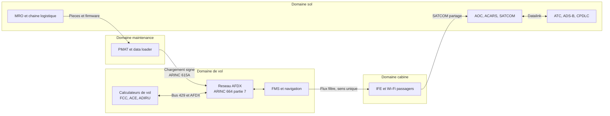

# Sécurité aéronautique

Un avion de ligne est un système cyber-physique certifié : des dizaines de calculateurs, des bus déterministes, des millions de lignes de code, et chaque évolution prouvée compatible avec le dossier de navigabilité. La sécurité de l'information y est subordonnée à la sûreté : une mesure qui ajoute latence ou dépendance doit démontrer qu'elle ne dégrade ni les lois de commande ni la disponibilité nécessaire au vol.

La confiance est asymétrique. Le cœur de vol est fermé, redondant et rarement mis à jour ; cabine, EFB, maintenance et liaisons sol sont ouverts et renouvelés au rythme de l'IT. L'attaquant ne prend pas les commandes par une interface web : il cherche un chemin depuis un terminal passager, un poste de maintenance, un compte fournisseur ou une donnée de navigation, puis une occasion de charger un logiciel ou de tromper un opérateur.

Cette note décrit cette chaîne, puis les menaces, les normes, les défenses, la détection et la réponse. Elle complète [[OT Security avancé]], [[Sécurité Réseau]] et [[Cryptographie]] ; [[Detection Engineering]] fournit la méthode.

> [!abstract] Définition — Domaine de sécurité aéronautique
> Un domaine de sécurité regroupe des fonctions, des réseaux et des équipements partageant le même niveau de confiance et les mêmes exigences d'isolation. DO-326A et ARINC 811 distinguent domaine de vol, cabine, maintenance et sol. Les échanges passent par une passerelle filtrante ou une diode, jamais par un routage direct.

## Quatre domaines, une frontière

Le domaine de vol porte commandes, autopilote, automanette, affichage, air data, inertiel, moteurs et alarmes. Il tolère des pannes, pas des adversaires : redondance, dissimilarité, commande/monitor, preuve pour chaque ligne de code. La cabine réunit IFE, Wi-Fi, gestion cabine, tablettes et USB. La maintenance comprend PMAT, data loader, ATE, BITE et ACMS/QAR. Le sol regroupe AOC, ATC, MRO et constructeur.



## Commandes de vol et bus avioniques

### ARINC 429

ARINC 429 transporte des mots de 32 bits à 12,5 ou 100 kbit/s, en simplex, d'un émetteur vers vingt récepteurs. Le mot porte un label octal, deux bits SDI, dix-neuf bits de données, deux bits SSM et un bit de parité impaire. Trame courte, périodique, sans adresse, session ni acquittement.

La parité détecte une erreur de transmission, pas une émission malveillante : un émetteur connaissant le format la calcule correctement. La protection est physique et architecturale, par le câble, le connecteur et l'isolation des LRU. Un accès au connecteur ou une LRU compromise peut injecter des paramètres air data acceptés comme valides.

### AFDX et IMA

AFDX (ARINC 664 partie 7) remplace le point-à-point par un Ethernet commuté full-duplex à 100 Mbit/s. Chaque flux est un lien virtuel identifié, avec un BAG de 1 à 128 ms, une taille maximale et un chemin redondant A/B. Les commutateurs appliquent un policing de débit, de taille et d'identifiant ; les récepteurs contrôlent le numéro de séquence et éliminent les doublons.

AFDX garantit le délai et l'ordre, pas l'authenticité. Un calculateur compromis peut émettre dans ses VL autorisés des données forgées que les consommateurs accepteront : la segmentation limite les liens accessibles, elle ne garantit pas leur contenu.

Les IMA (Integrated Modular Avionics) hébergent plusieurs fonctions de criticités différentes, séparées par ARINC 653. Le partitionnement temporel et spatial protège contre les fautes, pas contre une configuration erronée ou un pilote vulnérable.

Le CAN subsiste dans les moteurs, l'atterrisseur, la cabine et l'énergie : identifiant de 11 ou 29 bits, aucune adresse source, diffusion à tous. ARINC 825 en normalise l'usage sans apporter de sécurité. Une passerelle CAN vers AFDX doit filtrer par identifiant, sens et débit.

## FMS et données de navigation

Le FMS calcule la trajectoire, les performances, carburant et prédictions à partir d'une base ARINC 424, d'une base de performances et des vents. La base de navigation suit un cycle AIRAC de 28 jours et sa qualité relève de DO-200B. Les entrées sont le MCDU, le datalink — clairance de route, vent — et le chargement de la base.

Les menaces sont la base corrompue ou obsolète, l'uplink non conforme, l'erreur de saisie et le logiciel non approuvé. Une route erronée ne détruit pas l'avion, mais produit une violation d'espace, une perte de marge carburant ou une approche non stabilisée.

## Liaisons externes

### ADS-B

ADS-B Out émet sur 1090 MHz des messages Mode S de 112 bits, dont 56 de charge utile : adresse ICAO 24 bits, position compressée, altitude, vitesse, indicatif. Aucune authentification, signature ni anti-rejeu. ADS-B In alimente la conscience du trafic ; les stations sol recoupent avec radar et multilatération.

Les attaques sont matures : cibles fantômes, décalage de position, rejeu, saturation ; un brouilleur GNSS dégrade aussi la position. L'effet est une mauvaise image de la circulation, pas une commande directe : l'ADS-B n'est pas dans la boucle des lois de vol. La gravité vient de la dépendance de l'ATC et de la possibilité de masquer une intrusion.

Les parades sont le recoupement radar, la multilatération, la corrélation au plan de vol et la surveillance statistique. L'authentification n'est pas déployée à l'échelle du système. Le leurrage GNSS est traité dans [[Sécurité spatiale]] et [[Sécurité maritime et portuaire]].

### ACARS

ACARS transporte des messages caractères par VHF 2400 bit/s, HFDL ou SATCOM. Il sépare l'AOC — OOOI, loadsheet, météo, moteurs — de l'ATC, qui porte les clairances CPDLC/FANS. Le protocole historique n'authentifie pas l'émetteur ; ARINC 823 ajoute signature et chiffrement, mais le déploiement reste partiel.

Les risques sont l'écoute, l'injection d'un message AOC, le faux loadsheet et l'usurpation d'indicatif. Un loadsheet falsifié affecte les performances au décollage, donc la sûreté. Une clairance forgée est plus difficile à faire aboutir grâce aux procédures vocales, mais le protocole ne l'empêche pas.

### SATCOM

Le SATCOM relie l'avion au sol par terminal, antenne et station terrienne, en Classic Aero, SwiftBroadband ou Iridium. Il porte voix, ACARS, CPDLC et connectivité cabine. La bande est partagée ; une mauvaise configuration peut faire transiter la cabine par le même point d'accès que l'AOC.

Le terminal est un ordinateur exposé, avec interface d'administration. Des faiblesses ont été documentées sur des routeurs de cabine ; Viasat/KA-SAT en 2022 a détruit des modems au sol sans atteindre la navigabilité.

## Cabine, EFB et maintenance

La cabine est une frontière de confiance. IFE, portail passager, Wi-Fi, USB et tablettes exposent des systèmes parfois reliés au même backbone que la maintenance. ARINC 811 fournit le cadre. La segmentation doit être physique ou virtualisée, avec passerelle minimaliste, prises en charge seule ou filtrées, et réseau passager sans route vers l'avionique.

L'EFB porte cartes, performances et documentation : MDM, applications conteneurisées, documents signés et contrôle de version.

Le MRO est le talon d'Achille. PMAT et data loader sont les postes les plus privilégiés et les moins surveillés. ARINC 615A charge sur Ethernet ; ARINC 665 définit le LSAP, son numéro de pièce et son jeu de supports. Sans signature, part number et cohérence de configuration, le chargeur devient un vecteur d'implantation durable.

## Menaces

| Menace | Mécanisme | Effet |
|---|---|---|
| Usurpation ADS-B | SDR, trames 1090ES forgées | Cibles fantômes, fausse position |
| Brouillage GNSS | Brouilleur ou SDR | Perte de position, approche interrompue |
| Injection ACARS | Uplink non authentifié | Faux loadsheet, message mensonger |
| Pivot cabine | Wi-Fi, IFE, SATCOM | Rebond vers maintenance ou AOC |
| Poste de maintenance | USB, OS obsolète, compte partagé | Chargement non autorisé |
| Chaîne d'approvisionnement | Firmware, pièce, données | Implant, base altérée |
| Initié | Technicien, équipage, sous-traitant | Sabotage, fuite |
| Rançongiciel au sol | IT compagnie, MRO, aéroport | Perturbation, AOG |
| Réseau ATC | Poste, routeur, plan de vol | Perturbation de la circulation |

Les acteurs vont de l'État qui brouille le GNSS au criminel qui chiffre une compagnie, en passant par l'initié. Les incidents documentés touchent surtout le sol ou les liaisons : LOT en 2015, Viasat en 2022, perturbations GPS. L'avion résiste mieux que son écosystème.

## Cadre normatif

| Référentiel | Apport | Limite |
|---|---|---|
| DO-326A / ED-202A | Risque dans la certification, 2014 | Ne couvre pas l'exploitation |
| DO-356A / ED-203A | Évaluation et assurance, 2018 | Dépend des menaces |
| DO-355 / ED-204 | Navigabilité continue, 2014 | Volontaire |
| DO-178C et DO-254 | Sûreté logiciel et matériel | Ignorent l'adversaire |
| ARINC 664 P7, 653, 811 | Réseau, partitionnement, cabine | Partiels |
| ARINC 615A, 665, 823 | LSAP, sécurité ACARS | Déploiement inégal |
| ICAO Annexe 17, Doc 8973 | Actes illicites | Pas un cadre cyber |
| EASA Part-IS | ISMS de sécurité | Applicable depuis 2026 |
| NIS2 | Transport essentiel, notification | Transposition nationale |

DO-326A/ED-202A introduit la sécurité dans la certification : portée, conditions de menace, analyse de risque, exigences de sécurité de navigabilité et preuves. DO-356A/ED-203A fournit les méthodes d'évaluation et les niveaux d'assurance. DO-355/ED-204 descend à la navigabilité continue, donc à l'opérateur et au MRO. Le triptyque s'arrête à la frontière de l'organisme, pas à l'aéroport ni au prestataire ATM.

L'ICAO Annexe 17 traite les actes d'intervention illicite, pas la cybersécurité ; le cyber relève de la résolution A39-19 et du Doc 8973. EASA applique depuis le 21 février 2026 les règlements (UE) 2023/203 et 2022/1645, qui imposent un ISMS aux organismes de conception, production, maintenance, exploitation et aux prestataires ATM/ANS. NIS2 couvre le transport aérien, les aéroports et les fournisseurs de navigation, avec notification à 24 heures, 72 heures et un mois.

La FAA n'a pas d'équivalent horizontal : elle traite la cybersécurité par conditions spéciales de certification, au titre du 14 CFR 21.16 et des exigences du 14 CFR 25.1309. Pour un opérateur européen, la difficulté est d'articuler certification, ISMS Part-IS, NIS2 et contrats MRO sans quatre analyses contradictoires.

## Défenses

| Contrôle | Effet | Limite |
|---|---|---|
| Domaines et passerelles | Bloque le pivot cabine vers avionique | Configuration |
| Diode pour les données | Interdit le retour vers le vol | Ne couvre pas le chargement |
| Secure boot et firmware signé | Empêche l'implant persistant | Clé racine, LRU anciennes |
| Signature des LSAP | Garantit l'origine du logiciel | Contournement du chargeur |
| PKI et HSM | Protège les clés de confiance | Rotation complexe |
| Poste de maintenance dédié | Réduit l'exposition USB | Coût, discipline |
| Bastion, MFA, sessions | Contrôle les accès OEM et MRO | Comptes partagés |
| Isolation cabine et NAC | Empêche un terminal de router | SATCOM partagé |

Le premier contrôle est l'absence de chemin. Une passerelle cabine-avionique doit être dédiée, avec politique explicite, sens unique pour la maintenance et aucun routage générique. Une diode est préférable pour journaux et télémétrie ; elle ne remplace pas le filtrage du chargement.

Le deuxième est la chaîne de confiance du logiciel. Le secure boot vérifie de la ROM aux applications ; les LSAP sont signés et leur part number comparé à la configuration approuvée. La clé privée ne doit jamais être accessible depuis un poste de maintenance : elle vit dans un HSM, avec procédure M-of-N et audit, selon [[Gestion des clés et HSM]] et [[PKI en profondeur]]. Le chargement se fait à deux, dans une fenêtre documentée.

Le troisième est l'exploitation. Les accès constructeur, motoriste et MRO passent par bastion, MFA, comptes nominatifs et temporaires, enregistrement de session et revue des connexions hors horaires. Le poste de maintenance applique liste blanche, contrôle USB, durcissement et journalisation centralisée. La chaîne d'approvisionnement relève de [[Supply Chain Attacks]] : provenance, audits, SBOM, media sets.

Le patch reste contraint par la certification : correctifs par campagne et compensations réseau.

## Détection

La détection aéronautique est d'abord une détection de cohérence : une position ADS-B doit être compatible avec la vitesse, l'altitude et le plan de vol ; un chargement doit correspondre à une fenêtre et à un ordre de travail.

| Source | Contenu | Angle mort |
|---|---|---|
| Commutateurs AFDX | Policing, compteurs de VL | Pas de contenu applicatif |
| Moniteur ARINC 653 et CMS | Redémarrages, fautes | Rétention courte |
| ACMS et QAR | Paramètres, événements | Exploité après le vol |
| Data loader et PMAT | Chargements, part numbers | Postes hors SIEM |
| EFB et MDM | Versions, jailbreak | Usage personnel |
| NAC et DNS cabine | Équipements, requêtes | NAT, HTTPS |
| ADS-B sol et MLAT | Cibles, positions, doublons | Couverture océanique |
| ACARS et SATCOM sol | Uplinks, stations | Chiffrement partiel |
| Plan de vol ATC | Route, indicatif, heure | Corrélation tardive |

L'analyse ADS-B combine des tests robustes : saut de position incompatible avec la vitesse sol, écart entre altitude barométrique et géométrique, adresse ICAO observée sur deux positions. La multilatération fournit une position indépendante ; un écart persistant est un signal fort.

```python
from math import asin, cos, radians, sin, sqrt

def distance_nm(a, b):
    p1, p2 = radians(a["lat"]), radians(b["lat"])
    dp, dl = radians(b["lat"] - a["lat"]), radians(b["lon"] - a["lon"])
    h = sin(dp / 2) ** 2 + cos(p1) * cos(p2) * sin(dl / 2) ** 2
    return 6881.13 * asin(sqrt(h))

def controler(message, piste, dt_s):
    v = distance_nm(piste, message) / (dt_s / 3600)
    if v > 700:
        alerte("position incompatible avec la vitesse sol", message["icao"], v)
    if abs(message["alt_baro"] - message["alt_geo"]) > 1500:
        alerte("ecart altitude barometrique et geometrique", message["icao"])
```

Sur le segment maintenance, la règle la plus utile est le chargement hors contexte : un data loader exécuté hors fenêtre, depuis un compte non référencé ou vers un LRU absent de l'ordre de travail.

```yaml
title: Chargement avionique hors fenetre de maintenance
id: 3f1b7c2e-8a4d-4c1e-9b2f-6d5a1c0e7f21
status: experimental
description: Detection d'un chargement LSAP depuis un poste non reference
logsource:
  product: windows
  category: process_creation
detection:
  selection:
    Image|endswith: ['\ARINC615A.exe', '\DataLoader.exe', '\PMAT.exe']
  filter_maintenance:
    User|contains: 'svc-mro'
  condition: selection and not filter_maintenance
falsepositives:
  - Intervention planifiee par un technicien autorise
level: high
```

La corrélation fait la valeur : un accès VPN fournisseur inhabituel, suivi d'une connexion au PMAT, puis d'un chargement sur un LRU, est une enquête ; chaque événement isolé est banal. Les règles [[Sigma]] et la méthode de [[Detection Engineering]] s'appliquent, à condition d'ingérer les journaux des postes de maintenance. [[Threat Intelligence]] apporte les campagnes visant compagnies, MRO et équipementiers.

### Limites

La détection est incomplète. Aucun agent ne s'exécute sur un LRU certifié ; la capture AFDX exige un accès physique. Les bus ARINC 429 sont souvent non instrumentés, et l'ACARS comme le QAR sont différés : l'alerte arrive après le vol.

La ligne de base est difficile : flottes hétérogènes, configurations changeantes, événements légitimes qui ressemblent à des anomalies. Un faux positif peut immobiliser un avion, ce qui pousse à désactiver les règles. Le chiffrement SATCOM réduit la visibilité.

## Réponse et continuité

| Phase | Actions | Piège |
|---|---|---|
| Qualifier | Évaluer l'effet sûreté avec les opérations et l'OEM | Traiter l'incident comme un ticket IT |
| Confiner | Isoler au sol, couper l'uplink, révoquer les comptes | Toucher aux commandes en vol |
| Préserver | QAR, ACMS, journaux du loader, image du PMAT | Effacer la configuration |
| Éradiquer | Recharger un LSAP signé, rotation de clés | Restaurer un support non vérifié |
| Rétablir | Contrôle maintenance, essai en vol | Remettre en ligne sans validation |
| Notifier | NIS2, EASA, PSIRT OEM, A-ISAC | Oublier l'autorité ou l'OEM |

L'avion en vol ne se confine pas comme un serveur : on informe l'équipage, on applique les procédures et on prépare l'action au sol avec les opérations. L'immobilisation relève du commandant de bord, de la maintenance et de la réglementation, pas du SOC.

La préservation respecte les règles de sécurité des vols : FDR et CVR protégés, QAR et ACMS plus accessibles. Les journaux du loader, les versions de configuration et les images des postes sont souvent les preuves les plus utiles ; la restauration part d'un support signé.

La notification combine le CSIRT national au titre de NIS2, l'autorité de l'aviation civile et le système d'occurrence, le PSIRT du constructeur et l'A-ISAC. Un incident peut devenir un événement de navigabilité s'il révèle une faiblesse de conception.

> [!quiz] Une usurpation ADS-B peut-elle provoquer directement la perte de contrôle d'un avion ?
> Non. L'ADS-B n'est pas dans la boucle des lois de commande : il alimente la conscience du trafic et la surveillance. Une usurpation produit de fausses cibles ou une position erronée, avec un risque indirect pour la sécurité des vols. La parade est le recoupement radar et multilatération, la corrélation au plan de vol et les procédures.

> [!quiz] Pourquoi DO-326A ne suffit-il pas à sécuriser l'exploitation d'une compagnie aérienne ?
> Parce que DO-326A est un processus de certification : il traite la sécurité de conception de l'aéronef et de ses modifications, pas le MRO, la cabine, les systèmes au sol ni les accès fournisseurs. La navigabilité continue relève de DO-355, et l'organisation de Part-IS et, le cas échéant, de NIS2. Un avion certifié exploité par un MRO compromis reste exposé.
