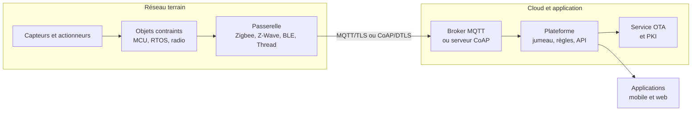
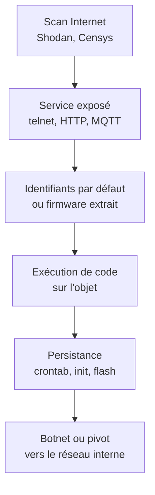

# Sécurité de l'IoT

L'Internet des objets regroupe les dispositifs dotés de calcul, de mesure ou d'action, connectés et administrés à distance. Caméras, compteurs, capteurs industriels, serrures et implants doivent fonctionner des années sans administrateur, sans écran ni utilisateur pour appliquer un correctif, avec un budget de calcul et d'énergie qui interdit les mécanismes d'un poste de travail.

Le modèle de menace en découle. L'appareil est physiquement accessible, son firmware dérive souvent d'un SDK partagé par des milliers de modèles, sa mise à jour dépend d'un cloud que le client ne contrôle pas, et son identité est parfois commune à toute une série. Compromettre un objet fournit un point d'appui réseau, une capacité de déni de service, parfois une clé pour la plateforme. [[Hardware Hacking]] traite l'extraction physique, [[Sécurité Réseau]] la segmentation, [[Sécurité Mobile]] les applications de contrôle.

> [!abstract] Définition — Objet connecté
> Dispositif embarqué combinant calcul limité, interface de mesure ou d'action, connectivité réseau et administration distante. Il couvre le capteur autonome, l'équipement industriel, l'objet domestique et le dispositif médical dès qu'ils exposent une surface accessible.

## Architecture : objet, passerelle, cloud

Trois plans décrivent la majorité des déploiements. L'objet porte la mesure et la radio ; la passerelle agrège, traduit et filtre ; le cloud conserve l'état, expose les API et distribue les mises à jour. Chaque frontière est un contrôle et un point de concentration.



L'objet combine un MCU ou un SoC, une flash, une radio et, sur les modèles corrects, un élément sécurisé. Les contraintes sont mesurables : quelques dizaines de kilo-octets de RAM sur un Cortex-M0, une pile pour dix ans, quelques kilobits par seconde en LoRaWAN. Un handshake TLS complet est parfois hors de portée : sessions persistantes, Mbed TLS ou terminaison TLS sur la passerelle.

La passerelle détient les clés du réseau local, parle plusieurs protocoles et tamponne les messages. Compromise, elle donne accès à tous les objets qu'elle fédère et permet de falsifier leur télémétrie. C'est l'unique point de filtrage applicatif pour des objets sans IP. Le cloud porte l'identité : quel appareil appartient à quel compte, à quel topic il publie. Une faiblesse d'autorisation expose le parc.

> [!important] Idée clé
> La passerelle est un concentrateur de confiance : elle voit le trafic en clair de ses objets et détient les clés pour les commander. La traiter comme un routeur domestique est l'erreur d'architecture la plus fréquente. Elle exige durcissement, mises à jour, journalisation et segmentation.

## Protocoles et sécurité native

Comparer les protocoles sur le seul chiffrement est trompeur : comptent l'établissement de la clé, ce que voit l'intermédiaire et ce qui reste vérifiable en bout de chaîne.

| Protocole | Transport | Sécurité native | Faiblesse typique |
|---|---|---|---|
| MQTT | TCP 1883/8883 | TLS, certificat client | Broker en clair, ACL larges |
| CoAP | UDP 5683/5684 | DTLS, OSCORE | Proxy terminant DTLS, NoSec |
| Zigbee | 802.15.4, 2,4 GHz | AES-128, install code | Clé de confiance par défaut |
| Z-Wave | Sous-GHz | S0, S2, DSK | S0 non authentifié |
| BLE | 2,4 GHz | LESC, appairage | Just Works |
| LoRaWAN | LoRa sous-GHz | AES-128, MIC, OTAA | ABP, compteurs |
| Matter | IP, Thread, Wi-Fi | SPAKE2+, CASE, DAC | Commissionnement |

MQTT domine la messagerie : publication-abonnement, courtier central, trois niveaux de QoS, messages retenus et testament. Il n'apporte aucune sécurité hors transport. Un broker sur 1883 en clair expose commandes et jetons ; un broker permissif accepte l'abonnement à `#`, offrant à un objet compromis la vision de tout le parc.

```conf
# mosquitto.conf — extrait
listener 8883
cafile   /etc/mosquitto/ca.pem
certfile /etc/mosquitto/server.pem
keyfile  /etc/mosquitto/server.key
tls_version tlsv1.3
require_certificate true
use_identity_as_username true
allow_anonymous false
acl_file /etc/mosquitto/acl
```

```text
# un objet ne publie que sous son identifiant
user device-7f3a
topic write devices/7f3a/telemetry
topic read  devices/7f3a/command

pattern readwrite devices/%u/#
```

CoAP (RFC 7252) reprend HTTP sur UDP. DTLS protège le transport, mais un proxy qui le termine voit le contenu ; OSCORE (RFC 8613) place la protection au niveau applicatif, si bien que le proxy route sans lire.

Zigbee s'appuie sur IEEE 802.15.4 et un coordinateur qui joue le centre de confiance. Sa faiblesse historique est la clé de lien par défaut, publique et identique sur des millions d'appareils : qui la connaît s'inscrit au réseau et obtient la clé réseau. L'install code dérive une clé unique à l'appairage, mais les procédures de secours restent réutilisées. Z-Wave utilise une bande sous-GHz : S0 échange une clé sans authentifier l'émetteur, donc vulnérable à l'homme du milieu ; S2 corrige le défaut et ajoute un code DSK.

BLE expose services et caractéristiques GATT. Le mode d'appairage décide de tout : Just Works n'authentifie rien et laisse passer un attaquant entre les pairs ; Passkey et Numeric Comparison ajoutent une confirmation humaine ; LE Secure Connections remplace les échanges legacy par ECDH.

LoRaWAN est un réseau longue portée, bas débit, en étoile. OTAA dérive les clés de session à chaque join ; ABP les fixe en usine, fige les compteurs et favorise le rejeu. La version 1.1 sépare clés réseau et application. Le point faible pratique est la passerelle : le packet forwarder historique parle en UDP sans authentification.

Matter normalise l'interopérabilité domestique sur IP, Thread ou Wi-Fi. Chaque appareil possède une chaîne d'attestation (PAA, PAI, DAC) gravée en usine, un code de commissionnement à usage unique, un échange SPAKE2+, puis des sessions CASE authentifiées par certificat. Les autorisations passent par des listes liées à un « fabric », ce qui évite le partage de clés entre écosystèmes. Les implémentations restent jeunes et le commissionnement physique demeure la surface la plus exposée.

## Firmware, racine de confiance et OTA

La chaîne de démarrage est le seul endroit où empêcher un firmware modifié de s'exécuter. Elle part d'une ROM immuable, vérifie le chargeur suivant avec une clé publique en OTP ou eFuse, puis chaque maillon vérifie le suivant.

```text
BootROM immuable
  → chargeur signé, clé publique en OTP
    → noyau signé, version comparée au compteur anti-rollback
      → rootfs vérifié par dm-verity ou IMA
```

Trois propriétés sont souvent confondues. La signature prouve l'origine ; l'anti-rollback empêche de réinstaller une version ancienne et vulnérable ; l'intégrité au runtime détecte une modification après démarrage. Un objet qui vérifie la signature au boot mais accepte ensuite une mise à jour non signée n'a qu'une protection décorative.

```bash
openssl dgst -sha256 -verify pubkey.pem -signature manifest.sig manifest.json
jq -r '.version, .min_bootloader, .sha256' manifest.json
# refus si version <= version courante ou si le hash diffère
```

Le stockage des clés conditionne la résistance à l'extraction. Une clé dans la flash externe se lit avec un clip SOIC-8 ; une clé dans un élément sécurisé ne sort jamais et la signature s'effectue dans le composant. Les ATECC608, SE050 et STSAFE offrent un stockage borné et un compteur monotone, au prix du coût et d'une dépendance fournisseur.

L'OTA doit survivre à une coupure au mauvais moment. Les schémas robustes utilisent deux partitions A/B : écrire l'image inactive, vérifier son hash, marquer le slot candidat, redémarrer, confirmer après test de santé, revenir au slot précédent en cas d'échec. Les deltas réduisent la consommation mais imposent une gestion stricte des versions de base. Le déploiement doit être progressif.

## Identité et cycle de vie

Un objet sans identité propre n'est pas administrable. L'identité doit être unique, créée avant la mise en service, stockée dans un composant non extractible et révocable. Trois modèles dominent : certificat X.509 dans un élément sécurisé, paire de clés générée localement et attestée par le fabricant, jeton dérivé d'un secret de fabrication ; le code d'appairage à usage unique reste le compromis des objets domestiques. Le certificat de série partagé, encore fréquent, transforme une fuite en compromission de toute la gamme.

Le cycle complet doit être écrit : fabrication, personnalisation, enrôlement, rotation, révocation, remplacement, destruction. La rotation est le parent pauvre. Un certificat prévu pour vingt ans sans procédure de renouvellement devient une bombe à retardement, et les objets incapables d'en recevoir un finissent en service avec une vérification désactivée.

## Menaces

Mirai reste la référence. En 2016, ce botnet a scanné l'IPv4 entier, essayé une soixantaine de couples d'identifiants par défaut sur telnet 23 et 2323, et recruté des centaines de milliers d'objets. Sa puissance de frappe a mis hors ligne une partie du DNS de Dyn le 21 octobre 2016. Son code source publié a produit Satori, Okiru et Mozi, qui ont ajouté exploits de routeurs et pair-à-pair.



Les identifiants par défaut sont la cause première : un mot de passe unique impose étiquette, logistique et procédure de réinitialisation. La première provision d'ETSI EN 303 645 interdit tout mot de passe universel. Les comptes de maintenance cachés et services UPnP maintiennent l'exposition.

Les mises à jour non signées constituent la seconde faille structurante. Un firmware téléchargé en HTTP, sans signature ni contrôle de version, permet à qui contrôle le réseau, le DNS ou le serveur de pousser du code permanent. L'absence d'anti-rollback permet de réinstaller une version dont la vulnérabilité est publique : le correctif devient une arme.

La cryptographie faible prend des formes concrètes : AES en ECB, clé unique par série, IV statique, XOR présenté comme chiffrement, MD5 pour les mots de passe, validation de certificat désactivée. Sur les objets à très faible coût, l'algorithme est parfois correct mais la clé dérive d'un numéro de série lisible. [[Cryptographie]] couvre les primitives, pas leur usage.

L'accès physique reste décisif. UART actif, flash SPI lisible, JTAG non verrouillé ou protection de lecture contournable par glitch donnent la clé, le firmware et parfois un shell. Les canaux auxiliaires complètent l'arsenal : consommation pour extraire une clé AES, mesure électromagnétique, attaque temporelle. Ces techniques sont détaillées dans [[Hardware Hacking]] et [[Attaques par canal auxiliaire]].

La chaîne d'approvisionnement ajoute une couche invisible : composants contrefaits, implants ajoutés en transit, firmware compilé par un ODM avec un SDK compromis. Le modèle de marque blanche aggrave le phénomène, un même produit étant revendu sous des dizaines de noms avec les mêmes secrets. [[Supply Chain Attacks]] traite la dimension logicielle, [[Physical Security]] la dimension matérielle.

Les API cloud sont devenues la surface la plus rentable. Jumeau numérique, provisioning, téléchargement de firmware : chaque fonction exige une autorisation vérifiée objet par objet. Les défauts classiques sont l'IDOR, le jeton de flotte trop permissif, la clé codée dans l'application mobile et l'énumération des numéros de série. [[API Security]] et [[Cloud Security]] fournissent les grilles d'analyse ; le numéro imprimé sous l'appareil suffit souvent.

## Normes et cadre réglementaire

| Référentiel | Nature | Apport |
|---|---|---|
| ETSI EN 303 645 | Norme | Treize provisions pour le grand public |
| OWASP IoT Top 10 | Référentiel | Taxonomie des risques |
| NIST IR 8259 | Guide | Capacités techniques et support |
| CRA (UE) 2024/2847 | Règlement | Exigences, conformité, notification |
| NIS2 | Directive | Gouvernance, chaîne d'approvisionnement |

ETSI EN 303 645 est le socle le plus opérationnel. Ses treize provisions couvrent les mots de passe universels, le signalement, la mise à jour, les secrets, le chiffrement, la surface exposée, l'intégrité, les données personnelles, la résilience, la télémétrie, l'effacement, l'installation et la validation des entrées. Elle n'est pas certifiable en soi, mais alimente schémas nationaux et appels d'offres.

OWASP IoT Top 10 (2018) classe les risques en dix familles : identifiants faibles ou codés en dur (I1), services réseau non sécurisés (I2), interfaces écosystème (I3), mise à jour non sûre (I4), composants obsolètes (I5), données personnelles (I6), transfert et stockage (I7), gestion des appareils (I8), paramètres par défaut (I9), durcissement physique (I10). Chaque famille appelle un contrôle : identité unique, OTA signé, SBOM, ACL, chiffrement.

NIST IR 8259 décline la même matière en capacités attendues : identité, configuration, protection des données, contrôle d'accès logique, mise à jour et conscience de l'état. Il insiste sur les capacités non techniques qui les rendent utilisables : inventaire, politique de support, canal de divulgation.

Le CRA change d'échelle. Il impose la sécurité dès la conception, une gestion des vulnérabilités pendant la période de support, un SBOM, une divulgation coordonnée et la notification des vulnérabilités exploitées et des incidents. Les notifications s'appliquent dès septembre 2026, l'application générale en décembre 2027 ; les sanctions atteignent 15 millions d'euros ou 2,5 % du chiffre d'affaires mondial. La difficulté est la preuve : versions supportées, délais de correction, traçabilité.

NIS2 intervient autrement. Elle vise les entités exploitant des services essentiels ou importants et leur impose de sécuriser leur chaîne d'approvisionnement : un opérateur d'eau ou un hôpital doit exiger de ses fournisseurs des preuves de sécurité, une politique de mise à jour et une notification d'incident. [[NIS2 et DORA]] détaille les obligations et les délais.

## Défenses

La défense commence par la réduction de surface : un service nécessaire, sur le réseau nécessaire, avec le compte nécessaire. Pas de telnet, pas d'administration HTTP en clair, pas d'UPnP, pas de diagnostic, et une sortie Internet limitée aux destinations utiles. Le filtrage sortant compte autant que l'entrant : un objet compromis qui ne joint que son broker et son service OTA a perdu l'essentiel de sa valeur.

| Couche | Mesure |
|---|---|
| Silicium | Secure boot, debug verrouillé, élément sécurisé |
| Firmware | Signature, anti-rollback, A/B, watchdog |
| Identité | Certificat par appareil, mTLS, rotation |
| Réseau | VLAN par usage, 802.1X, egress allowlist |
| Application | ACL par topic, autorisation par objet |

La segmentation se pense par usage, pas par bâtiment. Un VLAN « IoT » unique contenant caméras, capteurs et serrures ne protège rien : la compromission d'une caméra ouvre les autres. Les déploiements matures découpent par fonction et criticité, avec contrôle L3 et broker par domaine. Un capteur de température n'a aucune raison de publier sur le topic d'une serrure : le moindre privilège s'applique aux objets, et les ACL dérivent du rôle, pas du numéro de série.

## Décommissionnement

Un objet retiré du service dont le certificat reste valide, le jeton cloud actif et l'entrée d'inventaire présente est une porte dérobée oubliée. Le processus commence par la révocation : certificat en CRL, identité cloud désactivée, ACL supprimée. Vient l'effacement : clés détruites, configuration réinitialisée, stockage chiffré effacé. L'objet sort de l'inventaire et du jumeau numérique.

Pour un objet revendu, l'effacement doit être vérifié et documenté : une réinitialisation logicielle laisse parfois des clés dans une partition de secours. Une flash non effacée peut contenir identifiants de réseau, clés privées et données de consommation ; le broyage est parfois la seule option. Le service cloud doit aussi être démantelé, sous peine d'objets orphelins qui se reconnectent à un broker supprimé.

## Limites et détection

La détection se heurte à trois limites : trafic chiffré de bout en bout, protocoles non IP (Zigbee, Z-Wave, BLE, LoRaWAN) hors des points d'observation, échelle coûteuse par appareil. Un SOC qui ne voit que le cloud rate les attaques locales ; un SOC qui ne voit que le réseau rate les actions dans le cloud.

| Signal | Source | Révèle |
|---|---|---|
| Empreinte DHCP, OUI, mDNS | Commutateur, AP | Apparition, remplacement |
| Cadence et volume par topic | Broker MQTT | Balayage, énumération |
| Abonnement à `#` | Broker | Objet qui veut tout lire |
| TLS vers destination inconnue | Pare-feu, proxy | Exfiltration, C2, OTA pirate |
| Échec d'attestation | Objet, passerelle | Firmware modifié, rollback |
| Join, leave, deauth | Contrôleur Zigbee/Thread | Appairage pirate, brouillage |

La ligne de base est indispensable : sans cadence normale connue, une hausse de trente pour cent ne signifie rien. Les objets ont des rythmes réguliers, ce qui rend les anomalies détectables par écart à la moyenne ou topics nouveaux. Une allowlist de flux vaut mieux qu'un IDS signature.

Les journaux du broker, du serveur OTA et de l'API sont souvent les seuls exploitables. Centralisés, corrélés à l'inventaire, ils révèlent le firmware téléchargé par un objet jamais mis à jour, la commande d'ouverture depuis une adresse inhabituelle, la réauthentification en rafale. [[Detection Engineering]] et [[SIEM (Security Information and event Management)]] fournissent le cadre.

La réponse est contrainte par le risque de brique. Isoler un objet peut couper une fonction critique : prévoir modes dégradés et coordination métier. Quarantaine réseau, révocation de certificat et blocage au broker sont souvent plus sûrs qu'un redémarrage à distance.

La détection ne compense pas une conception défaillante. Un objet à mot de passe universel, sans anti-rollback ni certificat unique restera compromettable. La sécurité se gagne à la fabrication, se maintient par la mise à jour et se prouve par l'inventaire.

> [!quiz] Un objet MQTT sur TLS est-il protégé de bout en bout ?
> Non. TLS chiffre le canal jusqu'au broker, qui voit le contenu en clair et peut le lire, le modifier ou le conserver. La confidentialité de bout en bout exige une protection applicative, OSCORE pour CoAP ou un chiffrement de charge utile dont le broker ne détient pas la clé. L'ACL du broker reste nécessaire, mais ne remplace pas cette protection.

> [!quiz] Pourquoi une mise à jour signée ne suffit-elle pas sans anti-rollback ?
> Parce qu'un attaquant peut rejouer une version ancienne, correctement signée, dont la vulnérabilité est publique. Le compteur monotone et le refus de toute version inférieure empêchent ce retour en arrière. La signature garantit l'origine, pas la fraîcheur.
