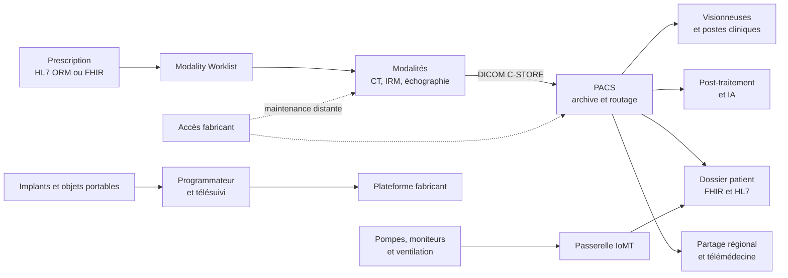
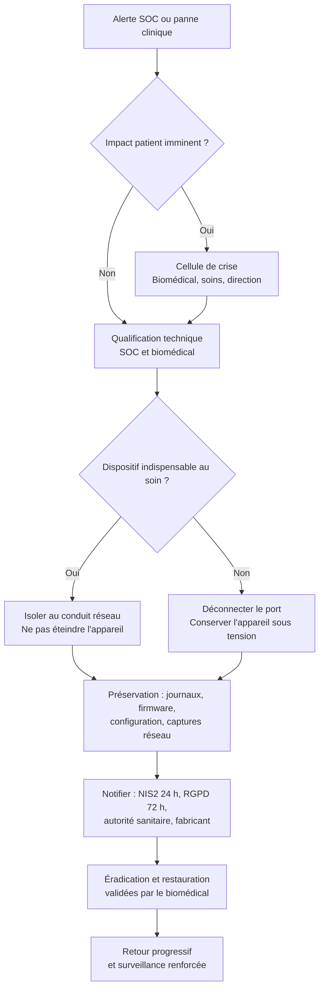

# Sécurité des dispositifs médicaux

Un dispositif médical n'est pas un ordinateur qui rend un service : c'est un objet dont la défaillance peut blesser. Une pompe qui reçoit une consigne erronée, un scanner qui n'envoie plus ses images, un moniteur dont l'alarme est masquée produisent un dommage corporel. La cybersécurité y devient une composante de la sécurité du patient.

Le secteur réunit ce que la sécurité de l'information gère mal : des systèmes figés pour quinze ans, des systèmes d'exploitation sans correctifs, des protocoles conçus sans adversaire et des fabricants seuls habilités à modifier leur logiciel. La vulnérabilité n'est pas l'anomalie : c'est l'état normal d'un parc installé.

Cette note suit l'écosystème, les protocoles, les contraintes et le cadre réglementaire, puis les défenses, les vulnérabilités, la réponse à incident et la détection. Elle complète [[Sécurité Réseau]], [[Sécurité des données]] et [[NIS2 et DORA]].

> [!abstract] Définition — Dispositif médical
> Au sens du règlement européen 2017/745, tout instrument, appareil, logiciel, implant ou article destiné par son fabricant à être utilisé chez l'homme à des fins de diagnostic, de prévention, de surveillance ou de traitement, et dont l'action principale n'est pas pharmacologique, immunologique ou métabolique. Un logiciel peut être dispositif médical à part entière ; un dispositif connecté forme avec son environnement un système dont la sécurité dépasse celle du produit certifié.

## L'écosystème clinique et l'IoMT

L'IoMT désigne les dispositifs connectés et les systèmes qui les entourent. Le terme suggère une catégorie homogène, alors que le parc va du pacemaker à l'IRM, du pousse-seringue au serveur d'archive.



### DICOM : l'imagerie comme protocole et comme surface

DICOM, normalisé par la série PS3 de NEMA, couvre le format, la communication réseau et les services web. Une association DIMSE s'ouvre sur le port 104 par un message `A-ASSOCIATE-RQ` qui négocie des contextes de présentation. Les services usuels sont `C-ECHO`, `C-STORE`, `C-FIND`, `C-MOVE` et `C-GET`. Chaque extrémité se présente par un *Application Entity Title* de seize caractères au plus.

Ce titre n'est pas une identité : il n'est ni secret ni vérifié, et l'adresse IP source fait office d'authentification. Un `C-FIND` mal filtré énumère des identités de patients ; un `C-MOVE` vers un titre inconnu pousse des examens vers une destination arbitraire, canal d'exfiltration qui emprunte le flux légitime du PACS ; un `C-ECHO` balayé révèle archives et modalités. La parade est le profil TLS de PS3.15, avec certificats et liste de confiance, complété par un filtrage des titres autorisés. Beaucoup de modalités anciennes ne le supportent pas.

Le format porte des métadonnées identifiantes : nom, date de naissance, numéro de dossier, parfois des annotations brûlées. PS3.15 définit le retraitement, mais l'anonymisation parfaite n'existe pas : une reconstruction faciale reste possible, ce qui impose le *defacing*. Le PACS est ainsi dispositif de soin, archive légale et entrepôt de données sensibles.

### HL7 v2, CDA et FHIR

HL7 v2 reste le ciment des échanges cliniques : des segments (`MSH`, `PID`, `OBR`, `OBX`) séparés par des retours chariot, des champs délimités par des barres verticales, transportés par MLLP entre `0x0B` et `0x1C 0x0D`, souvent sur le port 2575. Ni authentification, ni intégrité, ni confidentialité : qui atteint le port peut injecter un résultat biologique, modifier une identité ou rejouer une admission.

CDA, XML signé mais complexe, a peu diffusé ; FHIR expose des ressources JSON en REST (`Patient`, `Observation`, `ImagingStudy`, `AuditEvent`), avec recherche par paramètres et sécurité déléguée à OAuth 2.0 et à SMART on FHIR. C'est une surface applicative classique : autorisation au niveau objet insuffisante, `_include` qui élargit la réponse, `$everything` qui retourne tout un dossier.

La passerelle d'intégration reprend le contrôle : TLS, authentification des partenaires, validation contre un profil et journalisation. Sans elle, le moteur d'intégration devient un routeur universel.

## Contraintes cliniques et cadre réglementaire

| Contrainte | Conséquence |
|---|---|
| Sécurité du patient | Aucun correctif sans validation clinique |
| Disponibilité permanente | Patchs différés, compensations durables |
| Cycle de vie de quinze à vingt ans | Systèmes d'exploitation en fin de support |
| Validation réglementaire | Modifier un paramètre peut exiger une requalification |
| Accès urgent et comptes partagés | MFA et moindre privilège difficiles |
| Fabricant seul habilité | Contractualisation et accès distant encadré |

On ne transpose donc pas une politique de sécurité informatique. Un correctif qui exige un redémarrage se planifie avec le clinicien, le biomédical et le fabricant ; un scan trop brutal peut bloquer une pompe ; un changement de mot de passe sur un compte générique peut interrompre une garde. Chaque contrôle s'évalue sur deux axes : le risque qu'il réduit et le risque clinique qu'il introduit.

| Référentiel | Champ | Exigence opérationnelle |
|---|---|---|
| FDA 524B et QMSR | États-Unis, avant et après commercialisation | Surveillance, correctifs, SBOM |
| IEC 62304 | Cycle de vie logiciel | Classes A, B, C ; gestion des SOUP |
| ISO 14971 | Management du risque | Danger, situation dangereuse, dommage |
| IEC 81001-5-1 | Sécurité du cycle de vie santé | Activités alignées sur 62304 et 14971 |
| IEC 80001-1 | Réseau intégrant des dispositifs | Rôles de l'exploitant et du fabricant |
| MDR 2017/745 | Union européenne | Exigences générales (GSPR 17), vigilance |
| RGPD | Données de santé | Base légale, violation sous 72 heures |
| NIS2 | Entités essentielles de santé | Notification 24 et 72 heures |
| HIPAA | États-Unis | Security Rule, notification sous 60 jours |

Le fabricant raisonne en dossier de sécurité : exigences dérivées de l'analyse de risque, architecture, tests, gestion des vulnérabilités, mises à jour. IEC 81001-5-1 l'articule avec IEC 62304 et ISO 14971, en distinguant le risque de sécurité — un attaquant exploite une faiblesse — du risque de sûreté — un danger produit un dommage. Les deux se rejoignent : une commande falsifiée est une menace, la surdose qui en résulte est un danger.

Le RGPD ajoute une couche autonome. Les données de santé relèvent de l'article 9 ; l'article 32 exige des mesures adaptées, l'article 35 une analyse d'impact à grande échelle, l'article 33 une notification sous 72 heures. Un [[Ransomware|rançongiciel]] qui exfiltre un PACS déclenche plusieurs horloges : NIS2 pour la continuité, RGPD pour les personnes, vigilance MDR si un défaut du dispositif est en cause.

## Menaces et scénarios

| Menace | Effet clinique |
|---|---|
| Rançongiciel par phishing ou VPN | DPI et PACS indisponibles, soins reportés |
| Identifiants par défaut sur réseau plat | Dose ou alarme modifiée |
| Système non patché, ver ou USB | Modalité arrêtée, propagation |
| Abus DICOM `C-FIND` ou `C-MOVE` | Exfiltration d'imagerie |
| Injection HL7 ou FHIR | Faux résultat, dossier altéré |
| Accès fabricant mal encadré | Persistance, pivot vers l'IT |
| Implant et programmateur | Thérapie altérée |
| SOUP ou [[Supply Chain Attacks|mise à jour non signée]] | Code malveillant signé |
| Perte ou vol de portable | Fuite de données |

WannaCry paralyse en 2017 une large partie du NHS : environ 80 organisations, des milliers de rendez-vous annulés. Change Healthcare, en 2024, interrompt des semaines durant les vérifications d'assurance et les prescriptions aux États-Unis, avec les données de près de 190 millions de personnes exposées. Synnovis, la même année, perturbe la biologie et la transfusion de plusieurs hôpitaux londoniens. Dans tous les cas, l'attaque a visé un service dont le soin dépend, pas un dispositif.

Les implants suivent une autre logique. Des recherches publiques ont montré que la proximité radio suffisait à interroger, parfois à modifier, des paramètres de thérapie. Les fabricants ont répondu par des rappels de firmware et des communications chiffrées, mais la mise à jour se fait en consultation. Risque faible en probabilité, maximal en gravité : il justifie la surveillance du télésuivi.

## Architecture défensive

### Inventaire et propriétaire clinique

L'inventaire est le premier contrôle et le plus difficile. Un hôpital connaît ses fournisseurs, rarement ses dispositifs : un échographe acheté par un service, un moniteur prêté par un laboratoire, une pompe en essai clinique. La découverte doit être passive : journaux DHCP, tables ARP, NAC, mDNS, flux NetFlow, certificats. Chaque entrée porte un propriétaire clinique, une criticité, une version et une date de fin de support. Sans propriétaire, personne n'arbitre entre le confort d'un service et une mesure de sécurité. Le scan actif se réserve aux équipements dont le fabricant l'autorise.

### Segmentation et zones de soin

| Zone | Flux autorisés | Contrôle |
|---|---|---|
| IT institutionnelle | Vers PACS et passerelles | Pare-feu applicatif, authentification |
| Imagerie | DICOM et HL7 uniquement | Filtrage des AE, TLS, IDS |
| Soins critiques | Vers passerelle et centrale | Conduit étroit, liste blanche |
| Dispositifs connectés | Vers plateforme fabricant | Egress contrôlé, proxy |
| Administration | Depuis bastion | MFA, PAM, journalisation |
| Fabricant | Session à la demande | Courtage, MFA, enregistrement |

Un VLAN ne suffit pas : c'est le filtrage entre zones qui protège. Le conduit d'imagerie n'autorise que les couples source-destination nécessaires et, si possible, les seuls services DICOM utiles. Une modalité n'a aucune raison d'atteindre Internet ou d'ouvrir SMB. La microsegmentation par identité d'équipement, via 802.1X ou MAB, réduit le mouvement latéral lorsque le parc ne porte pas d'agent.

### Durcissement, identité et accès distant

Le durcissement commence par ce qui se modifie sans toucher au logiciel certifié : identifiants par défaut, services inutiles, chiffrement des disques des consoles, ports USB non utilisés, journalisation. Les consoles Windows qui pilotent un dispositif sont le maillon faible : elles relèvent de l'IT, mais leur compromission donne accès au dispositif. Les comptes de service génériques survivent, mais leurs secrets vont dans un coffre avec rotation. L'accès distant des fabricants passe par un courtier de session : approbation, créneau, MFA, enregistrement, révocation automatique. Un modem 4G oublié annule toute la segmentation.

### Mises à jour, secure boot et compensations

Un dispositif doit vérifier l'intégrité de son firmware au démarrage — secure boot, mesure, signature — et n'accepter que des mises à jour signées, avec retour arrière. Ces propriétés se vérifient à l'achat, pas après l'incident. Sinon, la compensation est architecturale : isolement, contrôle des supports amovibles, vérification des versions.

Quand le correctif n'existe pas, on compense : règle de pare-feu, signature IPS, désactivation d'un service, virtual patching, remplacement. Chaque compensation est documentée avec un propriétaire, une justification clinique, une date d'expiration et un critère de sortie.

### Données, sauvegardes et cycle de vie

Le PACS et le DPI concentrent la donnée. Il faut chiffrer volumes et sauvegardes, séparer les clés, journaliser les accès et tester la restauration : un PACS restauré en trois jours n'est pas un plan de continuité pour les urgences.

À l'achat, on exige une notice de sécurité fabricant, un SBOM, une politique de support et de correctifs, un engagement de divulgation, la durée de maintenance et les interfaces exposées. La fiche MDS2 donne une base de discussion ; elle ne remplace ni un test ni une clause contractuelle.

## Gestion des vulnérabilités

La gestion des vulnérabilités suit [[Gestion des Vulnérabilités]], avec deux décalages : la source de vérité est le fabricant, la priorisation est clinique. Les avis viennent des éditeurs, de la FDA, des CERT sectoriels et du NVD ; chacun doit être rapproché de l'inventaire réel, car une CVE critique sur un modèle absent du parc ne concerne personne.

| Critère | Effet |
|---|---|
| Exploitabilité et exposition | Urgence technique |
| Criticité clinique du dispositif | Gravité potentielle |
| Dommage possible : dose, perfusion, diagnostic | Priorité |
| Compensations en place | Réduction du risque |
| Correctif disponible ou fin de vie | Décision ou remplacement |

Une vulnérabilité exploitable à distance sur un dispositif de support de vie, exposé depuis une zone permissive, se traite en jours par isolement immédiat puis correctif. Une faille critique sur un équipement non routable, sans accès physique, peut attendre la fenêtre de maintenance. Le score CVSS informe, il ne décide pas.

Le processus tient en six étapes : collecter les avis, confronter à l'inventaire, évaluer le contexte clinique, décider (corriger, compenser, accepter), tracer, revérifier. Les exceptions sont signées par le propriétaire clinique et le RSSI, avec échéance. Les équipements en fin de vie n'ont pas d'exception possible : ils ont un plan de remplacement et, en attendant, un isolement renforcé.

## Réponse à incident avec la biomédicale

La réponse suit [[DFIR]] et se conduit à deux voix. Le SOC qualifie l'événement technique ; l'ingénierie biomédicale qualifie l'état de l'appareil et son rôle dans le soin. Aucune ne décide seule : isoler un moniteur peut priver une réanimation de ses alarmes, éteindre une pompe peut interrompre une perfusion. La cellule réunit biomédical, SOC, cliniciens, fabricant, DPO et direction ; chacun décide dans son domaine, et le clinicien arbitre toujours la priorité du soin.



Trois règles : isoler le conduit, pas l'appareil ; préserver journaux, firmware, configuration et captures avant de restaurer ; ne jamais réinstaller depuis un support trouvé sur le poste compromis.

Les notifications se déclenchent en parallèle : NIS2 impose l'alerte précoce sous 24 heures, la notification sous 72 heures et le rapport final sous un mois ; le RGPD impose la notification de violation sous 72 heures ; le fabricant doit être informé pour évaluer une vigilance au titre du MDR. Une chronologie unique, tenue dès la première heure, alimente tous les destinataires.

## Détection

La détection combine trois plans : le réseau, les applications cliniques et les journaux des appareils. Aucun ne suffit : le dispositif est souvent invisible à l'EDR, le PACS voit les requêtes mais pas la sémantique clinique, et le réseau ne voit pas une reprogrammation faite en consultation.

| Source | Signal | Angle mort |
|---|---|---|
| TAP, SPAN, IDS | DICOM et HL7 anormaux | Chiffré, liaisons série |
| Inventaire, NAC, DHCP | Nouvel appareil, changement de port | Usurpation de MAC |
| Journaux PACS | `C-MOVE`, `C-FIND`, volumes | Pas de contexte patient |
| FHIR `AuditEvent` | Accès API, export | Audit mal configuré |
| EDR des consoles | Processus, USB, RDP | Dispositif non instrumenté |
| Journaux de l'appareil | Configuration, erreurs | Horloge instable, rétention courte |

Les comportements à surveiller sont peu nombreux mais stables : modalité qui ouvre une connexion vers Internet, `C-MOVE` vers un titre inconnu, rafale de `C-FIND`, flux HL7 qui rejette massivement des messages, poste d'acquisition qui parle SMB ou RDP, nouvel administrateur local sur une console, support USB monté en salle d'examen, changement de firmware sans ticket.

```suricata
alert tcp !$DICOM_CLIENTS any -> $PACS_SERVERS 104 (msg:"DICOM - association depuis un hote non inventorie"; flow:to_server,established; content:"|01 00|"; offset:0; depth:2; threshold:type limit, track by_src, count 1, seconds 60; sid:7104001; rev:1;)

alert tcp !$HL7_GATEWAYS any -> $HL7_SERVERS 2575 (msg:"HL7 - MLLP depuis une passerelle inconnue"; flow:to_server,established; content:"|0b|MSH|7c|"; offset:0; depth:5; threshold:type limit, track by_src, count 1, seconds 60; sid:7104002; rev:1;)
```

```yaml
title: Nouveau service persistant sur poste d'acquisition
id: 5b1c7a90-3f2e-4a11-9d6c-8e2f4b7c1d33
status: experimental
description: Detecte l'installation d'un service sur une console clinique hors baseline
logsource:
  product: windows
  service: system
detection:
  selection:
    EventID: 7045
  filter_vendor:
    ImagePath|contains:
      - 'C:\Program Files\Vendor Imaging\'
  condition: selection and not filter_vendor
falsepositives:
  - Mise a jour planifiee par le fabricant
level: high
tags:
  - attack.persistence
  - attack.t1543.003
```

Une règle vaut par sa baseline : chaque dispositif a un profil stable de partenaires, ports, volumes, horaires et titres DICOM. C'est l'écart qui alerte. Un `C-STORE` de dix mille images est normal pour une mammographie, anormal pour un échographe.

Le SOC a besoin d'un référentiel clinique : dispositif vital, service utilisateur, astreinte. Les [[Playbooks IR]] prévoient une branche « dispositif médical » avec les numéros du biomédical et du fabricant ; [[Detection Engineering]] fournit le cycle de vie des règles.

## Limites et angles morts

La segmentation réduit le mouvement latéral ; elle ne protège ni d'une clé USB, ni d'un accès fabricant mal encadré, ni d'une visionneuse compromise. L'inventaire passif ne voit pas un dispositif silencieux, et l'inventaire actif peut provoquer l'incident qu'il cherche à prévenir.

La détection est incomplète : peu d'agents, horloges dérivantes, journaux courts, protocoles propriétaires. Les faux positifs ont un coût clinique : une alerte mal calibrée détourne une équipe du soin et finit désactivée. La conformité ne prouve pas la résistance : un dispositif marqué CE et un hôpital certifié ISO 27001 peuvent rester vulnérables.

> [!quiz] Un dispositif médical isolé sur un VLAN dédié est-il hors de portée d'un rançongiciel ?
> Réponse — Non. Le VLAN isole un domaine de diffusion, pas un risque. Le dispositif doit parler au PACS, au DPI, à la passerelle, au fabricant ou à un poste d'acquisition ; chacun de ces chemins est une porte. S'y ajoutent les clés USB, les comptes génériques et les accès de maintenance. Seul le filtrage des flux entre zones, avec authentification et surveillance, réduit réellement la surface.
