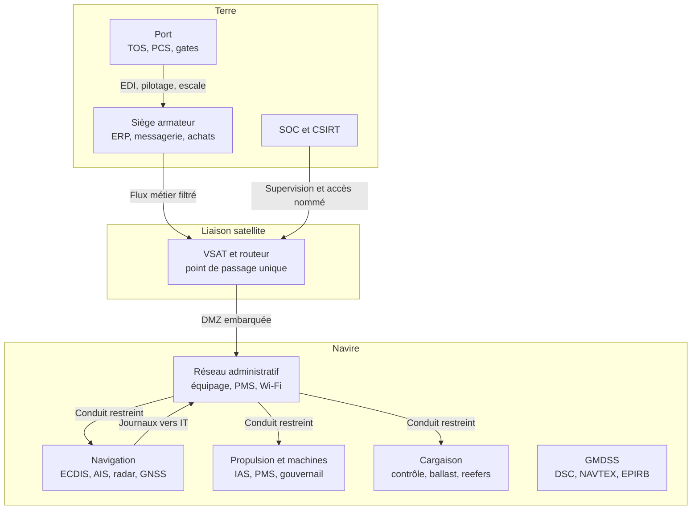

# Sécurité maritime et portuaire

Le transport maritime déplace près de 80 % du commerce mondial. Le navire est une usine mobile (propulsion, cargaison, navigation, satellite) ; le port une usine logistique (TOS, grues, gates, CCTV). Les deux se rejoignent à chaque escale par EDI, pilotage et prestataires. Un rançongiciel peut arrêter un terminal sans toucher une grue : Maersk en 2017, Nagoya en 2023.

Trois asymétries structurent le problème : actif mobile, autorité fragmentée entre armateur, capitaine, pavillon, port et État côtier, équipements conçus pour la disponibilité et non pour l'adversité. Cette note couvre architecture, normes, menaces, défenses, détection et réponse. Prérequis : [[OT Security avancé]], [[Sécurité Réseau]], [[NIS2 et DORA]], [[Physical Security]].

> [!abstract] Définition — OT maritime
> Systèmes informatiques embarqués ou portuaires qui concourent directement à la navigation, à la propulsion, à la manutention, au stockage ou à la sûreté physique. Il se distingue du SI administratif par l'impact physique immédiat et par ses contraintes : temps réel, cycles longs, protocoles peu authentifiés, fenêtres de maintenance rares.

## Architecture embarquée

Le navire s'organise en îlots qui ne devraient pas communiquer librement : passerelle, machines, cargaison, GMDSS, satellite, administration.

| Îlot | Composants | Technologies | Risque |
|---|---|---|---|
| Navigation | ECDIS, radar/ARPA, AIS, GNSS, gyro, loch, sondeur, pilote, VDR | NMEA 0183/2000, IEC 61162-450, Ethernet | Position fausse, route altérée, perte de veille |
| Propulsion | IAS/AMS, PMS, gouvernail, propulseurs | Modbus, PROFIBUS, CAN, propriétaire | Arrêt, surrégime, perte de manœuvrabilité |
| Cargaison | Contrôle, jauges, gaz inerte, ballast, reefers | Modbus, HART, OPC, propriétaire | Fausse mesure, pollution, incendie |
| GMDSS | VHF/MF/HF DSC, Inmarsat-C, NAVTEX, EPIRB, SART | Chaîne dédiée, secours | Détresse non émise, fausse alerte |
| Satellite | VSAT, L-band, LEO, routeur, pare-feu | IP, NAT, VPN | Point d'entrée, exfiltration, coupure |
| Administration | Messagerie, PMS, achats, comptes, Wi-Fi | Windows, AD, cloud | Hameçonnage, pivot |

L'ECDIS affiche la carte, la position et la route, et porte le plan de voyage (IEC 61174, S-52, S-57/S-101, S-63). Une carte est corruptible : mises à jour par support ou portail, avec permis et signatures. La route ou une zone interdite se modifie sans toucher au système.

L'AIS émet en clair sur VHF 87B/88B (ITU-R M.1371). Position, données statiques et classe B circulent sans authentification ni intégrité. Il aide à la veille mais ne prouve rien : un émetteur peut fabriquer un navire, dupliquer un MMSI, déplacer une position ou effacer une trace.

Le GNSS (GPS et autres constellations) fournit position et heure. Le brouillage coupe le signal ; l'usurpation impose une position fausse, parfois par dérive lente. DP, grues, AGV et horloges en dépendent. On recoupe radar, gyro, loch et estime, on surveille signal et géométrie, et on utilise OSNMA.

Le GMDSS (SOLAS IV) assure détresse, coordination et informations de sécurité via des équipements dédiés et une alimentation de secours. La position des alertes DSC vient souvent du GNSS : une usurpation fausse la localisation. Sa modernisation vers IP ouvre des menaces réseau.



La segmentation doit être vérifiable : VLAN, pare-feu navigation/administration, aucun routage du Wi-Fi équipage vers la passerelle, filtrage NMEA. Une DMZ embarquée héberge proxy, collecteur et courtier d'accès ; les modems de télémétrie sont des chemins oubliés.

## Architecture portuaire

Le port combine SI logistique et contrôle industriel. Le TOS planifie l'escale, affecte les emplacements, ordonne les mouvements et dialogue avec armateurs, transitaires, douanes et transporteurs ; le PCS échange les messages. Grues de quai, RTG, cavaliers et AGV exécutent les mouvements. La sûreté repose sur clôture, contrôle d'accès, CCTV et plan ISPS.

| Niveau | Fonction | Exemples | Surface d'attaque |
|---|---|---|---|
| L4 | Entreprise et autorité | ERP, RH, messagerie | Hameçonnage, comptes, fournisseurs |
| L3 | Logistique | TOS, PCS, EDI, facturation | Injection de messages, fraude, arrêt |
| L2 | Supervision terminal | Gestion de parc, positionnement RF | Usurpation, déni de service |
| L1 | Contrôle machine | Automates de grue, variateurs, AGV | Commandes non autorisées, mouvement |
| L0 | Procédé | Portique, spreader, énergie | Accident, impact direct |

Les gates lisent plaques, conteneurs et scellés, et contrôlent l'accès. Un TOS indisponible n'arrête pas forcément les grues, mais bloque planification, gates et documentation. Une attaque sur l'automate d'une grue produit un mouvement dangereux sans passer par le TOS : deux chemins distincts.

Les EDI structurent les échanges : BAPLIE (plan de baie), MOVINS (instructions), COPRAR (chargement), CODECO (gate), COARSE (stock), IFTSTA (statuts). Ils passent par réseaux à valeur ajoutée, FTP ou API, peu validés. Un message forgé déplace un conteneur, modifie un poids ou introduit une marchandise dangereuse.

## Cadre normatif

Le cadre est composite : l'IMO fixe des objectifs, les sociétés de classification vérifient la conception, l'ISPS organise la sûreté physique, NIS2 impose gestion du risque et notification.

| Référentiel | Objet | Portée pratique |
|---|---|---|
| IMO MSC-FAL.1/Circ.3 | Gestion du risque cyber maritime | Identifier, protéger, détecter, répondre, rétablir |
| Résolution MSC.428(98) | Risque cyber dans le SMS/ISM | Intégration au management depuis 2021 |
| SOLAS | Navigation, radio, ISM, ISPS | ECDIS, AIS, GMDSS, VDR, management |
| Code ISPS | Sûreté navires et installations portuaires | PFSP, niveaux, accès, zones restreintes |
| IACS UR E26 | Résilience cyber du navire | Conception, segmentation, inventaire, réponse |
| IACS UR E27 | Systèmes et équipements de bord | Développement sécurisé, durcissement |
| IEC 62443 | Zones, conduits, niveaux de sécurité | Ingénierie OT du navire et du terminal |
| NIS2 | Entités essentielles et importantes | Maritime et ports, notification 24/72 h |
| BIMCO/ICS, ENISA | Guides opérationnels | Bonnes pratiques bord et port |

MSC.428(98) inscrit le risque cyber dans le SMS depuis 2021 : analyse de risque, procédures, responsabilités, détection et réponse intégrées à l'ISM. Les UR E26/E27 de l'IACS, applicables aux contrats signés à partir du 1er juillet 2024, traduisent cela en règles de classe : inventaire, zones et conduits, exigences équipements, tests. Elles visent le neuf, pas la flotte existante.

Le Code ISPS (2004) impose évaluation de sûreté, plan par navire et installation, agent de sûreté et trois niveaux d'alerte. Il traite la sûreté physique, pas la cyber. Pourtant barrières, caméras et portiques sont dans son périmètre opérationnel : un plan qui ignore l'identité des équipements et la journalisation est incomplet.

NIS2 ajoute la couche juridique : transport maritime et opérateurs portuaires selon taille et criticité. L'entité gère le risque, sécurise sa chaîne d'approvisionnement, notifie le CSIRT sous 24 h, 72 h et un mois, et implique sa direction.

## Menaces

Les menaces combinent opportunisme (rançongiciel, hameçonnage, identifiants par défaut) et actions ciblées. Le point commun est l'exploitation d'une dépendance légitime : cartes, accès constructeur, EDI, signal GNSS.

| Menace | Cible | Effet | Contrôle principal |
|---|---|---|---|
| Brouillage/usurpation GNSS | ECDIS, AIS, DP, grues, AGV | Position fausse, arrêt, collision | Recoupement, OSNMA, PNT de secours |
| Usurpation AIS | Trafic, autorités, armateurs | Navire fantôme, MMSI dupliqué | Corrélation radar, analyse comportementale |
| Cartes/routes altérées | ECDIS | Échouement, zone interdite | S-63 signé, intégrité, double contrôle |
| Rançongiciel | Siège, TOS, messagerie, PMS | Arrêt logistique, perte de données | Sauvegardes, segmentation, EDR |
| Accès distant | Routeur satellite, poste constructeur | Pivot vers passerelle ou machines | Courtier, MFA, session enregistrée |
| Identifiants équipage | Messagerie, Wi-Fi, portails | Prise de contrôle, pivot | MFA, comptes nominatifs, formation |
| Chaîne d'approvisionnement | ECDIS, VSAT, TOS, MSP, chantier | Code ou firmware compromis | Contrats, audit, SBOM, tests |
| OT portuaire | Automates de grue, gates, CCTV | Mouvement dangereux, accès frauduleux | Segmentation, DPI, contrôle physique |

L'usurpation GNSS est silencieuse. Un brouilleur coupe le signal et déclenche souvent une alarme ; un usurpateur émet une constellation simulée plus forte, et le récepteur se cale dessus. La position dérive de quelques centaines de mètres : alarme, échouement, zone interdite ou fausse détresse. Les zones portuaires et de conflit sont documentées.

L'AIS n'authentifie rien : on peut émettre pour un MMSI existant, créer un navire fictif, changer destination ou cargaison, simuler une aide. La manipulation sert aussi à dissimuler une activité : coupure, changement de nom, transfert, sanctions. La détection repose sur la cohérence : AIS contre radar, vitesse incompatible, MMSI en deux endroits, données statiques modifiées en mer.

L'ECDIS est un système durci avec USB, série et réseau. Vecteurs : support de mise à jour, portail fournisseur, logiciel de route, fichiers échangés, utilitaires. Une carte falsifiée déplace une zone de sécurité ou supprime un haut-fond ; un fichier de route piégé exploite le logiciel. S-63 protège l'origine de la carte, pas la configuration.

Les rançongiciels frappent siège, messagerie, facturation ou TOS, puis se propagent par comptes et partages. NotPetya a paralysé Maersk et APM en 2017 ; CMA CGM en 2020 ; Nagoya en 2023, perturbant Toyota. L'impact vient de la dépendance à quelques services centraux : un port s'arrête sans qu'une grue soit touchée.

L'accès distant est le vecteur privilégié : routeurs satellite à identifiants par défaut, outils constructeur oubliés, comptes fournisseurs partagés, VPN sans MFA. L'attaquant atteint le poste de maintenance puis la passerelle ou les machines. Les identifiants d'équipage — messagerie, Wi-Fi, portails — ajoutent une porte, aggravée par les rotations et les comptes non révoqués.

La chaîne d'approvisionnement est opaque : constructeur ECDIS, cartes, intégrateur VSAT, automates, chantier, classification, TOS, CCTV, télécom. Chacun peut être compromis ou pousser une mise à jour non maîtrisée ; les cycles longs aggravent le risque.

## Défenses

La première défense est de rendre les chemins explicites. À bord : navigation, propulsion, cargaison, GMDSS, administration, équipage. Chaque conduit décrit flux, protocoles, utilisateurs et direction. Le réseau administratif n'initie pas vers l'ECDIS ; les journaux remontent, les commandes ne descendent pas. Le Wi-Fi équipage est séparé ; le routeur satellite est derrière un pare-feu.

À terre, le terminal applique Purdue : entreprise, DMZ, TOS, contrôle terminal, cellules. Les conduits TOS-automates sont filtrés par protocole et fonction, pas seulement par port : autoriser tout Modbus vers une grue autorise l'écriture de registres. Les accès distants passent par bastion, MFA, comptes nominatifs, fenêtre horaire et enregistrement.

L'ECDIS et les postes de maintenance sont durcis : comptes nominatifs, mots de passe uniques, services coupés, allowlisting, USB bloqués, journalisation et supervision centralisées. Installer messagerie ou navigateur sur un poste de navigation en fait un poste bureautique. Les mises à jour (patch management) se planifient à l'escale avec constructeur, sauvegarde et retour arrière. Les cartes viennent d'une source signée, avec permis et empreinte.

Les identités suivent les personnes : un compte par marin, MFA pour les accès distants, révocation au débarquement, comptes fournisseurs temporaires et tracés. Le compte de passerelle partagé détruit l'attribution. Les secrets — Wi-Fi, satellite, VPN, API TOS — vont dans un coffre avec rotation ; [[Gestion des clés et HSM]] en donne les principes.

Contre l'usurpation GNSS, on recoupe radar, gyro, loch, sonde, estime et veille visuelle ; on surveille satellites, géométrie, signal, sauts et écarts de temps. On utilise plusieurs constellations, OSNMA et une navigation dégradée préparée : cartes papier, relèvements radar, veille renforcée. Les systèmes critiques reçoivent une source de temps indépendante et, si nécessaire, un PNT terrestre.

Les contrats incluent sécurité, audit, notification, durée de support et mises à jour signées. Les composants critiques — ECDIS, VSAT, TOS, automates — sont évalués avant achat, inventoriés et suivis en fin de vie. Les sauvegardes sont hors ligne, testées, assez anciennes pour reconstruire un ECDIS ou un TOS. La formation couvre hameçonnage, USB, signalement et exercices cyber.

## Détection

La détection maritime est une détection de cohérence : une signature de malware ne dit rien d'une position fausse, d'un message AIS incohérent ou d'une grue hors séquence. Les sources sont réparties entre navire, port et partenaires ; la corrélation vaut mieux que la somme des alertes.

| Source | Signal | Angle mort |
|---|---|---|
| GNSS/ECDIS | Saut, écart radar, perte de satellites | Usurpation cohérente et progressive |
| AIS | MMSI dupliqué, vitesse impossible, téléportation | Couverture VHF, récepteurs non instrumentés |
| Réseau / IDS OT | Nouveau flux, protocole violé, balise, volume | Chiffrement, satellite hors capteur |
| Postes | USB, processus, RDP, compte inhabituel | ECDIS propriétaire, journaux courts |
| TOS/EDI | Message invalide, booking, gate hors horaire | Volume, faux positifs métier |
| OT terminal | Écriture Modbus hors TOS, mode maintenance | Automates anciens, protocoles fermés |
| Renseignement | Avis du port, MTS-ISAC, fournisseurs | Attribution, délai |

Le contrôle se calcule : écart GNSS/radar, cap gyro contre route fond, vitesse incohérente avec le type, temps GPS contre horloge indépendante. Un écart isolé n'est pas une attaque ; une séquence persistante mérite enquête.

```spl
index=maritime sourcetype="ais:json" (msg_type=5 OR msg_type=24)
| stats values(vessel_name) as noms values(call_sign) as indicatifs
        values(destination) as destinations dc(imo) as nb_imo by mmsi
| where mvcount(noms) > 1 OR mvcount(indicatifs) > 1 OR nb_imo > 1
| table mmsi noms indicatifs destinations nb_imo
```

La requête cherche les changements d'identité sur un même MMSI : plusieurs noms, indicatifs ou IMO. Elle ne prouve pas l'usurpation, mais produit une liste à confronter au registre de flotte et au radar.

```suricata
alert modbus !$TOS_HOST any -> $CRANE_PLC 502 (msg:"Port OT - ecriture Modbus hors TOS"; flow:to_server,established; content:"|00 00|"; offset:2; depth:2; content:"|06|"; offset:7; depth:1; threshold:type limit, track by_src, count 1, seconds 60; sid:6244501; rev:1;)
```

Une écriture Modbus venant d'un autre hôte que le TOS ou le poste de maintenance est un signal rare et fort. Il faut la compléter par une liste blanche de fonctions et de registres : lecture et écriture de consigne partagent le port. Une règle [[Sigma]] sur les sessions distantes hors fenêtre complète ce contrôle.

### Limites de la détection

La couverture est incomplète : AIS limité à la portée VHF, journaux ECDIS courts et propriétaires, routeurs satellite peu bavards, chiffrement opaque. Une usurpation GNSS cohérente trompe tous les récepteurs. Les faux positifs abondent : manœuvres, pertes de signal, rotations, corrections de plan.

La réponse est une défense en profondeur : nautique, réseau, postes, OT, TOS, sûreté physique, renseignement et threat intelligence. Une alerte AIS isolée vaut peu ; corrélée à un écart radar, une connexion satellite inhabituelle et un changement de route, elle vaut enquête. SOC portuaire et armateur doivent partager vocabulaire et seuils.

## Réponse à incident terre et bord

À bord, la première question n'est pas « comment éteindre la machine ? » mais « la navigation est-elle sûre ? ». Le capitaine conserve l'autorité. Une coupure, un redémarrage d'ECDIS ou une rotation de mots de passe peut aggraver la situation. On isole le segment, on passe en navigation dégradée si nécessaire, on conserve GMDSS et propulsion, et on documente chaque décision. La cellule de crise associe armateur, DPA, CSO, terminal, autorité portuaire et CSIRT ; pavillon, État du port, classification et assureur sont informés.

Les preuves se préservent avant la remédiation : journaux ECDIS, AIS, VDR, pare-feu, routeur et postes ; captures d'écran ; configurations ; supports amovibles. Le VDR enregistre navigation et communications : précieux mais fragile. Côté port, les journaux TOS, les messages EDI, les traces de gate et les vidéos CCTV complètent le tableau. [[DFIR]] et [[Network Forensics]] donnent la méthode, [[Playbooks IR]] structure les décisions.

La restauration part d'une image de référence vérifiée, jamais d'un fichier trouvé sur le poste compromis. On réinstalle l'ECDIS, on recharge les cartes signées, on valide permis, routes et profils, puis on remet en service sous surveillance. Comptes révoqués, secrets tournés, accès distants suspendus. Côté terre, la cellule décide des opérations manuelles, de la fermeture des gates et de la communication. Si l'incident est significatif au sens de NIS2, l'alerte part sous 24 h, la notification sous 72 h, le rapport final sous un mois.

> [!quiz] Un navire perd sa position GPS et l'ECDIS affiche un décalage de deux milles. Faut-il redémarrer l'ECDIS pour « réinitialiser » le récepteur ?
> Non, pas en premier réflexe. Il faut vérifier la sécurité nautique, confronter la position au radar, au gyro, au loch et à la veille visuelle, passer en navigation dégradée si nécessaire, puis isoler le segment. Un redémarrage peut effacer des preuves et ne corrige pas une usurpation ; la décision appartient au capitaine.

## Limites et angles morts

Le cadre laisse des trous : les UR E26/E27 visent les navires neufs, sans équivalent pour la flotte existante ; l'ISPS traite la sûreté physique, pas la cyber ; NIS2 dépend de la transposition et de la qualification, laissant petits ports, terminaux privés et prestataires hors périmètre alors qu'ils sont critiques. L'assurance exclut souvent cyber-guerre, actes d'État et dommages immatériels, et l'attribution d'une usurpation GNSS ou d'une manipulation AIS est lente.

La détection dépend des hommes : équipage fatigué, officier qui fait confiance à l'ECDIS, SOC qui ignore les horaires de quart. La formation et les exercices conjoints terre-bord valent plus qu'un catalogue de règles : la sécurité maritime est une propriété émergente de la coordination entre navire, port et chaîne d'approvisionnement.
