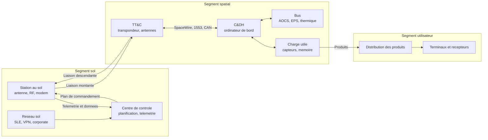

# Sécurité spatiale

Un satellite est un système informatique que l'on ne peut ni redémarrer à volonté, ni patcher après le lancement. Ses logiciels sont figés pour quinze à vingt ans, et son segment sol est relié à Internet. Une commande forgée n'y produit pas une exception logicielle, mais une manœuvre orbitale, un mode sûr ou la perte d'une charge utile.

La sécurité spatiale couvre une chaîne de confiance qui va du plan de commandement validé jusqu'à l'actionneur, en passant par le centre de contrôle, la station, le modem, le transpondeur et les bus embarqués. Cette note décrit cette chaîne, ses menaces et ses contrôles, et complète [[Sécurité Réseau]], [[Cryptographie]] et [[Gestion des clés et HSM]].

> [!abstract] Définition — Segment de mission
> Le **segment spatial** comprend la plateforme (bus, alimentation, contrôle d'attitude, thermique, calculateur de bord) et la charge utile. Le **segment sol** comprend les stations (antenne, chaîne RF, modem), le centre de contrôle, la planification, la mécanique spatiale, le réseau et les archives. Le **segment utilisateur** comprend les terminaux, récepteurs et plateformes qui consomment le service. Les liaisons entre segments forment une surface à part.

## Architecture : trois segments, une chaîne de commande

Le segment spatial s'organise autour du calculateur de commande et de traitement des données (C&DH), qui exécute les télécommandes, acquiert la télémétrie et pilote l'attitude (AOCS), l'alimentation (EPS), la thermique et la charge utile. La logique de détection et de rétablissement des fautes (FDIR) peut déclencher un mode sûr : cette autonomie est vitale, mais elle est une cible, car manipuler la FDIR revient à manipuler les réflexes du satellite.



Un opérateur construit un **plan de commandement** : des télécommandes horodatées, avec paramètres et contrôles de cohérence. Le plan est validé, transformé en trames, authentifié ou chiffré, puis émis lors d'un passage. Le satellite exécute, acquitte et renvoie une télémétrie. La sécurité tient à deux propriétés : **seul le plan autorisé produit des effets**, et **la télémétrie observée correspond à l'état réel**.

Le segment sol concentre le pouvoir : un centre commande parfois une constellation entière, avec des comptes à privilèges et des accès fournisseurs. Un attaquant n'a pas besoin d'une station radio s'il obtient un accès au réseau du centre ; les référentiels récents insistent donc davantage sur le sol que sur la liaison.

## Protocoles et bus embarqués

### CCSDS et TT&C

Le Consultative Committee for Space Data Systems définit la pile qui rend les missions interopérables. Elle superpose les paquets Space Packet (CCSDS 133.0-B) et le transfert de fichiers CFDP (727.0-B), les trames TC, TM et AOS (232.0-B, 132.0-B, 732.0-B), la sécurité SDLS (355.0-B-2) et le codage (131.0-B). Le paquet porte un en-tête de six octets : version, type, identifiant d'application (APID) sur onze bits, compteur de séquence sur quatorze bits et longueur. L'APID identifie le flux ; le compteur révèle une perte ou une réinjection.

Le protocole TC (CCSDS 232.0-B) découpe les paquets en trames avec identifiant de vaisseau (SCID), canal virtuel (VCID), numéro de séquence, jusqu'à 1016 octets de données et un CRC de seize bits (FECF). Ce CRC détecte les erreurs de transmission ; il ne prouve pas l'origine. Sans sécurité de liaison, quiconque connaît la fréquence, la modulation, le codage et le format peut fabriquer une trame acceptable, que SDLS protège ensuite par un en-tête et un MAC.

Le **TT&C** (telemetry, tracking and command) réunit trois fonctions : la télémesure descend l'état, la télécommande monte les ordres, le tracking mesure distance et vitesse radiale par temps de propagation, code de ranging et effet Doppler. Les bandes vont de l'UHF au Ka et à l'optique pour les intersatellites.

La liaison montante est la plus exposée : l'antenne peut être omnidirectionnelle en mode sûr, la puissance reçue est faible, et la marge de liaison est exactement ce qu'un brouilleur doit franchir. Un émetteur logiciel et une antenne directive suffisent parfois, en orbite basse, à dépasser le signal légitime pendant un passage.

Les récepteurs **GNSS** servent à l'orbite précise et à la synchronisation. Leurs signaux, reçus autour de -130 dBm, sont faciles à brouiller ou à leurrer, par meaconing ou par synthèse ; un leurrage corrompt la position et l'heure, donc les passages et les horodatages. Galileo propose depuis le 24 juillet 2025 un service opérationnel d'authentification des messages en accès libre, **OSNMA**. La vraie parade reste l'**A-PNT** : couplage inertiel, horloge embarquée, étoiles, optique.

### SDLS et bus embarqués

**SDLS** (CCSDS 355.0-B-2, juillet 2022) insère une couche de sécurité entre l'en-tête de trame et les données. Il définit des associations de sécurité (SA), identifiées par un index de paramètre de sécurité (SPI), et trois modes : authentification seule, chiffrement seul, ou les deux. Les procédures étendues (356.0-B-1) couvrent la gestion des clés ; le document 352.0-B-2 fixe les algorithmes recommandés, typiquement AES et HMAC-SHA-256.

> [!abstract] Définition — SDLS
> **Space Data Link Security** authentifie et/ou chiffre les trames TC, TM et AOS au moyen d'associations de sécurité et de clés symétriques pré-partagées. Elle protège la liaison sol-satellite, pas les réseaux internes du satellite, ni le centre de contrôle, ni le segment utilisateur.

SDLS ne protège ni le bus SpaceWire, ni le centre qui détient les clés, ni un plan malveillant d'opérateur autorisé ; il ne bloque le rejeu que si la fenêtre anti-rejeu est correcte.

À l'intérieur, les bus privilégient la masse et les radiations. **SpaceWire** (2 à 400 Mbit/s) offre routeurs, codes de temps et RMAP — lecture et écriture mémoire sans authentification. **MIL-STD-1553** (1 Mbit/s, contrôleur et terminaux, redondant) n'a pas de cryptographie native. **CAN** n'a aucune identité d'émetteur. La sécurité s'arrête où la liaison chiffrée se termine : qui atteint le sol détient déjà l'autorité de commande.

## Menaces

Le rapport CCSDS 350.1-G-3 (février 2022) fournit la taxonomie de référence. Il distingue les **sources** — renseignement, criminels, insiders, hackers, mais aussi débris, pannes et environnement — et les **événements** : accès non autorisé, rejeu, interception, modification, brouillage, leurrage, analyse de trafic, menaces logicielles et physiques.

| Menace | Mécanisme | Effet | Prérequis |
|---|---|---|---|
| Injection de commandes | Uplink non autorisé ou MOC compromis | Manœuvre, mode sûr, arrêt de charge utile | Accès RF et crypto, ou MOC |
| Rejeu | Réémission d'une trame valide | Commande rejouée | Absence d'anti-rejeu |
| Usurpation de télémétrie | Descente plus forte, meaconing | L'opérateur voit un état faux | Format et horaire |
| Compromission de station | VPN, MCS, poste, fournisseur | Contrôle de la mission ou de la flotte | Accès réseau |
| Chaîne d'approvisionnement | Firmware, logiciel sol, équipement de test | Implant, clé de test en vol | Accès fournisseur |
| Brouillage RF | Bruit large ou étroit | Perte de liaison, mode sûr | Émetteur, antenne |
| Leurrage RF | Faux signal cohérent | Verrouillage sur une fausse source | SDR, connaissance du signal |
| Attaque physique | Intégration, station, transport | Implant, vol, altération | Accès site |
| Logiciel embarqué | Application malveillante, FDIR détournée | Perte de contrôle | Téléchargement ou supply chain |
| GNSS | Brouillage ou leurrage | Orbite, temps, pointage faux | SDR et visibilité |

Le cas **Viasat/KA-SAT** de février 2022 illustre la primauté du sol : l'attaque a détruit les modems de milliers d'abonnés et provoqué l'arrêt de milliers d'éoliennes en Allemagne, sans que le segment spatial soit le point d'entrée. Le wiper **AcidRain**, attribué à des acteurs étatiques russes, a montré qu'une opération sur un réseau sol produit un effet physique à distance.

La menace la plus dangereuse n'est pas l'injection brute, mais l'injection **discrète**, accompagnée d'une télémétrie cohérente et d'une absence d'alarme. Un opérateur qui croit à une panne envoie les commandes de récupération prévues. C'est pourquoi l'authentification de la télémétrie compte autant que celle des commandes : elle protège la perception de l'opérateur.

## Normes et cadres

| Référentiel | Nature | Apport | Limite |
|---|---|---|---|
| CCSDS 350.1-G-3 | Livre vert informatif, février 2022 | Taxonomie et méthode d'analyse | Non certifiable |
| CCSDS 352.0-B-2 | Livre bleu | Algorithmes recommandés | Ne définit pas la politique |
| CCSDS 355.0-B-2 et 356.0-B-1 | Livres bleus | SDLS et procédures étendues | Liaison seulement |
| NIST IR 8270 | Rapport, version finale 2023 | Risque spatial, segments et CSF | Générique |
| NIST IR 8401 | Rapport, décembre 2022 | Profil CSF du segment sol et du C2 | Sol uniquement |
| ISO/IEC 27001 | Norme certifiable | Système de management | Pas spécifique au spatial |
| Space ISAC | Partage sectoriel, fondé en 2019 | Renseignement, Watch Center depuis 2023 | Volontaire |
| NIS2 | Directive européenne | Spatial essentiel, notification 24 h, 72 h, 1 mois | Transposition nationale |

Le paysage normatif a une caractéristique structurante : **les documents CCSDS sont des spécifications d'interopérabilité, pas des obligations de conformité**. Un livre vert recommande, un livre bleu définit un protocole ; être « CCSDS compatible » ne signifie pas être sécurisé. NIST IR 8270 applique le CSF au spatial et insiste sur le cycle de vie ; NIST IR 8401 descend au segment sol et au commandement. NIS2, lui, crée une obligation : le spatial est un secteur essentiel, et les opérateurs d'infrastructures au sol qui soutiennent des services spatiaux doivent notifier les incidents significatifs.

Les exigences nationales s'ajoutent souvent sans être publiques : classification, contrôle des personnels, audits, homologation des centres, règles d'emploi de la cryptographie. Les opérateurs combinent CCSDS, ISO ou NIST et obligations réglementaires, et la difficulté est de prouver leur cohérence.

## Défenses

La défense s'organise par segment : **le sol d'abord**, puis la liaison, puis l'embarqué. Chiffrer la liaison en laissant un centre plat, avec un compte partagé et un VPN fournisseur, protège un tuyau déjà compromis.

| Contrôle | Segment | Effet | Limite |
|---|---|---|---|
| SDLS authentifié et chiffré | Liaison | Intégrité, confidentialité, origine | Clés, liaison seulement |
| Anti-rejeu, compteurs, fenêtre | Liaison et bord | Bloque la réémission | Synchronisation |
| Rapprochement au plan | Sol | Bloque toute commande hors plan | Plan compromis |
| Double validation des commandes critiques | Sol | Réduit l'initié et l'erreur | Collusion |
| Segmentation et zero trust du MOC | Sol | Limite le mouvement latéral | Legacy, fournisseurs |
| MFA, PAM, moindre privilège | Sol | Vol de credentials difficile | Comptes de service |
| Secure boot, firmware signé | Spatial | Empêche l'implant persistant | Clé racine, pas de patch |
| Filtrage SpaceWire et 1553 | Spatial | Limite le pivot interne | Pas d'authentification native |

### Liaison et gestion des clés

SDLS doit être déployé en mode authentifié pour la télécommande, et de préférence en mode combiné : l'authentification seule laisse lire les commandes, le chiffrement seul laisse les modifier. L'anti-rejeu repose sur un numéro de séquence et une fenêtre ; une commande ancienne doit être rejetée même si son MAC est correct, et les compteurs doivent être persistants.

La gestion des clés est le maillon faible. Une mission utilise une clé racine hors ligne dans un HSM au sol, une clé de chiffrement de clés (KEK) par liaison, et des clés de session pour les associations SDLS. Le chargement initial se fait avant le lancement, avec partage M-of-N et double contrôle. La rotation en orbite passe par une procédure authentifiée : on n'envoie pas une nouvelle clé sur un canal dont on doute.

Les contraintes embarquées pèsent : processeurs durcis, mémoire limitée, pas de KMS joignable, fenêtres de contact courtes. Les clés vivent donc longtemps, ce qui aggrave l'impact d'une compromission et rend la **crypto-agilité** indispensable.

Le réseau de mission doit être séparé du corporate, avec un chemin contrôlé et journalisé ; les transferts vers les archives passent par un diode ou un proxy. Les accès fournisseurs sont nommés, limités dans le temps, avec MFA et enregistrement de session. Les comptes de service de planification sont sensibles : ils possèdent l'autorité de commande sans interaction humaine.

À bord, le **secure boot** vérifie la ROM, le bootloader, le noyau et les applications, avec un compteur anti-rollback, et les ports de débogage sont verrouillés avant le lancement. Le routage SpaceWire est filtré par nœud et par transaction, les passerelles CAN appliquent une liste blanche d'identifiants. Aucune de ces mesures n'authentifie un émetteur, mais elles réduisent la surface d'un pivot interne.

La chaîne d'approvisionnement est profonde : FPGA, ASIC, mémoires, horloges, capteurs, logiciels de vol, outils de test, stations, modems. Les défenses sont celles de [[Supply Chain Attacks]], adaptées à un contexte où l'on ne peut pas patcher : provenance des composants, audit des fonderies, bitstreams vérifiés, signature des livrables, SBOM, contrôle de l'intégration, et surtout **interdiction des clés de test en vol**.

## Détection

La détection combine quatre sources : télémétrie du satellite, journaux du segment sol, surveillance radiofréquence et renseignement sur les menaces. Aucune ne suffit seule : la télémétrie peut être falsifiée, les journaux effacés, la surveillance RF ne voit que ce qui passe à portée, et le renseignement arrive après coup.

| Signal | Source | Interprétation |
|---|---|---|
| Commande absente du plan | Journal du MOC, planification | Injection, erreur, plan modifié |
| Échec de MAC ou SPI inconnu | Compteurs SDLS, bord | Mauvaise clé, attaque |
| Saut ou doublon de compteur TC | Récepteur, télémétrie | Rejeu, perte, injection |
| Mode sûr ou FDIR inattendu | Télémétrie d'événements | Panne, brouillage, commande malveillante |
| Manœuvre non planifiée | AOCS, dynamique du vol | Injection, dérive |
| Incohérence de position | GNSS, inertiel, éphémérides | Leurrage, brouillage |
| APID inconnu ou débit anormal | TM, station | Charge utile compromise, exfiltration |
| Résidu de ranging ou Doppler | Station, dynamique | Leurrage, usurpation |
| Porteuse montante inattendue | Spectre RF | Brouillage, uplink pirate |

Le contrôle le plus spécifique est le **rapprochement au plan de commandement** : chaque commande émise ou reçue est comparée à la séquence approuvée — instant, identifiant, paramètres, empreinte. Une commande hors plan est une anomalie, même authentifiée. Ce contrôle déplace la détection du bit vers l'intention.

```python
"""Rapprochement simplifie entre plan approuve et commandes emises."""
plan = {
    ("2026-10-20T08:12:00Z", 0x1A2, "AOCS_SET_MODE", "NOMINAL"),
    ("2026-10-20T08:14:30Z", 0x1A2, "PAYLOAD_ON", "BAND_X"),
}

def verifier(commande):
    cle = (commande.temps, commande.apid, commande.code, commande.argument)
    if cle not in plan:
        alerter("commande hors plan", commande)
    if commande.temps < derniere_commande:
        alerter("horodatage non monotone", commande)
    if commande.compteur in compteurs_vus:
        alerter("rejeu probable", commande)
    compteurs_vus.add(commande.compteur)
```

La surveillance RF complète ce dispositif : puissance de porteuse, rapport porteuse/bruit, fréquence, modulation et direction d'arrivée. Une porteuse inattendue dans la bande montante, un résidu de ranging anormal ou un Doppler incohérent avec l'éphéméride signalent un émetteur non autorisé.

Les journaux du sol sont centralisés dans un SIEM et corrélés aux événements de mission. Les règles [[Sigma]] couvrent les connexions interactives d'un compte de service, les créations de comptes et les modifications de planification. [[Detection Engineering]] fournit la méthode, [[Threat Intelligence]] alimente les indicateurs, [[Threat Hunting]] teste les hypothèses.

Une technique simple est la **commande canari** : une commande qui ne doit jamais être émise en exploitation, surveillée en permanence. Toute occurrence est un incident, pas une anomalie statistique.

### Limites

La détection bute sur la **ligne de base** : les missions sont peu nombreuses, les événements rares, et le comportement normal varie avec l'orbite, la saison et la charge utile. Les modèles d'apprentissage produisent beaucoup de faux positifs sur des séries courtes, et un faux positif peut déclencher une commande de récupération coûteuse.

Le chiffrement de la télémétrie réduit la visibilité du sol : il faut déchiffrer au centre, ce qui recrée un point de confiance ; le chiffrement de la charge utile complique la détection d'exfiltration. À l'inverse, une télémétrie en clair facilite la surveillance mais expose les données.

Les attaques par initié restent largement invisibles : un opérateur qui a le droit de signer un plan peut produire un plan malveillant parfaitement authentifié, et la double validation réduit le risque sans l'éliminer. La réponse est aussi contrainte par la physique : une commande précipitée peut transformer un incident en perte définitive.

## Réponse et continuité

La réponse suit une séquence adaptée : qualifier, contenir, préserver, rétablir, notifier, apprendre. Le confinement peut être un isolement du réseau de mission, une révocation de session, un changement de clé ou, en dernier recours, l'arrêt de l'uplink. Les preuves — journaux du MOC, pcaps, enregistrements IQ, trames TM/TC, versions de plans, images de firmware — alimentent [[DFIR]] et [[Network Forensics]]. La continuité repose sur une station de secours, un centre alternatif et des plans hors site testés chaque année. La notification suit les canaux réglementaires : CSIRT et autorité NIS2, Space ISAC, CERT du fournisseur.

> [!quiz] Le chiffrement SDLS de la liaison montante suffit-il à empêcher l'injection de commandes ?
> Non. Il empêche un tiers de forger une trame sans la clé, mais il ne protège ni contre le rejeu si l'anti-rejeu est absent, ni contre un centre de contrôle compromis qui détient les clés, ni contre un initié qui construit un plan autorisé. La protection complète exige SDLS, une fenêtre anti-rejeu, une gestion de clés solide, un rapprochement au plan et une sécurité du segment sol.
