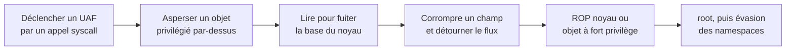
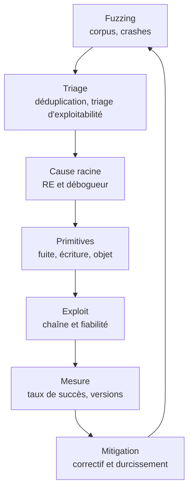

# Développement d'exploit

[[Binary Exploitation]] présente les mécanismes d'attaque : débordement de pile, chaînes ROP, format strings, corruption de tas. Le développement d'exploit commence là où cette note s'arrête : contrôler une adresse de retour n'est qu'une observation en débogueur, il faut ensuite construire une chaîne fiable, qui tienne compte des mitigations, de l'allocateur, de la version exacte de la cible et du nombre de tentatives disponibles.

Un exploit n'est pas un payload, c'est un **programme** : il découvre l'état de la cible, en déduit les adresses, construit une chaîne d'actions et la rejoue. Il a une fiabilité mesurable, des dépendances de version, des modes d'échec, et parfois besoin d'être rejoué des milliers de fois avant de réussir. Cette note couvre les mitigations modernes, les primitives qui les contournent, le tas, le noyau et le navigateur, puis le flux de travail qui va du crash au correctif.

> [!abstract] Définition — Primitive d'exploitation
> Capacité élémentaire obtenue en corrompant un programme : lire une adresse arbitraire, écrire une valeur à une adresse choisie, provoquer une confusion de type, gagner une course. Un exploit est une chaîne de primitives faibles transformées en exécution de code ou en élévation de privilèges.

## Des bases aux primitives

Le contrôle de l'instruction pointer est un point de départ, pas un exploit. Ce qui se vend, ce qui se corrige et ce qui se mesure, ce sont les primitives intermédiaires :

| Primitive | Description | Source typique |
|---|---|---|
| Contrôle de flux | Rediriger RIP ou un appel indirect | Débordement de pile, corruption de pointeur de fonction |
| Lecture arbitraire | Lire une adresse choisie | Format string `%s`, lecture hors bornes |
| Écriture arbitraire | Écrire une valeur à une adresse choisie | Format string `%n`, use-after-free |
| Corruption de métadonnées | Modifier un pointeur dans le tas | Débordement de chunk, tcache poisoning |
| Type confusion | Faire interpréter un objet comme un autre type | JIT, désérialisation, C++ |
| Course critique | Gagner une fenêtre temporelle | TOCTOU, double fetch |

Un exploit moderne enchaîne presque toujours trois phases : **fuite** (casser l'asymétrie d'information), **écriture** (obtenir une cible déterministe), **exécution** (détourner le flux ou corrompre un objet privilégié). C'est rarement l'exécution qui bloque : ce sont les deux premières, et la troisième ne fait que révéler leur échec.

## Mitigations modernes et leur coût

| Mitigation | Mécanisme | Contournement usuel | Coût |
|---|---|---|---|
| ASLR | Randomisation des bases (pile, tas, bibliothèques, binaire) | Fuite d'adresse, écrasement partiel, force brute sur processus `fork` | Élevé |
| DEP / NX | Zones de données non exécutables | Chaînes ROP, JOP, appels vers des fonctions existantes | Moyen |
| PIE | Le binaire lui-même est relogé | Fuite ou écrasement partiel des 12 bits bas | Faible si fuite |
| Canari de pile | Valeur sentinelle avant l'adresse de retour | Fuite par format string ou lecture hors bornes | Faible si fuite |
| RELRO partiel | `.got` inscriptible, `.init_array` protégé | Cible d'écriture alternative | Faible |
| Full RELRO | `.got` en lecture seule | Cibles hors GOT, hooks d'allocation, structures de flux | Moyen |
| `FORTIFY_SOURCE` | Contrôles sur `memcpy`, `strcpy`, etc. | Seules les fonctions instrumentées sont protégées | Faible |
| CFG (Windows) | Vérifie les cibles d'appels indirects | Appel vers une fonction valide, corruption du bitmap | Moyen |
| CET / shadow stack | Double pile pour les adresses de retour, IBT pour les sauts | JOP/COP, cibles munies de `endbr64`, désactivation par bug antérieur | Élevé |
| PAC (ARM64) | Signature des pointeurs sensibles | Fuite de signature, oracle, réutilisation de gadget signé | Élevé |
| seccomp, sandbox | Filtrage des appels système | Chaîne multi-étages, bug dans le broker | Élevé |
| KASLR, SMEP, SMAP, KPTI | Randomisation et isolation noyau | Fuite noyau, ROP noyau, trampoline KPTI | Élevé |
| MTE, `init_on_alloc` | Détection ou effacement des UAF | Corruption logique, pas de fuite de pointeur | Variable |

Quelques commandes pour établir l'état d'une cible avant d'écrire quoi que ce soit :

```bash
# Protections du binaire et de la libc
checksec --file=./cible
readelf -lW ./cible | grep -E 'GNU_STACK|GNU_RELRO'

# Paramètres système (laboratoire uniquement)
cat /proc/sys/kernel/randomize_va_space
cat /proc/sys/vm/unprivileged_userfaultfd
cat /proc/sys/kernel/yama/ptrace_scope
```

```gdb
# Entropie d'ASLR observée côté processus
start
vmmap
```

> [!important] Idée clé
> Les mitigations ne sont pas des murs indépendants, elles forment une chaîne de coûts. Une seule fuite d'adresse fait tomber ASLR, PIE et le canari en même temps ; l'écriture arbitraire qui suit neutralise NX en construisant une chaîne ROP. C'est pourquoi la question « ce binaire est-il protégé ? » a peu de sens : la bonne question est « quelle est la première primitive accessible, et que libère-t-elle ? ».

## Fuites et contournement d'ASLR

Toute la difficulté consiste à obtenir une adresse réelle sans exécution de code.

- **Format string.** `%N$p` lit le N-ième argument, `%N$s` lit à l'adresse contenue dans cet argument. En 64 bits, les premiers arguments sont dans les registres, il faut donc souvent les recopier sur la pile avant de les atteindre. En aveugle, on balaie les arguments jusqu'à reconnaître une adresse de la bibliothèque. L'écriture suit la même mécanique : `%n` écrit le nombre de caractères déjà émis à l'adresse pointée par l'argument, et `pwntools` répartit la valeur en plusieurs écritures de 2 octets pour rester dans des volumes raisonnables.
- **Écrasement partiel.** L'ASLR ne randomise pas les bits bas. Écraser un ou deux octets d'un pointeur suffit pour revenir dans la même page et atteindre une fonction voisine, sans connaître la base.
- **Force brute sur `fork`.** Un serveur qui appelle `fork` par requête conserve la même base pour tous ses enfants : une chance sur quelques centaines suffit, à condition de pouvoir retenter.

```python
from pwn import *

p = process(['./cible', 'AAAAAAAA'])
p.recvuntil(b'AAAA')

# Balayage des arguments pour trouver une adresse de pile exploitable
for i in range(1, 40):
    p.sendline(f'%{i}$p'.encode())
    valeur = p.recvline().strip()
    log.info(f'arg {i}: {valeur.decode(errors="replace")}')
```

## Chaînes de code : ROP, JOP et au-delà

| Technique | Principe | Contrainte principale |
|---|---|---|
| ret2libc | Appeler une fonction existante avec les arguments voulus | Connaître la base de la libc |
| ROP | Enchaîner des gadgets terminés par `ret` | Pile contrôlable, gadgets disponibles, alignement |
| ret2csu | Utiliser les gadgets de `__libc_csu_init` pour peupler `rdx`, `rsi`, `edi` | Absent des glibc récentes |
| ret2dlresolve | Faire résoudre `system` par le lieur, sans fuite | Structures `Elf64_Rela` falsifiées, RELRO partiel |
| SROP | Faire un `rt_sigreturn` pour restaurer tout le contexte | Gadget `syscall`, trame signée sur la pile |
| JOP / COP | Enchaîner des sauts et des appels, sans `ret` | Contourne la shadow stack, gadgets plus rares |
| one_gadget | Sauter dans un point de la libc qui lance `/bin/sh` | Contraintes de registres, souvent l'alignement |

Deux contraintes concrètes piègent régulièrement la construction d'une chaîne :

- **Alignement.** Sur x86-64, certaines instructions `movaps` exigent une pile alignée sur 16 octets ; un gadget `ret` inséré dans la chaîne corrige l'alignement.
- **CET et IBT.** Quand la shadow stack est appliquée, la chaîne ROP classique échoue au premier `ret`. Il faut alors viser des cibles munies de `endbr64`, passer par des mécanismes autorisés (gestionnaires de signaux, callbacks), ou trouver un bug antérieur qui désactive la protection.

Le **SROP** mérite un détour : un unique gadget `syscall` suivi d'un `rax` valant 15 déclenche `rt_sigreturn`, qui restaure un contexte complet depuis la pile. Une trame `SigreturnFrame` bien construite donne d'un coup `rax`, `rdi`, `rsi`, `rdx` et `rip`, ce qui évite de chercher un gadget par registre. La contrainte est la place disponible pour la trame et la présence du gadget.

```bash
# Recherche de gadgets
ROPgadget --binary ./cible --only "pop|ret" | grep -E "pop rdi"
ROPgadget --binary ./cible --rop --depth 8
ropper -f ./cible --search "syscall"
one_gadget /lib/x86_64-linux-gnu/libc.so.6
```

## Le tas : allocateur, versions, primitives

Le tas est le terrain le plus mouvant : les techniques dépendent de la version de glibc et disparaissent d'une mise à jour à l'autre.

| Version | Évolution | Conséquence offensive |
|---|---|---|
| 2.26 | `tcache` introduit | Cache par taille, plus rapide et plus attaquable |
| 2.29 | Contrôles sur le top chunk et les chunks `unsorted` | Fin de la House of Force, durcissement d'Einherjar |
| 2.32 | Safe-linking | Pointeurs `fd` chiffrés par `(adresse du chunk >> 12) XOR pointeur` |
| 2.34 | Retrait de `__malloc_hook` et `__free_hook` | Les cibles d'écriture migrent vers les structures `FILE` |
| 2.35 et après | Durcissement de l'allocateur et des structures `FILE` | House of Apple, exit handlers, cross-cache |

Techniques structurantes : empoisonnement de `tcache` (insérer une fausse adresse dans la liste des chunks libres, corrigée du safe-linking), `unsorted bin` pour obtenir une fuite de pointeur libc, `large bin attack` pour écrire un pointeur, corruption de structure `FILE` pour détourner la vtable, la table des destructeurs ou les gestionnaires de sortie, et attaques **cross-cache** qui manipulent des pages entières plutôt que des chunks.

Le **heap grooming** précède l'exploit : on façonne l'état de l'allocateur pour qu'un chunk contrôlé se retrouve à la place exacte d'un objet sensible. Cela implique de choisir les tailles de requête pour tomber dans la bonne classe, de remplir les caches, de défragmenter, et de libérer dans le bon ordre. Sous Windows, le raisonnement est identique mais l'allocateur diffère : LFH pour les petites tailles, segment heap depuis Windows 10, et corruption de *pool headers* pour les allocations noyau.

## Noyau et navigateur

**Noyau.** La surface d'attaque couvre les appels système, `io_uring`, le filtrage réseau (`nftables`), les systèmes de fichiers et les pilotes. Les mitigations (KASLR, SMEP, SMAP, KPTI, pile protégée, `init_on_alloc`) rendent l'exécution directe en espace noyau impossible : il faut une fuite, puis un ROP noyau ou un détournement d'objet privilégié. Les primitives classiques sont `msg_msg` et `pipe_buffer` pour l'aspersion (`spray`), `modprobe_path` et `core_pattern` comme cibles d'écriture, les structures `cred` pour l'élévation, et `userfaultfd` ou `io_uring` pour l'orchestration temporelle. L'exploit type suit une séquence :



**Navigateur.** La chaîne est multi-étages par construction : compromettre le moteur de rendu (type confusion dans la JIT, corruption dans le tas `PartitionAlloc`, `addrof`/`fakeobj` pour transformer une primitive en accès mémoire), puis franchir le bac à sable en trouvant un second bug dans le processus privilégié et son IPC, puis élever les privilèges sur l'hôte. La compression de pointeurs, les pages `W^X` et le durcissement de la JIT ont fait disparaître les chaînes courtes : un exploit moderne mobilise souvent trois vulnérabilités distinctes.

## Du crash à l'exploit



1. **Fuzzing.** [[fuzzing]] fournit des crashes reproductibles et des rapports de sanitizers. Le rapport indique le type de bug (`heap-buffer-overflow`, `use-after-free`) mais pas son exploitabilité.
2. **Triage.** Dédupliquer, minimiser l'entrée, vérifier la reproductibilité et identifier la version affectée. Un crash est classé selon la primitive accessible : lecture, écriture, contrôle de flux, ou simple déni de service.
3. **Cause racine.** [[Reverse Engineering]] sert à remonter du site de crash à la fonction fautive, comprendre la structure de données corrompue et déterminer ce que l'attaquant contrôle réellement.

```bash
# Triage rapide d'un crash
gdb -q -batch \
  -ex "run < crash.bin" \
  -ex "bt" \
  -ex "info registers rip rsp rdi rsi" \
  -ex "x/12i $rip" \
  ./cible

# Réduire l'entrée au minimum nécessaire
afl-tmin -i crash.bin -o crash_min.bin -- ./cible @@
```

4. **Construction de l'exploit.** Fixer les offsets par version, obtenir la fuite, puis l'écriture, puis l'exécution. Chaque étape doit être testée isolément, car un exploit qui échoue à la troisième étape ne permet pas de savoir si la première fonctionne.
5. **Fiabilité.** Mesurer un taux de succès sur des centaines d'exécutions, avec ASLR actif, sous la version exacte de la cible. Les sources d'échec sont l'état du tas, les threads, les temporisations, l'alignement et les différences de bibliothèque.
6. **Mitigation.** Le rapport final indique le correctif, mais aussi le durcissement possible : options de compilation, version d'allocateur, réduction de surface, journalisation ciblée.

## Détection et limites

La détection de l'exploitation, à distinguer de son développement :

| Signal | Source | Lecture |
|---|---|---|
| Arrêt par canari ou CFG | `__stack_chk_fail`, fast-fail Windows | Corruption active, tentative ou bug applicatif |
| Crash répété sur la même entrée | Télémétrie de crash, `coredumpctl`, WER | Fuzzing ou exploitation automatisée |
| Régions mémoire anormales | EDR, scan mémoire | Chaîne ROP, shellcode, objets détournés |
| Requêtes malformées volumétriques | WAF, IDS, journaux applicatifs | Fuzzing distant, force brute d'ASLR |
| Cadence régulière vers un service | Flux réseau | Retentatives d'exploitation |

Les limites tiennent au décalage entre un laboratoire et une cible réelle :

- **La fiabilité se paie en bruit.** Un exploit fiable pour un laboratoire peut échouer sur un serveur chargé, avec des threads concurrents et un tas déjà fragmenté.
- **La version fait la technique.** Chaque version déplace les offsets, les gadgets et le comportement de l'allocateur ; un exploit non testé sur la version cible n'existe pas.
- **La plupart des crashes ne sont pas exploitables.** Le triage d'exploitabilité produit des faux négatifs : un bug classé déni de service peut devenir exploitable avec une variante d'entrée ou une autre version.
- **Les mitigations augmentent le coût, pas l'impossibilité.** Elles déplacent l'effort vers la fuite, la logique applicative ou les chaînes multi-étages.
- **La détection arrive après coup.** Un exploit qui aboutit sans crash ne produit souvent aucun signal exploitable en temps réel ; l'analyse est forensique, pas préventive.

## Éthique et cadre

Le développement d'exploit est une compétence **dual-use** : le même travail sert à corriger une vulnérabilité et à l'armer. Le cadre qui le rend légitime tient en quelques règles :

- **Autorisation explicite.** Tester sans mandat écrit reste une atteinte à un système de traitement automatisé de données, indépendamment de l'intention.
- **Divulgation coordonnée.** Signaler au fournisseur, laisser un délai raisonnable avant publication, et éviter de livrer une preuve d'exploitation complète avant correctif. Voir [[Gestion des Vulnérabilités]] pour l'articulation avec le cycle de remédiation.
- **Périmètre de recherche.** Les programmes de bug bounty délimitent les cibles et les méthodes ; en sortir transforme une recherche légitime en intrusion.
- **Manipulation des armes.** Un PoC fonctionnel se conserve chiffré, circule par canal maîtrisé et ne se diffuse pas sans raison opérationnelle.
- **Traçabilité.** Documenter la découverte, la date, l'auteur et le destinataire : la même pratique qui protège la recherche sert de preuve en cas de litige.
- **Cadre sectoriel.** En environnement régulé, la recherche offensive relève de [[Compliance]] et de politiques internes, pas d'une initiative individuelle.

> [!warning] Piège
> Une preuve d'exploitation publiée trop tôt change la nature d'une vulnérabilité : ce qui relevait du correctif devient une arme disponible pour quiconque n'a pas la patience de la développer. Le même binaire, publié une semaine plus tôt, produit deux conséquences opposées : le calendrier de divulgation est un choix technique, pas une formalité.

> [!quiz] Pourquoi une fuite d'adresse est-elle souvent plus utile que le contrôle de RIP ?
> Parce qu'elle casse simultanément plusieurs protections : connaître une adresse réelle annule ASLR et PIE, permet de calculer la base de la libc, donc de localiser les gadgets et les fonctions à appeler. Le contrôle de RIP sans information de version ni d'adresse est rarement exploitable seul.

> [!quiz] Qu'apporte le safe-linking introduit dans glibc 2.32 ?
> Il chiffre les pointeurs de chaînage des chunks libres en combinant la valeur du pointeur avec l'adresse du chunk décalée de 12 bits, ce qui rend l'empoisonnement de `tcache` dépendant d'une adresse inconnue de l'attaquant, sauf s'il possède déjà une fuite du tas.

> [!quiz] Pourquoi un exploit navigateur mobilise-t-il souvent plusieurs vulnérabilités ?
> Parce que le bac à sable sépare les privilèges : compromettre le processus de rendu ne suffit pas à atteindre le système. Il faut un premier bug pour obtenir l'exécution dans le rendu, un second pour franchir l'IPC vers le processus privilégié, et parfois un troisième pour élever les privilèges sur l'hôte.

> [!quiz] Que signifie un taux de succès de 40 % pour un exploit ?
> Que l'exploit dépend d'un état non contrôlé — typiquement la disposition du tas ou l'ASLR — et échoue dans la majorité des cas. Un exploit à haut risque (service unique, pas de nouvelle tentative) doit viser un taux proche de 100 %, ce qui impose un grooming déterministe ou un contournement complet de la randomisation.
