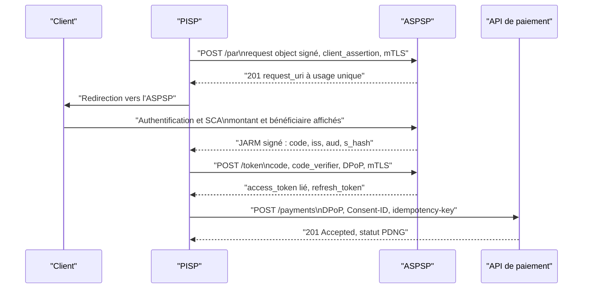
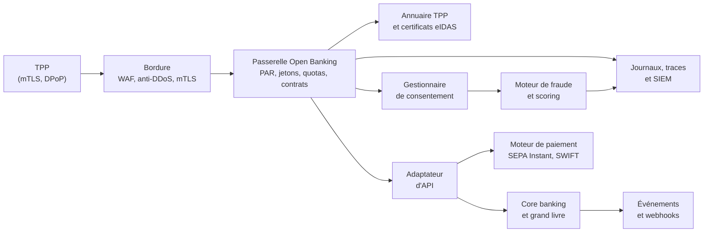

# Sécurité des API bancaires

Une API bancaire ne se contente pas d'exposer des données : elle délègue à un tiers agréé le pouvoir de lire un patrimoine ou de déclencher un virement. Ce pouvoir est encadré par la loi, rattaché à un consentement et à un certificat, et contestable devant une autorité. La sécurité consiste donc autant à prouver qu'une opération était autorisée qu'à empêcher qu'elle ne le soit pas.

Les fondamentaux — BOLA, rate limiting, fuzzing, gestion des erreurs — sont traités dans [[API Security]]. Cette note se concentre sur les spécificités bancaires : open banking, PSD2, profils FAPI, consentement, authentification forte, architecture face au core banking, fraude au virement autorisé et résilience réglementée.

> [!abstract] Définition — ASPSP
> Account Servicing Payment Service Provider : établissement de crédit ou de paiement qui tient le compte du client et expose, en application de PSD2, des interfaces dédiées aux prestataires tiers. Il est à la fois fournisseur d'identité, dépositaire du consentement et débiteur d'un niveau de disponibilité de ses interfaces.

## Le cadre : open banking et PSD2

La directive PSD2 (UE) 2015/2366 a créé un marché de l'accès aux comptes. Trois services y sont définis : information sur les comptes (AIS), initiation de paiement (PIS) et confirmation de disponibilité des fonds (CBI). Un prestataire tiers (TPP) doit être agréé par son autorité nationale et notifié aux banques. En contrepartie, l'ASPSP ne peut pas s'opposer à un accès autorisé : il doit offrir une interface dédiée, ou une interface de secours justifiée, avec une disponibilité équivalente à celle de son interface cliente.

Le règlement délégué (UE) 2018/389, dit RTS SCA et CSC, fixe les règles techniques : authentification forte, exemptions, liaison dynamique du montant et du bénéficiaire, réauthentification périodique. La révision PSD3/PSR élargit le périmètre au-delà des comptes de paiement, et le règlement (UE) 2024/886 ajoute la vérification du bénéficiaire (VoP), qui confronte le nom saisi au nom enregistré avant l'envoi.

| Standard | Zone | Authentification | Traits saillants |
|---|---|---|---|
| PSD2 et RTS | Union européenne | OAuth2/FAPI imposé par l'ASPSP | Consentement, SCA, interface dédiée |
| NextGenPSD2 (Berlin Group) | UE, large adoption | OAuth2, mTLS, certificats eIDAS | En-têtes `Consent-ID`, `TPP-Redirect-URI`, `X-Request-ID` |
| UK Open Banking | Royaume-Uni | OAuth2/FAPI, mTLS | Read/Write APIs, `x-fapi-interaction-id`, `x-idempotency-key` |
| FDX | États-Unis | OAuth2, consentement explicite | Comptes et paiements, sans obligation légale unique |
| ISO 20022 | International | Hors protocole | `pain.001`, `pacs.008`, `pacs.002`, `camt.053` |

> [!abstract] Définition — Consentement
> Autorisation explicite, limitée dans le temps et révocable, par laquelle le client permet à un TPP d'accéder à des comptes déterminés pour une finalité déterminée. En PSD2, il porte un identifiant, un périmètre de comptes, des scopes, une durée et un état opposable. Sa révocation doit produire un effet immédiat sur les jetons en cours.

## Acteurs, consentement et SCA

| Acteur | Rôle | Responsabilité de sécurité |
|---|---|---|
| ASPSP | Tient le compte, authentifie le client, expose l'interface | SCA, consentement, disponibilité, surveillance |
| TPP | Prestataire agréé, accède pour le compte du client | Protection des jetons et des clés, usage conforme |
| AISP | Information sur les comptes, lecture seule | Ne jamais initier de paiement, minimiser les données |
| PISP | Initiation de paiement, sans détention de fonds | Intégrité de la demande, idempotence, anti-fraude |
| CBPII | Confirmation de disponibilité des fonds | Réponse binaire, sans révéler solde ni historique |

Le consentement est la véritable unité d'autorisation. Un jeton valide ne prouve pas que l'opération est permise : encore faut-il que le consentement couvre le compte, le scope, la période et l'action. Les architectures sérieuses séparent donc le service qui émet les jetons de celui qui tient l'état du consentement, et vérifient les deux à chaque appel.

L'authentification forte combine au moins deux facteurs parmi connaissance, possession et inhérence. Pour un paiement à distance, elle doit lier dynamiquement le montant et le bénéficiaire : le code affiché ou signé change si l'un des deux change. Sans cette liaison, un attaquant modifie le virement entre l'affichage et l'exécution. Les exemptions — faibles montants, bénéficiaires de confiance, analyse du risque — réduisent la friction mais déplacent le risque vers la surveillance.

La réauthentification périodique, fixée à quatre-vingt-dix jours pour l'accès aux comptes, impose de renouveler la SCA. La révocation doit être transverse : supprimer le consentement dans l'application de la banque doit invalider les refresh tokens, les jetons d'accès et les abonnements. Un consentement révoqué mais encore exploitable une heure est une faille de conception.

La responsabilité suit la SCA : sans authentification requise, l'ASPSP supporte en principe la perte ; une SCA prouvée déplace la charge de la preuve. Au Royaume-Uni, les règles sur la fraude APP imposent un remboursement partagé entre banques émettrice et réceptrice, jusqu'à un plafond réglementaire.

## OAuth 2.0 et FAPI

OAuth 2.0 seul ne suffit pas. Le jeton porteur suppose que quiconque le détient peut l'utiliser ; les paramètres d'autorisation transitent par le navigateur ; et le vol de jeton est indétectable côté serveur. Le profil FAPI de l'OpenID Foundation corrige ces propriétés par la liaison, la signature et la preuve de possession.

| Mécanisme | Référence | Ce qu'il empêche | Contrôle |
|---|---|---|---|
| PAR | RFC 9126 | Paramètres exposés ou altérés dans le navigateur | `request_uri` à usage unique, courte durée |
| JARM | OpenID Foundation | Réponse falsifiée, substitution de code | Réponse signée, `iss`, `aud`, `s_hash` |
| mTLS | RFC 8705 | Rejeu d'un jeton non lié | `cnf.x5t#S256` |
| `private_key_jwt` | RFC 7523 | Secret client partagé, usurpation | Assertion signée, `jti`, `exp` courte, `aud` exacte |
| DPoP | RFC 9449 | Rejeu d'un jeton porteur | Preuve `htm`, `htu`, `jti`, `ath`, `cnf.jkt` |

FAPI 1.0 Advanced impose l'objet de requête signé (JAR), les jetons liés au certificat et une authentification forte du client. FAPI 2.0 durcit et simplifie : PAR et PKCE obligatoires, pas de flux implicite, jetons systématiquement contraints par mTLS ou DPoP, authentification au token endpoint par certificat ou assertion.



```http
POST /token HTTP/1.1
Host: aspsp.example
Content-Type: application/x-www-form-urlencoded
DPoP: eyJhbGciOiJFUzI1NiIsInR5cCI6ImRwb3Arand0In0...
TLS-Client-Cert: QWAC du TPP

grant_type=authorization_code
&code=SplxlOBeZQQYbYS6WxSbIA
&redirect_uri=https%3A%2F%2Ftpp.example%2Fcb
&code_verifier=...
&client_id=tpp-4412
&client_assertion_type=urn%3Aietf%3Aparams%3Aoauth%3Aclient-assertion-type%3Ajwt-bearer
&client_assertion=eyJhbGciOiJQUzI1NiJ9...
```

Le jeton porte `aud`, `client_id`, `scope`, `consent_id` et surtout `cnf`, qui le lie à la clé DPoP ou au certificat. Les clés privées vivent en HSM ou KMS, avec cérémonies documentées, rotation par `kid` et recouvrement, publication JWKS maîtrisée. Les algorithmes sont restreints à une liste blanche (PS256, ES256, EdDSA) : l'algorithme déclaré par le client ne détermine jamais seul la vérification. Les certificats eIDAS QWAC et QSealC sont validés contre la liste de confiance, leur chaîne, leurs rôles PSD2 et leur révocation ([[Gestion des clés et HSM]], [[PKI en profondeur]]).

## Architecture : passerelle, consentement et core banking



La passerelle termine TLS, valide le certificat, applique les quotas et vérifie les signatures. Le gestionnaire de consentement tient l'état opposable : comptes, scopes, expiration, révocation. L'adaptateur traduit le contrat REST vers le core banking, souvent ancien et lent. Le moteur de paiement gère les messages ISO 20022 et les statuts de règlement. Le moteur de fraude intervient avant l'exécution, avec un budget de latence strict.

Cette séparation crée un risque de contournement. Une passerelle qui vérifie le scope mais pas la propriété du compte laisse passer un BOLA. Un adaptateur qui fait confiance à un en-tête `X-Consent-ID` permet de désigner le consentement d'un autre. Chaque service revérifie ce dont il a besoin, et aucun identifiant interne n'est dérivé d'un paramètre client sans contrôle.

L'idempotence est vitale : un client qui réessaie après un timeout ne doit pas créer un second virement. La clé est générée par le client, liée au TPP et à l'endpoint, conservée avec l'empreinte de la requête et associée à une contrainte d'unicité dans le grand livre.

```http
POST /payments HTTP/1.1
Host: api.aspsp.example
Consent-ID: c-9f3e
X-Request-ID: 7b1c9a2e-4f3d-4a11-9c2b-1e8f0d6a5b3c
X-Idempotency-Key: 3f9a2c1e-8b7d-4c6a-9f01-2d5e7a4b8c60
DPoP: eyJhbGciOiJFUzI1NiIsInR5cCI6ImRwb3Arand0In0...
Content-Type: application/json

{
  "instructedAmount": { "currency": "EUR", "amount": "250.00" },
  "creditorAccount": { "iban": "FR7630006000011234567890189" },
  "creditorName": "Atelier Dupont"
}
```

Les quotas se pensent par dimension : TPP, certificat, consentement, compte, IP. Un plafond global ne protège ni d'un TPP qui interroge mille comptes ni d'un attaquant qui répartit ses requêtes. Les `429` portent un `Retry-After` et sont journalisées ; timeouts, disjoncteurs et files d'attente évitent qu'une lenteur du core banking devienne une panne réglementaire.

## Attaques spécifiques et contrôles

Les catégories d'[[API Security]] restent valables, mais leur impact change d'échelle. Un BOLA sur un catalogue expose des produits ; sur une API de comptes, il expose des relevés, des soldes et des bénéficiaires. La vérification porte sur la relation entre TPP, consentement et objet.

```python
def lire_compte(tpp_id, consent_id, account_id):
    consent = consentements.get(consent_id)
    if consent is None or consent.statut != "autorise":
        raise Refus("consentement absent ou non autorisé")
    if consent.tpp_id != tpp_id:
        raise Refus("consentement émis pour un autre TPP")
    if account_id not in consent.comptes:
        raise Refus("compte hors périmètre")
    if "accounts" not in consent.scopes:
        raise Refus("scope insuffisant")
    return core.lire_compte(account_id)
```

Le BFLA se manifeste par des endpoints internes accessibles : annulation d'un paiement d'un autre TPP, remboursement, création de bénéficiaire, modification de plafond. Les méthodes oubliées et routes de support sont des cibles classiques. La matrice d'autorisation est explicite par rôle, scope et état du consentement, puis testée entre deux TPP.

Le rejeu est la menace la plus rentable. Une preuve DPoP rejouée est refusée par un cache de `jti` ; un `request_uri` PAR consommé devient invalide ; une clé d'idempotence réutilisée avec un corps différent produit une erreur. Les courses critiques — solde vérifié puis débit, initiations simultanées — se traitent par verrou, transaction sérialisée et machine à états.

| Menace | Spécificité bancaire | Contrôle prioritaire | Signal |
|---|---|---|---|
| BOLA | Un consentement couvre plusieurs comptes | Liaison consentement-compte-TPP | Série de `403` sur des identifiants voisins |
| BFLA | Remboursement, annulation, plafond | Matrice de rôles et scopes | Endpoint hors contrat |
| Rejeu | Double débit, double remboursement | `jti`, idempotence, `s_hash`, TTL court | Même `jti` ou clé avec corps différent |
| Course | Solde contourné par deux requêtes | Verrou, contrainte unique, sérialisation | Deux paiements simultanés |
| SSRF | Webhook, `request_uri`, JWKS distant | Liste blanche, refus des adresses internes | Requête vers métadonnées cloud |
| Vol de jeton | Malware chez le TPP, journaux, mobile | Liaison mTLS/DPoP, rotation, révocation | Jeton utilisé depuis deux ASN |

La fraude au virement autorisé (APP) est le cas le plus délicat : le client authentifié est lui-même trompé. Usurpation d'un fournisseur, fausse facture, faux conseiller — la SCA est correctement appliquée et le paiement reste frauduleux. Les contrôles sont comportementaux : vérification du bénéficiaire, avertissement contextualisé, délai de refroidissement, plafonds, détection des comptes mules. La prise de contrôle de compte passe par le hameçonnage, le SIM swap, la fatigue de push ou le centre d'appels. Les facteurs résistants au hameçonnage (FIDO2, passkeys, number matching) valent mieux qu'un SMS.

## Conformité et résilience

| Référentiel | Objet | Conséquence sur l'API |
|---|---|---|
| PSD2 et RTS | Accès aux comptes, SCA, consentement | Interface dédiée, réauthentification, preuves |
| DORA | Résilience opérationnelle TIC | Registre des tiers, tests, notification |
| PCI DSS | Données de cartes | Chiffrement, tokenisation, segmentation |
| RGPD | Données personnelles | Base légale, minimisation, conservation |
| NIS2 | Cybersécurité des entités essentielles | Gouvernance, notification, chaîne d'approvisionnement |

DORA structure la résilience. Les API critiques figurent dans la cartographie des fonctions métier, les fournisseurs — passerelle, cloud, core banking en SaaS, service de fraude — dans le registre des accords TIC, et les incidents majeurs suivent le calendrier : notification initiale dans les quatre heures suivant la classification et au plus tard vingt-quatre heures après la prise de connaissance, rapport intermédiaire à soixante-douze heures, rapport final dans le mois. Le TLPT couvre les chemins de paiement, pas seulement l'infrastructure périphérique. [[NIS2 et DORA]] détaille ces obligations et leur articulation avec [[Compliance]].

Le consentement PSD2 n'est pas nécessairement un consentement RGPD : l'accès à un compte peut reposer sur le contrat, tandis que la prospection exige une autre base. Les journaux contiennent IBAN, montants et libellés : durée justifiée, accès restreint, contenu minimisé. La lutte contre la fraude peut relever de l'intérêt légitime, mais le profilage et les décisions automatisées doivent être documentés et contestables. PCI DSS ne s'applique que si des données de carte traversent l'API ; l'open banking par virement les évite souvent, sans dispenser de la segmentation.

## Tests

| Type | Cible | Exemple | Critère |
|---|---|---|---|
| Conformité FAPI | Protocole OAuth | Suite OpenID Foundation | Cas obligatoires validés |
| Contract testing | OpenAPI, NextGenPSD2 | Schémas, enums, en-têtes | Aucune dérive spec-implémentation |
| Autorisation | Consentement et objets | TPP A sur consentement de TPP B | Refus journalisé |
| Rejeu | Jetons et paiements | Même `jti`, même clé, corps modifié | Rejet, aucun double débit |
| Course | Grand livre | Deux paiements sur un solde limite | Un seul aboutit |
| Fuzzing | JSON et ISO 20022 | Montants négatifs, XML profond | Erreur contrôlée, pas de `500` |

Les tests doivent reproduire certificats, quotas et latences de production. Un pentest sans consentement valide ne teste que la surface non authentifiée. Le fuzzing inclut les messages ISO 20022 et les champs libres, car les parseurs XML restent une source classique de failles. Les scénarios de fraude se mesurent dans le temps : un cas qui passe une fois ne prouve pas qu'il sera détecté après dérive.

## Détection

La détection s'appuie sur quatre sources : passerelle, service de jetons, gestionnaire de consentement et core banking. Les champs minimaux sont `tpp_id`, `consent_id`, `psu_id` pseudonymisé, `request_id`, `x-fapi-interaction-id`, endpoint, statut, latence, empreinte du certificat, `jkt` DPoP, IP, ASN, montant, bénéficiaire et décision de fraude. Sans identifiant de corrélation stable, aucun parcours ne se reconstitue.

```spl
index(openbanking) status=403 endpoint=/accounts/*
| stats count values(endpoint) as endpoints dc(account_id) as comptes
        by tpp_id consent_id
| where count > 50 AND comptes > 10
```

| Cas d'usage | Données | Logique | Risque |
|---|---|---|---|
| Consentement puis paiement | Consentement, bénéficiaire | Paiement dans les 15 minutes | Fraude APP |
| Balayage BOLA | Statuts 403/404 | Plus de 50 refus, plus de 10 comptes | Énumération |
| Rejeu DPoP | `jti`, `jkt` | Même `jti` présenté deux fois | Vol de jeton |
| Jeton anormal | `jkt`, IP, ASN | Deux ASN en moins d'une heure | TPP compromis |
| Paiement sous seuil | Montant, historique | Montant récurrent juste sous un plafond | Contournement |
| Échec SCA répété | Authentification, appareil | Plusieurs push ou OTP échoués | Fatigue de SCA |

Le scoring fonctionne en deux temps. Un score synchrone, en moins de cent à deux cents millisecondes, accepte, challenge ou bloque. Un traitement asynchrone enrichit avec l'historique, les relations entre comptes et les listes de mules. Les règles sont testées en mode ombre avant activation, et le taux de faux positifs est suivi par segment : un blocage excessif sur les paiements instantanés se traduit en abandon et en réclamation.

La détection ne s'arrête pas au paiement. Une révocation anormalement fréquente, un TPP qui interroge des comptes sans jamais payer, ou une hausse brutale des `429` peuvent signaler un abus. Ces signaux remontent au [[SIEM (Security Information and event Management)]] et alimentent les règles de [[Detection Engineering]] ; [[Threat Hunting]] recherche les schémas qui échappent aux seuils.

## Limites et angles morts

Le faux positif est la première limite. Bloquer un virement légitime détruit la confiance plus vite qu'une fraude remboursée. Les seuils doivent être calibrés par population, canal et type de bénéficiaire, avec une procédure de déblocage rapide.

La pression transactionnelle est la deuxième. Les paiements instantanés imposent une décision en quelques centaines de millisecondes, alors que les signaux les plus riches ne sont disponibles qu'après. La détection doit décider avec une information partielle et réévaluer ensuite.

La dépendance aux tiers est la troisième. La visibilité s'arrête souvent au certificat du TPP : ce qu'il fait des jetons, comment il stocke ses clés, qui accède à ses journaux. DORA impose un registre et des clauses, mais ne donne pas de contrôle technique direct. La concentration — une même passerelle ou un même cloud pour plusieurs banques — crée un risque systémique que la supervision commence seulement à traiter.

La disponibilité et la donnée complètent le tableau. Une interface réglementée doit rester joignable en incident, et les plans de bascule doivent être exercés, comme le rappelle [[Business Continuity et Disaster Recovery]]. Les journaux nécessaires à la détection contiennent des données personnelles et financières : les conserver trop longtemps viole le RGPD, les supprimer trop tôt ruine une contestation. La réponse est juridique et organisationnelle, et doit être décidée avant l'incident.

> [!quiz] Un jeton d'accès FAPI signé, à durée de vie courte et transmis en TLS suffit-il à prouver que son porteur est le TPP légitime ?
> Non. La signature garantit l'intégrité et l'origine du jeton, pas la possession au moment de l'appel. Sans liaison mTLS (`cnf.x5t#S256`) ou DPoP (`cnf.jkt`), un jeton volé reste un jeton porteur rejouable. Le serveur doit vérifier la preuve de possession et refuser un jeton dont la contrainte ne correspond pas à la clé présentée.

> [!quiz] Pourquoi une clé d'idempotence ne suffit-elle pas à empêcher un double débit ?
> Parce que deux requêtes peuvent utiliser deux clés différentes, ou arriver simultanément avant que la première ne soit enregistrée. L'idempotence protège contre le rejeu d'une même requête, pas contre deux intentions distinctes ni contre une course entre deux threads. Il faut une contrainte d'unicité dans le grand livre, une machine à états et un verrou transactionnel.
