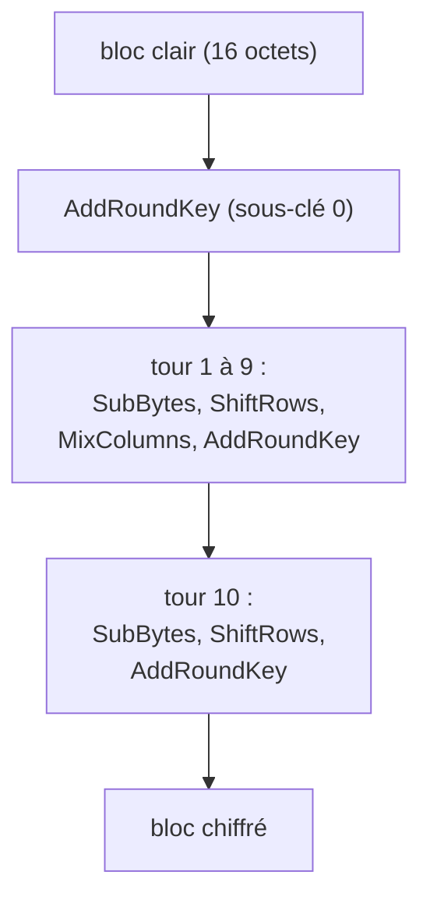

# Corps finis et AES

AES chiffre l'essentiel de ce qui circule sur Internet, du Wi-Fi au disque de votre téléphone. On le présente souvent comme une suite d'opérations arbitraires sur des octets : substituer, décaler, mélanger, ajouter une clé. En réalité, chacune de ces étapes est un calcul dans un corps fini à 256 éléments, noté GF(2^8), où les octets s'additionnent sans retenue et où chacun d'eux, sauf zéro, a un inverse. Cette note construit ce corps à partir des polynômes, montre comment on y multiplie deux octets, puis explique ce que chaque étape d'AES doit à cette structure.

L'usage pratique d'AES (modes, GCM, tailles de clé) est dans [[Cryptographie]].

## Pourquoi un corps ?

Un chiffrement par blocs doit être une bijection : chaque bloc clair donne un bloc chiffré différent, sinon on ne pourrait pas déchiffrer. Pour mélanger des octets de façon inversible, l'idéal serait de pouvoir les additionner, les multiplier et **diviser** par n'importe quel octet non nul, comme on le fait avec des nombres rationnels. Un ensemble où ces quatre opérations sont possibles et obéissent aux règles habituelles s'appelle un **corps** (voir [[Structures Algébriques]]).

Les entiers modulo 256 ne conviennent pas : 256 n'est pas premier, et 2 × 128 ≡ 0 (mod 256), donc 2 n'a pas d'inverse. Les entiers modulo un nombre premier p forment bien un corps, mais aucun nombre premier ne vaut 256. Il faut une autre construction.

> [!abstract] Définition — Corps fini
> Un corps fini est un ensemble fini muni d'une addition et d'une multiplication où tout élément non nul a un inverse. Évariste Galois a montré qu'il en existe un, et un seul à isomorphisme près, pour chaque taille de la forme p^k avec p premier, et aucun pour les autres tailles. On le note GF(p^k), pour « Galois Field ».

Un corps à 256 = 2^8 éléments existe donc. Reste à le construire.

## Le plus petit corps : deux éléments

Commençons par GF(2) = {0, 1}, les entiers modulo 2. La multiplication est le ET logique. L'addition est 1 + 1 = 0, ce qui est exactement le **OU exclusif** (XOR) des informaticiens. Le widget le vérifie : la table de `a ^ b` est celle de l'addition modulo 2.

```widget:table-verite
expr: a ^ b
```

Une conséquence étrange mais très commode : dans GF(2), soustraire est la même chose qu'additionner, puisque −1 = 1. Ajouter deux fois la même valeur revient à ne rien faire : x ⊕ k ⊕ k = x. C'est pour cela que l'étape AddRoundKey d'AES se défait en refaisant exactement la même opération.

## Les octets comme polynômes

Un octet a huit bits, b₇b₆b₅b₄b₃b₂b₁b₀. L'idée d'AES est de le lire comme un polynôme de degré au plus 7 dont les coefficients sont dans GF(2) :

$$b_7x^7 + b_6x^6 + \cdots + b_1x + b_0$$

L'octet 0x57, soit 01010111 en binaire, devient x⁶ + x⁴ + x² + x + 1.

**L'addition** de deux octets est l'addition des polynômes, coefficient par coefficient, modulo 2 : c'est un XOR bit à bit. Par exemple 0x57 + 0x83 = 0xD4, car (x⁶ + x⁴ + x² + x + 1) + (x⁷ + x + 1) = x⁷ + x⁶ + x⁴ + x² (les termes en x et les 1 s'annulent deux à deux). Aucune retenue ne se propage d'un bit à l'autre.

**La multiplication** est celle des polynômes, mais le produit peut atteindre le degré 14 et sortir de l'octet. On le ramène dans l'octet en prenant le reste de la division par un polynôme fixé de degré 8, comme on réduit modulo p pour les entiers. AES utilise :

$$m(x) = x^8 + x^4 + x^3 + x + 1 \quad (\text{0x11B})$$

Ce polynôme est **irréductible** : il ne se factorise pas en polynômes plus petits à coefficients dans GF(2). C'est l'analogue d'un nombre premier, et c'est ce qui garantit que tout octet non nul a un inverse, exactement comme tout entier non nul modulo un premier en a un.

## Multiplier deux octets à la main

Multiplier par x revient à décaler l'octet d'un bit vers la gauche. Si le bit de poids fort était à 1, le résultat contient un terme x⁸ qu'il faut réduire : on remplace x⁸ par x⁴ + x³ + x + 1 (puisque x⁸ ≡ x⁴ + x³ + x + 1 modulo m(x)), ce qui revient à faire un XOR avec 0x1B. Cette opération s'appelle **xtime** dans la norme FIPS 197.

Pour multiplier 0x57 par 0x13, on décompose 0x13 = 0x10 + 0x02 + 0x01, puis on enchaîne des xtime :

| Calcul | Résultat | Explication |
|---|---|---|
| 0x57 × 0x01 | 0x57 | |
| 0x57 × 0x02 | 0xAE | décalage, pas de débordement |
| 0x57 × 0x04 | 0x47 | 0xAE décalé = 0x15C, débordement : 0x5C ⊕ 0x1B |
| 0x57 × 0x08 | 0x8E | décalage |
| 0x57 × 0x10 | 0x07 | 0x8E décalé = 0x11C, débordement : 0x1C ⊕ 0x1B |
| 0x57 × 0x13 | 0xFE | 0x07 ⊕ 0xAE ⊕ 0x57 |

C'est l'exemple de la norme elle-même. Tout se fait avec des décalages et des XOR, sans multiplication matérielle, ce qui rend AES rapide même sur une carte à puce.

## Ce que chaque étape d'AES doit au corps

AES chiffre des blocs de 128 bits, vus comme une grille de 4 × 4 octets appelée l'**état**. Il répète 10, 12 ou 14 **tours** selon que la clé fait 128, 192 ou 256 bits. Chaque tour enchaîne quatre étapes.

```widget:ordonner
consigne: Remettez dans l'ordre les étapes d'un tour d'AES (hors dernier tour).
elements: SubBytes = chaque octet est remplacé par son image dans la S-box | ShiftRows = la ligne i de l'état est décalée de i cases vers la gauche | MixColumns = chaque colonne est multipliée par une matrice fixe dans GF(2^8) | AddRoundKey = l'état est combiné par XOR avec la sous-clé du tour
```

**SubBytes** est la seule étape non linéaire, et c'est elle qui empêche de résoudre AES comme un système d'équations. Chaque octet x est remplacé par son **inverse** x⁻¹ dans GF(2^8) (0 est envoyé sur 0), puis par une transformation affine fixe sur ses bits. Pourquoi l'inverse ? Parce que, dans un corps, la fonction x ↦ x⁻¹ est aussi éloignée que possible d'une fonction linéaire : Kaisa Nyberg a montré en 1993 qu'elle minimise les biais exploités par la cryptanalyse différentielle et linéaire. Concrètement, une différence en entrée de la S-box ne se retrouve en sortie qu'avec une probabilité d'au plus 4/256. La transformation affine ajoutée ensuite casse la structure algébrique trop simple de l'inverse et garantit qu'aucun octet n'est sa propre image : S(0x00) = 0x63, par exemple.

**ShiftRows** décale les lignes de l'état. C'est une simple permutation des octets, qui disperse le contenu d'une colonne dans les quatre colonnes au tour suivant.

**MixColumns** traite chaque colonne de quatre octets comme un vecteur et le multiplie par une matrice fixe, à coefficients dans GF(2^8) :

$$\begin{pmatrix} 02 & 03 & 01 & 01 \\ 01 & 02 & 03 & 01 \\ 01 & 01 & 02 & 03 \\ 03 & 01 & 01 & 02 \end{pmatrix}$$

Multiplier par 02 est un xtime, par 03 un xtime suivi d'un XOR avec l'octet de départ : le calcul reste léger. Cette matrice est choisie pour sa propriété de **diffusion maximale** (on dit qu'elle est MDS, pour *Maximum Distance Separable*) : si l'on change un seul octet d'une colonne en entrée, les quatre octets de sortie changent. Ce choix vient de la théorie des codes correcteurs d'erreurs, qui utilise les mêmes corps finis.

**AddRoundKey** combine l'état et une sous-clé de 128 bits par XOR, c'est-à-dire par addition dans GF(2). Les sous-clés sont dérivées de la clé principale par une procédure qui réutilise la S-box.



Claude Shannon avait formulé dès 1949 les deux qualités d'un bon chiffrement : la **confusion**, qui rend le lien entre clé et chiffré aussi complexe que possible, et la **diffusion**, qui étale l'influence de chaque bit du clair sur tout le chiffré. Dans AES, SubBytes apporte la confusion, ShiftRows et MixColumns la diffusion. Après deux tours, chaque octet de l'état dépend de chacun des seize octets d'entrée.

## Pourquoi c'est solide

AES, conçu par les Belges Joan Daemen et Vincent Rijmen sous le nom de Rijndael, a gagné en 2000 un concours public de trois ans organisé par le NIST, et il est normalisé depuis 2001 (FIPS 197). Plus de vingt-cinq ans d'analyse n'ont produit aucune attaque pratique. La meilleure attaque connue sur la version complète, la cryptanalyse « biclique » de 2011, ne gagne qu'un facteur quatre sur la recherche exhaustive : 2^126 opérations au lieu de 2^128.

Les vraies failles d'AES viennent des implémentations. Une implémentation par tables, où la S-box est lue en mémoire à une adresse qui dépend de la clé, laisse fuir cette clé par les temps d'accès au cache (voir [[Attaques par canal auxiliaire]]). Les processeurs modernes ont donc des instructions dédiées (AES-NI sur x86, extensions ARMv8), qui calculent un tour complet en temps constant.

Les corps finis servent ailleurs dans le même protocole. Le mode **GCM**, qui authentifie les données chiffrées par AES dans TLS, calcule son code dans un autre corps, GF(2^128), avec le polynôme x^128 + x^7 + x² + x + 1. Et les mêmes corps à 2^8 éléments permettent aux codes de Reed-Solomon de corriger les rayures d'un CD ou les erreurs d'un QR code.

## Questions de révision

> [!quiz] Pourquoi ne peut-on pas utiliser les entiers modulo 256 pour construire AES ?
> Parce que 256 n'est pas premier : certains octets non nuls, comme 2, n'ont pas d'inverse modulo 256, et l'ensemble n'est pas un corps.

> [!quiz] Que vaut l'addition de deux octets dans GF(2^8) ?
> - [x] Leur XOR bit à bit.
>   Les coefficients des polynômes s'additionnent modulo 2, sans retenue.
> - [ ] Leur somme modulo 256.
>   Ce serait une addition avec retenues, qui ne donne pas un corps.
> - [ ] Leur somme modulo 0x11B.
>   On réduit modulo m(x) seulement après une multiplication.

> [!quiz] Comment multiplie-t-on un octet par 0x02 dans AES ?
> On le décale d'un bit vers la gauche ; si le bit de poids fort était à 1, on fait en plus un XOR avec 0x1B pour réduire modulo x⁸ + x⁴ + x³ + x + 1. C'est l'opération xtime.

> [!quiz] Quelle étape d'AES est la seule non linéaire ?
> - [ ] MixColumns
>   C'est une multiplication matricielle : linéaire sur GF(2^8).
> - [x] SubBytes
>   L'inversion dans GF(2^8) est fortement non linéaire ; sans elle, AES se résoudrait comme un système d'équations linéaires.
> - [ ] AddRoundKey
>   Un XOR est une addition, donc linéaire.

> [!quiz] Pourquoi le polynôme x⁸ + x⁴ + x³ + x + 1 doit-il être irréductible ?
> Pour que les polynômes modulo m(x) forment un corps : comme un nombre premier pour les entiers, un polynôme irréductible garantit que tout élément non nul a un inverse.
