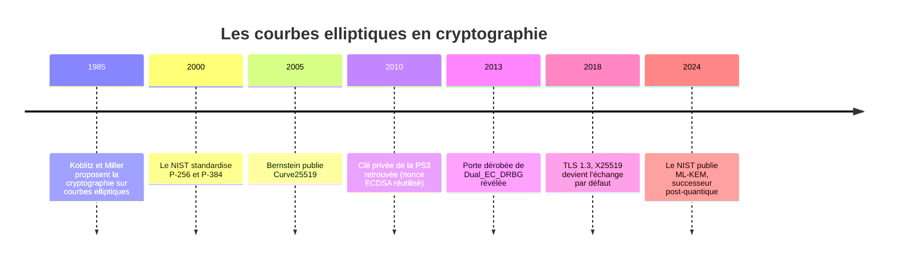

# Courbes elliptiques

Une clé RSA de 3 072 bits et une clé elliptique de 256 bits offrent à peu près la même sécurité. Cette différence de taille explique pourquoi les courbes elliptiques ont conquis, en une quinzaine d'années, TLS, SSH, Signal, les passeports biométriques, les cartes bancaires et Bitcoin. Pourtant, une courbe elliptique est d'abord un objet de géométrie du XIXe siècle, étudié pour calculer la longueur des arcs d'ellipse, d'où son nom. Cette note montre comment on additionne deux points d'une courbe, pourquoi cette addition forme un groupe, comment elle devient de l'arithmétique sur des nombres finis, et pourquoi le logarithme discret y est plus difficile que modulo p.

## Une courbe, une équation

Les courbes utilisées en cryptographie ont presque toutes une équation de la forme de Weierstrass :

$$y^2 = x^3 + ax + b$$

où a et b sont deux constantes. Sur les nombres réels, le dessin a une ou deux composantes selon les valeurs de a et b, toujours symétrique par rapport à l'axe horizontal, puisque si (x, y) est sur la courbe, (x, −y) l'est aussi. On exige une seule condition, 4a³ + 27b² ≠ 0, qui interdit les pointes et les croisements où la tangente ne serait pas définie.

Cette forme n'a rien à voir avec une ellipse. Le nom vient des **intégrales elliptiques**, qui donnent le périmètre d'une ellipse et dont l'étude a fait apparaître ces courbes. Elles ont ensuite pris une place centrale en théorie des nombres : c'est en démontrant une conjecture sur les courbes elliptiques qu'Andrew Wiles a prouvé le grand théorème de Fermat en 1994 (voir [[Théorie des Nombres]]). Leur usage en cryptographie a été proposé indépendamment par Neal Koblitz et Victor Miller en 1985.

## Additionner deux points avec une règle

La découverte surprenante est qu'on peut définir une **addition** des points de la courbe, avec une construction géométrique.

Pour additionner P et Q, on trace la droite qui passe par les deux points. Comme l'équation est de degré 3, cette droite coupe la courbe en exactement un troisième point. On prend le symétrique de ce troisième point par rapport à l'axe horizontal : c'est P + Q.

Deux cas particuliers complètent la règle. Pour doubler un point (calculer P + P), la droite par P et P n'est pas définie ; on prend la **tangente** en P, qui recoupe la courbe en un point dont le symétrique est 2P. Et si Q est le symétrique de P, la droite est verticale et ne recoupe la courbe nulle part : on ajoute alors un point imaginaire, le **point à l'infini** O, tout en haut de l'axe vertical, et l'on pose P + (−P) = O. Ce point joue le rôle du zéro : P + O = P.

Le widget permet de faire la construction. En mode « Nombres réels », déplacez P et Q le long de la courbe, puis rapprochez-les jusqu'à les confondre.

```widget:courbe-elliptique
mode: reels
a: -1
b: 1
objectif: Placez Q au même endroit que P pour voir la tangente, et donc le doublement.
cible: mode=reels, double=1
indice: Le bouton « Q = P » fait le travail ; vous pouvez aussi faire glisser les deux curseurs sur la même valeur.
bravo: La sécante devient tangente : elle touche la courbe « deux fois » en P, et le troisième point donne 2P.
objectif-2: Trouvez une position où P + Q est le point à l'infini.
cible-2: mode=reels, infini=1
indice-2: Il faut une droite verticale : même x, mais l'un en haut et l'autre en bas.
bravo-2: P et Q sont symétriques, Q = −P, et leur somme est le zéro du groupe.
```

Cette addition vérifie toutes les règles d'un groupe commutatif : il y a un élément neutre (O), chaque point a un opposé (son symétrique), l'ordre des termes ne compte pas (la droite par P et Q est la même que par Q et P). L'associativité, (P + Q) + R = P + (Q + R), est vraie mais nettement plus délicate à démontrer : on peut la vérifier par un calcul long, ou par un argument de géométrie algébrique sur les cubiques.

## Les formules

La construction se traduit en formules. Si P = (x₁, y₁) et Q = (x₂, y₂), on calcule d'abord la pente λ de la droite :

$$\lambda = \frac{y_2 - y_1}{x_2 - x_1} \quad \text{si } P \neq Q, \qquad \lambda = \frac{3x_1^2 + a}{2y_1} \quad \text{si } P = Q$$

La seconde formule est la pente de la tangente, obtenue en dérivant l'équation de la courbe. Le point P + Q = (x₃, y₃) est alors :

$$x_3 = \lambda^2 - x_1 - x_2, \qquad y_3 = \lambda(x_1 - x_3) - y_1$$

Ces formules n'utilisent que des additions, des multiplications et des divisions. Elles ont donc un sens dans n'importe quel ensemble où l'on sait faire ces quatre opérations, c'est-à-dire dans n'importe quel **corps**. C'est la clé du passage à la cryptographie.

## Sur un corps fini : un nuage de points

Les ordinateurs ne manipulent pas de nombres réels exacts. On remplace donc ℝ par le corps fini F_p des entiers modulo un nombre premier p, où diviser par un nombre veut dire multiplier par son inverse modulo p (calculé par l'algorithme d'Euclide étendu, voir [[Arithmétique]]). La courbe devient l'ensemble des couples (x, y) d'entiers entre 0 et p − 1 qui vérifient y² ≡ x³ + ax + b (mod p), plus le point O.

Le dessin perd toute allure de courbe : c'est un nuage de points dans une grille p × p, toujours symétrique (y et p − y vont ensemble). Mais les formules d'addition marchent exactement de la même façon, et l'ensemble garde sa structure de groupe. La « droite » par P et Q devient un ensemble de points qui se replie sur la grille modulo p.

Combien la courbe a-t-elle de points ? Pour chaque x, l'expression x³ + ax + b est un carré modulo p environ une fois sur deux, et donne alors deux valeurs de y. On s'attend donc à environ p points. Le **théorème de Hasse** (1933) le précise : le nombre de points est compris entre p + 1 − 2√p et p + 1 + 2√p. Pour une courbe de 256 bits, il y a donc environ 2^256 points, et des algorithmes efficaces (Schoof, 1985) permettent de les compter exactement, ce qui est indispensable pour vérifier qu'une courbe est sûre.

Dans le widget, en mode « Corps fini », la courbe y² = x³ + 2x + 2 sur F₁₇ a 19 points en comptant O. Touchez deux points pour les additionner, puis faites glisser le curseur k.

```widget:courbe-elliptique
mode: fini
p: 17
a: 2
b: 2
k: 5
objectif: Faites grandir k jusqu'à ce que kP retombe sur le point à l'infini O.
cible: mode=fini, p=17, x=-1, k<20
indice: Le nombre de points de la courbe (19) est premier : l'ordre de P ne peut être que 1 ou 19.
bravo: 19P = O. Les multiples de P parcourent toute la courbe avant de revenir au départ : P engendre le groupe.
```

## La multiplication scalaire et le problème difficile

Additionner P à lui-même k fois donne le point kP. C'est l'analogue elliptique de la puissance g^k modulo p : la notation est additive au lieu d'être multiplicative, mais la structure est la même, celle d'un groupe cyclique. En regardant le tracé des multiples P, 2P, 3P… dans le widget, on voit qu'ils sautent dans la grille sans motif apparent.

Calculer kP pour k de 256 bits ne demande pas k additions. On utilise l'algorithme **doubler-et-ajouter**, jumeau de l'exponentiation rapide : on lit les bits de k, on double le point à chaque bit, et l'on ajoute P quand le bit vaut 1. Environ 256 doublements et 128 additions suffisent.

> [!abstract] Définition — Logarithme discret elliptique (ECDLP)
> Étant donnés un point P d'une courbe elliptique sur un corps fini et un point Q = kP, retrouver l'entier k. Pour une courbe bien choisie, le meilleur algorithme connu est l'algorithme rho de Pollard, en √N opérations pour un groupe de N points.

C'est là que se trouve l'avantage décisif sur les entiers modulo p. Le calcul d'indice, qui rend le logarithme discret classique sous-exponentiel, repose sur la décomposition des entiers en petits facteurs premiers. Les points d'une courbe elliptique n'ont pas d'équivalent de cette décomposition. Il ne reste que les attaques génériques, en √N : une courbe de 256 bits offre environ 128 bits de sécurité.

| Sécurité visée | RSA ou DH modulo p | Courbe elliptique |
|---|---|---|
| 80 bits | 1 024 bits | 160 bits |
| 112 bits | 2 048 bits | 224 bits |
| 128 bits | 3 072 bits | 256 bits |
| 192 bits | 7 680 bits | 384 bits |
| 256 bits | 15 360 bits | 512 bits |

Des clés plus courtes signifient des certificats plus légers, des signatures plus rapides et moins d'énergie, ce qui compte pour une carte à puce ou un téléphone.

## ECDH et ECDSA

L'échange de clés de Diffie-Hellman se transpose directement. Alice et Bob conviennent d'une courbe et d'un point de base G. Alice tire un entier secret a et publie A = aG ; Bob tire b et publie B = bG. Chacun calcule le secret commun abG, Alice comme aB, Bob comme bA. C'est **ECDH**, utilisé dans pratiquement toutes les connexions TLS 1.3 sous la forme X25519.

La signature **ECDSA** est plus subtile. Pour signer l'empreinte h d'un message avec la clé privée d (clé publique Q = dG), on tire un nombre aléatoire k, appelé nonce, on calcule le point kG dont l'abscisse donne r, puis s = k⁻¹(h + r × d) modulo l'ordre n du groupe. La signature est le couple (r, s). Le vérificateur recombine h, r, s et Q pour retrouver kG sans connaître ni k ni d.

> [!warning] Piège
> Le nonce k doit être imprévisible et ne jamais servir deux fois. Avec deux signatures s₁ et s₂ faites avec le même k sur deux messages différents, on a s₁ − s₂ = k⁻¹(h₁ − h₂) : on en déduit k, puis la clé privée d par une simple division. C'est exactement ce qui est arrivé à Sony : en 2010, le groupe fail0verflow a montré que la PlayStation 3 signait ses logiciels avec un nonce constant, et a calculé la clé privée de la console. Depuis, le RFC 6979 dérive k de manière déterministe à partir de la clé et du message, et Ed25519 fait de même par construction.

## Choisir sa courbe

Toutes les courbes ne se valent pas, et le choix a donné lieu à de vraies controverses. Les courbes du NIST (P-256, P-384), standardisées en 2000, ont été générées à partir de graines aléatoires fournies par la NSA, sans explication de leur origine. Aucune faiblesse n'y a été trouvée, mais la révélation en 2013 que la NSA avait introduit une porte dérobée dans le générateur aléatoire Dual_EC_DRBG, lui aussi fondé sur les courbes elliptiques, a ruiné la confiance dans les paramètres inexpliqués.

Daniel J. Bernstein a proposé en 2005 **Curve25519**, définie sur F_p avec p = 2^255 − 19 (d'où son nom), choisie selon des critères publics et vérifiables. Elle est conçue pour qu'une implémentation simple soit aussi une implémentation sûre : l'échelle de Montgomery calcule kP en temps constant, sans branchement dépendant du secret, et n'importe quelle chaîne de 32 octets est une clé publique valide, ce qui supprime une classe d'attaques par points invalides. Sa variante pour les signatures, **Ed25519**, est aujourd'hui le choix par défaut de SSH et de nombreux protocoles.



Les courbes elliptiques ont un point commun avec RSA : l'algorithme de Shor résout aussi l'ECDLP sur un ordinateur quantique, et même avec moins de qubits que pour RSA à sécurité égale, puisque les clés sont plus courtes. La transition passe aujourd'hui par des échanges **hybrides**, comme X25519MLKEM768, qui combinent une courbe elliptique et un algorithme fondé sur les réseaux euclidiens (voir [[Réseaux euclidiens et LWE]]) : il faudrait casser les deux.

## Questions de révision

> [!quiz] Comment construit-on géométriquement P + Q sur une courbe elliptique réelle ?
> On trace la droite (PQ), qui recoupe la courbe en un troisième point ; P + Q est le symétrique de ce point par rapport à l'axe horizontal.

> [!quiz] Que représente le point à l'infini O ?
> L'élément neutre du groupe : P + O = P, et c'est la somme d'un point et de son symétrique, dont la droite est verticale.

> [!quiz] Pourquoi une courbe de 256 bits vaut-elle une clé RSA de 3 072 bits ?
> - [x] Parce que le calcul d'indice ne s'applique pas aux courbes : seules les attaques en √N restent.
>   Sur les entiers modulo p ou pour la factorisation, des algorithmes sous-exponentiels existent ; sur une courbe bien choisie, on ne connaît que rho de Pollard.
> - [ ] Parce que les calculs sur courbe sont plus lents.
>   Ils sont au contraire plus rapides à sécurité égale, grâce aux clés courtes.
> - [ ] Parce que les courbes utilisent des nombres réels, plus précis.
>   La cryptographie utilise des corps finis, jamais des réels.

> [!quiz] Que se passe-t-il si l'on signe deux messages ECDSA avec le même nonce k ?
> - [ ] Rien de grave, les deux signatures restent valides.
>   Elles sont valides, mais elles trahissent la clé.
> - [x] On retrouve k, puis la clé privée, par un simple calcul.
>   La différence s₁ − s₂ = k⁻¹(h₁ − h₂) donne k, et la formule de s donne ensuite d. C'est l'attaque qui a visé la PS3.
> - [ ] Les signatures deviennent identiques.
>   r est identique (même kG), mais s diffère avec le message.

> [!quiz] Que dit le théorème de Hasse ?
> Le nombre de points d'une courbe elliptique sur F_p, point à l'infini compris, est compris entre p + 1 − 2√p et p + 1 + 2√p.
