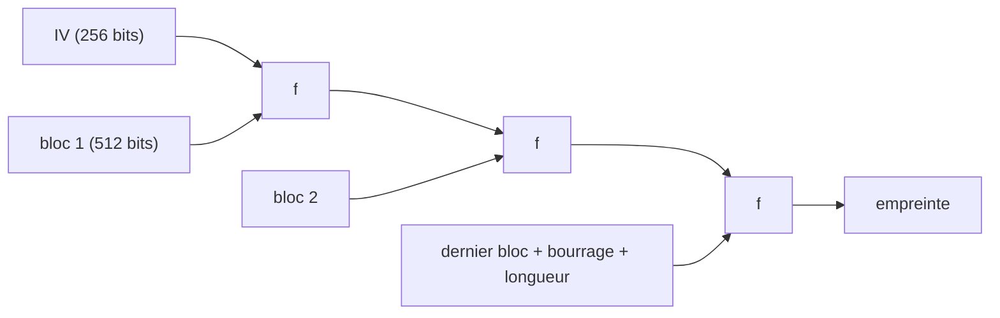
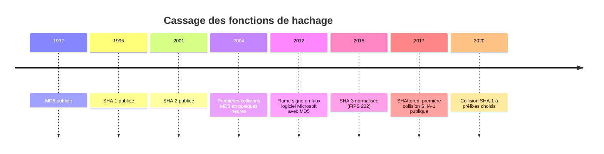
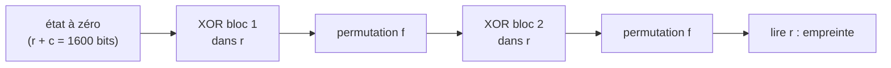

# Fonctions de hachage — comment elles sont construites

Une fonction de hachage transforme n'importe quel fichier, d'un octet ou d'un téraoctet, en une empreinte de taille fixe : 256 bits pour SHA-256, soit 64 caractères hexadécimaux. Git nomme chaque version de code par son empreinte, Bitcoin enchaîne ses blocs avec, les signatures numériques ne signent qu'elle, et les mots de passe ne sont stockés que sous cette forme. Tout cela suppose qu'il soit impossible, en pratique, de trouver deux fichiers différents qui ont la même empreinte. Or il en existe forcément une infinité. Cette note explique ce paradoxe, montre pourquoi une empreinte de 256 bits n'offre que 128 bits de résistance aux collisions, puis ouvre les deux grandes familles de construction, celle de SHA-256 et celle de SHA-3.

L'usage des hachages pour stocker des mots de passe, qui demande des fonctions volontairement lentes, est traité dans [[Hachage de mots de passe]].

## Ce qu'on attend d'une empreinte

Une fonction de hachage cryptographique doit être rapide à calculer et se comporter, vue de l'extérieur, comme si elle tirait une empreinte au hasard pour chaque entrée nouvelle. Concrètement, on lui demande trois résistances, de la plus forte à la plus faible.

La **résistance à la préimage** : étant donnée une empreinte h, il doit être impossible de trouver un message m tel que H(m) = h. La fonction est à sens unique. La **résistance à la seconde préimage** : étant donné un message m, il doit être impossible d'en trouver un autre, m', de même empreinte. C'est ce qui empêche de falsifier un document déjà signé. La **résistance aux collisions** : il doit être impossible de trouver une paire quelconque (m, m') de messages différents de même empreinte. L'attaquant a ici toute liberté sur les deux messages.

Une quatrième propriété, plus intuitive, sert de test : l'**effet d'avalanche**. Changer un seul bit de l'entrée doit faire basculer en moyenne la moitié des bits de l'empreinte, sans lien visible avec le changement. Le widget le montre sur SHA-256.

```widget:hash-avalanche
value: Le jardin de la connaissance
algo: SHA-256
```

## Le principe des tiroirs et le paradoxe des anniversaires

Il y a une infinité de messages possibles et seulement 2^256 empreintes. Par le **principe des tiroirs** (si l'on range plus d'objets que de tiroirs, deux objets partagent un tiroir), des collisions existent forcément, en nombre infini. La sécurité ne peut donc pas venir de leur absence, seulement de la difficulté à en trouver une.

Combien d'essais faut-il ? L'intuition dit 2^256, ou la moitié. Elle se trompe, et le **paradoxe des anniversaires** dit pourquoi. Dans une classe de 23 élèves, la probabilité que deux d'entre eux soient nés le même jour dépasse 50 %, alors qu'il y a 365 jours. La raison est qu'on ne cherche pas quelqu'un né un jour donné, mais **n'importe quelle paire**, et que 23 personnes forment 23 × 22 / 2 = 253 paires. Chaque paire a une chance sur 365 de coïncider ; avec 253 paires, la probabilité qu'aucune ne coïncide tombe sous la moitié.

Le calcul exact multiplie les probabilités que chaque nouvelle personne évite toutes les précédentes :

$$P(\text{aucune collision}) = \frac{N-1}{N} \times \frac{N-2}{N} \times \cdots \times \frac{N-k+1}{N} \approx e^{-k(k-1)/2N}$$

La probabilité atteint 50 % pour k ≈ 1,18 √N. Pour N = 365, cela donne 23. Pour une empreinte de n bits, N = 2^n, et il suffit d'environ 2^{n/2} essais pour trouver une collision.

```widget:anniversaire
k: 23
objectif: Combien de personnes faut-il pour dépasser 90 % de chances d'un anniversaire commun ?
cible: mode=jours, proba>=0.9, k<=41
indice: La courbe monte très vite après 23 ; cherchez vers 40.
erreur: k>41 → Ça marche, mais on peut s'arrêter plus tôt.
bravo: 41 personnes suffisent pour 90 %, et 57 pour 99 %.
objectif-2: Passez en mode « Empreinte de n bits ». Avec une empreinte de 64 bits, réglez le nombre d'essais pour atteindre environ 50 %.
cible-2: mode=bits, bits=64, proba>=0.3, proba<=0.7
indice-2: C'est autour de 2^32, la racine carrée de 2^64.
bravo-2: 2^32, quatre milliards d'essais : une heure sur un ordinateur portable. C'est pourquoi 64 bits ne suffisent pas, et pourquoi SHA-256 en a 256.
```

> [!important] Idée clé
> Une empreinte de n bits n'offre que n/2 bits de sécurité contre les collisions, mais n bits contre les préimages. C'est pour cela que la cryptographie moderne utilise des empreintes de 256 bits : 2^128 essais pour une collision, un nombre hors de portée de toute l'humanité réunie.

Ce raisonnement ne concerne que les attaques génériques, qui traitent la fonction comme une boîte noire. Une fonction est **cassée** dès qu'on trouve une méthode plus rapide que l'attaque des anniversaires, même si elle reste coûteuse.

## Merkle-Damgård : le moteur de MD5, SHA-1 et SHA-2

Comment traiter un message de longueur quelconque avec une fonction qui doit avoir une sortie fixe ? La réponse classique, proposée indépendamment par Ralph Merkle et Ivan Damgård en 1989, est de découper le message en blocs de taille fixe et de les « avaler » un par un.

On part d'une valeur initiale fixée, IV, de la taille de l'empreinte. Une **fonction de compression** f prend l'état courant et un bloc du message, et produit un nouvel état de même taille. On l'applique à chaque bloc tour à tour ; l'état final est l'empreinte. Pour SHA-256, les blocs font 512 bits et l'état 256 bits.



Le dernier bloc est complété par un **bourrage** qui se termine par la longueur du message en bits. Ce détail, le renforcement de Merkle-Damgård, permet de démontrer le résultat fondamental de la construction : si la fonction de compression résiste aux collisions, la fonction de hachage entière y résiste aussi. Tout le travail de conception se concentre donc sur f.

À l'intérieur, la fonction de compression de SHA-256 ressemble à un chiffrement par blocs. Elle fait 64 tours, chacun mélangeant huit mots de 32 bits par des additions modulo 2^32, des rotations de bits, des XOR et des fonctions booléennes non linéaires (« choix » et « majorité »). Le mélange de ces opérations, qui ne s'entendent pas entre elles algébriquement (l'addition modulo 2^32 n'est pas linéaire pour le XOR), est ce qui rend l'analyse si difficile. Les constantes de chaque tour sont tirées des racines cubiques des 64 premiers nombres premiers : des nombres « sans arrière-pensée », qui montrent qu'aucune constante n'a été choisie pour cacher une faiblesse.

## L'attaque par extension de longueur

La construction de Merkle-Damgård a un défaut structurel. L'empreinte publiée **est** l'état interne final. Quelqu'un qui connaît H(m) et la longueur de m peut donc reprendre le calcul là où il s'est arrêté, et calculer H(m ‖ bourrage ‖ suite) pour une suite de son choix, sans connaître m.

C'est grave quand on utilise naïvement H(secret ‖ message) comme code d'authentification. Un attaquant qui voit passer le message « montant=10 » et son code peut fabriquer un code valide pour « montant=10 ‖ bourrage ‖ &montant=10000 », que le serveur acceptera. Flickr a eu ce problème en 2009.

La parade est **HMAC**, qui hache deux fois avec deux clés dérivées du secret : HMAC(k, m) = H((k ⊕ opad) ‖ H((k ⊕ ipad) ‖ m)). Le hachage extérieur empêche de prolonger le calcul intérieur. HMAC est prouvé sûr à partir de propriétés de la fonction de compression, et il reste sûr avec SHA-1, voire MD5, alors même que ces fonctions ne résistent plus aux collisions. Voir [[Cryptographie]] pour son usage.

## Quand une fonction tombe

L'histoire des fonctions de hachage est celle d'une course entre concepteurs et cryptanalystes.

**MD5** (1992, 128 bits) devrait demander 2^64 essais pour une collision. En 2004, l'équipe de Xiaoyun Wang en a produit en quelques heures. En 2008, des chercheurs ont fabriqué un faux certificat d'autorité reconnu par les navigateurs, et en 2012 le logiciel espion Flame a utilisé une collision MD5 pour signer ses mises à jour comme si elles venaient de Microsoft.

**SHA-1** (1995, 160 bits) devait demander 2^80 essais. Des attaques théoriques sont apparues dès 2005, et en 2017, Google et le CWI d'Amsterdam ont publié SHAttered : deux fichiers PDF différents de même empreinte SHA-1, au prix d'environ 2^63 calculs, cent mille fois moins que l'attaque générique. En 2020, une collision « à préfixes choisis », où l'attaquant choisit le début des deux documents, a coûté environ 45 000 dollars de calcul. Git, qui nommait tout par SHA-1, a ajouté une détection de ces collisions puis prépare le passage à SHA-256.

**SHA-2** (2001, dont SHA-256 et SHA-512) partage la structure de Merkle-Damgård avec ses prédécesseurs, mais avec un état plus grand et une fonction de compression plus robuste. Malgré vingt-cinq ans d'analyse, les meilleures attaques n'atteignent qu'une version réduite d'environ 31 tours sur 64.



## L'éponge : la construction de SHA-3

Inquiet que SHA-2 suive le chemin de SHA-1, le NIST a lancé en 2007 un concours ouvert, comme pour AES. Le gagnant, **Keccak**, de Guido Bertoni, Joan Daemen, Michaël Peeters et Gilles Van Assche, est devenu SHA-3 en 2015. Il repose sur une idée entièrement différente : la **construction en éponge**.

L'état interne est un grand bloc de 1 600 bits, divisé en deux parties : le **débit** r, qui touche le message, et la **capacité** c, qui ne le touche jamais. Pendant la phase d'absorption, on XOR chaque bloc du message dans la partie débit, puis on brasse tout l'état avec une permutation fixe, f. Pendant la phase d'essorage, on lit la partie débit comme sortie, et l'on brasse de nouveau si l'on veut plus de bits.



Parce que la capacité n'est jamais publiée, l'empreinte ne révèle pas l'état complet : l'attaque par extension de longueur est impossible par construction. La sécurité se règle avec c : SHA3-256 prend c = 512 bits, ce qui donne 256 bits de sécurité contre les préimages et 128 contre les collisions. La même éponge sert aussi de « fonction à sortie extensible » (SHAKE), qui produit autant de bits qu'on veut, et c'est elle qu'utilise le standard post-quantique ML-KEM pour générer ses matrices (voir [[Réseaux euclidiens et LWE]]).

SHA-3 n'a pas remplacé SHA-256, qui reste solide et plus rapide en logiciel, notamment grâce aux instructions dédiées des processeurs. Il sert de solution de rechange d'une conception différente, prête si SHA-2 venait à faiblir.

## Questions de révision

> [!quiz] Pourquoi une empreinte de 256 bits n'offre-t-elle que 128 bits de résistance aux collisions ?
> À cause du paradoxe des anniversaires : parmi k empreintes tirées au hasard, on compte environ k²/2 paires, et une collision devient probable dès que k approche √(2^256) = 2^128.

> [!quiz] Combien de personnes faut-il dans une pièce pour avoir plus d'une chance sur deux que deux partagent leur anniversaire ?
> - [ ] 183
>   C'est la moitié de 365, le raisonnement qui ignore les paires.
> - [x] 23
>   23 personnes forment 253 paires, assez pour dépasser 50 %.
> - [ ] 50
>   À 50 personnes, la probabilité dépasse déjà 97 %.

> [!quiz] Qu'est-ce que l'attaque par extension de longueur, et quelle construction y échappe ?
> Avec Merkle-Damgård, l'empreinte est l'état interne final : connaissant H(m) et la longueur de m, on peut calculer H(m ‖ bourrage ‖ suite) sans connaître m. HMAC et l'éponge de SHA-3 y échappent.

> [!quiz] Que signifie qu'une fonction de hachage est « cassée » ?
> - [x] Qu'on connaît une attaque plus rapide que l'attaque générique.
>   SHA-1 est cassée parce qu'une collision coûte environ 2^63 au lieu de 2^80, même si cela reste un calcul énorme.
> - [ ] Qu'on peut retrouver le message à partir de l'empreinte.
>   C'est une préimage, bien plus difficile ; même MD5 y résiste encore en pratique.
> - [ ] Que des collisions existent.
>   Elles existent toujours, par le principe des tiroirs.

> [!quiz] Dans l'éponge de SHA-3, quel rôle joue la capacité c ?
> C'est la partie de l'état jamais exposée au message ni publiée. Elle fixe la sécurité (c/2 bits contre les collisions) et empêche de reprendre le calcul à partir de l'empreinte.
