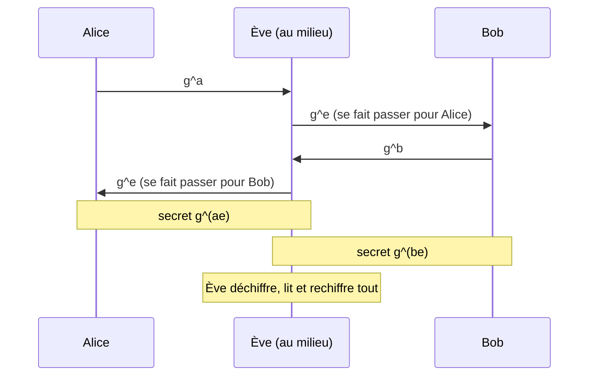
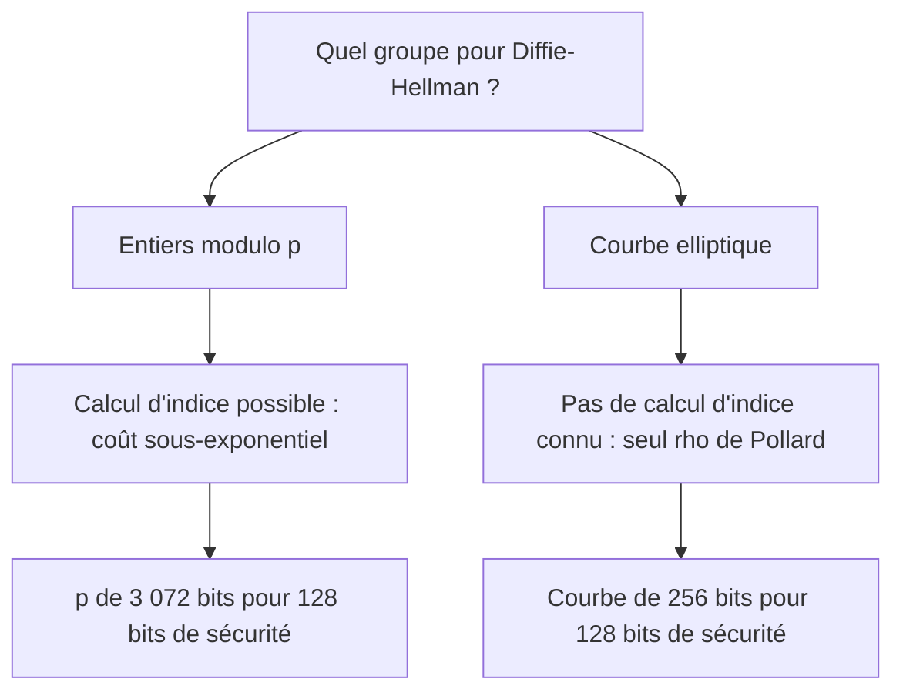

# Logarithme discret et Diffie-Hellman

Deux inconnus qui ne se sont jamais parlé peuvent-ils se mettre d'accord sur un secret, en criant leurs messages dans une pièce pleine d'espions ? En 1976, Whitfield Diffie et Martin Hellman ont montré que oui, et leur méthode sert encore à chaque connexion HTTPS, SSH ou Signal. Elle repose sur un problème que les mathématiciens appellent le **logarithme discret** : élever un nombre à une puissance modulo p est facile, retrouver l'exposant à partir du résultat ne l'est pas. Cette note part de l'horloge modulaire, construit le problème, explique l'échange de Diffie-Hellman, puis passe en revue les attaques qui fixent la taille des clés.

## Des puissances qui tournent en rond

Prenons les puissances de 3 modulo 7, en ne gardant à chaque fois que le reste de la division par 7 :

| k | 1 | 2 | 3 | 4 | 5 | 6 | 7 |
|---|---|---|---|---|---|---|---|
| 3^k mod 7 | 3 | 2 | 6 | 4 | 5 | 1 | 3 |

Deux choses frappent. D'abord, les valeurs semblent sauter au hasard sur le cadran : 3, 2, 6, 4, 5. Ensuite, la suite revient à 1 au sixième pas, puis recommence. En six pas, elle a visité tous les nombres de 1 à 6, chacun une seule fois.

Le cadran de l'horloge modulo 7 est un **groupe** : les nombres 1 à 6, munis de la multiplication modulo 7, vérifient les axiomes vus dans [[Structures Algébriques]] (associativité, élément neutre 1, un inverse pour chacun). Le nombre de pas avant de revenir à 1 s'appelle l'**ordre** de l'élément. Ici 3 est d'ordre 6, la taille du groupe entier : on dit que 3 est un **générateur**, et que le groupe est **cyclique**. En revanche, 2 est d'ordre 3 (2, 4, 1) : il ne parcourt que la moitié du cadran.

> [!abstract] Définition — Groupe cyclique
> Un groupe fini G est cyclique s'il contient un élément g, appelé générateur, dont les puissances g, g², g³… parcourent tous les éléments de G. Pour tout nombre premier p, les entiers 1 à p − 1 munis de la multiplication modulo p forment un groupe cyclique d'ordre p − 1.

Le théorème de Lagrange impose une contrainte forte : l'ordre d'un élément divise toujours la taille du groupe. Modulo 7, les ordres possibles sont donc 1, 2, 3 ou 6, jamais 4 ou 5. On le vérifie dans le widget ci-dessous, qui dessine les puissances de g sur l'horloge modulo n.

```widget:puissances-mod
n: 11
g: 2
objectif: Modulo 11, trouvez une base g qui n'est pas un générateur.
cible: n=11, generateur=0, ordre>0
indice: Essayez les carrés : 4, 9, 5, 3…
bravo: Les carrés modulo 11 ne parcourent que la moitié du cadran (ordre 5). L'ordre divise toujours φ(11) = 10.
objectif-2: Toujours modulo 11 avec g = 2, cherchez l'exposant k tel que 2^k ≡ 7.
cible-2: g=2, cherche=7, log=7
indice-2: Entrez 7 dans la case « Chercher ».
bravo-2: 2^7 = 128 = 11 × 11 + 7. Ici on lit la réponse sur le cadran ; avec 2^2048 graduations, il n'y a plus de cadran à lire.
```

## Le problème du logarithme discret

Dans les nombres réels, si l'on sait que 3^k = 729, on retrouve k = 6 avec un logarithme, et la fonction est régulière : un petit changement de k change un peu le résultat. Modulo p, ce n'est plus vrai. La suite 3, 2, 6, 4, 5, 1 ne laisse deviner aucune tendance. Savoir que 3^k ≡ 5 (mod 7) ne dit rien de k, sinon qu'il faut chercher.

> [!abstract] Définition — Logarithme discret
> Étant donnés un groupe cyclique G, un générateur g et un élément y, le logarithme discret de y en base g est l'exposant k tel que g^k = y. Le calculer est facile pour un petit groupe, mais aucun algorithme classique connu ne le fait en temps polynomial pour un groupe bien choisi de grande taille.

C'est une nouvelle fonction à sens unique : x ↦ g^x mod p se calcule en quelques milliers de multiplications grâce à l'exponentiation rapide (voir [[RSA — pourquoi ça marche]]), mais l'inverse semble demander un temps énorme. Contrairement à RSA, il n'y a pas de trappe : personne ne peut inverser facilement, pas même celui qui a choisi les paramètres. Diffie et Hellman n'en ont pas besoin.

## L'échange de Diffie-Hellman

Alice et Bob conviennent publiquement d'un grand nombre premier p et d'un générateur g. Chacun tire ensuite un nombre secret, a pour Alice, b pour Bob, et publie la puissance correspondante. Chacun combine enfin la valeur reçue avec son propre secret.

```widget:echange
acteurs: Alice | Ève | Bob
m1: Alice -> Bob : p = 23, g = 5 | Les paramètres sont publics. Ève les entend, et cela ne change rien.
m2: Alice -> Bob : A = 5^6 mod 23 = 8 | Alice a tiré a = 6 en secret. Elle publie A = g^a mod p.
m3: Bob --> Alice : B = 5^15 mod 23 = 19 | Bob a tiré b = 15 en secret et publie B = g^b mod p. Il calcule A^b = 8^15 mod 23 = 2 ; à réception, Alice calcule B^a = 19^6 mod 23 = 2. Le même nombre, g^(ab), sans l'avoir jamais envoyé.
m4: ! Ève -> Bob : 8 × 19 mod 23 = 14 ? | Ève essaie de combiner ce qu'elle a vu. Raté : g^a × g^b = g^(a+b), pas g^(ab). Pour obtenir 2, il lui faudrait a ou b, donc un logarithme discret.
```

Le secret commun est g^{ab} mod p. Alice l'obtient en élevant B = g^b à la puissance a, Bob en élevant A = g^a à la puissance b, et les deux calculs donnent le même nombre parce que (g^b)^a = (g^a)^b = g^{ab}.

L'analogie la plus parlante est celle des pots de peinture. Alice et Bob partent d'une couleur publique, du jaune. Chacun y mélange une couleur secrète et envoie le mélange obtenu. Chacun ajoute ensuite sa couleur secrète au mélange reçu : les deux obtiennent la même teinte finale, jaune + secret d'Alice + secret de Bob. Ève, qui a vu passer le jaune et les deux mélanges intermédiaires, ne sait pas « démélanger » la peinture. L'exponentiation modulaire joue le rôle du mélange : facile à faire, impossible à défaire.

Ève fait face au **problème de Diffie-Hellman calculatoire** : à partir de g, g^a et g^b, calculer g^{ab}. Savoir résoudre le logarithme discret suffirait (on retrouve a, puis on calcule (g^b)^a). L'inverse n'est pas démontré en général, mais aucune méthode plus rapide n'est connue.

> [!warning] Piège
> Diffie-Hellman protège contre l'écoute, pas contre l'usurpation. Si Ève s'interpose et fait un échange avec Alice en se faisant passer pour Bob, et un autre avec Bob en se faisant passer pour Alice, elle partage un secret avec chacun et relaie tout en clair : c'est l'attaque de l'homme du milieu. Il faut donc toujours authentifier l'échange, par une signature et un certificat (TLS) ou par une empreinte vérifiée à la main (SSH, Signal).



Dans TLS 1.3, l'échange se fait avec des secrets a et b neufs à chaque connexion, puis jetés. Même si la clé privée du serveur est volée plus tard, les conversations passées restent illisibles : c'est la **confidentialité persistante** (forward secrecy). Voir [[TLS 1.3]].

## Les attaques, ou comment choisir p

La sécurité ne dépend pas seulement de la taille de p. Plusieurs attaques exploitent la structure du groupe, et chacune explique une règle de choix des paramètres.

La **recherche exhaustive** essaie g, g², g³… jusqu'à tomber sur y. Pour un groupe de N éléments, elle demande en moyenne N/2 essais. Avec N de l'ordre de 2^256, c'est sans espoir.

L'algorithme **pas de bébé, pas de géant** (baby-step giant-step, Daniel Shanks, 1971) fait beaucoup mieux par un compromis temps-mémoire. On pose m ≈ √N et l'on écrit l'exposant cherché k = i × m + j. On calcule et l'on range les m « petits pas » g^j, puis l'on fait des « grands pas » y × g^{−im} jusqu'à retomber sur une valeur rangée. Environ 2√N opérations au lieu de N. L'algorithme **rho de Pollard** atteint le même coût sans la mémoire. Conséquence : un groupe de taille N n'offre que √N de sécurité, soit 128 bits pour un groupe de 2^256 éléments. C'est la limite pour tout groupe « générique », et c'est celle des courbes elliptiques.

L'attaque de **Pohlig-Hellman** exploite les petits diviseurs. Si p − 1 = 2 × 3 × 5 × … se décompose en petits facteurs, on résout le logarithme dans chaque petit sous-groupe séparément, puis on recolle les morceaux par le théorème chinois des restes. Le coût dépend alors du plus grand facteur premier de p − 1, pas de p. D'où la règle : choisir un **nombre premier sûr** p = 2q + 1 avec q premier, ou travailler dans un sous-groupe d'ordre premier q suffisamment grand.

Le **calcul d'indice**, et sa version moderne le crible algébrique, est la raison pour laquelle p doit être si grand. Il exploite le fait que les entiers modulo p peuvent se décomposer en petits nombres premiers, ce qui permet de relier les logarithmes entre eux par un gigantesque système linéaire. Son coût est sous-exponentiel, comme pour la factorisation, et les tailles de clé sont donc les mêmes que pour RSA : 2 048 bits au minimum, 3 072 pour 128 bits de sécurité. Le record public est un logarithme discret modulo un nombre premier de 795 bits, calculé en 2019 par l'équipe qui a factorisé RSA-240 la même année.

> [!example] Logjam (2015)
> Des chercheurs ont montré que de nombreux serveurs acceptaient encore des paramètres « export » de 512 bits, hérités des restrictions américaines des années 1990, et qu'un attaquant au milieu pouvait forcer leur usage. Pire, la plus grosse partie du calcul d'indice ne dépend que de p, pas de la clé échangée : un État qui précalcule une fois pour les quelques nombres premiers de 1 024 bits utilisés par des millions de serveurs peut ensuite casser chaque échange en quelques minutes. Depuis, les recommandations exigent 2 048 bits et des groupes standardisés et vérifiés (RFC 7919), ou, mieux, les courbes elliptiques.



Ce dernier contraste explique le succès des courbes elliptiques : le même échange de Diffie-Hellman, dans un groupe où le calcul d'indice ne s'applique pas, avec des clés douze fois plus courtes. C'est l'objet de [[Courbes elliptiques]]. Et comme pour RSA, l'algorithme de Shor résout aussi le logarithme discret sur un ordinateur quantique, ce qui menace les deux familles à la fois.

## Questions de révision

> [!quiz] Que vaut l'ordre de 2 modulo 7, et pourquoi 2 n'est-il pas un générateur ?
> Les puissances de 2 modulo 7 sont 2, 4, 1 : l'ordre vaut 3. Elles ne visitent que trois des six éléments du groupe, donc 2 n'engendre pas tout le groupe.

> [!quiz] Dans Diffie-Hellman, que voit passer Ève et que lui manque-t-il ?
> Elle voit p, g, g^a et g^b. Il lui manque g^{ab}, qu'elle ne sait calculer qu'en retrouvant a ou b, c'est-à-dire en résolvant un logarithme discret.

> [!quiz] Pourquoi choisit-on p = 2q + 1 avec q premier ?
> - [x] Pour que p − 1 n'ait pas de petits facteurs exploitables par Pohlig-Hellman.
>   Le coût de Pohlig-Hellman dépend du plus grand facteur premier de p − 1 ; avec p = 2q + 1, c'est q, presque aussi grand que p.
> - [ ] Pour accélérer l'exponentiation rapide.
>   La forme de p n'a pas d'effet notable sur la vitesse du calcul.
> - [ ] Pour empêcher l'attaque de l'homme du milieu.
>   Aucun choix de paramètre n'empêche l'homme du milieu ; seule l'authentification le fait.

> [!quiz] Pas de bébé, pas de géant : combien d'opérations pour un groupe de 2^64 éléments ?
> - [ ] Environ 2^64.
>   C'est le coût de la recherche exhaustive.
> - [x] Environ 2^33.
>   Le coût est de l'ordre de 2√N, soit 2 × 2^32.
> - [ ] Environ 64.
>   Ce serait un algorithme polynomial, qu'on ne connaît pas sur ordinateur classique.

> [!quiz] Qu'apporte la confidentialité persistante de TLS 1.3 ?
> Des secrets Diffie-Hellman éphémères, neufs à chaque connexion puis effacés : le vol ultérieur de la clé privée du serveur ne permet pas de déchiffrer les échanges passés.
