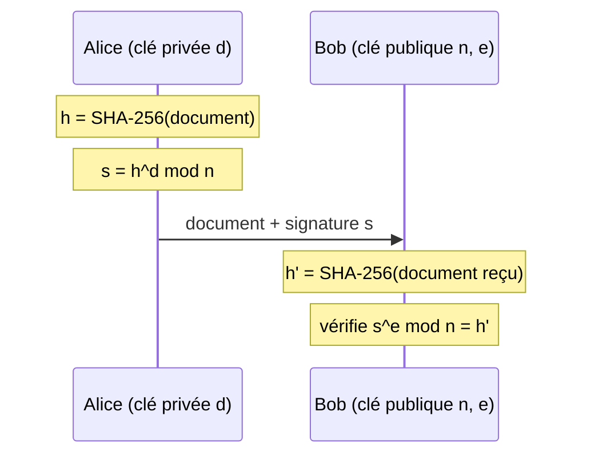

# RSA — pourquoi ça marche

Chaque fois qu'un navigateur vérifie le certificat d'un site, il refait un calcul inventé en 1977 par Ron Rivest, Adi Shamir et Leonard Adleman : élever un nombre à une puissance, modulo un autre nombre. Ce calcul a une propriété étrange. Tout le monde peut le faire dans un sens, mais seul celui qui connaît un secret, la décomposition d'un grand nombre en deux facteurs premiers, peut le défaire. Cette note explique d'où vient cette dissymétrie, pourquoi le déchiffrement redonne exactement le message, comment on calcule des puissances de 600 chiffres en une fraction de seconde, et pourquoi la version « de manuel » de RSA ne doit jamais être utilisée telle quelle.

Les outils de base (congruences, algorithme d'Euclide, indicatrice d'Euler) sont dans [[Arithmétique]] ; l'usage pratique de RSA dans les protocoles est dans [[Cryptographie]].

## Une serrure qu'on ferme sans clé

La cryptographie symétrique, celle d'AES, suppose que les deux correspondants partagent déjà une clé. Mais comment se mettre d'accord sur cette clé avec un serveur qu'on n'a jamais rencontré, sur un réseau où tout le monde écoute ? L'idée de la cryptographie à clé publique, publiée par Whitfield Diffie et Martin Hellman en 1976, est de séparer deux opérations : fermer et ouvrir. On distribue à tout le monde un cadenas ouvert ; n'importe qui peut l'enclencher sur une boîte, mais seul le propriétaire possède la clé qui le rouvre.

Mathématiquement, il faut une **fonction à sens unique avec trappe** : facile à calculer, pratiquement impossible à inverser, sauf pour qui détient une information supplémentaire.

> [!abstract] Définition — Fonction à sens unique avec trappe
> Une fonction f facile à calculer pour tout le monde, dont l'inverse est hors de portée de tout calcul réaliste, sauf si l'on connaît un secret (la trappe) qui rend l'inversion facile. Pour RSA, f(m) = m^e mod n, et la trappe est la factorisation de n.

RSA tire sa trappe d'une asymétrie arithmétique très simple à constater. Multiplier 61 par 53 se fait de tête : 3 233. Retrouver 61 et 53 à partir de 3 233 demande déjà quelques essais. Avec deux nombres premiers de 1 024 bits chacun, le produit se calcule en une microseconde, mais aucun algorithme connu ne retrouve les facteurs en moins de temps qu'il n'en reste au Soleil.

## Fabriquer une paire de clés

La génération suit cinq étapes, que le widget plus bas refait sur de petits nombres.

1. Choisir deux grands nombres premiers distincts p et q, au hasard.
2. Calculer le module n = p × q. Il sera public.
3. Calculer φ(n) = (p − 1)(q − 1), le nombre d'entiers entre 1 et n premiers avec n. Il reste secret.
4. Choisir un exposant public e premier avec φ(n). En pratique, presque tout le monde prend e = 65 537 = 2^16 + 1.
5. Calculer l'exposant privé d, l'inverse de e modulo φ(n) : e × d ≡ 1 (mod φ(n)).

La clé publique est le couple (n, e), la clé privée est d. On chiffre un message m (un nombre plus petit que n) par c = m^e mod n, et on déchiffre par m = c^d mod n.

L'étape 5 est la seule qui demande un vrai calcul. L'inverse modulaire s'obtient par l'algorithme d'Euclide étendu : en divisant successivement φ(n) par e, puis e par le reste, et ainsi de suite, on finit par écrire 1 comme combinaison φ(n) × u + e × v = 1 (identité de Bézout). Réduite modulo φ(n), cette égalité dit que e × v ≡ 1 : v est l'inverse cherché. Avec l'exemple classique p = 61, q = 53, e = 17, on trouve φ(n) = 3 120 et d = 2 753, car 17 × 2 753 = 46 801 = 15 × 3 120 + 1.

L'asymétrie est là : pour calculer d, il faut φ(n), et pour calculer φ(n), il faut connaître p et q. Celui qui ne voit que n est bloqué, à moins de savoir factoriser.

```widget:rsa
p: 61
q: 53
e: 17
m: 65
objectif: Avec p = 61 et q = 53, essayez e = 3. Pourquoi la clé est-elle refusée ? Trouvez ensuite le plus petit e supérieur à 17 qui marche.
cible: e=19, valide=1
indice: e doit être premier avec φ(n) = 3 120 = 2⁴ × 3 × 5 × 13. Écartez les multiples de 2, 3, 5 et 13.
erreur: e=18 → 18 est pair, comme 3 120. ;; valide=0 → Ce e partage un facteur avec 3 120.
bravo: 19 est premier et ne divise pas 3 120 : d existe, c'est 2 299.
objectif-2: Remettez e = 17 puis chiffrez le message 1. Que remarquez-vous ? Essayez aussi 0.
cible-2: c=1
indice-2: 1 élevé à n'importe quelle puissance vaut 1.
bravo-2: 0 et 1 sont des points fixes : RSA « de manuel » laisse certains messages en clair. C'est une des raisons du bourrage aléatoire (OAEP).
```

## Pourquoi le déchiffrement redonne le message

Rien dans les cinq étapes ne dit encore pourquoi (m^e)^d mod n redonne m. C'est le cœur mathématique de RSA, et il tient en un théorème du XVIIIe siècle.

Le **théorème d'Euler** affirme que si m est premier avec n, alors m^φ(n) ≡ 1 (mod n). Or e × d ≡ 1 (mod φ(n)) signifie qu'il existe un entier k tel que e × d = 1 + k × φ(n). Il suffit d'écrire :

$$c^d = (m^e)^d = m^{ed} = m^{1 + k\varphi(n)} = m \times \left(m^{\varphi(n)}\right)^k \equiv m \times 1^k = m \pmod n$$

L'exposant d « annule » l'exposant e parce que les puissances modulo n tournent en rond avec une période qui divise φ(n) : faire ed tours, c'est faire un tour entier k fois, plus un pas.

Reste un cas que la preuve laisse de côté : un message m qui ne serait pas premier avec n, c'est-à-dire multiple de p ou de q. Le **théorème chinois des restes** règle la question. Il suffit de vérifier m^{ed} ≡ m séparément modulo p et modulo q, car deux nombres égaux modulo p et modulo q le sont modulo pq. Modulo p, soit p divise m et les deux membres valent 0, soit m est premier avec p et le petit théorème de Fermat (m^{p−1} ≡ 1) donne le résultat, puisque p − 1 divise φ(n). Même raisonnement modulo q. La formule marche donc pour tous les messages entre 0 et n − 1. En pratique, tomber par hasard sur un multiple de p reviendrait d'ailleurs à avoir factorisé n.

> [!important] Idée clé
> RSA ne repose pas sur une astuce de calcul mais sur une propriété de structure : les inversibles modulo n forment un groupe à φ(n) éléments, et dans un groupe fini, élever à la puissance « taille du groupe » ramène toujours à 1. Connaître la taille du groupe, c'est connaître la trappe.

## Calculer m^65537 sans y passer l'éternité

Une difficulté pratique saute aux yeux : avec n de 2 048 bits, d fait lui aussi environ 2 048 bits. Calculer c^d en multipliant c par lui-même d fois demanderait de l'ordre de 2^2048 multiplications, un nombre qui dépasse de très loin le nombre d'atomes de l'univers (environ 2^266).

La solution, l'**exponentiation rapide** (square-and-multiply), repose sur l'écriture binaire de l'exposant. Puisque 17 s'écrit 10001 en binaire, m^17 = m^16 × m, et m^16 s'obtient par quatre mises au carré successives : m → m² → m⁴ → m⁸ → m^16. On lit les bits de gauche à droite : à chaque bit, on met le résultat au carré, et si le bit vaut 1, on multiplie en plus par m. Après chaque opération, on réduit modulo n, ce qui empêche les nombres de grossir.

Le coût devient proportionnel au **nombre de bits** de l'exposant, pas à sa valeur : environ 2 048 mises au carré et un millier de multiplications pour une clé privée de 2 048 bits. C'est aussi pourquoi e = 65 537 est si populaire : 10000000000000001 en binaire, il ne demande que 16 carrés et une multiplication, ce qui rend le chiffrement et la vérification de signature très rapides.

Le widget ci-dessus détaille ce calcul : cliquez sur « Voir l'exponentiation rapide » à l'étape 4.

Le déchiffrement, lui, reste coûteux. On l'accélère d'un facteur trois à quatre avec le théorème chinois des restes : au lieu de calculer c^d modulo n (2 048 bits), on calcule c^d modulo p et modulo q (1 024 bits chacun, avec des exposants réduits d mod (p − 1) et d mod (q − 1)), puis on recolle les deux résultats. Presque toutes les bibliothèques le font, et elles stockent pour cela p, q et ces exposants réduits dans la clé privée.

> [!warning] Piège
> L'exponentiation rapide naïve fait une multiplication de plus pour chaque bit à 1. En mesurant le temps ou la consommation électrique du calcul, un attaquant peut lire les bits de d un par un. Les implémentations sérieuses utilisent des algorithmes à temps constant (échelle de Montgomery, masquage du message). Voir [[Attaques par canal auxiliaire]].

## RSA « de manuel » est cassé

La formule c = m^e mod n, appliquée telle quelle, a trois défauts graves, qui expliquent pourquoi aucun protocole réel ne l'utilise sans préparation.

Elle est **déterministe** : le même message donne toujours le même chiffré. Si l'on chiffre « oui » ou « non », un espion n'a qu'à chiffrer lui-même les deux réponses avec la clé publique et comparer. Elle est **malléable** : multiplier un chiffré par 2^e mod n donne le chiffré de 2m, sans connaître m. Un attaquant peut donc transformer un message chiffré de façon contrôlée. Enfin, elle laisse passer les **petits messages** : avec e = 3 et un message m tel que m³ < n, le modulo ne joue aucun rôle, et une simple racine cubique entière retrouve m.

La réponse est le **bourrage** (padding) : avant d'exponentier, on mélange le message avec de l'aléa selon un schéma prouvé sûr. Pour le chiffrement, c'est OAEP (Optimal Asymmetric Encryption Padding, 1994). Pour la signature, c'est PSS. L'ancien bourrage PKCS#1 v1.5 a permis l'attaque de Bleichenbacher en 1998, qui revient régulièrement sous de nouvelles formes (ROBOT en 2017) : un serveur qui répond différemment selon que le bourrage est valide ou non sert d'oracle pour déchiffrer, requête après requête. La même famille d'attaques existe en symétrique, voir [[Padding Oracle Attack]].

## Signer : le même calcul à l'envers

Puisque e et d jouent des rôles symétriques dans la formule, on peut aussi appliquer d en premier. Le propriétaire de la clé privée calcule s = h^d mod n, où h est l'empreinte du document (voir [[Fonctions de hachage — comment elles sont construites]]). N'importe qui vérifie avec la clé publique que s^e mod n redonne bien h. Seul le détenteur de d a pu produire s, et toute modification du document changerait h.



On signe l'empreinte et non le document pour deux raisons : le document peut dépasser n, et signer directement des nombres choisis exposerait à la malléabilité décrite plus haut.

## Ce qui protège RSA, et ce qui le menace

Toute la sécurité repose sur la difficulté de factoriser n. Les algorithmes progressent par paliers. La division par tous les nombres jusqu'à √n est exponentielle et sans espoir. Le meilleur algorithme classique connu, le **crible algébrique** (GNFS, *General Number Field Sieve*), est sous-exponentiel : son coût croît comme exp((64/9)^{1/3} (ln n)^{1/3} (ln ln n)^{2/3}). C'est beaucoup plus rapide qu'une recherche exhaustive, ce qui explique pourquoi RSA demande des clés bien plus longues qu'AES pour une sécurité égale.

Le record académique établi est RSA-250, un nombre de 829 bits factorisé en février 2020 par une équipe française et américaine (Boudot, Gaudry, Guillevic, Heninger, Thomé, Zimmermann) après l'équivalent de 2 700 années de calcul d'un cœur de processeur. Des annonces de 2026 revendiquent des nombres un peu plus grands ; aucune n'approche 2 048 bits.

| Taille de n | Sécurité estimée (bits) | Équivalent symétrique |
|---|---|---|
| 1 024 bits | ≈ 80 | Cassable par un État, déconseillé depuis 2013 |
| 2 048 bits | ≈ 112 | Minimum actuel |
| 3 072 bits | ≈ 128 | AES-128 |
| 15 360 bits | ≈ 256 | AES-256, impraticable |

La vraie menace est ailleurs. En 1994, Peter Shor a montré qu'un ordinateur quantique factorise en temps polynomial : il trouve la période de la fonction x ↦ a^x mod n, et cette période révèle les facteurs. En mai 2025, Craig Gidney (Google) a estimé qu'il suffirait de moins d'un million de qubits physiques bruités, pendant moins d'une semaine, pour casser RSA-2048, contre vingt millions dans l'estimation de 2019. Les machines actuelles en comptent de l'ordre de mille. Le NIST a fixé le calendrier en conséquence : RSA et les courbes elliptiques sont dépréciés après 2030 et interdits après 2035 pour les systèmes fédéraux américains, quelle que soit la taille de clé. La suite est dans [[Réseaux euclidiens et LWE]] et [[Cryptographie post-quantique]].

## Questions de révision

> [!quiz] Pourquoi faut-il connaître p et q pour calculer la clé privée d ?
> Parce que d est l'inverse de e modulo φ(n) = (p − 1)(q − 1), et que φ(n) ne se calcule facilement qu'à partir des facteurs de n. Savoir calculer φ(n) équivaut d'ailleurs à savoir factoriser n.

> [!quiz] Quel théorème garantit que (m^e)^d ≡ m (mod n) ?
> Le théorème d'Euler (m^φ(n) ≡ 1 pour m premier avec n), complété par le théorème chinois des restes et le petit théorème de Fermat pour les messages multiples de p ou de q.

> [!quiz] Combien de multiplications modulaires faut-il, à peu près, pour calculer c^d avec un exposant de 2 048 bits ?
> - [ ] Environ 2^2048.
>   C'est le coût de la méthode naïve, hors de portée de tout ordinateur.
> - [x] Quelques milliers.
>   L'exponentiation rapide fait une mise au carré par bit, plus une multiplication par bit à 1 : environ 2 048 + 1 024.
> - [ ] Environ 2 048 × 2 048.
>   Le coût est linéaire en nombre de bits, pas quadratique (chaque multiplication coûte plus cher, mais on en fait peu).

> [!quiz] Pourquoi ne chiffre-t-on jamais un message avec RSA « de manuel » ?
> - [ ] Parce que c'est trop lent.
>   C'est vrai pour de gros volumes, mais ce n'est pas un problème de sécurité.
> - [x] Parce qu'il est déterministe et malléable.
>   Le même message donne le même chiffré, et l'on peut transformer un chiffré sans le déchiffrer. OAEP ajoute de l'aléa et une structure vérifiable.
> - [ ] Parce que e = 65 537 est connu de tous.
>   L'exposant public est public par définition ; la sécurité ne repose pas sur lui.

> [!quiz] Quel algorithme ferait tomber RSA, et sur quelle machine ?
> L'algorithme de Shor (1994), sur un ordinateur quantique tolérant aux fautes : il trouve la période de a^x mod n en temps polynomial, ce qui donne les facteurs de n.
