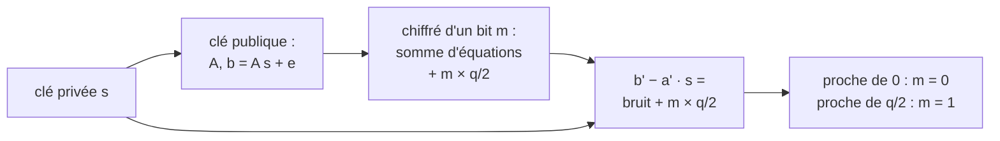

# Réseaux euclidiens et LWE

RSA, Diffie-Hellman et les courbes elliptiques tomberont le jour où un ordinateur quantique assez grand fonctionnera, car l'algorithme de Shor sait trouver les périodes cachées sur lesquelles ils reposent. Pour les remplacer, le NIST a choisi en 2024 un algorithme fondé sur un problème très différent : retrouver un vecteur inconnu à partir d'équations linéaires volontairement faussées par un petit bruit. Ce problème, appelé LWE (*Learning With Errors*), vit dans des **réseaux euclidiens**, des grilles de points en des centaines de dimensions. Cette note part de la grille du plan, montre pourquoi une mauvaise base cache les vecteurs courts, construit LWE sur un petit exemple, puis explique comment ML-KEM s'en sert pour échanger une clé.

Le panorama des algorithmes post-quantiques et la migration en pratique sont dans [[Cryptographie post-quantique]].

## Un réseau, plusieurs bases

Un **réseau** est l'ensemble de tous les points qu'on atteint en ajoutant et en retranchant un nombre entier de fois quelques vecteurs de départ, appelés la **base**. Dans le plan, les vecteurs (1, 0) et (0, 1) engendrent la grille des points à coordonnées entières, ℤ². Les vecteurs (2, 0) et (1, 2) engendrent une autre grille, plus lâche et inclinée.

> [!abstract] Définition — Réseau euclidien
> Un réseau de dimension n est l'ensemble des combinaisons à coefficients entiers k₁b₁ + k₂b₂ + … + kₙbₙ de n vecteurs indépendants b₁, …, bₙ de ℝⁿ, appelés une base du réseau. C'est une grille régulière de points, discrète, qui s'étend à l'infini.

Un même réseau a une infinité de bases. Les vecteurs (5, 3) et (3, 2), par exemple, engendrent eux aussi toute la grille ℤ², alors qu'ils sont longs et presque parallèles. Ce n'est pas évident à l'œil nu, et c'est tout l'enjeu. La règle est la suivante : deux bases engendrent le même réseau si l'on passe de l'une à l'autre par une matrice à coefficients entiers de déterminant ±1. Le déterminant mesure l'aire du parallélogramme construit sur la base, et cette aire est la même pour toutes les bases d'un réseau.

Le widget montre l'image du carré unité par la matrice dont les colonnes sont les deux vecteurs de base (la première colonne est (a, c), la seconde (b, d)).

```widget:matrice-2d
a: 5
b: 3
c: 3
d: 2
objectif: Cette base est mauvaise mais engendre toute la grille ℤ² (déterminant 1). Trouvez une autre base à coefficients entiers, différente de l'identité, qui engendre aussi ℤ².
cible: det=1, a<5, b!=0
indice: Le déterminant ad − bc doit valoir 1 ; essayez par exemple a = 2, b = 1, c = 1, d = 1.
erreur: det=2 → Déterminant 2 : la grille obtenue n'a qu'un point sur deux de ℤ².
bravo: Toute matrice entière de déterminant 1 transforme la grille en elle-même, mais les vecteurs de base peuvent être très longs et très inclinés.
```

## Le vecteur le plus court

Sur une bonne base, presque orthogonale et faite de vecteurs courts, on voit tout de suite le plus petit vecteur non nul du réseau. Sur une mauvaise base, il est caché : les vecteurs de base sont longs, et le vecteur court s'obtient par une combinaison astucieuse qu'il faut trouver.

> [!abstract] Définition — Problème du plus court vecteur (SVP)
> Étant donnée une base d'un réseau, trouver un vecteur non nul du réseau de longueur minimale. Le problème voisin du plus proche vecteur (CVP) demande, pour un point quelconque de l'espace, le point du réseau le plus proche.

En dimension 2, c'est facile : l'algorithme de Lagrange et Gauss réduit n'importe quelle base en une bonne base en quelques étapes. En dimension plus grande, l'algorithme **LLL** (Lenstra, Lenstra, Lovász, 1982) fait de même en temps polynomial, mais il ne trouve qu'un vecteur « assez court », et son approximation se dégrade exponentiellement avec la dimension. Les meilleurs algorithmes connus, les cribles et l'algorithme BKZ, ont un coût exponentiel en la dimension. En quelques centaines de dimensions, la différence entre une bonne et une mauvaise base devient abyssale.

Voici donc une nouvelle trappe. Une bonne base, gardée secrète, permet de résoudre CVP facilement : on décompose le point dans la base et l'on arrondit les coefficients. La mauvaise base, publiée, ne le permet pas, car l'arrondi dans une base très inclinée tombe sur un point éloigné. C'était l'idée du système GGH (1997), qui a été cassé sous cette forme mais a montré la voie.

Le point décisif est ailleurs. On ne connaît **aucun algorithme quantique** qui résolve ces problèmes de réseaux nettement plus vite qu'un ordinateur classique. L'algorithme de Shor exploite une périodicité cachée dans un groupe commutatif ; les problèmes de réseaux ne présentent pas cette structure, et les tentatives pour la leur donner ont échoué depuis vingt-cinq ans.

## LWE : des équations bruitées

En 2005, Oded Regev a introduit un problème plus commode, qui lui a valu le prix Gödel en 2018 : l'apprentissage avec erreurs.

Commençons sans bruit. On cherche un vecteur secret s = (s₁, s₂) d'entiers modulo q = 17. On nous donne des équations de la forme a · s ≡ b (mod 17), avec des vecteurs a tirés au hasard :

| a | b = a · s mod 17 |
|---|---|
| (5, 2) | 12 |
| (4, 9) | 7 |
| (11, 3) | 3 |

Deux équations suffisent : le pivot de Gauss, modulo 17, donne s = (3, 7) en quelques lignes. Les systèmes linéaires sont faciles.

Ajoutons maintenant à chaque b un petit bruit e, égal à −1, 0 ou 1, tiré au hasard et non révélé. Les valeurs deviennent 13, 6 et 3. Le pivot de Gauss ne marche plus : chaque combinaison d'équations additionne les bruits, qui grossissent et finissent par recouvrir toute l'information. Avec deux inconnues, on peut encore essayer les 289 vecteurs possibles. Avec 768 inconnues et q = 3 329, l'espace de recherche compte plus de 10^2700 vecteurs.

> [!abstract] Définition — Learning With Errors (LWE)
> Étant donnés une matrice A tirée au hasard modulo q et un vecteur b = A s + e mod q, où s est secret et e un vecteur d'erreurs petites, retrouver s. Regev a montré que résoudre LWE en moyenne est au moins aussi difficile que résoudre certains problèmes de réseaux dans le pire cas, même pour un ordinateur quantique.

Le lien avec les réseaux est géométrique. Les vecteurs de la forme A s mod q forment un réseau ; le vecteur b est un point **proche** de ce réseau, décalé par l'erreur e. Retrouver s, c'est trouver le point du réseau le plus proche de b : un problème CVP déguisé. Cette garantie « du pire cas au cas moyen » est rare et précieuse : elle dit qu'une instance tirée au hasard est aussi dure que les pires instances, alors qu'avec la factorisation, on doit simplement espérer que les nombres choisis ne sont pas spéciaux.

## Chiffrer un bit avec du bruit

Le principe du chiffrement de Regev tient en quelques lignes. La clé privée est s. La clé publique est une collection d'équations bruitées (A, b = A s + e).

Pour chiffrer un bit m, on additionne au hasard quelques-unes des équations publiques, ce qui donne une nouvelle équation bruitée (a', b'), dont le bruit reste petit. On ajoute à b' la valeur m × ⌊q/2⌋ : rien si m = 0, environ q/2 si m = 1. Le chiffré est le couple (a', b').

Pour déchiffrer, on calcule b' − a' · s. Ce qui reste est le bruit accumulé, plus m × q/2. Si le résultat est proche de 0, m valait 0 ; s'il est proche de q/2, m valait 1. Le bruit doit rester assez petit pour ne pas faire basculer l'arrondi, et c'est tout l'art du choix des paramètres.



L'expéditeur ne voit qu'un système bruité et ne sait rien de s ; un espion qui voudrait déchiffrer devrait séparer le bruit de l'information, ce qui revient à résoudre LWE.

## ML-KEM : LWE à l'échelle

Le schéma de Regev a un défaut : la clé publique est une matrice énorme, des mégaoctets. Les schémas modernes ajoutent de la structure pour la comprimer. Au lieu de nombres modulo q, ils manipulent des **polynômes** de degré inférieur à 256, à coefficients modulo q, réduits modulo X^256 + 1. Une seule ligne de polynômes remplace alors 256 lignes de la matrice. C'est le problème **Module-LWE**, et l'on peut multiplier ces polynômes très vite grâce à une variante de la transformée de Fourier, la transformée de Fourier discrète sur les entiers modulo q (NTT).

C'est sur ce problème que repose **ML-KEM**, issu de l'algorithme CRYSTALS-Kyber et normalisé par le NIST en août 2024 (FIPS 203). Il ne chiffre pas de message : c'est un mécanisme d'encapsulation de clé, qui permet à deux machines de partager un secret de 32 octets, comme le fait ECDH.

| | X25519 (courbe elliptique) | ML-KEM-768 |
|---|---|---|
| Problème difficile | Logarithme discret elliptique | Module-LWE |
| Résiste à un ordinateur quantique | Non | Oui, selon l'état des connaissances |
| Clé publique | 32 octets | 1 184 octets |
| Message envoyé en retour | 32 octets | 1 088 octets |
| Paramètres | p = 2^255 − 19 | q = 3 329, polynômes de degré 256, modules de rang 3 |

Le prix est la taille, près de quarante fois plus grande, mais la vitesse de calcul est comparable, voire meilleure. Comme l'analyse de ces schémas est plus récente que celle des courbes, les déploiements combinent les deux : l'échange **X25519MLKEM768**, activé par défaut dans Chrome et chez Cloudflare depuis fin 2024, mélange un secret X25519 et un secret ML-KEM. Un attaquant devrait casser les deux. Les signatures suivent le même chemin avec **ML-DSA** (FIPS 204), lui aussi fondé sur les réseaux.

> [!warning] Piège
> « Résistant au quantique » ne veut pas dire « prouvé incassable ». La sécurité de ML-KEM repose sur l'absence d'algorithme connu, classique ou quantique, pour Module-LWE avec ces paramètres. La structure ajoutée par les polynômes est surveillée de près. C'est la raison de l'hybridation pendant la transition, et de la normalisation d'algorithmes de familles différentes (SLH-DSA, fondé seulement sur les fonctions de hachage).

## Questions de révision

> [!quiz] Pourquoi les vecteurs (5, 3) et (3, 2) engendrent-ils tout ℤ² ?
> Parce que la matrice qu'ils forment est à coefficients entiers et de déterminant 5 × 2 − 3 × 3 = 1 : elle est inversible sur les entiers, donc chaque point entier s'écrit comme combinaison entière de ces deux vecteurs.

> [!quiz] Pourquoi une mauvaise base protège-t-elle un secret ?
> - [x] Parce qu'elle cache les vecteurs courts : en grande dimension, les retrouver demande un temps exponentiel.
>   Avec la bonne base, résoudre le problème du plus proche vecteur est facile ; avec la mauvaise, même LLL ne trouve qu'une approximation grossière.
> - [ ] Parce qu'elle engendre un réseau différent.
>   Bonne et mauvaise base engendrent le même réseau.
> - [ ] Parce que ses vecteurs ne sont pas entiers.
>   Ils sont entiers ; la difficulté vient de leur longueur et de leur inclinaison.

> [!quiz] Que change le petit bruit e dans LWE ?
> Sans bruit, le système b = A s se résout par le pivot de Gauss. Avec bruit, chaque combinaison d'équations accumule les erreurs, et le problème devient aussi dur que trouver un point proche dans un réseau de grande dimension.

> [!quiz] Pourquoi l'algorithme de Shor ne s'applique-t-il pas aux réseaux ?
> - [ ] Parce que les réseaux utilisent de trop grands nombres.
>   Les coefficients de ML-KEM sont petits (q = 3 329) ; ce n'est pas la taille qui compte.
> - [x] Parce qu'il exploite une période cachée dans un groupe commutatif, structure que les problèmes de réseaux n'offrent pas.
>   Factorisation et logarithme discret se ramènent à trouver une période ; aucun équivalent n'est connu pour LWE.
> - [ ] Parce que Shor ne fonctionne qu'en dimension 2.
>   Shor ne dépend pas d'une dimension géométrique.

> [!quiz] Quelle est la taille de la clé publique de ML-KEM-768, comparée à X25519 ?
> 1 184 octets, contre 32 octets pour X25519 : environ trente-sept fois plus.
