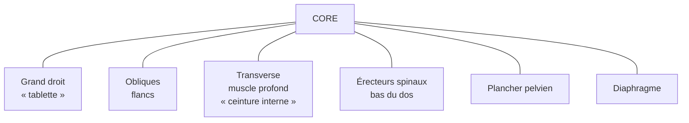

# Abdominaux et gainage

Le **« core »** désigne l'ensemble des muscles profonds et superficiels qui stabilisent la colonne vertébrale et le bassin. Travailler les abdominaux ne sert pas seulement à dessiner une silhouette : c'est le centre de transmission de force pour *tous* les autres mouvements (course, soulevé de terre, simple port de charge). Quand on porte une valise d'une main, que l'on court ou que l'on soulève une barre, la force produite par les jambes doit traverser le tronc pour atteindre les bras ; si le tronc plie, une partie de cette force se perd, et c'est souvent le bas du dos qui encaisse.

## Anatomie rapide

Le core forme une sorte de caisson. À l'avant, le **grand droit**, la fameuse « tablette de chocolat », fléchit le tronc. Sur les côtés, les **obliques** le font tourner et pencher. En profondeur, le **transverse** entoure l'abdomen comme une ceinture. À l'arrière, les **érecteurs du rachis** redressent le dos. Le **diaphragme** en forme le couvercle et le **plancher pelvien** le fond : en se contractant ensemble, ils font monter la pression dans l'abdomen, ce qui rigidifie le tronc comme un ballon gonflé.

| Muscle | Rôle principal | Recruté par |
|---|---|---|
| **Grand droit de l'abdomen** | Flexion du tronc | Crunch, sit-up |
| **Obliques** (externes + internes) | Rotation, flexion latérale | Russian twist, side plank |
| **Transverse de l'abdomen** | Stabilisation, « ceinture » qui maintient les organes | Gainage frontal, hollow body, vacuum |
| **Érecteurs spinaux** | Extension du dos | Superman, bird-dog, soulevé de terre |
| **Plancher pelvien + diaphragme** | Pression intra-abdominale (verrouillage) | Respiration abdominale, gainage tenu |

Le rôle premier de ces muscles n'est pas de produire du mouvement mais de l'empêcher : un bon core travaille en **anti-mouvement**, il résiste à la rotation, à la flexion et à l'extension du tronc. C'est pourquoi le gainage, qui entraîne précisément cette résistance, a autant sa place qu'un crunch, qui ne fait que plier le tronc.

> [!important] Idée clé
> Cette logique d'anti-mouvement explique pourquoi le core est sollicité dans quasi tous les mouvements de musculation (squat, soulevé de terre, développé) sans exercice dédié : à chaque fois qu'une charge cherche à faire fléchir, tourner ou basculer le tronc, c'est le core qui résiste pour transmettre la force entre le haut et le bas du corps. Un exercice d'isolation (crunch) muscle le grand droit, mais c'est le travail anti-mouvement qui protège la colonne sous charge.

## Exercices au poids du corps

La **planche**, ou gainage frontal, est l'exercice de base. En appui sur les avant-bras, coudes sous les épaules et pieds joints, on aligne le corps en une ligne droite, sans creuser le dos ni pointer les fesses vers le ciel, en serrant les fessiers, en rentrant légèrement le nombril et en continuant à respirer normalement. Elle sollicite le transverse, le grand droit, les épaules et les fessiers. Un débutant tient trois fois vingt à trente secondes, un pratiquant avancé trois fois une minute à une minute et demie. Les deux erreurs typiques sont de cambrer, ce qui fait mal au dos, et de bloquer sa respiration.

La **planche latérale** (*side plank*), en appui sur un seul avant-bras, corps aligné vu de face et hanches hautes, cible les obliques et le transverse ; on la tient vingt à quarante-cinq secondes de chaque côté. Le **hollow body**, venu de la gymnastique, se pratique allongé sur le dos, bas du dos plaqué au sol, bras tendus derrière la tête et jambes tendues décollées, le corps formant une banane renversée ; tenu vingt à quarante secondes, il développe un contrôle remarquable du grand droit et du transverse.

Le **bird-dog** se fait à quatre pattes : on tend en même temps le bras droit et la jambe gauche, puis l'inverse, sans laisser le bassin basculer ni tourner, à raison d'une dizaine de répétitions par côté. Il travaille les érecteurs, le transverse et les fessiers, et entraîne la coordination, ce qui en fait un classique de la prévention du mal de dos. Les **mountain climbers**, enfin, ramènent alternativement et rapidement les genoux vers la poitrine depuis la position de planche, pendant trente à quarante-cinq secondes : ils combinent gainage dynamique et effort cardiovasculaire.

## Exercices avec haltère

Le **russian twist** cible les obliques et le grand droit. Assis au sol, genoux fléchis, talons posés, ou décollés pour plus de difficulté, on incline le tronc vers l'arrière d'environ 45°, dos droit et non voûté, puis on tourne de chaque côté en amenant l'haltère, tenue à deux mains, toucher le sol à côté du bassin. On en fait trois séries de douze à quinze rotations par côté.

Le **plank pull-through** est un exercice d'anti-rotation très fonctionnel. En planche haute, bras tendus, avec une haltère posée d'un côté, on la fait passer sous la poitrine avec la main opposée, sans laisser les hanches tourner, une dizaine de fois par côté. Le **wood chop**, avec une haltère ou une poulie, consiste à partir debout, charge tenue à deux mains au-dessus d'une épaule, et à descendre en diagonale vers la hanche opposée ; il travaille les obliques et le transverse sur un mouvement proche de ceux des sports de lancer et de raquette.

Le **sit-up lesté**, enfin, renforce le grand droit : allongé, genoux fléchis, haltère tenue contre la poitrine, on se redresse complètement puis on redescend en contrôlant, dix à quinze fois. En cas de douleur lombaire, mieux vaut lui préférer les exercices de gainage.

## Programmer son core

| Niveau | Fréquence | Séance type |
|---|---|---|
| **Débutant** | 2-3 ×/semaine | Gainage frontal + side plank + bird-dog |
| **Intermédiaire** | 3 ×/semaine | + hollow body, russian twist, mountain climbers |
| **Avancé** | 3-4 ×/semaine | Circuits + ajouts lestés (plank pull-through, wood chop, sit-up lesté) |

Dix à quinze minutes suffisent, en fin de séance principale, si l'intensité est au rendez-vous. Les grands exercices de musculation comme le squat ou le soulevé de terre sollicitent déjà fortement le core (voir [[Jambes]]).

## Précautions

Une douleur au cou pendant les crunchs signale presque toujours que l'on tire sur sa tête avec les mains : la nuque doit rester détendue, et si la douleur persiste, mieux vaut passer au gainage. Une douleur au bas du dos indique souvent que le transverse ne fait pas son travail de stabilisation ; on revient alors aux exercices statiques, planche, hollow body et bird-dog, avant de reprendre les mouvements dynamiques.

Après une grossesse, il est fréquent que les deux moitiés du grand droit restent écartées, ce qu'on appelle une **diastase abdominale**. On commence alors par travailler le transverse en respiration profonde, et l'on réintroduit les crunchs et les sit-ups progressivement, sous le contrôle d'un kinésithérapeute ou d'une sage-femme.

> [!warning] Piège
> La diastase n'est pas propre au post-partum : une pression intra-abdominale mal gérée (apnée, "pousser" le ventre au lieu de le stabiliser) peut créer ou aggraver un écartement des grands droits chez n'importe qui, notamment en musculation lourde. Le réflexe de "gonfler" le ventre en poussant sous charge (au lieu de le rentrer/stabiliser) est une erreur technique fréquente et invisible à l'œil nu.

D'une manière générale, la pression abdominale se contrôle par la respiration plutôt qu'en la bloquant. L'apnée volontaire, la « manœuvre de Valsalva », se réserve aux efforts maximaux ponctuels, avec une technique apprise.

Reste une dernière illusion à dissiper : les abdominaux visibles ne se construisent pas, ils se révèlent. Aucun exercice ne fait fondre la graisse du ventre en particulier ; la tablette apparaît quand le taux de masse grasse baisse suffisamment, et l'endroit où le corps stocke ses graisses dépend largement de la génétique.
