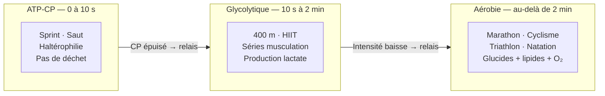

# Physiologie de l'Exercice

Usain Bolt couvre 100 mètres en moins de dix secondes ; Eliud Kipchoge court un marathon à plus de 20 km/h pendant deux heures. Aucun des deux ne pourrait faire ce que fait l'autre, et ce n'est pas qu'une question de volonté. Leurs muscles ne puisent pas leur énergie de la même façon, ne sont pas faits des mêmes fibres, et leur cœur ne s'est pas adapté de la même manière. La **physiologie de l'exercice** étudie comment le corps fournit l'énergie de l'effort, et comment il se transforme quand on l'entraîne.

## Trois façons de produire de l'énergie

Le muscle ne fonctionne qu'avec une seule monnaie, l'**ATP** (adénosine triphosphate), une molécule qui libère de l'énergie en se cassant. Il n'en stocke que de quoi tenir deux ou trois secondes. Tout le problème est donc de la reconstituer aussi vite qu'on la dépense, et le corps dispose pour cela de trois systèmes, plus ou moins rapides et plus ou moins endurants.

Le premier, le **système ATP-CP** ou système des phosphagènes, puise dans une petite réserve de **créatine phosphate** stockée dans le muscle, qui recharge l'ATP presque instantanément. Il fournit une puissance énorme, mais s'épuise en une dizaine de secondes : c'est le carburant du sprint, du saut et du lancer, et celui d'une série lourde de deux ou trois répétitions. Il ne produit pas de lactate, et sa réserve se reconstitue en trois à cinq minutes de repos, ce qui explique les longues pauses entre les séries de force maximale.

Le deuxième, le **système glycolytique**, découpe le glucose et le glycogène sans avoir besoin d'oxygène. Il prend le relais pour les efforts intenses de dix secondes à deux minutes environ, comme un 400 mètres ou une série de musculation de dix à quinze répétitions. Il produit du **lactate**, qu'on a longtemps accusé de provoquer la brûlure musculaire et les courbatures. On sait aujourd'hui que le lactate est innocent : la brûlure vient de l'accumulation d'ions hydrogène qui acidifient le muscle, et le lactate est au contraire un carburant que le cœur et les autres muscles recyclent. Les courbatures du lendemain, elles, viennent de micro-lésions des fibres.

Le troisième, le **système aérobie** ou oxydatif, brûle les glucides et les graisses en présence d'oxygène, dans les **mitochondries** des cellules. Il est lent à se mettre en route et ne fournit qu'une puissance modérée, mais il peut tourner pendant des heures, tant qu'il reste du carburant. C'est lui qui fait courir le marathonien et pédaler le cycliste sur route.

> [!important] Idée clé
> Les "durées" citées pour chaque système (0-10s, 10s-2min, >2min) ne signifient pas que les autres systèmes sont inactifs en dehors — les trois tournent dès la première seconde d'effort. Ce qui change, c'est lequel domine la production d'énergie à un instant donné. Un sprint de 10 secondes utilise majoritairement l'ATP-CP, mais le système aérobie contribue déjà, en arrière-plan, à la récupération entre les efforts.

On parle pour cette raison de **continuum énergétique** : la part de chaque système varie selon l'intensité et la durée de l'effort, et l'entraînement développe en priorité celui qu'on sollicite.

## Trois sortes de fibres

Un muscle est fait de milliers de fibres, qui ne sont pas toutes du même type. Les **fibres de type I**, dites lentes ou rouges, se contractent lentement et sans grande force, mais résistent à la fatigue pendant des heures : riches en mitochondries et en vaisseaux sanguins, elles fonctionnent à l'oxygène. Les **fibres de type IIx**, rapides et blanches, se contractent très vite et avec une grande force, mais s'épuisent en quelques secondes, car elles dépendent du glycogène et des phosphagènes. Entre les deux, les **fibres de type IIa** sont rapides mais assez endurantes, polyvalentes, à l'image des efforts d'un joueur de football ou d'un coureur de 800 mètres.

| Caractéristique | Type I (Lentes) | Type IIa (Intermédiaires) | Type IIx (Rapides) |
|---|---|---|---|
| Contraction | Lente | Rapide | Très rapide |
| Endurance | Haute | Moyenne | Faible |
| Force | Faible | Moyenne | Maximale |
| Métabolisme | Aérobie | Mixte | Anaérobie |
| Mitochondries | Nombreuses | Moyennes | Peu |
| Sport type | Marathon | 800 m · Sports collectifs | Sprint · Haltéro |

Chez la plupart des gens, les fibres lentes représentent environ la moitié du total. Les sprinters d'élite ont jusqu'à 70 à 80 % de fibres rapides dans les jambes, les marathoniens d'élite autant de fibres lentes. Cette répartition est en grande partie héritée.

> [!warning] Piège
> On ne peut pas "transformer" un profil de sprinter en profil de marathonien à force d'entraînement d'endurance, ni l'inverse : la marge de manœuvre entraînable se limite à l'axe IIx↔IIa (fibres rapides qui deviennent plus ou moins oxydatives). La frontière type I / type II, elle, reste largement fixée génétiquement — l'entraînement optimise ce qu'on a, il ne réécrit pas la distribution de départ.

## Ce que l'entraînement transforme

Le corps s'adapte à ce qu'on lui demande, et chaque système change à sa façon. Le **cœur** de l'athlète d'endurance grossit et se renforce, si bien qu'il éjecte davantage de sang à chaque battement. Il peut donc battre moins vite au repos, souvent entre 40 et 50 battements par minute au lieu de 60 à 80, et son débit maximal atteint 35 à 40 litres par minute, contre 20 à 25 chez un sédentaire. Dans les muscles, de nouveaux **capillaires** se développent autour des fibres pour mieux les irriguer.

Le **muscle** lui-même change selon l'entraînement. L'endurance multiplie les mitochondries et les enzymes qui brûlent les graisses et le glucose avec l'oxygène, et augmente les réserves de glycogène. La musculation fait grossir les fibres, surtout les rapides : c'est l'**hypertrophie**. L'idée que les fibres pourraient aussi se diviser, l'**hyperplasie**, a été observée chez l'animal mais reste très discutée chez l'humain. Les premiers progrès en force, enfin, ne viennent pas du muscle mais du système nerveux, qui apprend à recruter plus de fibres en même temps et à mieux les coordonner (voir [[Musculation et Force]]).

Les **poumons**, en revanche, s'adaptent peu : leur volume ne change guère avec l'entraînement, et chez une personne en bonne santé, ce ne sont pas eux qui limitent la performance. Ce sont surtout les muscles respiratoires qui deviennent plus endurants. Sur le plan **métabolique**, l'entraînement améliore la sensibilité à l'insuline et apprend aux muscles à brûler davantage de graisses à une allure donnée, ce qui épargne le glycogène. Le corps transpire aussi plus tôt et plus abondamment, ce qui l'aide à évacuer la chaleur.

Les **os**, enfin, se densifient sous l'effet des impacts et des charges, ce qui protège de l'ostéoporose, et les tendons et ligaments se renforcent, mais beaucoup plus lentement que les muscles. Ce décalage explique bien des blessures chez ceux qui augmentent leur charge trop vite.

## La VO2max et le seuil

La **VO2max** est le volume maximal d'oxygène qu'une personne peut consommer en une minute, rapporté à son poids. Elle dépend surtout du débit du cœur et de la capacité des muscles à utiliser l'oxygène. Un homme sédentaire se situe vers 35 à 40 ml par kilo et par minute, une femme sédentaire vers 30 à 35. Les athlètes d'endurance masculins atteignent 70 à 85, et les records, chez les skieurs de fond et les cyclistes, dépassent 90. L'entraînement l'améliore de 15 à 25 %, mais la génétique en fixe une large part.

La VO2max ne dit pourtant pas tout. Deux coureurs de VO2max identique peuvent avoir des performances très différentes, parce que l'un peut tenir une plus grande fraction de ce maximum. C'est le rôle du **seuil lactique**, l'intensité au-delà de laquelle le lactate s'accumule dans le sang plus vite qu'il n'est recyclé. Chez un sédentaire, il se situe vers 60 à 70 % de la VO2max ; chez un athlète entraîné, vers 80 à 90 %. Pour les épreuves d'endurance, c'est un meilleur prédicteur de la performance, et il se travaille par des séances d'allure soutenue proches du seuil.

Ces repères servent à définir des **zones d'entraînement**, exprimées en pourcentage de la fréquence cardiaque maximale. La zone 1 (50 à 60 %) sert à la récupération active ; la zone 2 (60 à 70 %), celle de l'endurance fondamentale, où l'on peut tenir une conversation, développe le système aérobie et l'utilisation des graisses ; la zone 3 (70 à 80 %) correspond à une allure soutenue ; la zone 4 (80 à 90 %) au seuil ; la zone 5 (90 à 100 %) aux efforts courts qui sollicitent la VO2max. On présente souvent la zone 2 comme la zone où l'on « brûle les graisses ». C'est vrai en proportion, mais un effort plus intense brûle davantage de calories au total : sa vraie valeur est de construire la base aérobie sans fatigue excessive. La plupart des athlètes d'endurance passent ainsi environ 80 % de leur temps à faible intensité (voir [[Entraînement et Performance]]).
