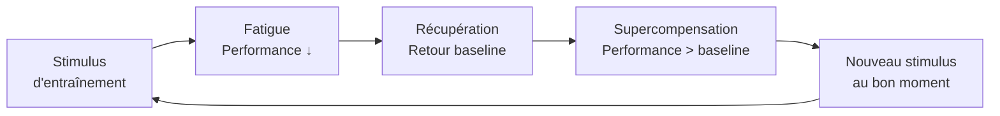

# Récupération et Supercompensation

Au sortir d'une séance difficile, on est moins fort qu'en y entrant : les muscles sont fatigués, les réserves d'énergie entamées, quelques fibres abîmées. Ce n'est donc pas pendant l'entraînement que l'on progresse, mais pendant les heures et les jours qui suivent, quand le corps répare les dégâts et se reconstruit un peu plus solide qu'avant, comme pour se préparer à la prochaine agression. La séance n'est que le signal ; la **récupération** est le moment où l'adaptation se produit. Sans elle, l'entraînement ne mène pas au progrès mais à l'épuisement.

## Le cycle de la supercompensation

Le modèle classique décrit quatre temps. L'entraînement provoque une **fatigue**, qui fait baisser la capacité de performance. Le corps **récupère** ensuite et revient à son niveau de départ. Puis il le dépasse pendant un temps : c'est la **supercompensation**. Si aucun nouvel entraînement ne vient, ce gain s'efface peu à peu.



Tout l'art de l'entraîneur tient dans le moment où placer la séance suivante. Trop tôt, avant la fin de la récupération, la fatigue s'accumule de séance en séance et l'on glisse vers le surentraînement. Trop tard, une fois le gain dissipé, on revient sans cesse au point de départ et l'on stagne. Au bon moment, au sommet de la supercompensation, chaque séance part d'un niveau un peu plus haut que la précédente. Ce modèle simplifie la réalité, car chaque qualité (force, endurance, réserves de glycogène) récupère à son propre rythme, mais il en donne bien la logique.

Place des séances sur le calendrier et compare « Bien espacées » et « Tous les jours » : la courbe montre la fatigue, puis la surcompensation ou la fatigue qui s'accumule.

```widget:supercompensation
jours: 21
seances: 1,5,9,13
intensite: intense
```

> [!tip] Méthode
> La VFC (variabilité de la fréquence cardiaque) est un indicateur avancé de récupération — elle bouge avant que la fatigue devienne visible en performance. La fréquence cardiaque de repos, elle, est un indicateur retardé : quand elle grimpe, le déficit de récupération est souvent déjà installé depuis plusieurs jours. Suivre la VFC permet d'ajuster le timing du prochain stimulus avant que la baisse de performance ne soit mesurable.

## Les étapes de la récupération

Dans la demi-heure qui suit l'effort, le corps commence par rétablir son équilibre : il faut se réhydrater avec de l'eau et des électrolytes, et, après un effort de plus d'une heure, apporter des glucides pour commencer à recharger le glycogène, ainsi que 20 à 40 g de protéines pour lancer la réparation musculaire. Un retour au calme en trottinant élimine le lactate plus vite que le repos complet, mais cela compte peu : le lactate disparaît de toute façon en une heure et n'est pour rien dans la fatigue du lendemain.

Dans les vingt-quatre heures qui suivent, l'essentiel se joue pendant le sommeil et à table (voir [[Nutrition Sportive]]). Une **inflammation** locale se développe autour des fibres abîmées. Elle fait mal, mais elle fait partie du processus de réparation : c'est elle qui attire les cellules chargées de nettoyer et de reconstruire.

> [!warning] Piège
> Prendre des anti-inflammatoires (AINS) systématiquement après chaque séance pour "récupérer plus vite" peut jouer contre l'objectif recherché : l'inflammation post-effort n'est pas qu'un dommage à supprimer, c'est en partie le signal qui déclenche la réparation et l'adaptation musculaire. La bloquer chroniquement peut émousser les gains d'entraînement à long terme, même si elle soulage la douleur à court terme.

Sur plusieurs jours, enfin, viennent les adaptations profondes : les fibres musculaires grossissent, les tendons et les os se renforcent, le système nerveux affine sa commande. C'est pour leur laisser le temps de s'installer qu'on programme, toutes les quatre à six semaines, une **semaine de décharge** où l'on réduit nettement le volume.

## Le sommeil, premier outil de récupération

Aucune méthode de récupération n'égale le sommeil. C'est pendant le sommeil profond que l'organisme sécrète l'essentiel de l'hormone de croissance, répare les tissus et renforce l'immunité, tandis que les autres phases consolident les gestes appris à l'entraînement.

| Phase | Processus de récupération |
|---|---|
| NREM 1-2 | Consolidation mémoire motrice, baisse température |
| NREM 3-4 (sommeil profond) | Sécrétion GH, réparation tissulaire, immunité |
| REM | Consolidation apprentissages, régulation émotionnelle |

Un adulte a besoin de sept à neuf heures par nuit, et beaucoup d'athlètes de haut niveau dorment neuf à dix heures. La régularité des horaires compte autant que la durée. Une chambre sombre, silencieuse et fraîche, autour de 17 à 19 °C, aide à s'endormir, tandis que les écrans et les entraînements intenses dans les deux heures qui précèdent le coucher le retardent.

## Reconnaître une récupération insuffisante

Les signes d'alerte sont de trois ordres. Les plus fiables sont les **performances** : une baisse de force, d'endurance ou de vitesse sur plusieurs séances de suite, l'incapacité à tenir les allures habituelles. Les signes **subjectifs** les accompagnent souvent : une fatigue qui ne passe pas malgré le repos, de l'irritabilité, une humeur en berne, une motivation qui s'effrite, des courbatures qui durent. Certains signes **biologiques** peuvent aussi alerter, comme une fréquence cardiaque de repos qui grimpe de cinq à sept battements ou une variabilité cardiaque qui chute. Les dosages hormonaux comme le cortisol et la testostérone varient beaucoup d'une personne à l'autre et ne permettent pas de poser un diagnostic à eux seuls. Un bilan sanguin permet aussi d'écarter une carence en fer, dont les symptômes se confondent avec ceux de la fatigue d'entraînement (voir [[Micronutriments et Performance]]).

## Le surentraînement

Quand la charge dépasse durablement la capacité de récupération, on glisse par étapes vers le **surentraînement**. Le premier stade, le **surmenage fonctionnel**, est normal et même recherché : après un bloc d'entraînement chargé, la performance baisse quelques jours, puis remonte au-dessus de son niveau initial. Si l'on insiste, on passe au **surmenage non fonctionnel**, où il faut des semaines, voire des mois, pour retrouver son niveau, sans gain à la clé. Le **syndrome de surentraînement** proprement dit, plus rare, est un état d'épuisement qui peut durer des mois et demande un suivi médical.

La prévention repose sur la **périodisation** de l'entraînement, qui fait alterner phases de charge et phases de décharge, avec une réduction du volume de 40 à 60 % lors des semaines allégées. Suivre chaque matin sa variabilité cardiaque ou sa fréquence de repos aide à repérer les dérives. On conseille souvent de ne pas augmenter la charge totale de plus de 10 % par semaine ; cette règle n'a rien d'une loi, mais elle rappelle que les tissus ont besoin de temps pour suivre.

## Les méthodes de récupération active

Une foule de techniques promettent d'accélérer la récupération, avec des preuves très inégales.

| Méthode | Mécanisme | Efficacité |
|---|---|---|
| Bain froid (10-15°C, 10-15 min) | Vasoconstriction, réduction inflammation | Bonne pour douleurs |
| Contraste chaud/froid | Effet pompe vasculaire, circulation | Bonne |
| Massage / foam rolling | Détente myofasciale, circulation | Bonne (subjective surtout) |
| Marche légère / récup active | Élimination lactate, circulation | Très bonne |
| Électrostimulation (TENS/EMS) | Contraction passive, circulation | Modérée |
| Caisson hyperbare | Oxygénation accrue | Coûteux, faible preuve |
| Compression (manchons) | Réduction œdème, retour veineux | Modérée |

Ces méthodes soulagent surtout la sensation de fatigue et les courbatures, ce qui est précieux en compétition quand il faut enchaîner les épreuves. Mais le bain froid illustre la même limite que les anti-inflammatoires : pris systématiquement après la musculation, il freine la prise de muscle et de force, parce qu'il atténue les signaux qui déclenchent l'adaptation. Mieux vaut le réserver aux périodes où la récupération rapide compte plus que la progression.
