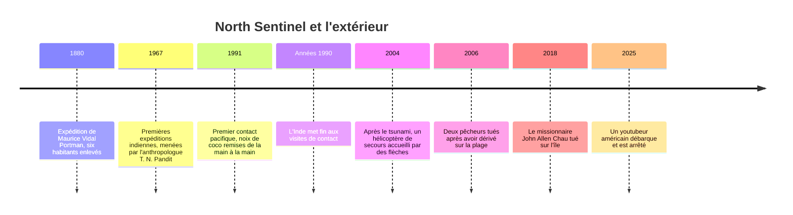

# North Sentinel

**North Sentinel** est une île de l'archipel indien des Andaman, dans le golfe du Bengale, habitée par les **Sentinelles**, l'un des derniers peuples au monde à vivre sans contact avec l'extérieur. Ils repoussent, souvent à l'arc, toute personne qui tente de débarquer, et l'Inde a renoncé depuis les années 1990 à les approcher. L'île est un cas d'école pour une question que l'anthropologie se pose depuis ses débuts : a-t-on le droit, ou le devoir, d'entrer en contact ?

## L'île

| | |
|---|---|
| Situation | archipel des Andaman (territoire indien des îles Andaman-et-Nicobar), à une cinquantaine de km à l'ouest de Port Blair |
| Superficie | environ 60 km² |
| Relief | plate et boisée, point culminant vers 120 m |
| Littoral | ceinturé de récifs coralliens qui rendent l'accostage difficile |
| Statut | territoire indien, de fait laissé à ses habitants |

Le séisme de décembre 2004 a soulevé l'île d'un à deux mètres, asséchant une partie des récifs.

## Les Sentinelles

### Combien sont-ils ?

Personne ne le sait. Toutes les estimations sont faites depuis un bateau ou un hélicoptère, sans jamais voir l'intérieur de la forêt.

| Source | Estimation |
|---|---|
| Recensement indien de 2001 | 39 personnes |
| Recensement indien de 2011 | 15 personnes, chiffre jugé fantaisiste par la presse indienne |
| Survival International | 50 à 150 personnes, réparties en trois groupes |
| Estimations publiées en 2012 | 50 à 400 personnes |

### Mode de vie

Ce que l'on sait vient de l'observation à distance et des brèves visites du siècle dernier :

- **Chasseurs-cueilleurs-pêcheurs** : chasse au sanglier dans la forêt, cueillette, pêche dans le lagon ; aucune trace d'agriculture.
- **Pirogues** étroites à balancier, poussées à la perche dans les eaux peu profondes du récif, pas faites pour la haute mer.
- **Habitat** : grandes huttes communes et abris temporaires.
- **Armes** : arcs, flèches et lances. Les pointes sont faites du **fer récupéré** sur les épaves échouées sur le récif et sur les objets rejetés par la mer.
- **Langue** : inconnue. Elle n'a jamais pu être enregistrée ni classée ; en 1991, l'équipe de contact a appelé les habitants avec des mots onge, une autre langue des Andaman, sans qu'on sache s'ils ont été compris.

Leur isolement les rend surtout **vulnérables aux maladies** : sans immunité contre la grippe ou la rougeole, un seul contact peut décimer le groupe, comme cela est arrivé à d'autres peuples des Andaman au XIXe siècle.

## Histoire des contacts

### L'enlèvement de 1880

L'officier britannique **Maurice Vidal Portman** débarque en 1880 avec une troupe armée et enlève six habitants, un couple âgé et quatre enfants, pour les emmener à Port Blair. Les deux aînés tombent malades et meurent ; les enfants sont ramenés sur l'île avec des cadeaux. L'épisode illustre la menace la plus constante pour les Sentinelles : les maladies venues de l'extérieur.

### Les expéditions indiennes (1967-1990s)

À partir de 1967, l'Inde envoie des expéditions de « contact » : on dépose sur la plage des cadeaux (noix de coco, bananes, casseroles, tissu), et on se retire. L'accueil est le plus souvent fait de flèches.

Le **4 janvier 1991**, l'équipe de l'Anthropological Survey of India dirigée par **Triloknath Pandit**, dont l'anthropologue **Madhumala Chattopadhyay** était la seule femme, obtient le premier échange pacifique : des Sentinelles s'approchent du bateau sans armes et prennent les noix de coco de la main des visiteurs.

Les visites cessent au milieu des années 1990. Survival International leur reprochait d'exposer les Sentinelles aux maladies et de créer une dépendance aux cadeaux ; l'Inde a depuis adopté une politique de **non-contact** : observer de loin, ne plus approcher.

### Après le tsunami de 2004

Trois jours après le séisme et le tsunami de décembre 2004, un hélicoptère indien survole l'île pour vérifier si ses habitants ont survécu. Un homme sur la plage le vise à l'arc ; la photo fait le tour du monde et répond à la question : les Sentinelles avaient survécu.

### Les morts de 2006 et 2018

- **Janvier 2006** : deux pêcheurs, Sunder Raj et Pandit Tiwari, qui braconnaient près de l'île, voient leur bateau rompre son amarre et dériver jusqu'au rivage. Ils sont tués. Personne n'est poursuivi.
- **Novembre 2018** : **John Allen Chau**, missionnaire américain de 26 ans, paie des pêcheurs pour l'approcher de l'île afin d'y prêcher l'Évangile. Repoussé une première fois (une flèche transperce sa Bible), il revient et est tué ; son corps n'a jamais été récupéré. Sept personnes qui l'avaient aidé sont arrêtées. L'Inde renonce à récupérer le corps pour ne pas risquer un nouveau contact.

### 2025 : le youtubeur

Le **29 mars 2025**, Mykhailo Polyakov, un youtubeur américain de 24 ans, débarque illégalement sur la côte nord-est avec un bateau gonflable. Il laisse une canette de Coca light et une noix de coco en « offrande », filme, ramasse du sable et repart. Repéré par des pêcheurs, il est arrêté à Port Blair le 31 mars. C'était sa troisième tentative.

## Le cadre légal

- La **réglementation de 1956 sur la protection des tribus aborigènes des Andaman-et-Nicobar** interdit d'aller sur l'île et de s'en approcher ; les sources donnent une zone d'exclusion de 5 km autour de l'île (certaines parlent de 5 milles nautiques).
- La Marine et les garde-côtes indiens patrouillent la zone tampon.
- Les Sentinelles ne sont pas poursuivis pour la mort des intrus : l'État considère qu'ils défendent leur territoire.
- En août 2018, l'île figure parmi les 29 îles retirées du régime de permis spécial (*Restricted Area Permit*) pour faciliter le tourisme dans l'archipel. Le changement ne levait pas l'interdiction de 1956, mais la mort de Chau quelques mois plus tard a relancé le débat.

> [!chiffres]
> - **~60 km²** de forêt et de récif
> - **1991** : seul contact pacifique documenté
> - **5 km** de zone d'exclusion fixée par la réglementation de 1956
> - **50 à 150** habitants selon Survival International, personne n'a pu les compter

## Ce que l'île pose comme question

North Sentinel est l'inverse des terrains classiques de l'anthropologie. Aux [[Social Sciences/Anthropology/Terrains/Îles Trobriand|îles Trobriand]], Malinowski fondait l'ethnographie moderne sur l'immersion longue ; ici, le consensus actuel est que la meilleure chose à faire est de **ne pas y aller**.

Trois arguments soutiennent cette position :

1. **Sanitaire** : chaque contact est un risque d'épidémie mortelle. L'histoire des autres peuples des Andaman, comme les Grands Andamanais, environ 5 000 avant la colonisation et une cinquantaine aujourd'hui, en est l'avertissement.
2. **Le consentement** : les Sentinelles disent non, à leur manière, depuis plus d'un siècle.
3. **Le précédent** : leurs voisins jarawa, sortis de l'isolement en 1997-1998, ont connu deux épidémies de rougeole et des « safaris humains » le long de la route qui traverse leur réserve.

L'île n'en est pas moins exposée : braconnage de langoustes, d'holothuries et de tortues dans ses eaux, et curiosité des missionnaires et des influenceurs.

## Sources

- Survival International, « The Sentinelese », [lien](https://www.survivalinternational.org/tribes/sentinelese)
- Wikipédia (en), « North Sentinel Island » (géographie, recensements, chronologie), [lien](https://en.wikipedia.org/wiki/North_Sentinel_Island)
- Wikipédia (en), « Madhumala Chattopadhyay » et « Triloknath Pandit » (contact de 1991), [lien](https://en.wikipedia.org/wiki/Madhumala_Chattopadhyay), [lien](https://en.wikipedia.org/wiki/Triloknath_Pandit)
- « American killed by protected Andaman tribe on island off limits to visitors », *The Wire*, novembre 2018 (réglementation de 1956), [lien](https://thewire.in/rights/american-killed-by-protected-andaman-tribe-on-island-off-limits-to-visitors)
- « Centre mulls putting North Sentinel Island back in Restricted Area Permit regime », *The News Minute*, novembre 2018, [lien](https://www.thenewsminute.com/amp/story/news/centre-mulls-putting-north-sentinel-island-back-restricted-area-permit-regime-92853)
- « American killed by isolated tribe on India's North Sentinel Island, police say », *NBC News*, novembre 2018, [lien](https://www.nbcnews.com/news/world/american-killed-isolated-tribe-india-s-north-sentinel-island-police-n938826)
- « Time ticking for India's Jarawa tribe », *Al Jazeera*, janvier 2014 (Jarawa, Grands Andamanais), [lien](https://www.aljazeera.com/amp/features/2014/1/4/time-ticking-for-indias-jarawa-tribe)
- « U.S. tourist arrested after bringing Diet Coke to remote tribe on forbidden island », *CBS News*, avril 2025, [lien](https://www.cbsnews.com/amp/news/us-tourist-remote-tribe-forbidden-north-sentinel-island-india)
