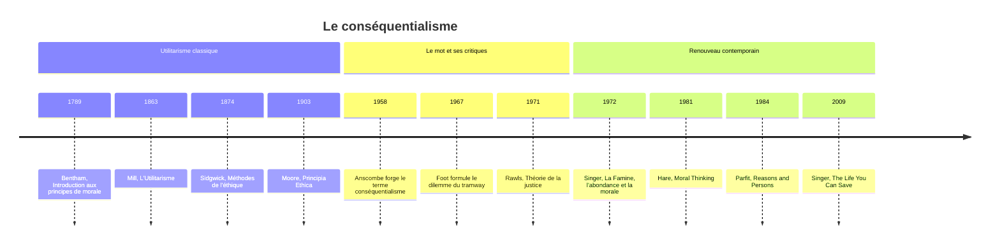

# Conséquentialisme

En 1958, la philosophe britannique Elizabeth Anscombe publie un article retentissant, « La philosophie morale moderne ». Elle y forge un mot pour désigner ce qu'elle reproche à presque tous les moralistes anglais depuis Henry Sidgwick : le **conséquentialisme**, l'idée qu'une action se juge uniquement à ses conséquences. Le mot devait être une critique ; il est devenu le nom d'une famille entière de théories morales, dont l'[[Utilitarisme]] est la plus connue. Pour toutes, ce qui rend une action bonne ou mauvaise n'est ni l'intention de celui qui agit, ni la nature de l'acte, mais ce qu'il produit dans le monde. On résume souvent cette position par l'adage « la fin justifie les moyens », à condition de préciser qu'il s'agit d'une fin évaluée impartialement, pour tous ceux que l'action affecte.

## Une famille de théories

Toutes les théories conséquentialistes partagent la même structure : elles définissent ce qui est bon, puis demandent de le promouvoir. Elles diffèrent par la réponse à la première question. L'**utilitarisme** classique de Jeremy Bentham et de John Stuart Mill tient que le seul bien est le bonheur, entendu comme plaisir et absence de douleur. Bentham proposait de mesurer plaisirs et peines selon leur intensité, leur durée, leur certitude, leur proximité, leur fécondité, leur pureté et leur étendue ; Mill ajoutait que certains plaisirs, ceux de l'esprit, sont supérieurs à d'autres. Pour savoir comment agir, l'utilitarisme de l'**acte** évalue chaque action dans sa situation, tandis que l'utilitarisme de la **règle** recommande de suivre les règles dont le respect général produit les meilleurs résultats (voir [[Utilitarisme]]).

D'autres versions élargissent ou déplacent la notion de bien. Le **conséquentialisme des préférences** de R. M. Hare et de Peter Singer cherche à satisfaire ce que les gens veulent réellement, plutôt qu'à maximiser leur plaisir. Le **conséquentialisme idéal** du philosophe de Cambridge G. E. Moore (*Principia Ethica*, 1903) compte d'autres biens que le plaisir, comme l'amitié et la contemplation de la beauté. Le **conséquentialisme négatif**, dont Karl [[Popper|Popper]] a esquissé l'idée, vise à réduire la souffrance évitable plutôt qu'à augmenter le bonheur. Quant à l'**égoïsme éthique**, défendu par la romancière Ayn Rand sous le nom d'« égoïsme rationnel », il ne retient que les conséquences pour soi ; la plupart des philosophes refusent d'y voir une morale, puisqu'il abandonne l'impartialité qui fait le cœur du conséquentialisme.

Une position nuancée s'est imposée chez beaucoup de conséquentialistes contemporains, la théorie **à deux niveaux** de R. M. Hare (*Moral Thinking*, 1981). Au quotidien, nous suivons des règles morales simples et intériorisées, ne pas tuer, ne pas mentir, tenir ses promesses, parce que calculer à chaque instant serait impossible et dangereux. Mais à un niveau critique, dans le calme de la réflexion, ces règles se justifient et se révisent par leurs conséquences à long terme.

## La difficulté du calcul

Le conséquentialisme suppose que l'on puisse comparer et additionner les biens et les maux de personnes différentes. Or comment comparer le bonheur d'une personne avec la souffrance d'une autre, ou prévoir les effets lointains d'une décision ? Le bombardement d'Hiroshima en août 1945 a été justifié par les vies qu'il aurait épargnées en évitant un débarquement au Japon ; mais combien de vies, et comment les mettre en balance avec les civils tués ? Le calcul est impossible à mener avec précision.

> [!warning] Piège
> Le problème n'est pas seulement « difficile à calculer en pratique » — c'est une objection structurelle. Le calcul suppose que le bonheur soit une grandeur unique, commensurable entre individus. Rien ne garantit que l'intensité de plaisir d'une personne soit comparable à celle d'une autre. Les critiques suivantes (Rawls, valeur intrinsèque) dérivent toutes de cette faille initiale.

## Les cas qui divisent

Les philosophes ont imaginé des cas pour mettre le conséquentialisme à l'épreuve. Dans le **dilemme du tramway**, formulé par Philippa Foot en 1967, un tramway fou va écraser cinq personnes, à moins que vous n'actionniez un aiguillage qui le dévie vers une voie où se trouve une seule personne. Le conséquentialiste actionne le levier : un mort vaut mieux que cinq. Mais la plupart des gens refusent de pousser un homme d'une passerelle pour arrêter le tramway avec son corps, alors que le bilan est le même. Le déontologue kantien explique ce refus : tuer activement un innocent, en se servant de lui comme d'un moyen, est mal quelles qu'en soient les conséquences.

> [!tip] Méthode
> Le dilemme ne cherche pas à savoir « quel choix est le bon » — il isole la distinction entre tuer activement et laisser mourir (act/omission distinction). Le même bilan chiffré (1 mort contre 5) donne des réponses opposées selon qu'on agit ou qu'on s'abstient : c'est cet écart d'intuition, pas le nombre de morts, que le dilemme est fait pour révéler.

D'autres cas sont plus favorables au conséquentialisme. Si des soldats nazis cherchent des Juifs cachés chez vous, presque tout le monde juge qu'il faut mentir pour les sauver, alors que [[Kant]] maintenait un devoir absolu de vérité. Le cas de la « bombe à retardement », où un terroriste capturé saurait où est cachée une bombe sur le point d'exploser, est plus troublant : le calcul semble justifier la torture si elle peut sauver des millions de vies. On objecte que la dignité humaine est inviolable, que la torture dégrade celui qui la pratique et la société qui la tolère, et que son efficacité est douteuse, puisqu'un homme torturé dit ce qu'on veut entendre.

## Les forces du conséquentialisme

Le conséquentialisme part d'une intuition difficile à contester : les conséquences de nos actes comptent moralement, et éviter la souffrance, favoriser le bien-être, sont au cœur de la morale. Il est **impartial** : selon la formule de Bentham, chacun compte pour un, personne pour plus d'un, sans privilège de naissance, de nation ou d'espèce. Il fournit un guide clair et adaptable aux situations nouvelles. C'est enfin la théorie morale qui inspire le plus les décisions publiques : analyses coûts-bénéfices, économie de la santé qui compare les traitements en « années de vie ajustées sur la qualité » (QALY), politiques climatiques qui mettent en balance les coûts présents et les dommages futurs, arbitrages des confinements pendant la pandémie. Le mouvement de l'**altruisme efficace**, autour de Peter Singer et William MacAskill, en applique la logique à la générosité privée, en orientant les dons vers les causes qui sauvent le plus de vies par euro.

## Les critiques

La critique la plus connue porte sur les **droits individuels**. Un chirurgien qui a cinq patients mourants, chacun en attente d'un organe différent, devrait-il tuer un visiteur en bonne santé pour les sauver tous ? Le calcul dit oui ; l'intuition morale crie non. Le conséquentialisme semble pouvoir justifier n'importe quelle horreur, sacrifier un innocent, voler, trahir, rompre une promesse, pourvu que le bilan soit positif.

John Rawls a donné à cette objection sa forme la plus profonde dans *Théorie de la justice* (1971). En additionnant les bonheurs comme s'ils formaient une seule masse, l'utilitarisme « ne prend pas au sérieux la distinction entre les personnes ». Il traite les individus comme de simples réceptacles interchangeables de plaisir et de peine, alors que chacun a sa propre vie.

> [!important] Idée clé
> Cette critique de Rawls est la plus profonde de toutes car elle n'attaque pas la difficulté pratique du calcul, mais sa logique même : additionner le bonheur de plusieurs personnes comme si c'était une seule masse ignore qu'aucune personne ne vit la somme — chacune ne vit que sa propre part. C'est un problème de principe, pas de précision.

Le philosophe Bernard Williams ajoute une critique de l'**intégrité** : en exigeant que chacun se fasse l'agent impartial du meilleur état du monde, le conséquentialisme nous aliène de nos propres projets et engagements, ceux qui donnent un sens à notre vie. D'autres objectent que certaines choses ont une **valeur intrinsèque**, la justice, la vérité, l'amitié, la beauté, qui ne se réduit pas à leurs effets sur le bien-être : détruirait-on une œuvre d'art unique pour épargner à quelqu'un une légère souffrance ?

Reste l'**exigence excessive**. Singer a proposé une expérience devenue célèbre : si vous passez devant un étang où un enfant se noie, vous devez le sauver, même si cela abîme vos vêtements. Or nous pourrions sauver des enfants à l'autre bout du monde pour le prix de ces vêtements, en donnant à des organisations efficaces. Le conséquentialisme semble alors exiger de donner jusqu'au point où donner davantage nous coûterait autant que cela rapporte aux autres, une morale héroïque qui ne laisse presque plus de place à la vie personnelle.

## Conséquentialisme et déontologie

| Conséquentialisme | [[Universalisme Moral|Déontologie (Kant)]] |
|:--|:--|
| Seules les conséquences comptent | Les intentions et devoirs comptent |
| La fin peut justifier les moyens | Certains actes sont toujours mal |
| Flexible, situationnel | Règles absolues |
| Impartial, calcul | Respect de la dignité |
| Maximiser le bien | Respecter les droits |
| "Que produit cette action?" | "Puis-je universaliser cette maxime?" |

Les grands représentants du conséquentialisme, Bentham, Mill, Henry Sidgwick, G. E. Moore, R. M. Hare, Peter Singer ou Derek Parfit, ont chacun cherché à répondre à ces objections sans renoncer à l'idée centrale. Beaucoup de philosophes jugent aujourd'hui qu'une éthique équilibrée doit tenir ensemble ce que chaque tradition voit le mieux : que les conséquences comptent, que certains principes ne se négocient pas, et que le caractère de celui qui agit importe aussi.

## Ressources

- John Stuart Mill, *L'Utilitarisme* (1863) : le classique, court et accessible.
- Peter Singer, *Sauver une vie* (*The Life You Can Save*, 2009).
- Judith Jarvis Thomson, « The Trolley Problem » (1985) : l'article qui a donné son nom au dilemme.
- Stanford Encyclopedia of Philosophy : [Consequentialism](https://plato.stanford.edu/entries/consequentialism/).
- YouTube : [Utilitarisme expliqué](https://www.youtube.com/watch?v=uvmz5E75ZIA).
- Site du mouvement : [Effective Altruism](https://www.effectivealtruism.org).
