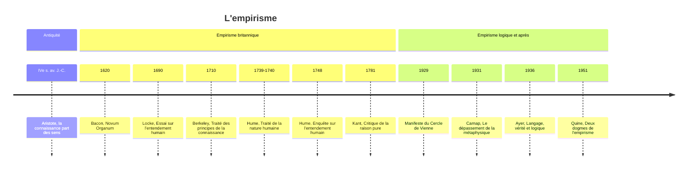

# Empirisme

En 1688, le savant irlandais William Molyneux écrit à John Locke pour lui soumettre une énigme. Un aveugle de naissance a appris à distinguer au toucher un cube d'une sphère. Si on lui rendait soudain la vue, reconnaîtrait-il, sans les toucher, lequel est le cube et lequel la sphère ? Locke répond que non : l'aveugle devrait apprendre à associer ce qu'il voit à ce qu'il touchait, car rien dans l'esprit ne relie d'avance les deux sens. Le « problème de Molyneux » condense la thèse de l'**empirisme** (du grec *empeiria*, l'expérience) : toute connaissance vient de l'expérience des sens. Il reprend un adage des philosophes médiévaux, « rien n'est dans l'intellect qui n'ait d'abord été dans les sens », et s'oppose au [[Rationalisme]], pour qui certaines connaissances sont innées ou découvertes par la raison seule.

## Des origines antiques à Bacon

Dès l'Antiquité, Aristote s'oppose à l'innéisme de son maître [[Platon]] : la connaissance commence par la perception des choses particulières, à partir desquelles l'esprit abstrait des notions générales. Les épicuriens et les stoïciens font eux aussi de la sensation le critère de la vérité. Mais l'empirisme moderne naît au XVIIe siècle, en Grande-Bretagne surtout, porté par la révolution scientifique et ses expériences, et dressé contre la scolastique héritée d'Aristote comme contre le rationalisme continental.

Francis Bacon (1561-1626), chancelier d'Angleterre, en pose le programme dans le *Novum Organum* (1620), dont le titre défie l'*Organon*, la logique d'Aristote. La déduction, juge-t-il, ne fait que développer ce qu'on sait déjà ; pour découvrir, il faut observer la nature, rassembler les faits, en tirer des lois générales par **induction**, puis les vérifier par l'expérimentation. Encore faut-il se débarrasser des **idoles**, les illusions qui faussent le jugement : celles de la tribu, communes à toute l'espèce humaine ; celles de la caverne, propres à chaque individu ; celles du forum, nées des ambiguïtés du langage ; celles du théâtre, héritées des systèmes philosophiques. Bacon est l'un des pères de la méthode expérimentale.

## Locke : l'esprit comme page blanche

John Locke (1632-1704) fonde l'empirisme moderne dans son *Essai sur l'entendement humain* (1690). Il commence par attaquer les idées innées : si elles existaient, tous les hommes les posséderaient, y compris les enfants, or un enfant n'a aucune idée de Dieu ni des principes de la logique. Il faut donc supposer qu'au départ l'esprit est « une table rase, vide de tous caractères, sans aucune idée ».

D'où viennent alors nos idées ? De deux sources : la **sensation**, qui nous fait percevoir le monde extérieur, ses couleurs, ses sons, ses odeurs, et la **réflexion**, par laquelle nous observons nos propres opérations mentales, penser, douter, vouloir. L'esprit reçoit passivement des **idées simples**, indécomposables, comme le rouge, le froid ou le sucré, puis les combine activement en **idées complexes** : une pomme, c'est du rouge, du rond, du sucré réunis.

Locke distingue aussi deux sortes de qualités dans les objets.

| Qualités Premières | Qualités Secondes |
|--------------------|-------------------|
| Dans l'objet lui-même | Dans notre perception |
| Étendue, forme, mouvement, solidité | Couleur, son, odeur, goût |
| Objectives | Subjectives |
| Mesurables | Non mesurables objectivement |

La forme d'une pomme lui appartient, quel que soit celui qui la regarde ; sa couleur rouge, elle, n'existe que dans la rencontre entre la surface du fruit et un œil.

> [!warning] Piège
> Ne pas confondre « qualité seconde » et « illusion ». Locke ne dit pas que le rouge n'existe pas — il dit que la couleur dépend de la relation entre l'objet et un percevant (structure de sa surface, œil humain), alors que l'étendue existerait telle quelle même sans observateur. C'est une distinction relationnelle, pas une hiérarchie réel/illusoire.

Locke bute enfin sur la **substance**. Nous ne percevons jamais que des qualités, jamais le support qui les porterait. La substance n'est qu'un « je ne sais quoi », une idée obscure. Cette remarque, en apparence modeste, ouvre la voie à Berkeley et à Hume.

## Berkeley : être, c'est être perçu

L'Irlandais George Berkeley (1685-1753), évêque anglican, pousse la logique de Locke jusqu'à une conclusion stupéfiante dans son *Traité des principes de la connaissance humaine* (1710). Nous ne connaissons que nos idées, nos perceptions ; nous n'avons aucun accès à une matière qui existerait indépendamment d'elles. Parler d'une matière « en soi » n'a donc aucun sens. Même les qualités premières de Locke dépendent de la perception : la grandeur d'un objet varie selon la distance d'où on le regarde. Conclusion : seuls existent les esprits et leurs idées. Pour les choses, « être, c'est être perçu » (*esse est percipi*). C'est l'**immatérialisme**.

Mais que devient un arbre quand personne ne le regarde ? Berkeley répond que Dieu perçoit tout, continuellement, et maintient ainsi le monde dans l'existence. Un limerick anonyme, souvent attribué au prêtre Ronald Knox, s'en est amusé :

> "There was a young man who said 'God  
> Must find it exceedingly odd  
> To think that the tree  
> Should continue to be  
> When there's no one about in the quad.'"

Et la réponse :

> "Dear Sir, your astonishment's odd;  
> I am always about in the quad.  
> And that's why the tree  
> Will continue to be  
> Since observed by, Yours faithfully, God."

## Hume : l'empirisme jusqu'au scepticisme

L'Écossais David [[Hume]] (1711-1776) mène l'empirisme à ses ultimes conséquences dans le *Traité de la nature humaine* (1739-1740), puis dans l'*Enquête sur l'entendement humain* (1748), plus accessible. Il distingue les **impressions**, nos perceptions vives et immédiates, et les **idées**, qui n'en sont que des copies affaiblies, dans la mémoire ou l'imagination.

| Impressions | Idées |
|-------------|-------|
| Sensations vivaces (voir, toucher) | Copies affaiblies des impressions (mémoire, imagination) |
| Force et vivacité | Plus faibles |
| Primaires | Dérivées |

Toute idée simple dérive d'une impression. Pour savoir si un mot a un sens, il suffit donc de demander de quelle impression vient l'idée qu'il désigne. S'il n'y en a aucune, le mot est vide, et une bonne partie de la métaphysique s'effondre.

Hume applique ce test à la **causalité**. Quand une boule de billard en heurte une autre, je vois la première rouler, puis la seconde se mettre en mouvement. Mais je ne vois jamais le lien nécessaire qui unirait les deux. Je ne perçois qu'une succession, que j'ai vue se répéter si souvent que j'ai pris l'**habitude** d'attendre le second mouvement quand survient le premier. La causalité n'est pas une nécessité dans les choses, mais une attente dans l'esprit.

> [!important] Idée clé
> C'est le moment où l'empirisme se retourne contre lui-même : la méthode qui fonde toute connaissance sur l'observation ne peut pas observer la nécessité causale — seulement la succession répétée de deux événements. Poussé jusqu'au bout, l'empirisme sape le concept même sur lequel repose la science qu'il voulait légitimer.

Il en découle le **problème de l'induction**. Pourquoi croyons-nous que le soleil se lèvera demain ? Parce qu'il s'est toujours levé. Mais cette justification suppose déjà que l'avenir ressemblera au passé, ce qu'il s'agissait de prouver : elle tourne en rond. Et la raison ne peut pas davantage la fonder, puisqu'il n'y a aucune contradiction à imaginer que le soleil ne se lève pas. L'induction n'a donc aucune justification rationnelle. C'est cette découverte qui, selon ses propres mots, « réveilla [[Kant]] de son sommeil dogmatique ».

Le **moi** n'échappe pas à l'analyse. « Quand je pénètre le plus intimement dans ce que j'appelle moi-même, je tombe toujours sur une perception particulière ou sur une autre, de chaud ou de froid, de lumière ou d'ombre, d'amour ou de haine, de douleur ou de plaisir. » Je ne me saisis jamais sans une perception. Le moi n'est qu'un **faisceau de perceptions**, une sorte de théâtre où elles défilent, sans spectateur permanent.

Hume n'est pourtant pas un sceptique absolu. La nature nous contraint à croire à la causalité, au monde extérieur et à notre propre identité ; nous ne pourrions pas vivre autrement. Ces croyances sont naturelles et nécessaires, même si la raison ne peut les justifier. « La coutume est le grand guide de la vie humaine. » On parle à son propos de **naturalisme sceptique**.

## Kant et le dépassement du débat

[[Kant]] (*Critique de la raison pure*, 1781) répond à Hume en distinguant deux choses que l'empirisme confondait : « si toute notre connaissance commence avec l'expérience, il n'en résulte pas qu'elle dérive toute de l'expérience ». Les sensations fournissent la matière de la connaissance ; mais l'espace et le temps, formes de la sensibilité, et la causalité, catégorie de l'entendement, sont des structures a priori de l'esprit qui organisent toute expérience. La causalité n'est donc ni une habitude, comme le croyait Hume, ni une propriété des choses en soi : c'est une condition de l'expérience elle-même. D'où la possibilité de jugements à la fois instructifs et nécessaires, les **jugements synthétiques a priori**.

## L'empirisme logique

Au XXe siècle, l'empirisme renaît à Vienne. Dans les années 1920 et 1930, le **Cercle de Vienne**, autour de Moritz Schlick, Rudolf Carnap et Otto Neurath, veut unifier la science sur des bases empiristes, armées de la logique moderne. Son arme est le **principe de vérification** : le sens d'une proposition est la méthode de sa vérification. Un énoncé n'a de sens que s'il est vérifiable par l'expérience, comme « l'eau bout à 100 °C », ou vrai par définition, comme « tous les célibataires sont non mariés ». Tout le reste, et notamment la métaphysique, n'est pas faux mais dépourvu de sens. Carnap prend pour cible une phrase de Heidegger, « le Néant lui-même néantit », qu'il juge vide.

Le mouvement décline pourtant rapidement. Le principe de vérification n'est lui-même ni vérifiable par l'expérience ni vrai par définition : selon son propre critère, il est dépourvu de sens. Il est en outre trop strict, car une loi scientifique universelle ne peut jamais être vérifiée sur tous les cas. Karl [[Popper|Popper]] lui substitue un autre critère, non plus du sens mais de la science : la **réfutabilité**. On ne pourra jamais prouver par l'observation que tous les cygnes sont blancs, mais un seul cygne noir suffit à prouver le contraire.

> [!tip] Méthode
> Repérer ce schéma ailleurs : chaque fois qu'une théorie propose un critère universel pour trier le sens du non-sens, demander si le critère lui-même passe son propre test. Le principe de vérification échoue à sa propre épreuve — un problème structurel qui revient dans d'autres tentatives de démarcation (la falsifiabilité de Popper évite cet écueil en se présentant comme une convention méthodologique, pas un critère de sens).

L'Américain Willard Van Orman Quine porte le coup suivant dans « Deux dogmes de l'empirisme » (1951). La distinction entre vérités analytiques, vraies par définition, et vérités synthétiques, fondées sur l'expérience, est floue. Nos croyances ne font pas face à l'expérience une par une, mais forment un **réseau** dont n'importe quel nœud peut être révisé : c'est le **holisme**. Quine propose enfin une **épistémologie naturalisée**, qui étudie la connaissance avec les méthodes de la psychologie et des sciences cognitives.

## Les critiques

Le problème de l'induction est une autocritique de l'empirisme. Kant y répond par les structures a priori de l'esprit, Popper en renonçant à l'induction au profit de la réfutation. Une deuxième objection vise l'idée d'une observation pure : toute observation est « chargée de théorie ». Voir « une table » suppose déjà de posséder le concept de table, et même la perception la plus simple mobilise des cadres préalables. Les mathématiques posent un troisième problème. « 2 + 2 = 4 » semble nécessaire et universel, et non une simple généralisation de l'expérience. John Stuart Mill a pourtant soutenu qu'il s'agissait de généralisations empiriques extrêmement bien confirmées, mais on peine à concevoir une expérience qui pourrait les démentir. L'idéalisme de Berkeley, enfin, sert souvent de repoussoir : partir des sens pour finir par nier la matière paraît un aboutissement bien paradoxal.

| Aspect | Empirisme | Rationalisme |
|--------|-----------|--------------|
| **Source de la connaissance** | Expérience sensorielle | Raison, idées innées |
| **Méthode** | Induction (particulier → général) | Déduction (général → particulier) |
| **Métaphore de l'esprit** | Tabula rasa (table vierge) | Lumière naturelle, idées innées |
| **Vérité** | A posteriori (après l'expérience) | A priori (avant l'expérience) |
| **Mathématiques** | Généralisations empiriques (Mill) | Vérités rationnelles nécessaires |
| **Exemples** | Locke, Berkeley, Hume | Descartes, Spinoza, Leibniz |
| **Géographie** | Principalement britannique | Principalement continental |

## Les héritages

L'empirisme a façonné la méthode scientifique moderne, de Bacon à Popper : observer, formuler une hypothèse, expérimenter, confirmer ou réfuter. En psychologie, il inspire le **behaviorisme** de John Watson et de B. F. Skinner, qui renonce à l'introspection pour n'étudier que les comportements observables, en termes de stimulus et de réponse. En philosophie du langage, il nourrit l'empirisme logique et le *Tractatus* de Wittgenstein : « les limites de mon langage signifient les limites de mon monde ». En politique, enfin, le libéralisme de Locke, avec son état de nature, son contrat social et sa théorie de la propriété fondée sur le travail, a inspiré les révolutions américaine et française.

## Ressources

**Œuvres classiques :**
- John Locke, *Essai sur l'entendement humain* (1690).
- George Berkeley, *Traité des principes de la connaissance humaine* (1710).
- David Hume, *Enquête sur l'entendement humain* (1748) : plus accessible que le *Traité*.
- A. J. Ayer, *Langage, vérité et logique* (1936) : le manifeste anglophone de l'empirisme logique.

**Études :**
- Bertrand Russell, *Histoire de la philosophie occidentale* : les chapitres sur les empiristes britanniques.
- Gilles Deleuze, *Empirisme et subjectivité* (1953) : une lecture de Hume.
