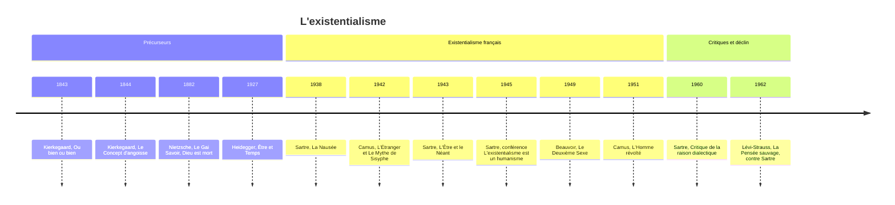

# Existentialisme

En 1940, un jeune homme vient trouver Sartre pour lui demander conseil. Son frère a été tué par les Allemands, et il hésite : rejoindre les Forces françaises libres en Angleterre pour le venger, ou rester auprès de sa mère, qui n'a plus que lui ? Aucune morale toute faite ne tranche. Le christianisme commande d'aimer son prochain, mais lequel ? Kant demande de traiter l'autre comme une fin, mais partir, c'est traiter sa mère comme un moyen, et rester, c'est sacrifier les combattants. Sartre lui répond : « Vous êtes libre, choisissez, c'est-à-dire inventez. » Cette scène, racontée dans *L'existentialisme est un humanisme* (1946), résume le courant : l'être humain n'a ni nature ni morale données d'avance, il se fait par ses choix, et il en porte seul la responsabilité.

## L'existence précède l'essence

La formule de [[Sartre]] condense toute la doctrine. Un objet fabriqué, comme un coupe-papier, a été conçu avant d'exister : son essence, sa définition et sa fonction, précède son existence. La tradition pensait l'homme de la même façon, comme la réalisation d'une nature humaine voulue par Dieu ou inscrite dans la nature. Si Dieu n'existe pas, il n'y a plus de plan préalable. L'homme surgit d'abord dans le monde, puis se définit par ce qu'il fait. Il n'est rien d'autre que la somme de ses actes.

> [!important] Idée clé
> « L'existence précède l'essence » n'est pas juste une manière optimiste de dire « on peut changer » — c'est un renversement métaphysique précis. Pour la tradition classique, l'essence (ce qu'est une chose) précède et détermine son existence : un couteau existe pour trancher, une « nature humaine » existerait avant l'individu. Sartre inverse ce rapport — rien ne précède l'existence humaine, donc rien ne la détermine par avance. L'essence (qui je suis) est un résultat, jamais un point de départ.

Il en découle une **liberté radicale**. L'homme est, selon le mot de Sartre, « condamné à être libre » : il ne s'est pas créé lui-même, mais une fois jeté dans le monde, il est responsable de tout ce qu'il fait. Même ne pas choisir est un choix, et même dans les pires conditions, il reste libre de la manière dont il y répond. Cette liberté entraîne une **responsabilité absolue** : ni Dieu, ni la nature, ni la société, ni le destin ne peuvent servir d'excuse. D'où l'**angoisse**, qui n'est pas la peur d'un danger précis, mais le vertige devant une liberté sans appui.

## Angoisse, absurde et mauvaise foi

Les existentialistes ont donné à l'angoisse un sens philosophique. Pour Kierkegaard, elle est « le vertige de la liberté », l'émotion de celui qui se tient devant le possible. Pour Heidegger, elle révèle que nous sommes « jetés » dans une existence que nous n'avons pas choisie, face au néant. Pour Sartre, elle naît de notre totale responsabilité. Le monde lui-même n'offre aucune réponse : il n'a pas de sens intrinsèque, aucune raison objective ne justifie que nous existions.

Albert Camus fait de ce silence le point de départ de sa pensée. L'**absurde** naît de la confrontation entre l'appel humain au sens et le silence déraisonnable du monde. Face à lui, trois réponses sont possibles. Le **suicide** fuit le problème en supprimant l'un de ses termes. Le **saut de la foi** le fuit aussi, en inventant un sens transcendant. Reste la **révolte** : vivre pleinement, lucidement, sans espoir et sans résignation. C'est pourquoi « il faut imaginer Sisyphe heureux ».

La plupart du temps, pourtant, nous fuyons notre liberté. Sartre appelle cette fuite la **mauvaise foi** : se mentir à soi-même en se cachant derrière des déterminismes (« c'est ma nature », « je n'avais pas le choix ») ou en s'identifiant entièrement à un rôle. Son exemple célèbre est celui du garçon de café, dont les gestes sont un peu trop vifs, un peu trop précis, comme s'il jouait à être garçon de café pour oublier qu'il pourrait être autre chose. À l'opposé, la vie **authentique** assume sa liberté et crée ses valeurs en connaissance de cause.

## Les figures du courant

Le Danois Søren [[Kierkegaard]] (1813-1855) est souvent considéré comme le père de l'existentialisme. Contre les grands systèmes de Hegel, il défend l'individu concret, seul devant ses choix. Il distingue trois stades de l'existence : le stade **esthétique**, celui du séducteur qui vit dans l'instant ; le stade **éthique**, celui de l'homme qui s'engage et assume ses devoirs ; le stade **religieux**, auquel on n'accède que par un **saut de la foi** que la raison ne peut justifier. « La vérité est la subjectivité », écrit-il.

> [!warning] Piège
> [[Kierkegaard]] est souvent cité comme « premier existentialiste » au même titre que Sartre ou Camus, mais son cadre reste théiste : l'angoisse mène au saut de la foi, pas à l'absurde assumé sans Dieu. La « vérité subjective » ne signifie pas « chacun a sa vérité » (relativisme) — elle désigne l'engagement personnel dans une vérité qui existe indépendamment de soi (la foi chrétienne), pas son invention.

Friedrich [[Nietzsche|Nietzsche]] (1844-1900) fournit l'autre point de départ, athée celui-là : Dieu est mort, il faut donc créer de nouvelles valeurs. Son [[Nietzsche|surhomme]] est celui qui y parvient, mû par la volonté de puissance, capable d'aimer son destin (*amor fati*) au point de vouloir son éternel retour.

L'Allemand Martin Heidegger (1889-1976), dans *Être et Temps* (1927), cherche à reposer la question du sens de l'**être**. Il appelle l'existence humaine le ***Dasein***, l'« être-là », et montre que, la plupart du temps, nous vivons dans la **déchéance**, perdus dans l'anonymat du « on » (*das Man*) : on pense ce qu'on pense, on fait ce qui se fait. Seule l'assomption de notre **être-pour-la-mort**, de notre finitude, nous rend à nous-mêmes. Heidegger refusait d'ailleurs d'être qualifié d'existentialiste. Son compatriote Karl Jaspers (1883-1969) décrit quant à lui les **situations-limites**, la mort, la souffrance, le combat, la culpabilité, où l'homme se heurte à ses bornes et s'ouvre à la transcendance.

Jean-Paul Sartre (1905-1980) systématise le courant dans *L'Être et le Néant* (1943). Il y oppose l'**en-soi**, l'être massif et plein des choses, qui est ce qu'il est, et le **pour-soi**, la conscience, qui n'est jamais ce qu'elle est et toujours en projet. Il montre aussi que le regard d'autrui me fige en objet (voir [[Le regard des autres]]) : « L'enfer, c'est les autres », dit un personnage de *Huis clos*. Après la guerre, il défend l'**engagement** politique de l'écrivain.

Simone de Beauvoir (1908-1986) applique la méthode existentialiste à la condition des femmes dans *Le Deuxième Sexe* (1949). « On ne naît pas femme, on le devient » : la prétendue « nature féminine » est une essence imposée, dont les femmes peuvent s'affranchir. Albert Camus (1913-1960), enfin, proche du courant mais refusant l'étiquette, fait du suicide « le seul problème philosophique vraiment sérieux » et répond par la révolte, refusant à la fois le nihilisme et les consolations.

## La mort

Les existentialistes ne s'accordent pas sur le sens de la mort. Pour Heidegger, l'être-pour-la-mort donne son sérieux à la vie : c'est parce que nous mourrons que nos choix comptent. Pour Sartre, au contraire, la mort ne donne aucun sens ; elle vient de l'extérieur interrompre arbitrairement nos projets et nous livre au jugement des autres. Pour Camus, elle est la manifestation la plus éclatante de l'absurde.

## Une philosophie qui passe par la littérature

L'existentialisme s'exprime souvent mieux dans les romans et au théâtre que dans les traités. Sartre fait éprouver la contingence de l'existence dans *La Nausée* (1938), le face-à-face avec la mort dans la nouvelle *Le Mur* (1939), la liberté et l'engagement dans la trilogie des *Chemins de la liberté*, les dilemmes de l'action politique dans *Les Mains sales* (1948). Camus incarne l'absurde dans *L'Étranger* (1942) et *Caligula* (1944), puis la solidarité face au mal dans le roman *La Peste* (1947).

## Les critiques

Les **marxistes** reprochent à l'existentialisme son individualisme : il oublie les luttes collectives et le poids des [[Stratification et Classes Sociales|classes sociales]] sur la liberté réelle. Sartre tentera lui-même une synthèse avec le marxisme dans la *Critique de la raison dialectique* (1960), avec un succès mitigé. Les critiques **religieux** y voient un nihilisme déguisé, un désespoir sans transcendance. Les **rationalistes** lui reprochent son pathos, son absence de critères objectifs et une complaisance pour l'angoisse.

La critique la plus redoutable vient du **structuralisme** des années 1960. Lévi-Strauss, puis Foucault, montrent que le langage, l'inconscient et les structures sociales façonnent l'individu bien avant qu'il ne choisisse quoi que ce soit.

> [!important] Idée clé
> Cette critique est la plus dangereuse pour l'existentialisme car elle ne dit pas « vous avez tort sur un point » mais « votre prémisse de départ est fausse » : la liberté radicale suppose un sujet transparent à lui-même, choisissant en pleine conscience. Foucault et Lévi-Strauss répondent que ce sujet est lui-même un effet de structures (langage, inconscient, rapports de pouvoir) antérieures à tout choix — on ne choisit pas depuis nulle part.

## Héritage

L'existentialisme a pourtant laissé une empreinte profonde. En psychologie, il inspire la **psychothérapie existentielle** de Rollo May et d'Irvin Yalom, et la **logothérapie** de Viktor Frankl, centrée sur la recherche du sens, qui font de la liberté, de la mort, de la solitude et du sens les matériaux du travail thérapeutique. En littérature, il prépare le théâtre de l'absurde d'Ionesco et de Beckett. En politique, il accompagne les luttes de décolonisation et la contre-culture de Mai 68. En philosophie, sa critique des essences ouvre la voie au postmodernisme, tout en prolongeant la phénoménologie et l'herméneutique.

Le contraste avec la pensée qu'il combat se résume ainsi :

| Existentialisme | Essentialisme |
|:--|:--|
| Existence précède essence | Essence précède existence |
| L'humain se crée | L'humain a une nature fixe |
| Liberté radicale | Déterminisme (nature, Dieu) |
| Responsabilité individuelle | Soumission à l'ordre naturel/divin |
| Devenir | Être |
| Authenticité subjective | Vérité objective universelle |

## Ressources

**Livres d'introduction :**
- Sartre, *L'existentialisme est un humanisme* (1946) : court et accessible.
- Camus, *Le Mythe de Sisyphe* (1942).
- William Barrett, *Irrational Man* (1958) : une introduction classique au courant, en anglais.

**Œuvres littéraires :** *La Nausée* et *Huis clos* de Sartre, *L'Étranger* de Camus.

**Traités philosophiques :** *L'Être et le Néant* de Sartre (difficile) et *Être et Temps* de Heidegger (très difficile).

**Vidéos :**
- [Existentialisme en 8 minutes](https://www.youtube.com/watch?v=YaDvRdLMkHs)
- Crash Course Philosophy, épisode sur l'existentialisme, en anglais.
