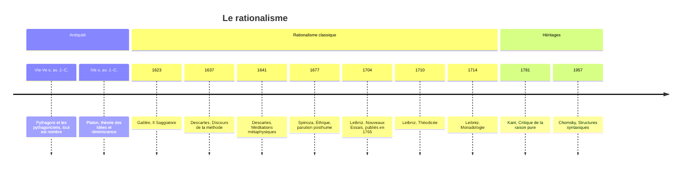

# Rationalisme

Dans le *Ménon* de Platon, Socrate appelle un jeune esclave qui n'a jamais appris la géométrie et lui trace un carré dans le sable. Comment construire un carré d'une surface double ? Le garçon répond d'abord qu'il suffit de doubler le côté, et se trompe. Mais Socrate, sans rien lui apprendre, se contente de lui poser des questions, et l'esclave finit par trouver lui-même la solution : il faut construire le carré sur la diagonale. D'où lui vient ce savoir, puisque personne ne le lui a enseigné ? Cette question est au cœur du **rationalisme** (du latin *ratio*, la raison), la doctrine selon laquelle la raison, indépendamment de l'expérience des sens, peut découvrir des vérités nécessaires et universelles. Il s'oppose à l'[[Empirisme]], pour qui toute connaissance vient de l'expérience.

## Les sources antiques

Les pythagoriciens, au VIe siècle avant notre ère, avaient découvert que les intervalles musicaux correspondent à des rapports simples de longueurs de corde : l'octave à un rapport de 2 à 1, la quinte à 3 à 2. Ils en tirent une conviction : « tout est nombre », l'univers est structuré par des rapports mathématiques que la raison peut saisir.

[[Platon]] (428-348 av. J.-C.) en fait une philosophie complète. Le monde que nous percevons par les sens est changeant et imparfait ; aucun cercle tracé n'est parfaitement rond. Mais la raison conçoit le Cercle parfait, et plus largement les **Idées**, modèles éternels des choses, qui forment un monde intelligible plus réel que le monde sensible. Dans l'allégorie de la caverne, les prisonniers prennent des ombres pour la réalité, et seul le philosophe, sorti au grand jour, contemple le soleil, image de l'Idée du Bien. Si nous connaissons les Idées, c'est que notre âme les a contemplées avant de naître : apprendre, c'est se souvenir. C'est la **réminiscence**, que l'épisode de l'esclave du *Ménon* est censé démontrer.

> [!important] Idée clé
> Ne pas prendre l'anamnèse au pied de la lettre (une vie antérieure de l'âme) pour rejeter tout l'argument. Le point philosophique survit à la mythologie : l'esclave du *Ménon* montre qu'on peut faire émerger, par questionnement pur, des vérités géométriques nécessaires sans qu'on les lui ait enseignées empiriquement — un argument sérieux en faveur de structures cognitives a priori, indépendamment de la théorie de la réincarnation qui l'habille chez Platon.

## Le XVIIe siècle : fonder le savoir sur la raison

Le rationalisme moderne naît dans un double contexte. La **révolution scientifique** de Copernic, Galilée et Kepler montre que la nature obéit à des lois mathématiques : l'univers, écrit Galilée en 1623, est un livre « écrit en langue mathématique ». Dans le même temps, les guerres de religion et le retour du scepticisme ébranlent toutes les certitudes. Il faut refonder le savoir sur une base indiscutable. Le mouvement est surtout continental, en France, aux Pays-Bas et en Allemagne, face à l'empirisme britannique de Locke et de Hume.

### Descartes

René [[Descartes]] (1596-1650), mathématicien, inventeur de la géométrie analytique, veut donner à la philosophie la certitude des mathématiques. Son *Discours de la méthode* (1637) fixe quatre règles : n'accepter pour vrai que ce qui est évident, c'est-à-dire clair et distinct ; diviser chaque difficulté en autant de parties qu'il faut ; conduire ses pensées du plus simple au plus complexe ; tout vérifier pour ne rien omettre.

Dans les *Méditations métaphysiques* (1641), il pousse le doute aussi loin que possible. Les sens nous trompent parfois, et « il est de la prudence de ne se fier jamais entièrement à ceux qui nous ont une fois trompés ». Peut-être même rêvons-nous, ou un malin génie nous abuse-t-il en permanence. Une seule chose résiste : pendant que je doute, je pense, donc je suis. Le **cogito** n'est pas une observation, mais une intuition de la raison.

Descartes distingue trois sortes d'idées : les idées **adventices**, qui semblent venir des sens, comme une couleur ou un son ; les idées **factices**, forgées par l'imagination, comme une chimère ; et les idées **innées**, présentes en nous par nature, comme celles de Dieu, de l'étendue ou du nombre. L'idée d'un être parfait, par exemple, ne peut venir de moi, qui suis imparfait : elle a été placée en moi par Dieu, qui garantit à son tour la vérité de nos idées claires et distinctes. Le monde se divise alors en deux substances : la **chose pensante** (*res cogitans*), l'esprit, et la **chose étendue** (*res extensa*), la matière, dont l'essence est l'étendue géométrique. L'exemple du morceau de cire le montre : approché du feu, il change de couleur, d'odeur, de forme et de consistance, et pourtant nous savons que c'est la même cire. Ce n'est pas par les sens, qui n'en perçoivent que des qualités changeantes, mais par l'entendement que nous la connaissons.

### Spinoza

Baruch [[Spinoza]] (1632-1677) pousse l'ambition rationaliste à son terme. Son *Éthique*, publiée après sa mort, est « démontrée selon l'ordre géométrique » : définitions, axiomes, propositions et démonstrations s'enchaînent comme dans les *Éléments* d'Euclide. La métaphysique peut, selon lui, atteindre la même rigueur que les mathématiques.

Il n'existe pour Spinoza qu'une seule substance, infinie, qu'il appelle « Dieu, c'est-à-dire la Nature » (*Deus sive Natura*). Tout ce qui existe en découle nécessairement, comme les propriétés d'un triangle découlent de sa définition. Il n'y a ni finalité dans la nature, ni libre arbitre en l'homme. Connaître, c'est comprendre cette nécessité, et la forme la plus haute de connaissance, la **science intuitive**, saisit les choses « sous l'aspect de l'éternité ». Quant à l'expérience vague des sens, elle ne nous apprend rien de certain sur l'essence des choses.

> [!warning] Piège
> « Pas de libre arbitre » chez Spinoza ne veut pas dire résignation passive. La liberté spinoziste consiste à comprendre les causes nécessaires de nos affects et actions plutôt qu'à y échapper — un homme libre n'est pas un homme sans causes, c'est un homme qui agit à partir d'idées adéquates (compréhension rationnelle) plutôt que d'affects subis passivement. Comprendre la nécessité est déjà, pour Spinoza, une forme d'émancipation.

### Leibniz

Gottfried Wilhelm Leibniz (1646-1716), mathématicien qui invente le calcul infinitésimal en même temps que Newton, répond point par point à Locke dans les *Nouveaux Essais sur l'entendement humain*, écrits vers 1704 et publiés en 1765. À l'adage empiriste « rien n'est dans l'intellect qui n'ait d'abord été dans les sens », il ajoute : « sauf l'intellect lui-même ». Les sens fournissent la matière de la connaissance, mais l'esprit en fournit la forme : les principes d'identité, de non-contradiction et du tiers exclu, et le **principe de raison suffisante**, selon lequel rien n'arrive sans raison. Les idées innées ne sont pas des connaissances toutes faites présentes chez le nourrisson, mais des dispositions, comme les veines d'un bloc de marbre qui dessinent à l'avance la statue que le sculpteur en dégagera.

Leibniz distingue deux sortes de vérités :

| Vérités de Raison | Vérités de Fait |
|-------------------|-----------------|
| Nécessaires | Contingentes |
| A priori | A posteriori |
| Analytiques (prédicat contenu dans sujet) | Synthétiques |
| Principe : Non-contradiction | Principe : Raison suffisante |
| Exemples : Mathématiques, logique | Exemples : "César a franchi le Rubicon" |

« 2 + 2 = 4 » ne pourrait pas être faux sans contradiction ; « César a franchi le Rubicon » aurait pu ne pas arriver, et l'on ne le sait que par l'histoire.

Sa *Monadologie* (1714) déduit, par le seul raisonnement, que l'univers est fait de **monades**, des substances simples et sans parties. Chacune perçoit l'univers entier depuis son point de vue, mais elles n'agissent pas les unes sur les autres : elles sont « sans fenêtres ». Si elles semblent s'accorder, c'est que Dieu les a réglées d'avance comme des horloges synchronisées, selon une **harmonie préétablie**. Leibniz en tire un optimisme célèbre : Dieu, parfait, a choisi de créer le meilleur des mondes possibles. Après le tremblement de terre de Lisbonne de 1755, Voltaire en fera la satire dans *Candide*, à travers le personnage de Pangloss.

## Les traits du rationalisme

Au-delà de leurs différences, ces philosophes partagent une même attitude. Ils accordent la **primauté à la raison** sur les sens, jugés trompeurs : le bâton plongé dans l'eau paraît brisé, les rêves semblent réels. Ils admettent des **idées innées**, principes logiques, notions mathématiques, idée de Dieu. Ils privilégient la **méthode déductive**, qui part de principes évidents pour en tirer rigoureusement les conséquences, sur le modèle de la géométrie. Ils pensent que l'essence du réel est **mathématique**, l'étendue géométrique pour Descartes, les lois nécessaires de la Nature pour Spinoza, et Leibniz rêve même d'une « caractéristique universelle », une langue logique parfaite où l'on calculerait au lieu de disputer. Ils partagent enfin un **optimisme épistémologique** : la raison peut découvrir la vérité sur l'univers et répondre à des questions comme celle de Leibniz, « pourquoi y a-t-il quelque chose plutôt que rien ? ».

| Aspect | Rationalisme | Empirisme |
|--------|--------------|-----------|
| **Source de connaissance** | Raison, idées innées | Expérience sensorielle |
| **Méthode** | Déduction (général → particulier) | Induction (particulier → général) |
| **Vérités** | A priori (nécessaires, universelles) | A posteriori (contingentes) |
| **Métaphore de l'esprit** | Lumière naturelle, veines du marbre | Tabula rasa (table vierge) |
| **Mathématiques** | Modèle de connaissance certaine | Généralisations empiriques (Mill) |
| **Confiance dans les sens** | Méfiance (trompeurs) | Confiance (source unique) |
| **Figures** | Descartes, Spinoza, Leibniz | Locke, Berkeley, Hume |
| **Géographie** | Continental (France, Allemagne, Pays-Bas) | Britannique |

## La synthèse critique de Kant

[[Kant]], dans la *Critique de la raison pure* (1781), cherche à dépasser l'opposition. « Si toute notre connaissance commence avec l'expérience, il n'en résulte pas qu'elle dérive toute de l'expérience. » L'expérience fournit la matière de la connaissance ; l'esprit en fournit la forme, avec l'espace et le temps, formes de la sensibilité, et les catégories de l'entendement, comme la causalité et la substance. C'est ce qui rend possibles des **jugements synthétiques a priori**, à la fois instructifs et nécessaires, comme « 7 + 5 = 12 » ou « la ligne droite est le plus court chemin d'un point à un autre ». Mais cette révolution, qui fait tourner les objets autour de l'esprit plutôt que l'inverse, impose une limite : nous ne connaissons que les **phénomènes**, jamais les **choses en soi**. Dieu, l'âme et le monde comme totalité échappent à la connaissance, et c'en est fini des grandes métaphysiques rationalistes.

## Les critiques

Les **empiristes** contestent d'abord les idées innées : un nouveau-né n'a aucune idée de Dieu ni du nombre. Les rationalistes répondent, avec Leibniz, que ces idées sont des dispositions et non des connaissances explicites, et que l'expérience, toujours particulière, ne peut à elle seule expliquer des vérités nécessaires comme celles des mathématiques. On a aussi reproché à Descartes un **cercle** : il prouve l'existence de Dieu par la raison, puis fonde la fiabilité de la raison sur Dieu. Nietzsche et Heidegger accusent enfin le rationalisme d'imposer au réel des catégories rigides, et la phénoménologie lui reproche d'appauvrir le monde vécu en ne retenant que ce qui se mesure. Descartes tenait les couleurs et les saveurs pour des « qualités secondes », subjectives, et seule l'étendue pour une « qualité première », objective.

## Les héritages

Le rationalisme a profondément marqué les sciences. Il a donné la géométrie analytique, le calcul infinitésimal, et, au XXe siècle, les projets de Frege et de [[Russell]] pour fonder les mathématiques sur la logique. Einstein s'étonnait encore que les mathématiques, « produit de la pensée humaine indépendant de l'expérience », s'appliquent si parfaitement aux objets de la réalité. En politique, les théories du contrat social de Hobbes, Rousseau ou Kant prétendent déduire rationnellement les principes de l'État juste.

> [!important] Idée clé
> Ce clivage historique se prolonge directement dans le débat contemporain inné/acquis en sciences cognitives (voir plus bas la section sur Chomsky) — la question « d'où viennent nos concepts fondamentaux » n'a jamais quitté la philosophie, elle a juste changé de vocabulaire (idées innées → dispositions génétiques, raison pure → architecture cognitive).

Le linguiste Noam Chomsky en est l'héritier le plus direct. Les enfants, observe-t-il, apprennent leur langue maternelle bien trop vite, et à partir de données bien trop pauvres, pour que cet apprentissage repose uniquement sur l'expérience : ils doivent disposer d'une **grammaire universelle** innée, que l'environnement linguistique se contente d'activer. D'autres prolongements existent : le **platonisme mathématique** de Kurt Gödel ou de Roger Penrose, pour qui les objets mathématiques existent indépendamment de nous et sont découverts plutôt qu'inventés, et le **rationalisme critique** de Karl Popper, pour qui la science progresse non par induction mais par des conjectures audacieuses, inventées par la raison et mises à l'épreuve par l'expérience.

## Ressources

**Œuvres classiques :**
- René Descartes, *Discours de la méthode* (1637) : accessible.
- Baruch Spinoza, *Éthique* (1677) : difficile, à cause de sa méthode géométrique.
- Gottfried Wilhelm Leibniz, *Nouveaux Essais sur l'entendement humain*.
- Platon, *Ménon*, et *La République*, livre VII, pour l'allégorie de la caverne.

**Études :**
- Martial Gueroult, *Descartes selon l'ordre des raisons* : un commentaire rigoureux.
- Ferdinand Alquié, *Le Rationalisme de Spinoza*.
- Bertrand Russell, *Histoire de la philosophie occidentale* : les chapitres sur les rationalistes.
