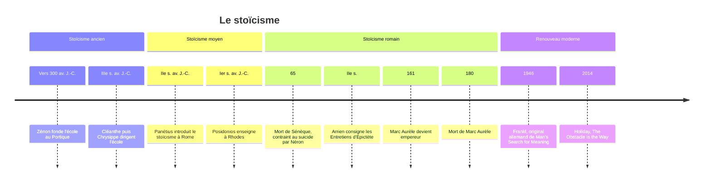

# Stoïcisme

Vers 300 avant J.-C., un marchand phénicien venu de Chypre, Zénon de Citium, fait naufrage au large du Pirée. Ruiné, il échoue à Athènes, entre chez un libraire et tombe sur un livre consacré à Socrate. Il demande où trouver des hommes de cette trempe ; le libraire lui montre le cynique Cratès qui passe dans la rue. Zénon le suit, puis fonde sa propre école sous le Portique peint de l'agora, la *Stoa poikilè*, qui donnera son nom au **stoïcisme**. L'anecdote, rapportée par Diogène Laërce, dit déjà l'essentiel : une philosophie née d'un revers de fortune, qui apprend à ne pas faire dépendre son bonheur de ce que la mer peut emporter. Le stoïcisme est une philosophie **pratique**, qui place la **vertu** au-dessus de tout et enseigne à distinguer ce qui dépend de nous de ce qui n'en dépend pas.

## Cinq siècles d'une même école

On distingue trois grandes périodes. Le **stoïcisme ancien**, à Athènes, est celui des fondateurs : Zénon (vers 334-262 av. J.-C.), son successeur Cléanthe, auteur d'un célèbre *Hymne à Zeus*, puis Chrysippe, qui donne à la doctrine son armature logique et physique au point qu'on disait « sans Chrysippe, pas de Portique ». De leurs centaines de livres, il ne reste presque rien que des fragments cités par d'autres.

Le **stoïcisme moyen**, aux IIe et Ier siècles avant J.-C., assouplit la doctrine et la fait passer à Rome. Panétius de Rhodes fréquente le cercle de Scipion Émilien, Posidonios enseigne à Rhodes où Cicéron vient l'écouter. Le stoïcisme devient alors la philosophie de l'élite romaine, attachée au devoir et au service de la cité.

Le **stoïcisme impérial** est celui que nous lisons encore, parce que ses textes nous sont parvenus entiers. Il tient en trois figures que tout oppose socialement : Sénèque (vers 4 av. J.-C.-65), précepteur puis conseiller de Néron, contraint par lui au suicide ; Épictète (vers 50-vers 135), né esclave en Phrygie, affranchi, qui enseigne à Rome puis à Nicopolis après l'expulsion des philosophes par Domitien ; et [[Marc Aurèle]] (121-180), empereur de 161 à sa mort, qui écrit pour lui seul, sous la tente, pendant les guerres du Danube et la peste antonine. Un ministre, un esclave, un empereur : le stoïcisme se veut une sagesse accessible à toute condition.

## Ce qui dépend de nous

Le *Manuel* d'Épictète s'ouvre sur une phrase qui résume l'école : « Il y a des choses qui dépendent de nous, et d'autres qui n'en dépendent pas. » Dépendent de nous nos jugements, nos désirs et nos aversions, nos intentions, bref tout ce qui relève de notre faculté de juger. N'en dépendent pas notre corps, la maladie et la vieillesse, la richesse, la réputation, les actes des autres, la mort. Toute la souffrance vient, selon Épictète, de ce que nous attachons notre bonheur au second groupe, où nous serons tôt ou tard déçus. D'où sa formule la plus citée : « Ce ne sont pas les choses qui troublent les hommes, mais les jugements qu'ils portent sur les choses. » Une insulte ne blesse que si je juge qu'elle me fait du tort ; la perte d'un bien n'est un malheur que si je le tenais pour mien.

> [!warning] Piège
> Ne pas lire la dichotomie du contrôle comme « ne te soucie pas de ce que tu ne contrôles pas », ce qui glisserait vers l'indifférence pratique. Le stoïcien agit pleinement sur les externes (santé, réputation, résultats) — la dichotomie porte sur où placer sa paix intérieure, pas sur où placer son effort. On vise l'excellence de l'action, sans faire dépendre son bonheur du résultat, qui lui échappe toujours en partie.

Épictète en tire une discipline en trois volets, que Pierre Hadot a mise en lumière. La **discipline du désir** apprend à ne désirer que ce qui dépend de nous et à accueillir le reste. La **discipline de l'action** règle nos rapports aux autres : agir avec justice, remplir nos devoirs envers la famille et la cité, servir le bien commun. La **discipline du jugement**, enfin, consiste à examiner nos représentations avant d'y donner notre assentiment, à ne pas nous laisser emporter par la première impression.

## Vivre selon la nature

Cette éthique repose sur une physique. Pour les stoïciens, l'univers est un tout vivant, ordonné par une raison immanente, le **logos**, qu'ils appellent aussi Nature, Destin ou Zeus. L'homme, être raisonnable, porte en lui une parcelle de cette raison. « Vivre en accord avec la nature », la formule que Diogène Laërce prête à Zénon, signifie donc vivre selon la raison : comprendre l'ordre du monde et y tenir sa place, comme un acteur joue au mieux le rôle qu'il a reçu, sans avoir choisi la pièce.

Dans ce cadre, la **vertu** est le seul bien et le vice le seul mal. Elle se décline en quatre vertus cardinales héritées de Platon : la sagesse (*phronèsis*), qui discerne le bien du mal ; le courage, qui tient face à l'adversité ; la justice, qui rend à chacun son dû ; la tempérance, qui maîtrise les désirs. Tout le reste, santé, richesse, gloire, est « indifférent » au sens où cela ne rend ni bon ni mauvais. Les stoïciens précisent cependant qu'il existe des **indifférents préférables** : il est raisonnable de préférer la santé à la maladie et d'agir pour l'obtenir, à condition de ne pas y suspendre son bonheur.

## Accepter ce qui arrive

Si tout ce qui arrive découle de l'ordre rationnel du monde, se révolter contre l'événement revient à se révolter contre la raison elle-même. Épictète le dit dans le *Manuel* : « Ne demande pas que ce qui arrive arrive comme tu le veux, mais veuille que ce qui arrive arrive comme il arrive, et tu seras heureux. » Les modernes résument souvent cette attitude par l'expression **amor fati**, « amour du destin ». Le mot n'est pas stoïcien : il vient de Nietzsche, qui en fait sa « formule pour la grandeur de l'homme » dans *Ecce Homo* (1888). Mais il désigne bien le consentement stoïcien à l'événement, que Marc Aurèle exprime en se disant que tout ce qui arrive arrive justement.

> [!important] Idée clé
> L'amor fati porte sur ce qui est déjà arrivé, pas sur ce qui reste à décider. Aimer son destin ne dispense pas d'agir de toutes ses forces avant que l'issue soit fixée — la dichotomie du contrôle s'applique en amont (agir sur ce qui dépend de soi), l'amor fati en aval (accepter ce qui, une fois joué, ne dépend plus de personne).

Le but n'est pas l'indifférence mais une paix de l'âme que les stoïciens nomment **apatheia**, l'absence de passions au sens de troubles violents et irrationnels (colère, peur, envie), et que Sénèque appelle *tranquillitas animi*, la tranquillité de l'âme, reprenant le grec *euthymia*. On parle parfois d'ataraxie, mais le mot est surtout celui des épicuriens et des sceptiques. Surtout, l'apatheia n'est pas l'insensibilité : le sage connaît des « émotions bonnes » (*eupatheiai*), la joie, la bienveillance, la vigilance. Le contresens du stoïcien froid et passif vient de la confusion entre passion et émotion. Le stoïcien ressent, mais il n'est pas dominé ; il accepte ce qu'il ne peut changer et agit de toutes ses forces sur ce qu'il peut changer.

## Une philosophie qui s'exerce

Pour les stoïciens, la philosophie n'est pas un savoir qu'on possède mais une manière de vivre qui s'entraîne, ce que Pierre Hadot appelle des « exercices spirituels ». Le plus connu est la **préméditation des maux** (*praemeditatio malorum*) : se représenter à l'avance la perte, l'exil, la maladie, pour ne pas être pris au dépourvu et pour mieux goûter ce qu'on a encore. Les auteurs modernes en tirent une « gratitude négative », imaginer la perte d'un bien pour l'apprécier.

La méditation de la mort en est la forme extrême. « Celui qui a appris à mourir a désappris à servir », écrit Sénèque dans les *Lettres à Lucilius* : qui ne craint plus la mort ne peut plus être tenu par la menace. Marc Aurèle se répète qu'il pourrait quitter la vie à l'instant, et que cette pensée doit régler chacun de ses actes. Dans *De la brièveté de la vie*, Sénèque retourne la plainte commune : la vie n'est pas courte, c'est nous qui la gaspillons, et elle est longue si l'on sait s'en servir.

D'autres pratiques ponctuent la journée. Le matin, on se prépare aux obstacles : Marc Aurèle commence le livre II des *Pensées* en se disant qu'il rencontrera aujourd'hui des indiscrets, des ingrats, des violents, et qu'aucun ne pourra lui nuire s'il ne le veut pas. Le soir, Sénèque passe en revue sa journée, comme il le raconte dans *De la colère*, pour se juger sans complaisance. La **vue d'en haut** invite à regarder les affaires humaines depuis le cosmos pour en mesurer la petitesse. Et devant une offense, on suspend la réaction le temps d'examiner la représentation qui nous agite.

## Citoyens du monde

Puisque tous les hommes participent de la même raison, ils forment une seule communauté. Le mot de **cosmopolite** remonte à Diogène le Cynique, qui répondait à qui lui demandait d'où il venait : « Je suis citoyen du monde. » Les stoïciens en font une doctrine : chacun appartient à deux cités, celle où le hasard l'a fait naître et la grande cité des êtres raisonnables. Sénèque rappelle que l'esclave est fait de la même étoffe que son maître ; Marc Aurèle écrit qu'en tant qu'Antonin sa cité est Rome, mais qu'en tant qu'homme c'est le monde. Cette idée d'une humanité commune nourrira le droit naturel et, bien plus tard, l'universalisme des droits de l'homme.

## Les écoles rivales

Le stoïcisme se définit aussi par contraste avec les autres sagesses hellénistiques, qui visent toutes la tranquillité mais par des voies opposées.

| Stoïcisme | Épicurisme |
|:--|:--|
| Vertu = seul bien | Plaisir = bien suprême |
| Engagement social | Retrait du monde |
| Accepter le destin | Éviter la douleur |
| Raison gouverne | Plaisir modéré |

| Stoïcisme | Cynisme |
|:--|:--|
| Vertu + raison | Vertu seule (rejet raison formelle) |
| Vivre en société | Rejet conventions sociales |
| Acceptation | Provocation |

> [!important] Idée clé
> Ces écoles ne diffèrent pas seulement par leur style de vie mais par toute la chaîne de justification : les stoïciens fondent l'éthique sur une physique (l'univers est rationnellement ordonné, donc vivre selon la raison = vivre selon la nature) ; les épicuriens sur une physique matérialiste opposée (atomes, hasard, absence de providence) ; les cyniques rejettent l'idée même qu'une théorie physique soit nécessaire pour fonder l'éthique — la vertu se prouve par la pratique, pas par la démonstration.

La différence avec l'épicurisme est la plus nette : là où Épicure voit dans le plaisir mesuré le souverain bien et conseille de « vivre caché », loin des affaires publiques, les stoïciens tiennent la vertu pour seul bien et font de l'engagement dans la cité un devoir. Avec le cynisme, la parenté est réelle, puisque Zénon fut l'élève de Cratès, mais les stoïciens ont gardé la morale exigeante des cyniques en y ajoutant une logique, une physique et le respect des devoirs sociaux que Diogène tournait en dérision.

## Le renouveau moderne

Le stoïcisme n'a jamais disparu : Montaigne, Juste Lipse, Descartes et sa morale par provision, Spinoza ont puisé chez lui. Au XXe siècle, il revient par la psychologie. Albert Ellis et Aaron Beck, fondateurs des **thérapies cognitives**, citent Épictète comme précurseur : nos troubles viennent moins des événements que de nos interprétations, et l'on peut apprendre à les corriger. Viktor Frankl, rescapé des camps, défend dans *Découvrir un sens à sa vie* (1946) la liberté intérieure de choisir son attitude face à l'épreuve, une idée souvent rapprochée du stoïcisme même si Frankl ne s'en réclame pas.

Depuis les années 2010, l'école connaît une vogue nouvelle, portée par des livres grand public comme ceux de Ryan Holiday (*The Obstacle Is the Way*, 2014) ou de Massimo Pigliucci (*How to Be a Stoic*, 2017), et par des initiatives comme la « Stoic Week » du projet Modern Stoicism. Ce succès a son revers : réduit à une technique de gestion du stress ou de performance, le stoïcisme perd sa physique, sa justice et son cosmopolitisme, c'est-à-dire ce qui en faisait une philosophie et non une méthode de développement personnel.

## Ressources

- Épictète, *Manuel* et *Entretiens* : le cœur pratique de la doctrine, en quelques dizaines de pages pour le premier.
- Marc Aurèle, *Pensées pour moi-même* : le journal d'un empereur qui s'exhorte lui-même.
- Sénèque, *Lettres à Lucilius* et *De la brièveté de la vie*.
- Pierre Hadot, *La Citadelle intérieure* (1992) : la meilleure introduction à Marc Aurèle et aux trois disciplines.
- William B. Irvine, *A Guide to the Good Life* (2009) et Massimo Pigliucci, *How to Be a Stoic* (2017) : deux adaptations contemporaines.
- Stanford Encyclopedia of Philosophy : [Stoicism](https://plato.stanford.edu/entries/stoicism/).
- Site du projet [Modern Stoicism](https://modernstoicism.com/).
- France Inter : [Qu'est-ce que le stoïcisme ?](https://www.radiofrance.fr/franceinter/qu-est-ce-que-c-est-la-philosophie-du-stoicisme-6656587)
