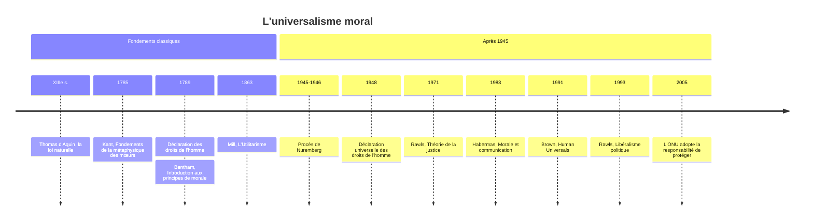

# Universalisme Moral

Au procès de Nuremberg, en 1945 et 1946, les dignitaires nazis invoquent pour leur défense qu'ils ont obéi aux lois de leur pays et aux ordres de leurs supérieurs. Le tribunal refuse cet argument : il existe des **crimes contre l'humanité**, condamnables quelles que soient les lois en vigueur dans l'État où ils ont été commis. Ce jugement repose sur une conviction philosophique, l'**universalisme moral** : certains principes moraux valent pour tous les êtres humains, en tout temps et en tout lieu, indépendamment de la culture, de la religion ou des circonstances. Certaines vérités morales seraient objectives et universelles.

## Universalisme et relativisme

L'universalisme s'oppose au **relativisme moral**, pour qui chaque culture définit sa propre morale, si bien qu'aucune ne peut légitimement juger les autres.

| Universalisme Moral | Relativisme Moral |
|:--|:--|
| Vérités morales objectives | Morale relative à la culture |
| Principes valables partout | Chaque culture définit sa morale |
| Jugement moral interculturel possible | Pas de critique légitime entre cultures |
| Exemple: Torture est **toujours** mal | Exemple: Torture mal **dans notre culture** |

> [!important] Idée clé
> Le vrai clivage n'est pas "y a-t-il des règles morales partagées entre cultures" (empiriquement, oui — cf. Donald Brown plus bas) mais "ces règles partagées sont-elles vraies indépendamment de nous, ou juste des convergences accidentelles". L'universalisme est une thèse sur le **statut** de la morale (objective vs conventionnelle), pas une thèse sur la **fréquence** de l'accord moral.

## Les fondements possibles

Le fondement le plus ancien est **religieux** : des commandements divins valables pour tous. Le judaïsme connaît ainsi, à côté de la loi de Moïse réservée au peuple juif, sept lois « noachides », données à Noé et censées s'imposer à toute l'humanité. Le christianisme et l'islam se veulent eux aussi des morales universelles. La difficulté est évidente : laquelle choisir, et comment convaincre ceux qui n'ont pas la foi ?

Au XIIIe siècle, Thomas d'Aquin propose un fondement accessible à tous par la raison : la **loi naturelle**, inscrite dans la nature humaine par le Créateur. Tout homme peut reconnaître par lui-même qu'il est bon de préserver sa vie, de fonder une famille, de vivre en société et de chercher la vérité, et en tirer des règles valables pour tous.

[[Kant]] (1724-1804) en propose une version purement rationnelle, qui fait de lui la figure centrale de l'universalisme moral. La loi morale ne vient ni de Dieu ni de la nature, mais de la raison elle-même, et elle s'impose à tout être raisonnable. Elle prend la forme d'un **impératif catégorique**, c'est-à-dire inconditionnel : non pas « si tu veux être aimé, sois honnête », mais « sois honnête », sans condition. Kant le formule de plusieurs façons. La première est un test d'universalisation : « Agis uniquement d'après la maxime qui fait que tu peux vouloir en même temps qu'elle devienne une loi universelle. » Si tout le monde mentait dès que cela l'arrange, plus personne ne croirait les promesses, et le mensonge lui-même deviendrait impossible : ne pas mentir est donc un devoir universel. La deuxième exige le respect de la **dignité** de chacun : « Agis de telle sorte que tu traites l'humanité, aussi bien dans ta personne que dans la personne de tout autre, toujours en même temps comme une fin, et jamais simplement comme un moyen. » La troisième fait de chacun un législateur moral : il faut agir comme si l'on était membre d'un « règne des fins », une communauté d'êtres raisonnables qui se donnent à eux-mêmes leurs lois. Cette morale est a priori, connue par la raison avant toute expérience, et ne souffre aucune exception.

L'**utilitarisme** de Jeremy Bentham et de John Stuart Mill est universaliste d'une autre manière. Son principe, « le plus grand bonheur pour le plus grand nombre », est impartial : « chacun compte pour un, et personne pour plus d'un », par-delà les frontières, les classes et même les espèces (voir [[Utilitarisme]]).

> [!warning] Piège
> Ne pas confondre l'universalisme kantien avec l'universalisme utilitariste (section 4 plus bas) : les deux disent "valable pour tous", mais Kant universalise la **règle d'action** (le devoir), l'utilitarisme universalise le **calcul des conséquences** (le bien-être). Un même acte peut donc être universellement interdit chez Kant et universellement permis chez Bentham — l'universalisme n'est pas une école unique, c'est une exigence formelle que plusieurs théories rivales remplissent chacune à leur façon.

Après la Seconde Guerre mondiale, ces traditions convergent dans les **droits humains**. La Déclaration universelle des droits de l'homme, adoptée par l'ONU en 1948, proclame des droits inaliénables, attachés à la dignité et à l'égalité de tous, indépendamment de la nationalité, de la culture ou de la religion : le droit à la vie, l'interdiction de la torture et de l'esclavage, la liberté de pensée et d'expression, l'égalité devant la loi. Elle hérite directement des Lumières, de Locke, de Rousseau et de Kant.

## Les arguments en faveur de l'universalisme

Certaines intuitions semblent partagées par tous : torturer un enfant pour le plaisir est mal, trahir ceux qui nous font confiance est mal, aider ceux qui sont dans le besoin est bien. L'anthropologue américain Donald Brown a dressé en 1991 une liste d'« universaux humains » observés dans toutes les sociétés connues, parmi lesquels l'interdiction du meurtre et de l'inceste, la réciprocité ou un sens de l'équité, ce qui suggère un fondement biologique commun. Kant ajoute un argument de principe : si les mathématiques valent pour tous parce qu'elles sont rationnelles, la morale peut l'être aussi. L'idée de **dignité** humaine, enfin, attachée à l'humanité de chacun et non à sa culture ou à sa religion, exige un respect universel.

L'argument le plus fort est peut-être négatif. Sans universalisme, comment condamner l'esclavage, le génocide ou la torture ? Ils ne seraient que des « différences culturelles », et il deviendrait impossible de dire qu'une pratique est objectivement mauvaise.

## Les objections

Les anthropologues ont d'abord souligné la **diversité** des morales : ce qui est honorable ici est honteux ailleurs, et des sociétés ont admis le cannibalisme rituel, le sacrifice humain ou l'esclavage. Les universalistes répondent que les principes fondamentaux restent les mêmes et que seule leur application varie. La critique **postcoloniale** va plus loin : ce qu'on appelle « universel » serait souvent l'exportation des valeurs occidentales, et les droits individuels, nés des Lumières européennes, nieraient la légitimité de traditions plus communautaires, comme celles que certains gouvernements asiatiques ont invoquées sous le nom de « valeurs asiatiques ». L'universalisme a d'ailleurs servi à justifier la colonisation au nom d'une « mission civilisatrice », en classant les cultures en primitives et civilisées.

Reste le problème de la **justification**. Comment prouver qu'un principe est vraiment universel ? L'intuition est subjective, la raison kantienne présupposerait une rationalité occidentale, Dieu suppose de choisir une religion, et la nature humaine est un concept contesté. Les désaccords persistent d'ailleurs entre universalistes eux-mêmes, sur l'avortement, l'euthanasie, la peine de mort ou les droits des animaux. Si des vérités morales universelles existaient, ne devrait-on pas s'accorder davantage ?

## Universalisme fort et universalisme faible

Ces objections ont conduit à distinguer plusieurs degrés d'universalisme. L'**universalisme fort**, celui de Kant, défend des règles précises et sans exception : ne jamais torturer, ne jamais mentir, même pour sauver une vie. L'**universalisme faible** se contente de principes généraux, comme le respect de la dignité humaine, dont l'application varie selon les contextes. Il est plus plausible et moins impérialiste, mais guide moins l'action et laisse place à des interprétations contradictoires.

Les philosophes contemporains comme John Rawls et Jürgen Habermas défendent un universalisme **procédural**. Dans *Libéralisme politique* (1993), Rawls cherche un **consensus par recoupement** : des traditions religieuses et philosophiques différentes peuvent s'accorder sur quelques principes, la liberté de conscience, l'égalité fondamentale, des droits de base, sans partager la même conception de la vie bonne. Habermas fonde la morale sur une éthique de la discussion : sont valables les normes que tous les intéressés pourraient accepter au terme d'un dialogue libre. La philosophe américaine Martha Nussbaum défend enfin une liste de **capabilités** humaines fondamentales, ce que chacun doit pouvoir être et faire pour mener une vie digne.

> [!tip] Méthode
> Face à un cas concret (voile, excision, peine de mort...), se demander systématiquement : est-ce que je défends une règle **substantielle** précise (universalisme fort, façon Kant) ou une **procédure** minimale de dialogue (universalisme faible, façon Rawls/Habermas) ? La plupart des désaccords entre universalistes viennent de ce qu'ils ne se situent pas au même niveau — pas d'un vrai désaccord sur le fond.

Michael Walzer et Charles Taylor proposent un **universalisme pluraliste** : une morale « mince » de quelques interdits universels, contre la torture ou le génocide, et une large place pour la diversité des morales « épaisses » propres à chaque culture, à affiner par le dialogue. Leurs critiques se demandent si c'est encore de l'universalisme ou un relativisme qui ne dit pas son nom.

## La règle d'or

L'argument le plus souvent avancé en faveur de l'universalisme est la présence, dans presque toutes les grandes traditions religieuses et morales, d'une même **règle d'or**. Le christianisme commande : « Aime ton prochain comme toi-même. » Le judaïsme, selon le sage Hillel : « Ce qui t'est haïssable, ne le fais pas à ton prochain. » Un hadith de l'islam affirme : « Nul d'entre vous n'est croyant s'il ne désire pour son frère ce qu'il désire pour lui-même. » Le bouddhisme invite à ne pas blesser autrui de la manière dont on ne voudrait pas être blessé, l'hindouisme à ne pas faire aux autres ce qui nous causerait de la peine, et le [[Confucianisme]] à ne pas faire à autrui ce qu'on ne voudrait pas qu'on nous fasse. Mais ces mêmes religions divergent sur l'avortement, l'homosexualité ou la place des femmes : un même principe de dignité peut conduire à des conclusions opposées.

## Les applications

L'universalisme moral est au fondement du **droit international pénal**, du tribunal de Nuremberg à la Cour pénale internationale : le génocide et les crimes contre l'humanité y sont punissables partout. Il inspire la **responsabilité de protéger**, adoptée par l'ONU en 2005, qui autorise la communauté internationale à intervenir quand un État commet des atrocités contre sa population ; on lui reproche son application sélective et la question de savoir qui décide. Il traverse les débats de **bioéthique** : faut-il des règles universelles, comme l'interdiction du clonage reproductif humain, ou laisser chaque pays décider ? Il est enfin au cœur des débats sur les **droits des femmes**, où les universalistes défendent partout l'accès à l'éducation, le vote et l'égalité, face à ceux qui invoquent les traditions culturelles, à propos de l'excision, du mariage forcé ou du voile.

Peut-on être universaliste sans être dogmatique, et respecter les différences culturelles tout en affirmant des valeurs valables pour tous ? C'est la question que l'universalisme moral laisse ouverte.

## Ressources

- Emmanuel Kant, *Fondements de la métaphysique des mœurs* (1785) : le texte classique.
- John Rawls, *Théorie de la justice* (1971).
- Martha Nussbaum, *Creating Capabilities* (2011).
- Stanford Encyclopedia of Philosophy : [Moral Relativism](https://plato.stanford.edu/entries/moral-relativism/), qui expose le débat entre universalisme et relativisme.
