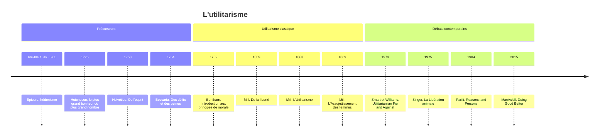

# Utilitarisme

Dans le hall de l'University College de Londres, une vitrine abrite un étrange occupant : le squelette de Jeremy Bentham, habillé de ses propres vêtements, surmonté d'une tête de cire. Le philosophe avait demandé que son corps serve à la science, puis soit exposé, pour être utile jusque dans la mort. Ce geste excentrique résume la doctrine qu'il a fondée. Pour l'**utilitarisme**, une action est bonne si elle produit le plus grand bonheur pour le plus grand nombre. Rien d'autre ne compte, ni l'intention, ni la règle, ni la tradition : seulement les conséquences pour le bien-être de tous.

Quatre traits définissent cette morale. Elle est **conséquentialiste** : seules les conséquences d'une action comptent pour la juger. Elle est **welfariste** : le bien-être, le bonheur ou le plaisir, est la seule chose qui ait de la valeur en elle-même. Elle est **égalitaire** : le bonheur de chacun pèse autant que celui de n'importe qui. Elle est enfin **maximisatrice** : il ne suffit pas de faire du bien, il faut faire le plus de bien possible.

## Les précurseurs

L'idée que le plaisir est le bien remonte à [[Épicure]] (341-270 av. J.-C.), pour qui le plaisir, compris comme absence de douleur et de trouble, est le souverain bien, à condition de calculer prudemment plaisirs et peines. Mais Épicure visait le bonheur du sage, non celui de la collectivité. C'est au XVIIIe siècle que la formule moderne apparaît. Le philosophe écossais Francis Hutcheson écrit en 1725 que « la meilleure action est celle qui procure le plus grand bonheur au plus grand nombre ». En France, Helvétius fonde la morale sur l'utilité publique dans *De l'esprit* (1758), qui marque Bentham. En Italie, Cesare Beccaria applique ce critère à la justice pénale dans *Des délits et des peines* (1764) : une peine n'est légitime que si elle prévient plus de mal qu'elle n'en cause, ce qui le conduit à condamner la torture et la peine de mort.

## Bentham : la morale comme science

Jeremy Bentham (1748-1832) systématise la doctrine dans son *Introduction aux principes de la morale et de la législation* (1789). Le **principe d'utilité** approuve ou désapprouve toute action selon qu'elle tend à augmenter ou à diminuer le bonheur des personnes concernées. Et dans ce calcul, « chacun compte pour un, et personne pour plus d'un ». Le bonheur d'un ouvrier vaut celui d'un lord.

Bentham veut faire de la morale une science exacte. Il propose donc de mesurer plaisirs et peines selon sept critères : c'est le **calcul hédoniste** (*felicific calculus*).

| Critère | Description |
|---------|-------------|
| **Intensité** | Force du plaisir/peine |
| **Durée** | Combien de temps dure-t-il ? |
| **Certitude** | Quelle probabilité de se réaliser ? |
| **Proximité** | Dans combien de temps ? |
| **Fécondité** | Conduit-il à d'autres plaisirs ? |
| **Pureté** | Mélangé à des peines ? |
| **Étendue** | Combien de personnes affectées ? |

Faut-il construire un parc public ou une prison ? Il suffirait, en principe, d'estimer le bonheur et le malheur que produirait chaque option, et de retenir celle qui donne le meilleur total. Pour Bentham, il n'y a d'ailleurs pas de hiérarchie entre les plaisirs : seule compte leur quantité. Selon une formule que Mill lui attribue, à plaisir égal, le *push-pin*, un jeu d'enfant, vaut la poésie.

Bentham est avant tout un réformateur. Il critique la *common law* anglaise, qu'il juge archaïque et cruelle, et propose des codes rationnels. Il dessine les plans du **panoptique**, une prison circulaire où un surveillant unique peut observer tous les détenus depuis une tour centrale. Il défend l'extension du droit de vote, la liberté des échanges, la dépénalisation de l'homosexualité. Il est aussi l'un des premiers à inclure les animaux dans la morale : « La question n'est pas : peuvent-ils raisonner ? ni : peuvent-ils parler ? mais : peuvent-ils souffrir ? »

## Mill : un utilitarisme raffiné

John Stuart Mill (1806-1873), filleul spirituel de Bentham, élevé par son père pour devenir le continuateur de la doctrine, en corrige les aspects les plus choquants dans *L'Utilitarisme* (1863). Si seule compte la quantité de plaisir, objectaient les critiques, la morale utilitariste est une « morale de porcs ». Mill répond que certains plaisirs sont **qualitativement supérieurs** : les plaisirs de l'intelligence, de la sensibilité et de la morale l'emportent sur ceux du corps. « Il vaut mieux être un être humain insatisfait qu'un porc satisfait ; il vaut mieux être Socrate insatisfait qu'un imbécile satisfait. »

Comment savoir quel plaisir est supérieur ? Mill propose de s'en remettre à ceux qui ont connu les deux : celui que tous, ou presque tous, préfèrent est le plus désirable. Ceux qui ont goûté à la fois à la philosophie et aux plaisirs du corps choisiraient la philosophie. Le critère a été accusé de circularité, puisqu'il présuppose une élite de juges compétents. Mill distingue au passage le **bonheur**, une vie épanouie qui peut inclure luttes et sacrifices, et le simple **contentement**, une satisfaction tranquille qui peut être médiocre.

> [!important] Idée clé
> La différence Bentham/Mill n'est pas un détail historique : c'est le clivage qui structure tout l'utilitarisme depuis 200 ans. Bentham est cohérent mais choquant (un plaisir simple et intense "vaut" autant qu'un plaisir raffiné) ; Mill est intuitif mais fragile (son critère de "supériorité" — ce que préfèrent ceux qui ont connu les deux — présuppose déjà la conclusion qu'il veut démontrer, cf. le "Problème" noté plus bas).

Mill est aussi le grand défenseur de la liberté. Dans *De la liberté* (1859), il formule le **principe de non-nuisance** : « la seule raison légitime que puisse avoir une communauté pour user de la force contre un de ses membres est de l'empêcher de nuire aux autres ». Pour tout ce qui ne concerne que lui, l'individu est souverain. Il défend une liberté d'expression très large, qui ne s'arrête qu'à l'incitation directe à la violence, et l'intérêt des « expériences de vie » variées, par lesquelles une société découvre ce qui rend heureux. La liberté se justifie ainsi par l'utilité : à long terme, elle favorise la créativité, le progrès et l'épanouissement. Dans *L'Assujettissement des femmes* (1869), écrit en dialogue avec sa femme Harriet Taylor, Mill montre enfin que l'oppression des femmes gaspille la moitié des talents de l'humanité et diminue le bonheur de tous. Élu député, il dépose en 1867 le premier amendement en faveur du vote des femmes au Parlement britannique.

## Les variantes

Les utilitaristes du XXe siècle ont distingué plusieurs versions de la doctrine, dont on trouve déjà des germes chez Mill. L'**utilitarisme de l'acte** évalue chaque action selon ses conséquences dans la situation particulière. Il conduit à des conclusions troublantes : un chirurgien devrait tuer un patient en bonne santé pour prélever ses organes et sauver cinq malades, si cela maximise le bonheur total. L'**utilitarisme de la règle** recommande plutôt de suivre les règles générales, comme « ne jamais tuer un innocent », dont le respect par tous maximise l'utilité à long terme, en préservant la confiance et la stabilité. Il est plus proche de nos intuitions, mais se rapproche dangereusement de la déontologie de [[Kant]].

L'**utilitarisme des préférences**, défendu par R. M. Hare et Peter Singer, cherche à satisfaire les préférences des personnes plutôt qu'à maximiser leur plaisir : il évite de définir le bonheur à leur place et respecte leur autonomie, par exemple le choix de mourir dignement plutôt que de vivre diminué. L'**utilitarisme négatif**, suggéré par Karl [[Popper|Popper]], vise enfin à réduire la souffrance plutôt qu'à augmenter le bonheur, parce que la souffrance est plus urgente et plus facile à reconnaître.

## Les applications contemporaines

L'utilitarisme est sans doute la théorie morale la plus influente dans la vie publique. Peter Singer, dans *La Libération animale* (1975), en tire une conséquence radicale : puisque les animaux peuvent souffrir, leur souffrance compte autant que la nôtre, et le **spécisme**, la discrimination selon l'espèce, est aussi injustifiable que le racisme. Ce livre a fondé le mouvement animaliste moderne.

L'économie du bien-être et l'**analyse coûts-bénéfices** évaluent les politiques publiques selon leur effet sur le bien-être total. En santé publique, on compare les traitements en « années de vie ajustées sur la qualité » (QALY). L'utilitarisme justifie aussi la redistribution : en vertu de l'**utilité marginale décroissante**, un euro apporte bien plus de bonheur à un pauvre qu'à un riche. La pandémie de Covid-19 a mis ces raisonnements au premier plan : faut-il confiner, quelles populations vacciner d'abord, qui soigner quand les lits de réanimation manquent ?

Le mouvement de l'**altruisme efficace**, porté par Peter Singer et William MacAskill, applique ce raisonnement à la générosité individuelle : donner aux causes qui font le plus de bien par euro dépensé, d'après les données disponibles, comme le recommande l'organisation GiveWell, voire choisir un métier très rémunérateur pour pouvoir donner davantage. Certains de ses membres, comme Nick Bostrom ou Toby Ord, s'intéressent aux **risques existentiels**, intelligence artificielle, pandémies, qui menacent l'avenir de l'humanité tout entière.

## Les critiques

La première objection est celle des **droits individuels**. L'utilitarisme peut justifier le sacrifice d'innocents : tuer un patient pour ses organes, condamner un innocent pour calmer une foule prête à l'émeute, voire tolérer l'esclavage si le bonheur des maîtres l'emportait sur la souffrance des esclaves. Les utilitaristes répondent que de telles pratiques détruiraient la confiance et produiraient à long terme plus de malheur que de bonheur, ou qu'il faut suivre les règles qui protègent les innocents. Mais pour leurs critiques, cette protection reste contingente : elle dépend d'un calcul, et non de la valeur de la personne.

La deuxième est la **mesure du bonheur**. Comment comparer le bonheur de deux personnes, ou quantifier l'amour, la dignité, l'émotion esthétique ? Le calcul de Bentham paraît bien simpliste, le critère qualitatif de Mill bien subjectif, et les indicateurs économiques ne donnent que des approximations.

La troisième est l'**exigence excessive**. En 1972, Singer écrit que « si nous pouvons empêcher quelque chose de mauvais d'arriver sans sacrifier quoi que ce soit d'une importance morale comparable, nous devons le faire ». Il faudrait alors donner tout ce qui dépasse le nécessaire, renoncer aux loisirs et aux luxes. Les critiques jugent cette morale impossible à vivre et destructrice de la vie privée et des projets personnels. Certains utilitaristes répondent qu'une sphère personnelle protégée maximise l'utilité à long terme ; d'autres assument que la morale soit exigeante.

La quatrième porte sur la **répartition**. L'utilitarisme vise un total, sans se soucier de sa distribution. Une société de dix personnes heureuses à 50 chacune totalise 500 ; une société où une personne est heureuse à 400 et neuf à 20 totalise 580. L'utilitarisme préférerait la seconde, pourtant profondément inégalitaire. L'utilité marginale décroissante corrige en partie ce défaut, mais John Rawls objecte que la justice ne se réduit pas à un total : les inégalités ne sont justes que si elles profitent aux plus défavorisés.

> [!tip] Méthode
> Pour situer rapidement une critique de l'utilitarisme, se demander ce qu'elle reproche exactement : (1) qu'on ne puisse pas mesurer le bonheur (problème épistémique), (2) qu'il sacrifie des individus au nom du total (problème des droits), ou (3) qu'il ignore comment ce total est réparti (problème distributif, ici). Ce sont trois objections indépendantes — une réponse à l'une ne répond pas aux deux autres.

La cinquième est la **conclusion répugnante** du philosophe britannique Derek Parfit (*Reasons and Persons*, 1984). Comparons un monde de dix milliards de personnes très heureuses, à 100 chacune, soit un total de mille milliards, et un monde de mille milliards de personnes dont la vie vaut à peine d'être vécue, à 2 chacune, soit deux mille milliards. L'utilitarisme du total doit préférer le second, conclusion que Parfit lui-même trouvait « répugnante ».

> [!warning] Piège
> Ce paradoxe révèle une ambiguïté cachée dans "maximiser le bonheur" : maximiser le **total** (additionner) et maximiser la **moyenne** (diviser par le nombre de personnes) donnent des réponses opposées dès qu'on fait varier la population elle-même — pas seulement sa répartition. Vérifier systématiquement, face à un argument utilitariste, lequel des deux critères est mobilisé : beaucoup de désaccords "sur l'utilitarisme" sont en réalité des désaccords entre ces deux versions.

On peut rejeter l'utilitarisme du total, passer à l'utilitarisme de la moyenne, qui a ses propres paradoxes, ou accepter la conclusion par souci de cohérence.

La dernière objection, kantienne, concerne les **intentions**. Celui qui donne cent euros par charité et celui qui les donne pour soigner son image sauvent la même vie : pour l'utilitarisme, leurs actions se valent. Pour [[Kant]], seule la première a une valeur morale. Les utilitaristes répondent que les bonnes intentions comptent indirectement, parce qu'elles forment des dispositions qui produisent de bonnes conséquences à l'avenir.

## L'utilitarisme parmi les morales

| Théorie | Critère Moral | Exemple |
|---------|--------------|---------|
| **Utilitarisme** | Conséquences (bonheur total) | Mentir est OK si ça maximise le bonheur |
| **Déontologie ([[Kant]])** | Devoir, règles universelles | Mentir est toujours mal (impératif catégorique) |
| **Éthique des vertus (Aristote)** | Caractère vertueux | Agir comme agirait une personne vertueuse |
| **Éthique du care** | Relations, sollicitude | Prendre soin des proches |
| **Contractualisme (Rawls)** | Justice comme équité | Principes choisis sous voile d'ignorance |

Face à l'utilitarisme, l'éthique des vertus d'[[Aristote]] demande moins ce qu'il faut faire que ce qu'il faut être, et l'éthique antique, épicurienne ou [[Courants & Écoles/Stoïcisme|stoïcienne]], pensait le bonheur du sage plutôt que celui de la collectivité. La prétention de l'utilitarisme à valoir pour tous les êtres sensibles en fait l'une des grandes formes de l'[[Universalisme Moral]].

## Ressources

**Œuvres classiques :**
- Jeremy Bentham, *Introduction aux principes de la morale et de la législation* (1789).
- John Stuart Mill, *L'Utilitarisme* (1863) : court et accessible.
- John Stuart Mill, *De la liberté* (1859).

**Auteurs contemporains :**
- Peter Singer, *La Libération animale* (1975) et *Sauver une vie* (2009).
- William MacAskill, *Doing Good Better* (2015) : l'altruisme efficace.
- Derek Parfit, *Reasons and Persons* (1984) : de la philosophie morale avancée.

**Études :**
- J. J. C. Smart et Bernard Williams, *Utilitarianism: For and Against* (1973) : le débat classique, pour et contre.
- Roger Crisp, *Mill on Utilitarianism* (1997).
