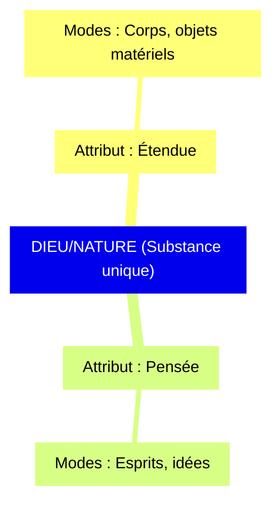

# Baruch Spinoza (1632-1677)

Le 27 juillet 1656, dans la synagogue portugaise d'Amsterdam, on lit devant la communauté un texte d'une violence inouïe : « Par le décret des anges et le jugement des saints, nous excommunions, chassons, maudissons et exécrons Baruch de Spinoza [...] Maudit soit-il le jour, maudit soit-il la nuit ; maudit soit-il quand il se couche et maudit soit-il quand il se lève. » Il est interdit à quiconque de lui parler, de lui écrire, de demeurer sous le même toit que lui ou de lire ce qu'il écrira. Le jeune homme a vingt-trois ans ; il n'a encore rien publié. Il ne cherchera jamais à revenir. Il gagnera sa vie en polissant des lentilles et écrira, en secret, l'un des livres les plus audacieux de l'histoire de la philosophie, l'*Éthique*, où Dieu n'est rien d'autre que la Nature.

## Une vie libre et retirée

Spinoza naît à Amsterdam en 1632 dans une famille de marchands juifs séfarades venus du Portugal, d'anciens convertis forcés qui avaient fui l'Inquisition pour retrouver aux Pays-Bas la liberté de pratiquer le judaïsme. Il reçoit l'éducation de la communauté, l'hébreu, la Torah, les commentateurs, puis apprend le latin auprès d'un ancien jésuite, Franciscus van den Enden, et découvre Descartes et la science nouvelle. Les motifs exacts du *herem* ne sont pas connus ; les témoignages évoquent des propos niant l'immortalité de l'âme, faisant de Dieu un être corporel et réduisant la Loi à une institution humaine.

Après l'exclusion, il vit modestement à Rijnsburg, Voorburg puis La Haye, polisseur de lentilles réputé, entouré d'un petit cercle d'amis collégiants et cartésiens qui lisent et discutent ses manuscrits. Il correspond avec Henry Oldenburg, secrétaire de la Royal Society, reçoit la visite de [[Leibniz]] en 1676, refuse en 1673 une chaire à l'université de Heidelberg pour garder sa liberté de philosopher. Il meurt en 1677, à quarante-quatre ans, d'une maladie pulmonaire que la poussière de verre a peut-être aggravée. Le seul livre qu'il ait signé de son vivant est un exposé de Descartes ; le *Traité théologico-politique* parut sans nom d'auteur, et l'*Éthique* ne fut publiée par ses amis qu'après sa mort.

| Œuvre | Année | Publication | Thème |
|-------|-------|-------------|-------|
| **Court Traité de Dieu, de l'Homme et de la Béatitude** | ~1660 | Posthume | Esquisse de l'Éthique |
| **Traité de la réforme de l'entendement** | ~1661 | Posthume (inachevé) | Méthode philosophique |
| **Principes de la philosophie de Descartes** | 1663 | Seul livre signé de son vivant | Exposition géométrique de Descartes |
| **Traité théologico-politique** | 1670 | Anonyme | Critique de la religion, liberté de pensée |
| **Éthique** (*Ethica ordine geometrico demonstrata*) | 1661-1675 | Posthume (1677) | Métaphysique, morale, Dieu/Nature |
| **Traité politique** | 1677 | Posthume (inachevé) | Philosophie politique |

## Une philosophie démontrée comme la géométrie

L'*Éthique* se présente comme un traité d'Euclide : définitions, axiomes, propositions, démonstrations, corollaires et scolies, en cinq parties qui vont de Dieu à la liberté humaine. Cette forme, *ordine geometrico*, n'est pas un ornement. Spinoza veut considérer les actions et les désirs humains « comme s'il était question de lignes, de plans et de corps », sans les maudire ni les tourner en dérision. Le *Traité politique* le dit en une formule célèbre : « Ne pas rire, ne pas pleurer, ne pas détester, mais comprendre. »

## Dieu, c'est-à-dire la Nature

Tout part de la définition de la **substance** : « ce qui est en soi et se conçoit par soi », c'est-à-dire ce qui n'a besoin de rien d'autre pour exister ni pour être pensé. Une telle substance ne peut être produite par une autre ; elle est donc cause de soi, infinie, éternelle, et il ne peut y en avoir qu'une. Cette substance unique, Spinoza l'appelle Dieu, ou la Nature : *Deus sive Natura*. Dieu n'est pas un créateur extérieur au monde qui l'aurait fait par un libre décret ; il est le monde lui-même considéré dans sa puissance productive, ce que Spinoza nomme la « nature naturante », par opposition à la « nature naturée », l'ensemble des choses produites.

| Spinoza | Théisme Traditionnel | Différence |
|---------|---------------------|------------|
| Dieu **est** la Nature | Dieu **crée** la Nature | Panthéisme vs. Création |
| Dieu est **immanent** (dans le monde) | Dieu est **transcendant** (au-delà du monde) | Pas de Dieu personnel |
| Dieu agit par **nécessité** (lois naturelles) | Dieu agit par **volonté** et **liberté** | Déterminisme vs. Providence |
| Pas de finalité (pas de "pour quoi") | Création a un but (salut, gloire de Dieu) | Pas de téléologie |

Ce Dieu ne veut rien, ne poursuit aucun but, ne récompense ni ne punit. L'appendice de la première partie démonte l'illusion **finaliste** : les hommes, qui agissent toujours en vue d'une fin, imaginent que la nature fait de même et qu'elle a tout disposé pour eux, puis, quand survient une tempête ou une épidémie, ils l'attribuent à la colère des dieux. La volonté de Dieu devient alors « l'asile de l'ignorance ». On comprend que le spinozisme ait été dénoncé comme un athéisme, alors même que le mot de Dieu revient à chaque page.

Cette substance s'exprime dans une infinité d'**attributs**, dont nous ne connaissons que deux, la **pensée** et l'**étendue**. Les choses particulières, les corps, les esprits, nous-mêmes, sont des **modes**, des manières d'être de la substance, qui existent en elle et se conçoivent par elle. Mon corps est un mode de l'étendue, mon esprit un mode de la pensée, l'idée de ce corps.

> [!important] Idée clé
> Cette structure explique pourquoi, chez Spinoza, il n'y a pas d'âme séparée du corps qui pourrait survivre ou interagir causalement avec lui (contra [[Descartes]]) : esprit et corps sont deux expressions parallèles de la même chose, jamais deux substances en interaction.

Le problème cartésien de l'union de l'âme et du corps disparaît ainsi : « L'ordre et la connexion des idées sont les mêmes que l'ordre et la connexion des choses. » L'esprit ne commande pas au corps, ni le corps à l'esprit ; ce sont une seule et même chose exprimée de deux manières.

## La nécessité et l'illusion du libre arbitre

« Dans la nature, il n'y a rien de contingent, mais tout y est déterminé par la nécessité de la nature divine à exister et à produire quelque effet d'une certaine manière » (I, 29). Tout ce qui arrive arrive nécessairement, nos pensées et nos désirs compris. Pourquoi alors nous croyons-nous libres ? Parce que nous sommes conscients de nos désirs et ignorants des causes qui nous déterminent. Dans une lettre de 1674, Spinoza imagine une pierre lancée qui, si elle pensait, croirait se mouvoir par sa propre volonté. Ainsi l'enfant croit désirer librement le lait, l'homme en colère vouloir librement la vengeance, et l'ivrogne dire de son plein gré ce qu'il regrettera une fois dégrisé.

> [!warning] Piège
> Ne pas confondre ce déterminisme avec un fatalisme résigné : Spinoza ne dit pas "rien ne sert d'agir", il dit que la liberté consiste justement à comprendre les causes qui nous déterminent — plus on comprend, plus on agit "depuis sa propre nature" plutôt que d'être ballotté par des causes extérieures incomprises.

La liberté n'est donc pas l'absence de causes, c'est le fait d'être cause de ses propres actes. Est libre ce qui existe et agit par la seule nécessité de sa nature ; est contraint ce qui est déterminé par autre chose. Dieu seul est absolument libre en ce sens. L'homme ne l'est que dans la mesure où il comprend, car comprendre, c'est agir à partir de soi au lieu de subir.

## Les trois genres de connaissance

Spinoza distingue trois manières de connaître. Le premier genre est l'**imagination** : la connaissance par ouï-dire et par expérience vague, à partir des affections de notre corps. Le soleil nous paraît à deux cents pieds ; même quand nous savons sa vraie distance, nous continuons à le voir ainsi. Cette connaissance est inadéquate, c'est la seule source de l'erreur. Le deuxième genre est la **raison**, qui procède par « notions communes », ce qui est commun à toutes choses, et en déduit des propriétés universelles, comme en mathématiques ou en physique. Le troisième genre est la **science intuitive**, qui saisit l'essence des choses singulières en voyant comment elles découlent de Dieu. C'est elle qui procure la joie la plus haute. Le chemin de l'*Éthique* mène de l'un à l'autre : passer de l'imagination à la raison, puis à l'intuition, c'est se libérer.

## Le conatus et les affects

« Chaque chose, autant qu'il est en elle, s'efforce de persévérer dans son être » (III, 6). Cet effort, le **conatus**, est l'essence même de chaque chose. Chez l'homme, quand il est conscient de lui-même, il s'appelle **désir**, et Spinoza renverse une idée reçue : nous ne désirons pas une chose parce que nous la jugeons bonne, nous la jugeons bonne parce que nous la désirons.

Le désir se module en deux affects fondamentaux. La **joie** est le passage à une perfection plus grande, une augmentation de notre puissance d'agir ; la **tristesse** est le passage à une perfection moindre. Tous les autres affects en dérivent : l'amour est une joie accompagnée de l'idée de sa cause, la haine une tristesse accompagnée de l'idée de sa cause, l'espoir une joie inconstante liée à une chose dont l'issue est douteuse, la crainte une tristesse inconstante, et « il n'y a pas d'espoir sans crainte ni de crainte sans espoir ». La troisième partie de l'*Éthique* déroule cette géométrie des passions avec une finesse qui fait penser aux moralistes.

| Passions | Actions |
|----------|---------|
| Affects **subis** (causes externes) | Affects **produits** par notre nature |
| Connaissance **inadéquate** | Connaissance **adéquate** |
| **Servitude** | **Liberté** |

> [!tip] Méthode
> Cette distinction passions/actions est la clé pour comprendre toute l'*Éthique* : le programme spinoziste entier consiste à transformer des affects subis (passions, servitude) en affects compris (actions, liberté) — pas à supprimer les émotions, mais à les rendre adéquates.

## Bien, mal et vertu

Bien et mal ne désignent rien de positif dans les choses ; ce sont des manières de penser, relatives à notre nature. « Une même chose peut être en même temps bonne, mauvaise et aussi indifférente. Par exemple, la musique est bonne pour le mélancolique, mauvaise pour l'affligé ; pour le sourd, elle n'est ni bonne ni mauvaise » (IV, préface). Est bon ce qui nous est utile, c'est-à-dire ce qui augmente notre puissance d'agir ; est mauvais ce qui la diminue.

La **vertu** se confond alors avec la puissance : agir par vertu, c'est agir selon les lois de sa propre nature, sous la conduite de la raison, et chercher ce qui nous est réellement utile. Cette morale de l'utile n'est pas égoïste au sens étroit, car rien n'est plus utile à l'homme qu'un autre homme qui vit sous la conduite de la raison : « l'homme est un dieu pour l'homme » (IV, 35, scolie). Elle se méfie en revanche des passions tristes, la haine, l'envie, la honte, le remords, et de ceux qui les cultivent, les tyrans et les prêtres qui ont besoin de la crainte pour gouverner. « L'homme libre ne pense à rien moins qu'à la mort, et sa sagesse est une méditation non de la mort, mais de la vie » (IV, 67).

## La béatitude

La cinquième partie décrit le terme du chemin. Plus nous comprenons nos affects, moins nous les subissons, et plus nous connaissons les choses par le troisième genre, plus nous les rapportons à Dieu. Naît alors l'**amour intellectuel de Dieu**, une joie accompagnée de l'idée de Dieu comme cause, qui n'est autre que « l'amour même dont Dieu s'aime lui-même » à travers nous (V, 36). On a souvent rapproché cette acceptation joyeuse de la nécessité de l'*amor fati* de [[Nietzsche]], qui saluait en Spinoza son « précurseur ».

Spinoza va jusqu'à affirmer que « l'esprit humain ne peut être absolument détruit avec le corps, mais il en reste quelque chose qui est éternel » (V, 23). La thèse divise les commentateurs. La plupart y voient non une immortalité personnelle, un souvenir qui survivrait après la mort, mais l'éternité, hors du temps, de ce que l'esprit comprend adéquatement. « Nous sentons et nous expérimentons que nous sommes éternels », écrit-il. La béatitude n'est pas la récompense de la vertu, elle est la vertu même. Et l'*Éthique* se clôt sur une phrase modeste : « Tout ce qui est remarquable est aussi difficile que rare. »

## La liberté de penser et la démocratie

Le *Traité théologico-politique* (1670) est un livre de combat, écrit alors que les pasteurs calvinistes réclament la censure et que la république néerlandaise des frères de Witt est menacée. Spinoza y lit la Bible comme un texte historique, écrit par des hommes, en des temps et des langues qu'il faut étudier comme on étudie la nature ; il soutient que les prophètes avaient une imagination vive plutôt qu'une connaissance supérieure, que les miracles sont impossibles puisque rien ne peut déroger aux lois de la nature, et que l'enseignement de l'Écriture se réduit à une morale pratique, la justice et la charité. La conclusion est politique : l'État doit laisser à chacun la liberté de penser et de dire ce qu'il pense, car cette liberté, loin de menacer la paix, en est la condition. Le livre est interdit aux Pays-Bas en 1674 et mis à l'Index.

Spinoza partage avec Hobbes l'idée que le droit naturel de chacun s'étend aussi loin que sa puissance, mais il en tire d'autres conséquences.

| Hobbes | Spinoza |
|--------|---------|
| État absolu pour éviter guerre civile | État pour garantir **liberté** |
| Monarchie absolue | Préférence pour **démocratie** |
| Contrat irrévocable | Droit naturel inaliénable |

Personne ne peut transférer entièrement son droit et sa puissance à un autre ; un pouvoir qui voudrait régner sur les esprits se condamne à la révolte. La fin de l'État, écrit-il, n'est pas de dominer les hommes par la crainte, mais de les libérer de la crainte : « la fin de l'État est en réalité la liberté ». Le *Traité politique*, interrompu par la mort, devait culminer dans l'étude de la démocratie, qu'il tient pour le régime le plus naturel.

## Réception et héritage

Pendant un siècle, « spinoziste » a été synonyme d'athée. Bayle le réfute dans son *Dictionnaire*, Leibniz s'en démarque, mais ses idées circulent sous le manteau et nourrissent ce que l'historien Jonathan Israel a appelé les « Lumières radicales ». En 1785, la « querelle du panthéisme », déclenchée par Jacobi qui révèle le spinozisme de Lessing, le remet au centre de la philosophie allemande. Goethe, les romantiques, [[Hegel]], pour qui « on est spinoziste ou on n'est pas philosophe », s'en inspirent.

Au XXe siècle, Gilles Deleuze fait de lui le philosophe de l'immanence et de la joie, Martial Gueroult et Pierre Macherey en donnent des commentaires monumentaux, Étienne Balibar et Antonio Negri relisent sa politique. Le neurologue Antonio Damasio, dans *Spinoza avait raison* (2003), voit dans sa théorie des affects une anticipation de ce que la neurobiologie découvre sur le rôle des émotions dans la pensée. Le philosophe norvégien Arne Næss, fondateur de l'écologie profonde, se réclame de son refus de l'anthropocentrisme, et l'économiste Frédéric Lordon analyse le salariat comme une capture du conatus des travailleurs dans *Capitalisme, désir et servitude* (2010).

## Les objections

Pour la théologie, identifier Dieu à la nature revient à supprimer le Dieu personnel, la providence et la prière ; Spinoza l'assume, il ne veut pas d'un Dieu fait à l'image de l'homme. Le déterminisme semble supprimer la responsabilité : comment blâmer qui ne pouvait agir autrement ? Spinoza répond que l'on peut encore se protéger des méchants comme on se protège des chiens enragés, sans leur supposer un libre arbitre, et que la vraie liberté, celle qui naît de la compréhension, reste à conquérir. Certains jugent que la méthode géométrique impose à la réalité une rigidité qui ne lui convient pas et que ses démonstrations sont moins contraignantes qu'elles le paraissent. Enfin, la doctrine de l'éternité de l'esprit reste obscure, et le relativisme du bien et du mal laisse ouverte la question de savoir comment fonder une morale commune, à laquelle Spinoza répond par l'utilité bien comprise et l'accord des hommes raisonnables.

## Questions de révision

> [!quiz] Que signifie la formule *Deus sive Natura* ?
> Dieu, c'est-à-dire la Nature : il n'existe qu'une seule substance, infinie et cause de soi. Dieu n'est pas un créateur transcendant mais est immanent au monde et agit par nécessité, sans finalité.

> [!quiz] Quels attributs de la substance connaissons-nous, et que change cela par rapport à Descartes ?
> La pensée et l'étendue, parmi une infinité d'attributs. Esprit et corps ne sont pas deux substances en interaction mais deux expressions parallèles d'une même réalité.

> [!quiz] Pourquoi les hommes se croient-ils libres selon Spinoza ?
> Parce qu'ils sont conscients de leurs désirs mais ignorants des causes qui les déterminent. La vraie liberté consiste à comprendre la nécessité et à agir selon sa propre nature, guidé par la raison.

> [!quiz] Quels sont les trois genres de connaissance chez Spinoza ?
> L'imagination (ouï-dire, expérience vague, inadéquate), la raison (notions communes et déduction, adéquate) et la science intuitive, connaissance des choses à partir de Dieu, source de béatitude.

> [!quiz] Qu'est-ce que le *conatus* ?
> L'effort par lequel chaque chose, autant qu'il est en elle, s'efforce de persévérer dans son être ; c'est l'essence même de chaque chose. Chez l'homme, le désir est ce conatus conscient de lui-même.

> [!quiz] Quelle différence Spinoza fait-il entre passions et actions ?
> Les passions sont des affects subis, causés par l'extérieur et liés à une connaissance inadéquate : c'est la servitude. Les actions sont des affects produits par notre nature et une connaissance adéquate : c'est la liberté.

## Ressources

- *Éthique* (posthume, 1677) : l'œuvre maîtresse, difficile ; commencer par l'appendice de la partie I et la préface de la partie III.
- *Traité théologico-politique* (1670) : plus accessible, sur la religion et la liberté de penser.
- *Traité de la réforme de l'entendement* : une introduction à la méthode.
- Gilles Deleuze, *Spinoza. Philosophie pratique* (1981) : l'introduction la plus vivante.
- Martial Gueroult, *Spinoza* (2 tomes, 1968-1974) : le commentaire académique de référence.
- Pierre Macherey, *Introduction à l'Éthique de Spinoza* (5 tomes).
- Antonio Damasio, *Spinoza avait raison* (2003).
- Frédéric Lenoir, *Le Miracle Spinoza* (2017) : une présentation grand public.
- Les cours de Deleuze sur Spinoza (enregistrements et transcriptions en ligne).
