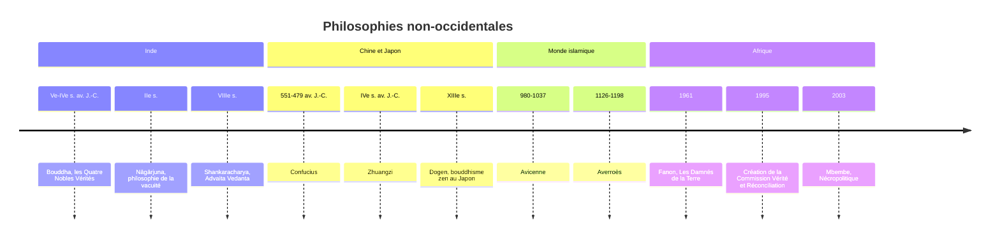

# Philosophies non-occidentales

Vers le Ve siècle avant notre ère, en quelques générations, trois civilisations sans contact entre elles voient naître des sages qui vont marquer des milliards de personnes : Socrate à Athènes, le Bouddha dans la plaine du Gange, Confucius dans la principauté de Lu, en Chine. Le philosophe allemand Karl Jaspers a appelé cette époque l'« âge axial ». La philosophie enseignée en France, des Grecs à Foucault, est pourtant presque entièrement européenne. Cette limite a quelque chose d'arbitraire : pendant des siècles, ce sont des penseurs de langue arabe, comme Avicenne et Averroès, qui ont conservé et prolongé l'œuvre d'Aristote, alors que l'Europe latine l'avait en grande partie perdue ; et l'Inde comme la Chine ont posé les grandes questions de la philosophie, sur le moi, l'action, la vérité, avec des réponses souvent différentes. Ce panorama ne prétend pas en faire le tour, seulement situer ces traditions et ouvrir des comparaisons.

## La philosophie bouddhiste

Le bouddhisme est souvent présenté comme une religion, mais plusieurs de ses thèses sont philosophiques et peuvent s'étudier sans adhésion religieuse. Selon la tradition, le prince Siddhartha Gautama, élevé dans le luxe, découvre un jour la vieillesse, la maladie et la mort, et quitte son palais pour comprendre la souffrance. Devenu le Bouddha, « l'Éveillé », il formule ce qu'il a compris en **quatre nobles vérités**, à la manière d'un diagnostic médical : la souffrance (*dukkha*) est inhérente à l'existence ordinaire ; elle a une cause, le désir et l'attachement ; elle peut cesser ; et un chemin y mène, le **noble sentier octuple**, qui associe sagesse, conduite éthique et méditation.

Pourquoi le désir fait-il souffrir ? Parce que tout est **impermanent** (*anicca*) : ce à quoi l'on s'attache finit toujours par changer ou disparaître, si bien que même les plaisirs laissent un manque. Et parce qu'il n'y a pas de **soi** permanent (*anatta*) : ce que j'appelle « moi » n'est qu'un flux de sensations, de pensées et d'émotions, sans noyau fixe. Au IIe siècle, le philosophe indien Nāgārjuna radicalise cette idée avec la **vacuité** (*śūnyatā*) : rien n'existe par soi-même, tout dépend de conditions. Au Japon, au XIIIe siècle, le moine Dōgen fonde l'école zen Sōtō : « Étudier la Voie du Bouddha, c'est s'étudier soi-même. » Au XXe siècle, le moine vietnamien Thich Nhat Hanh (1926-2022) popularise en Occident la **pleine conscience** et un bouddhisme engagé dans les combats politiques.

Ces thèses rencontrent étonnamment certaines idées occidentales.

| Bouddhisme | Philosophie occidentale |
|---|---|
| Anatta (non-soi) | Hume : "le moi est un faisceau de perceptions" |
| Impermanence | Héraclite : "Tout s'écoule" (*panta rhei*) |
| Méditation sur l'impermanence | Stoïcisme : memento mori, acceptation |
| Interdépendance de tous les phénomènes | Spinoza : tout est modes d'une substance unique |
| Libération par le détachement | Épictète : liberté par la dichotomie du contrôle |

> [!important] Idée clé
> Cette convergence entre traditions sans contact historique direct (Hume n'a pas lu de bouddhisme) n'est probablement pas un hasard : plusieurs traditions arrivent indépendamment à une conception anti-substantialiste du moi parce que l'introspection elle-même, poussée assez loin, ne trouve jamais de noyau stable — seulement des perceptions qui se succèdent. C'est un argument phénoménologique convergent, pas un emprunt culturel.

## Le taoïsme

Le [[Taoïsme|taoïsme]] est traditionnellement attribué à [[Laozi]], un sage du VIe siècle avant notre ère dont l'existence historique reste incertaine, auteur supposé du *Tao Te King*. Son principe est le **Tao**, la « Voie », source de toutes choses, antérieure à toute distinction et impossible à enfermer dans des mots : « Le Tao qui peut être dit n'est pas le Tao éternel », dit le premier chapitre. Le sage ne cherche pas à imposer sa volonté au monde ; il pratique le ***wu wei***, le « non-agir », qui n'est pas l'inaction, mais une action sans effort inutile, qui épouse le cours des choses au lieu de le forcer, comme l'eau qui contourne les rochers et finit par les user. La valeur suprême est le ***ziran***, ce qui est spontanément soi-même, sans artifice.

Zhuangzi, au IVe siècle avant notre ère, donne au taoïsme ses plus belles paraboles. Un cuisinier découpe un bœuf sans jamais émousser sa lame, parce qu'il suit les jointures naturelles de l'animal au lieu de trancher : voilà le *wu wei* parfait. Une nuit, Zhuangzi rêve qu'il est un papillon ; à son réveil, il ne sait plus s'il est Zhuangzi qui a rêvé être un papillon, ou un papillon qui rêve à présent qu'il est Zhuangzi. Deux mille ans avant Descartes, le doute sur la frontière entre rêve et réalité est posé. Le Tao indicible, lui, fait penser à la théologie négative des mystiques chrétiens, qui refusent d'attribuer à Dieu aucun prédicat, ou à la chose en soi de Kant, que nous ne pouvons pas connaître.

## Le confucianisme

[[Confucius]] (551-479 av. J.-C.) vit un siècle avant Socrate, dans une Chine déchirée par les guerres entre principautés. Sa pensée, recueillie par ses disciples dans les *Entretiens*, fonde une éthique sociale et politique qui a structuré la Chine, la Corée, le Japon et le Vietnam pendant deux millénaires et demi. Sa vertu centrale est le ***ren***, l'humanité ou la bienveillance, résumée par une version de la règle d'or : « Ce que tu ne voudrais pas que l'on te fasse, ne le fais pas aux autres. » Le ***yi***, la droiture, consiste à agir selon ce qui est juste et non selon son intérêt. Les ***li***, les rites, ne sont pas des formalités vides : les gestes de politesse, les cérémonies familiales et les usages sociaux transmettent et entretiennent les valeurs. L'idéal est le ***junzi***, « l'homme de bien », qui incarne ces vertus dans sa conduite quotidienne.

Le confucianisme est ainsi une **éthique des vertus**, plus proche d'Aristote que de Kant (voir [[Éthique — Utilitarisme, Déontologie, Vertus]]). Comme Aristote, il pense l'excellence humaine dans les relations, celles du fils et du père, du sujet et du souverain, des amis entre eux. Mais il accorde à la tradition et aux rites un poids que la philosophie moderne, attachée à l'autonomie de l'individu, leur refuse.

## La pensée africaine : Ubuntu

La pensée africaine est trop diverse pour se ramener à un système. Un concept a pourtant reçu une élaboration philosophique particulière : ***ubuntu***, issu des langues bantoues d'Afrique australe. Le proverbe zoulou *umuntu ngumuntu ngabantu* signifie « une personne est une personne par les autres » ; le philosophe kényan John Mbiti l'a résumé par la formule « je suis parce que nous sommes ». L'identité n'est pas donnée à un individu isolé : elle est constituée par ses relations.

> [!warning] Piège
> Réduire Ubuntu à "collectivisme contre individualisme" en fait une simple préférence politique parmi d'autres — et manque le point. La thèse est ontologique, pas seulement politique : elle affirme que la relation précède l'individu dans l'ordre de l'être (je n'existe pas d'abord comme atome qui *ensuite* choisit d'entrer en relation), pas seulement qu'il faudrait privilégier le groupe par choix de valeurs.

Cette idée conteste le point de départ de l'individualisme libéral de Locke ou de Rawls, et fonde une éthique de la réciprocité et de la solidarité plutôt que des droits individuels. Elle a trouvé une traduction politique spectaculaire : l'archevêque Desmond Tutu l'invoque explicitement pour justifier la Commission vérité et réconciliation, créée en 1995 en Afrique du Sud, qui privilégie l'aveu et le pardon sur la punition. D'autres penseurs africains et de la diaspora ont marqué la philosophie contemporaine : Frantz Fanon, avec *Les Damnés de la terre* (1961), sur la décolonisation et la violence ; le Camerounais Achille Mbembe, avec la **nécropolitique**, ce pouvoir de décider qui peut vivre et qui doit mourir, qui prolonge et critique le biopouvoir de Foucault ; le Ghanéen Kwame Anthony Appiah, avec un cosmopolitisme attentif aux identités multiples.

## La philosophie indienne

La philosophie indienne s'organise en plusieurs écoles, les *darshanas*, parmi les plus anciennes et les plus subtiles du monde. L'**Advaita Vedanta**, la non-dualité, systématisée par Shankara au VIIIe siècle, enseigne que l'âme individuelle (*atman*) et la réalité absolue (*brahman*) ne font qu'un, et que la multiplicité du monde n'est qu'apparence (*maya*), une thèse qu'on a rapprochée de l'idéalisme de Berkeley ou de certaines lectures de Spinoza. L'école **Nyaya** développe une logique et une théorie de la connaissance rigoureuses, indépendamment de la logique grecque. Les *Yoga Sutras* de Patanjali, dont la datation est discutée, mais que beaucoup de chercheurs placent vers 400 de notre ère, décrivent une discipline de l'esprit menant à la libération (*moksha*), qui commence par des règles éthiques comme la non-violence et la véracité.

## Ce que ces traditions apportent

Elles offrent d'abord d'autres conceptions du **moi** : le non-soi bouddhiste et l'*ubuntu* contestent l'idée occidentale d'un sujet individuel, stable et souverain. Elles interrogent notre rapport à l'**action** : le *wu wei* rappelle qu'il y a une sagesse à ne pas tout forcer. Le [[Confucianisme|confucianisme]] montre qu'une **éthique** profondément relationnelle est possible sans partir de l'individu autonome. Et les traditions de l'indicible, du Tao au *brahman*, suggèrent que la philosophie occidentale a peut-être trop fait confiance au langage pour dire la **vérité**.

## Ressources

**Introductions accessibles :**
- Bryan Van Norden, *Introduction to Classical Chinese Philosophy* (2011) : une excellente entrée au confucianisme et au taoïsme, en anglais.
- Mark Siderits, *Buddhism as Philosophy* (2007) : le bouddhisme lu avec les outils de la philosophie analytique, en anglais.
- Thich Nhat Hanh, *Le Cœur de l'enseignement du Bouddha* : une introduction accessible au bouddhisme vivant.
- Kwame Anthony Appiah, *Le Code d'honneur* (2011) : comment les révolutions morales se produisent.

**Podcasts et vidéos :**
- *Philosophize This!* (Stephen West) : épisodes sur le bouddhisme, le taoïsme, Confucius et la philosophie indienne.
- France Culture, *Les Chemins de la philosophie* : épisodes consacrés aux philosophies non occidentales.
- Stanford Encyclopedia of Philosophy : entrées **Buddhism**, **Confucius** et **Daoism** (plato.stanford.edu).

## Questions ouvertes

- Le concept bouddhiste de non-soi (*anatta*) est-il compatible avec la responsabilité morale — si je ne suis pas un "moi" stable, en quel sens suis-je responsable de mes actions d'hier ?
- *Ubuntu* ("je suis parce que nous sommes") remet en question le fondement de l'éthique libérale (droits individuels, autonomie). Comment concilier les deux dans une société plurielle ?
- Le *wu wei* taoïste (agir sans forcer) ressemble à la passivité mais aussi à une forme de sagesse écologique. Dans quels domaines de ta vie est-ce que l'idée de "faire moins pour accomplir plus" pourrait s'appliquer ?
- La commission Vérité et Réconciliation en Afrique du Sud a fondé la réconciliation sur Ubuntu plutôt que sur la punition. Est-ce philosophiquement justifiable — ou est-ce sacrifier la justice rétributive au nom de la paix sociale ?
- Y a-t-il quelque chose que ces traditions non-occidentales peuvent apporter à nos débats contemporains (IA, crise climatique, inégalités) que la philosophie occidentale a du mal à formuler ?
