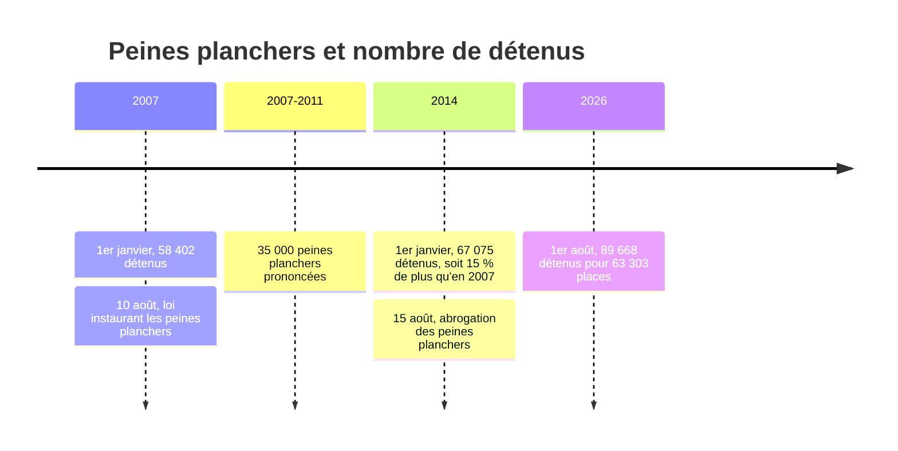

# Arguments contre l'extrême droite

Le Rassemblement national (RN) et Reconquête, le parti d'Éric Zemmour, bâtissent l'essentiel de leur discours sur trois affirmations : l'immigration « submerge » la France, elle fait exploser la délinquance, et la justice est trop laxiste pour y répondre. Leurs programmes de 2022 en tirent des mesures : référendum sur l'immigration, « priorité nationale » inscrite dans la Constitution pour le logement social, l'emploi et les aides, suppression de l'aide médicale d'État (AME), retour des peines planchers, et pour Reconquête un « ministère de la Remigration ». Le RN y ajoute un volet social : abrogation de la réforme des retraites, baisse de la TVA sur l'énergie, exonérations de cotisations pour les hausses de salaire.

Cette note confronte chacune de ces affirmations aux chiffres de la statistique publique (Insee, ministère de l'Intérieur, ministère de la Justice, Conseil de l'Europe, OCDE). Elle ne nie pas ce que les chiffres montrent quand ils vont dans le sens de l'adversaire : un argument qui cache une donnée gênante se fait démonter au premier débat. La force des contre-arguments vient de leur précision.

> [!important] Idée clé
> Presque tous les slogans de l'extrême droite partent d'un chiffre réel (les étrangers sont surreprésentés parmi les personnes mises en cause, la part d'immigrés augmente) et en tirent une conclusion que le chiffre ne permet pas (la nationalité serait la cause, la France serait « submergée », la justice serait laxiste). Le travail consiste à remettre le chiffre dans son contexte, pas à le contester.

## Trois précautions avant de débattre

**Immigré n'est pas étranger.** Un *immigré* est né étranger à l'étranger ; il le reste toute sa vie, même naturalisé. Un *étranger* n'a pas la nationalité française, qu'il soit né à l'étranger ou en France. En 2025, la France compte 8,0 millions d'immigrés (11,6 % de la population), dont un tiers sont devenus français, et 6,3 millions d'étrangers (9,1 %)[^insee-pop]. Les statistiques de police et de justice ne connaissent que la **nationalité** : tout chiffre sur « la délinquance des immigrés » est en réalité un chiffre sur les étrangers.

**Une statistique de police mesure l'activité de la police.** Une personne « mise en cause » est soupçonnée, pas condamnée. Le nombre d'infractions enregistrées dépend des plaintes déposées et des contrôles effectués : une infraction de séjour irrégulier n'existe que si quelqu'un est contrôlé. L'Insee prévient lui-même que la nationalité déclarée n'est pas toujours vérifiable[^insee-nat].

**Les séries ont des ruptures.** L'Insee a changé sa méthode de recensement en 2024 : les parts d'immigrés d'avant 2024 ne se comparent pas directement aux suivantes[^insee-pop]. Citer « + 1 point en un an » entre 2023 et 2024, c'est comparer deux thermomètres.

## « La France est submergée »

Le mot « submersion » (Jordan Bardella) et la thèse du « grand remplacement » (Éric Zemmour) supposent une transformation brutale. Les chiffres de l'Insee montrent une hausse réelle mais lente. La part des immigrés était de 6,6 % en 1931, 7,4 % en 1975, 7,3 % en 1999, puis elle remonte depuis le début des années 2000 jusqu'à 11,6 % en 2025[^insee-pop]. La population étrangère pèse 9,1 % en 2025, contre 6,5 % en 1975 et 6,6 % déjà en 1931.

Deux mécanismes expliquent la remontée récente, et l'Insee les cite ensemble : l'immigration augmente, mais la population née en France croît moins vite, parce que la fécondité baisse. Une part qui monte ne veut pas dire un flux qui explose.

Avant de lire la suite, dessine la courbe telle que tu l'imagines. Dans l'enquête *Perils of Perception* d'Ipsos publiée en 2018, les Français estimaient en moyenne à 27 % la part des immigrés, pour 12 % en réalité.

```widget:owid
graphe: migrant-stock-share
type: devine
devine: 2000
pays: France
depuis: 1990
titre: Quelle part des habitants de la France est née à l'étranger ?
sous-titre: Personnes nées dans un autre pays, Français nés hors de France compris, en % de la population (ONU, via Our World in Data)
unite: %
```

Ce chiffre de l'ONU compte toutes les personnes nées à l'étranger, y compris les Français nés hors de France, d'où un résultat plus élevé que la part des immigrés. Avec la même mesure pour tous, la comparaison européenne remet les choses à leur place : la France est en dessous de ses grands voisins.

```widget:owid
graphe: migrant-stock-share
type: pente
annees: 1990, 2024
pays: France, Allemagne, Espagne, Royaume-Uni, Suède
mettre-en-avant: France
titre: La France est le pays où la part des personnes nées à l'étranger a le moins augmenté
sous-titre: Personnes nées dans un autre pays, en % de la population, 1990 et 2024 (ONU, via Our World in Data)
unite: %
```

En 2024, 13,8 % des habitants de la France sont nés à l'étranger, contre 17,1 % au Royaume-Uni, 18,5 % en Espagne, 19,8 % en Allemagne et 21,4 % en Suède. Surtout, la France est le pays de la liste où la part a le moins augmenté depuis 1990 : + 3,5 points, quand l'Espagne en gagne plus de seize.

> [!tip] Réponse courte
> « La part des immigrés est passée de 7,4 % en 1975 à 11,6 % aujourd'hui : c'est une hausse, en cinquante ans, et la France reste en dessous de l'Allemagne, de l'Espagne et du Royaume-Uni. On ne remplace pas un pays à ce rythme-là. »

## « L'immigration, c'est la délinquance »

C'est l'argument le plus fort de l'extrême droite parce qu'il repose sur un fait exact : **les étrangers sont surreprésentés à chaque étape de la chaîne pénale**. Il faut le dire, puis expliquer pourquoi.

> [!chiffres]
> - **7 %** de la population en France est étrangère en 2019
> - **18 %** des personnes mises en cause par la police et la gendarmerie sont étrangères (2019)
> - **14 %** des auteurs dont les parquets ont traité l'affaire sont étrangers (2019)
> - **21 %** des personnes écrouées sont étrangères au 1er janvier 2020, **24,6 %** des détenus au 31 janvier 2024

Sources : Insee, *Sécurité et société*, édition 2021[^insee-nat] ; Conseil de l'Europe, SPACE I 2024[^space].

Les chiffres plus récents vont dans le même sens : un bilan du ministère de l'Intérieur, rapporté par la presse, donne 8 % d'étrangers dans la population et environ 17 % parmi les mis en cause[^ssmsi].

### Ce que la surreprésentation veut dire, et ce qu'elle ne veut pas dire

**Elle se concentre sur certaines infractions.** Les étrangers ne sont pas mis en cause pour les mêmes faits que les Français. Ils sont très présents dans les vols et dans les atteintes économiques (contrefaçon, vente à la sauvette), et dans des délits qui n'existent que pour eux (séjour irrégulier, travail sans titre). Ils le sont beaucoup moins dans les violences sexuelles, les destructions ou les atteintes à la famille, où les Français dominent largement.

```widget:classer
consigne: Classe ces infractions selon la part des étrangers parmi les personnes mises en cause en 2019 (de la plus forte à la plus faible)
elements: Atteintes économiques et financières = 45.8; Vols sans violence = 29.0; Vols avec violence = 28.1; Cambriolages = 23.5; Ensemble des infractions = 17.7; Violences physiques = 15.0; Infractions sexuelles = 13.5; Stupéfiants = 11.5; Destructions et dégradations = 10.8; Atteintes à la famille = 8.1
unite: %
```

Source : SSMSI, base des mis en cause 2019, publiée par l'Insee[^insee-nat]. Les étrangers représentaient alors 7 % de la population : tous les chiffres du classement sont au-dessus, mais l'écart va du simple au sextuple selon l'infraction.

**L'essentiel, ce sont des délits, pas des crimes.** C'est vrai pour tout le monde : les crimes (homicides, viols, vols à main armée) sont une petite minorité des infractions enregistrées, Français et étrangers confondus. Ce qui distingue le profil des étrangers mis en cause, c'est la place des atteintes aux biens : les vols pèsent 27 % de leurs mises en cause, contre 16 % pour les Français[^insee-nat]. Attention à ne pas en conclure que la surreprésentation ne touche que les petits délits : elle existe aussi pour les vols avec violence (28 %).

**La nationalité n'est pas une cause.** Le sexe et l'âge sont de loin les premiers facteurs de délinquance, partout et à toutes les époques : les mis en cause sont très majoritairement des hommes jeunes. Viennent ensuite la précarité et le niveau d'études. Or la population étrangère compte, en moyenne, plus d'hommes jeunes, plus de pauvres et de chômeurs que la population française, et elle vit davantage dans les quartiers où la police patrouille le plus. Le criminologue suisse André Kuhn montre qu'en comparant étrangers et nationaux de même sexe, même âge, même niveau socio-économique et même formation, l'écart se réduit très fortement, et disparaît souvent[^kuhn]. La statistique française ne permet pas de faire ce calcul, faute de croiser nationalité, âge et revenu : c'est une limite, mais elle interdit tout autant de conclure que la nationalité est la cause.

### La « surincarcération » des étrangers

Les étrangers pèsent 14 % des auteurs traités par la justice mais un quart des détenus. Cet écart entre 14 % et 25 % ne vient pas d'une délinquance plus grave : il vient du fonctionnement de la justice[^insee-nat].

Jusqu'au procès, pourtant, les parquets traitent Français et étrangers presque de la même façon. Le diagramme suit les auteurs dont une affaire a été traitée en 2019 : environ 40 % des Français comme des étrangers finissent poursuivis devant un tribunal, et les bandes gardent les mêmes proportions à chaque sortie.

```mermaid
---
config:
  sankey:
    suffix: " 000"
---
sankey-beta

Auteurs français,Affaire non poursuivable,366
Auteurs français,Classement sans suite,72
Auteurs français,Alternative aux poursuites,432
Auteurs français,Poursuites devant un tribunal,572
Auteurs étrangers,Affaire non poursuivable,60
Auteurs étrangers,Classement sans suite,16
Auteurs étrangers,Alternative aux poursuites,89
Auteurs étrangers,Poursuites devant un tribunal,108
```

*Auteurs traités par les parquets en 2019, en milliers (ministère de la Justice, fichier Cassiopée, publié par l'Insee). Les 212 000 auteurs de nationalité inconnue ne sont pas représentés. Les alternatives comprennent la composition pénale.*

L'écart se creuse après, à deux moments :

- **La détention provisoire.** Pour laisser un prévenu libre en attendant son procès, le juge exige des « garanties de représentation » : un domicile, un emploi, de la famille en France (article 144 du code de procédure pénale). Un étranger sans adresse stable ne les a pas. Au 1er janvier 2020, 35 % des étrangers écroués étaient en détention provisoire, contre 26 % des Français.
- **Les peines.** Les tribunaux prononcent plus souvent une amende contre un Français (34 % des condamnés) que contre un étranger (29 %), et plus souvent de la prison ferme contre un étranger (31 % contre 23 %). Les aménagements de peine (bracelet électronique, semi-liberté) supposent eux aussi un domicile et un travail.

> [!tip] Réponse courte
> « Oui, les étrangers sont surreprésentés parmi les mis en cause, surtout pour les vols. Mais ils sont plus jeunes, plus souvent des hommes et plus pauvres que la moyenne, et c'est cela qui prédit la délinquance, pas le passeport. Et s'ils sont un quart des détenus pour 14 % des auteurs jugés, c'est parce que sans domicile on va plus souvent en détention provisoire. »

## « La délinquance explose »

Sur le long terme, la violence la plus grave, l'homicide, n'a jamais été aussi basse. C'est l'indicateur le plus fiable, parce qu'un corps se compte et ne dépend pas de la propension à porter plainte.

```widget:owid
graphe: homicide-rates-across-western-europe
type: recit
pays: France, Italie, Pays-Bas, Suède
depuis: 1300
titre: Depuis la fin du Moyen Âge, le taux d'homicide a chuté d'un facteur dix à cent en Europe de l'Ouest
sous-titre: Homicides pour 100 000 habitants (estimations de Manuel Eisner, puis OMS)
unite: pour 100 000
etape1: 1300-1700 | Italie | À la fin du Moyen Âge, l'Italie dépasse 60 homicides pour 100 000 habitants, cent fois plus qu'aujourd'hui.
etape2: 1500-1900 | France | La France passe d'environ 20 homicides pour 100 000 habitants au XVIe siècle à 1,5 au XIXe : l'État moderne, la police et le recul de la vengeance privée font reculer la violence.
etape3: 1950-2023 | France | Depuis 1950, le taux reste sous 2,5 pour 100 000. Le pic de 1957-1962 coïncide avec la guerre d'Algérie.
```

Sur les trente dernières années, la série des Nations unies, la plus comparable entre pays, montre une baisse de 43 % en France : 2,4 homicides pour 100 000 habitants en 1990, 1,3 en 2024. La remontée depuis le point bas de 2020 est réelle mais laisse le pays bien en dessous des niveaux des années 1990.

```widget:owid
graphe: homicide-rate-unodc
type: devine
devine: 1995
pays: France
depuis: 1990
titre: Le taux d'homicide en France a baissé de 43 % depuis 1990
sous-titre: Homicides volontaires pour 100 000 habitants (ONUDC, via Our World in Data)
unite: pour 100 000
```

Les vols suivent la même pente. D'après les enquêtes de victimation, où l'on interroge directement les ménages (ce qui évite le biais des plaintes), le nombre de cambriolages de la résidence principale est passé de 5,9 pour 100 ménages en 1984-1985 à 3,3 en 2019-2020, une baisse de 45 % en trente-cinq ans, malgré une remontée dans les années 2010[^cesdip].

**Ce qui augmente vraiment**, et qu'il ne faut pas nier : les coups et blessures volontaires *enregistrés* progressent d'année en année depuis le milieu des années 2010. Une grande partie de la hausse vient des violences intrafamiliales et sexuelles, que les victimes déclarent beaucoup plus depuis 2017. Le ministère de l'Intérieur le rappelle à chaque bilan : une hausse des plaintes n'est pas forcément une hausse des faits. Dire « la criminalité baisse depuis quarante ans » sans nuance est donc faux pour les violences enregistrées ; c'est juste pour les homicides et les vols.

## « La justice est laxiste »

C'est l'argument qui résiste le moins aux chiffres. La France n'a jamais autant emprisonné.

> [!chiffres]
> - **89 668** détenus au 1er août 2026, record historique
> - **63 303** places de prison opérationnelles
> - **141,6 %** de densité carcérale : 27 841 détenus en surnombre, 7 956 matelas posés au sol

Source : ministère de la Justice, statistique mensuelle de la population écrouée[^justice].

La France enferme aussi plus que la moyenne européenne. Au 31 janvier 2024, elle comptait 111,5 détenus pour 100 000 habitants, au-dessus de la médiane des 51 administrations pénitentiaires du Conseil de l'Europe (104,8), de l'Italie et loin devant l'Allemagne.

```widget:classer
consigne: Classe ces pays selon leur nombre de détenus pour 100 000 habitants au 31 janvier 2024 (du plus élevé au plus faible)
elements: Angleterre et pays de Galles = 145.0; Espagne = 117.2; France = 111.5; Médiane européenne = 104.8; Italie = 102.8; Allemagne = 71.2; Pays-Bas = 54.0
unite: détenus pour 100 000
```

Source : Conseil de l'Europe, SPACE I 2024. La France est donc au-dessus de la médiane européenne, et l'Allemagne, souvent citée en modèle de fermeté, enferme une fois et demie moins.

```widget:vrai-faux
affirmation: L'Allemagne est plus sévère que la France : elle enferme davantage.
reponse: faux
explication: En janvier 2024, l'Allemagne comptait 71 détenus pour 100 000 habitants, contre 111,5 en France, pour un taux d'homicide plus bas (0,9 contre 1,3 pour 100 000 en 2023). Plus de prison ne garantit pas moins de violence.
```

**Les peines planchers ont déjà été essayées.** La loi du 10 août 2007 imposait une peine minimale aux récidivistes. Entre 2007 et 2011, 35 000 peines planchers ont été prononcées[^planchers]. Le ministère de la Justice les a jugées « non pertinentes en matière de sécurité », contraires à l'individualisation des peines et dotées d'un « effet certain sur la surpopulation carcérale » ; elles ont été abrogées par la loi du 15 août 2014. À l'inverse, l'économie du crime montre que le bracelet électronique, à profil de condamné comparable, réduit la récidive par rapport à la prison ferme[^bracelet] : la prison surpeuplée fabrique de la récidive.

La frise met côte à côte les peines planchers et le nombre de détenus. Les peines minimales ne sont pas la seule cause de la hausse, mais elles y ont contribué, et leur abrogation n'a pas vidé les prisons : le nombre de détenus a continué de monter depuis.



*Sources : ministère de la Justice, statistiques de la population carcérale au 1er janvier 2007 et au 1er janvier 2014, mesure mensuelle au 1er août 2026 ; réponse à la question écrite n° 831.*

> [!tip] Réponse courte
> « Laxiste ? La France bat chaque mois son record de détenus, 141 % de taux d'occupation, 8 000 matelas au sol. Elle enferme plus que l'Italie et une fois et demie plus que l'Allemagne. Les peines planchers, on les a eues de 2007 à 2014 : elles ont rempli les prisons sans faire baisser la récidive. »

## « Les immigrés coûtent cher »

L'OCDE a calculé, pour 25 pays et sur la période 2006-2018, ce que les personnes nées à l'étranger paient en impôts et cotisations et ce qu'elles reçoivent en prestations et services publics. Sa conclusion générale : dans la plupart des pays, la contribution nette des immigrés est comprise entre -1 % et +1 % du PIB[^ocde]. Pour la France, elle est positive (+1,02 % du PIB par an en moyenne) si l'on compte ce que chacun paie et reçoit individuellement ; elle devient négative (environ -0,85 %) si l'on impute aussi aux immigrés une part des dépenses collectives comme la défense. Dans les deux cas, l'ordre de grandeur est faible : l'immigration n'est ni une manne ni un gouffre pour les finances publiques.

L'**AME**, que le RN et Reconquête veulent supprimer, soigne les étrangers en situation irrégulière. Elle coûtait environ 1,2 milliard d'euros en 2023, moins de 0,5 % des dépenses de l'assurance maladie. Le rapport remis au gouvernement en décembre 2023 par Claude Évin et Patrick Stefanini, ancien directeur de campagne de François Fillon, l'a jugée « utile » et « globalement maîtrisée », et a déconseillé de la réduire aux seules urgences : des maladies non soignées arrivent plus tard, plus graves et plus chères à l'hôpital, et les maladies infectieuses ne s'arrêtent pas aux papiers[^ame].

## « La priorité nationale »

Réserver le logement social, l'emploi ou certaines aides aux Français se heurte à un principe que le Conseil constitutionnel applique depuis 1990 : l'égalité devant la loi protège aussi les étrangers en situation régulière. Le 22 janvier 1990 (décision n° 89-269 DC), il a censuré une loi qui privait des étrangers d'une allocation de vieillesse. En 2024, il a encore jugé contraire à la Constitution une proposition de référendum qui conditionnait les prestations sociales à cinq ans de résidence, y voyant une « atteinte disproportionnée » au droit à la protection sociale[^cc]. Le RN propose pour cette raison de réviser la Constitution par référendum ; la mesure resterait contraire au droit européen, qui impose l'égalité de traitement aux résidents de longue durée.

L'argument de fond est économique autant que juridique. Les étrangers en situation régulière paient les mêmes cotisations et les mêmes impôts que les Français : les exclure des prestations, c'est leur faire payer une assurance qui ne les couvre pas.

L'Institut Montaigne a chiffré ces mesures pour les législatives de 2024 : réserver les allocations familiales aux foyers dont un parent est français économiserait environ 3,3 milliards d'euros par an, et réserver le RSA aux étrangers ayant travaillé cinq ans en France entre 0,6 et 2,6 milliards. Il relève dans les deux cas une « grande complexité juridique, politique et diplomatique »[^montaigne].

## « Le RN est le parti du pouvoir d'achat »

Le RN se présente comme le défenseur des classes populaires ; Reconquête, lui, assume un programme libéral (retraite à 64 ans, baisse des impôts des entreprises). La critique porte donc d'abord sur le RN, et elle tient en trois points : ses promesses sociales ne sont pas financées, il en reporte une partie dès qu'il approche du pouvoir, et il vote contre les hausses de salaire directes.

**Les salaires.** Le 20 juillet 2022, l'Assemblée a examiné des amendements portant le SMIC à 1 500 euros net. Les 69 députés RN présents ont voté contre, un s'est abstenu, aucun n'a voté pour[^smic]. À la place, le RN propose d'exonérer de cotisations patronales les hausses de salaire de 10 % jusqu'à trois SMIC. L'Institut Montaigne chiffre la mesure à 0,8 milliard d'euros en 2025 et 12 milliards en 2029, et y voit de forts effets d'aubaine : les entreprises seraient payées pour des hausses qu'elles auraient accordées de toute façon. Une hausse financée par moins de cotisations est payée par la Sécurité sociale ou par l'État qui la compense, donc par le contribuable, et non par l'employeur.

**Les retraites.** En 2022, Marine Le Pen promettait la retraite à 60 ans pour ceux qui ont commencé à travailler avant 20 ans, et le retour à 62 ans pour les autres. En juin 2024, Jordan Bardella a gardé la première mesure mais renvoyé la seconde à « après » l'audit des comptes publics. L'Institut Montaigne chiffre l'abrogation complète, telle qu'annoncée, à 34,7 milliards d'euros par an (entre 31,5 et 44,7)[^montaigne].

**Le budget.** Toujours selon l'Institut Montaigne, le programme du RN aux législatives de 2024 aurait creusé le déficit public de 71 milliards d'euros par an. Les économies affichées reposent surtout sur l'immigration (8 milliards) et la privatisation de l'audiovisuel public (1,6 milliard), deux mesures dont la faisabilité juridique est incertaine. Celui d'Éric Zemmour en 2022 l'aurait creusé de 145,8 milliards par an, quand le candidat annonçait un excédent de 20 milliards.

```widget:classer
consigne: Classe ces mesures du programme du RN aux législatives de 2024 selon leur montant annuel estimé, coût ou économie (du plus gros au plus petit)
elements: Retraites : abroger la réforme = 34.7; TVA sur l'énergie : baisse = 11.3; Immigration : économies attendues = 8; Audiovisuel public : privatisation = 1.6
unite: milliards d'euros par an
```

Source : Institut Montaigne, chiffrage des programmes des législatives de 2024[^montaigne-global]. Les deux plus grosses lignes sont des dépenses, les deux plus petites sont les économies censées les financer.

**La santé.** On entend parfois que le RN voudrait privatiser le système de santé : ce n'est pas dans son programme. En 2024, il promettait au contraire de supprimer les agences régionales de santé, de plafonner à 10 % les postes administratifs à l'hôpital et de mettre fin aux fermetures de lits. La critique sérieuse est ailleurs : dans les effectifs hospitaliers, les « administratifs » comprennent des métiers indispensables aux soins (secrétaires médicales, brancardiers, psychologues), que le plafond de 10 % menacerait, et la suppression de l'AME reporte sur l'hôpital public des soins plus tardifs et plus chers. La privatisation que le RN propose vraiment, c'est celle de l'audiovisuel public (France Télévisions, Radio France), pour une économie que l'Institut Montaigne estime à environ 2 milliards d'euros par an au mieux, au bout de trois à cinq ans.

> [!tip] Réponse courte
> « Le RN a voté contre le SMIC à 1 500 euros. Il promettait d'abroger la réforme des retraites, puis a renvoyé le retour à 62 ans à "après l'audit" dès qu'il a cru gouverner. Et son programme creusait le déficit de 71 milliards par an, avec des économies sur l'immigration que le Conseil constitutionnel a déjà censurées sous d'autres formes. »

## Les pièges à éviter

Un contre-argument faux affaiblit tous les autres. Quelques formulations courantes à corriger :

| On entend | Ce que disent les chiffres |
|---|---|
| « Les immigrés sont 8 % de la population » | Ce sont les **étrangers** qui étaient 8 % (8,2 % en 2023, 9,1 % en 2025). Les immigrés sont 11,6 % |
| « Les étrangers sont 14 % des délinquants » | 14 % des auteurs traités par les parquets en 2019, mais 18 % des mis en cause par la police la même année |
| « Les étrangers ne commettent que des petits délits » | Les vols dominent, mais ils sont aussi surreprésentés dans les vols avec violence (28 %) |
| « La criminalité baisse depuis 40 ans » | Vrai pour les homicides et les cambriolages ; faux pour les violences enregistrées, qui augmentent |
| « Le RN veut privatiser la santé » | Ce n'est pas dans son programme ; il veut privatiser l'audiovisuel public. Attaquer plutôt le plafond de 10 % d'administratifs à l'hôpital et la suppression de l'AME |
| « Il n'y a pas de lien entre immigration et délinquance » | Il y a une corrélation ; ce qui manque, c'est la preuve d'une causalité par la nationalité |

## S'entraîner à répondre

Chaque slogan a son chiffre. Associe-les avant un débat.

```widget:associer
consigne: Associe chaque slogan au chiffre qui lui répond.
paires: « Submersion migratoire » = 13,8 % de personnes nées à l'étranger, moins qu'en Allemagne (19,8 %) | « Ensauvagement » = Taux d'homicide en baisse de 43 % depuis 1990 | « Laxisme judiciaire » = 141,6 % de densité carcérale, un record | « Les étrangers, c'est la délinquance » = Surreprésentés, mais d'abord parce que plus jeunes, plus souvent des hommes et plus pauvres | « L'AME coûte une fortune » = Moins de 0,5 % des dépenses de l'assurance maladie | « Le parti du pouvoir d'achat » = Contre le SMIC à 1 500 euros net en 2022
```

## Questions de révision

> [!quiz] Quelle est la différence entre un immigré et un étranger ?
> Un immigré est né étranger à l'étranger et le reste même naturalisé ; un étranger n'a pas la nationalité française, qu'il soit né en France ou non. En 2025 : 11,6 % d'immigrés, 9,1 % d'étrangers.

> [!quiz] Quelle part des personnes mises en cause par la police étaient étrangères en 2019, pour quelle part de la population ?
> 18 % des mis en cause, pour 7 % de la population.

> [!quiz] Pourquoi les étrangers sont-ils plus nombreux en prison (un quart des détenus) que parmi les auteurs jugés (14 %) ?
> Ils vont plus souvent en détention provisoire faute de garanties de représentation (domicile, emploi), et sont plus souvent condamnés à de la prison ferme qu'à une amende.

> [!quiz] De combien le taux d'homicide a-t-il baissé en France entre 1990 et 2024 ?
> De 43 % : de 2,4 à 1,3 homicides pour 100 000 habitants (série ONUDC).

> [!quiz] Quelle était la densité carcérale en France au 1er août 2026 ?
> 141,6 % : 89 668 détenus pour 63 303 places.

> [!quiz] Combien le programme du RN aux législatives de 2024 aurait-il ajouté au déficit public chaque année, selon l'Institut Montaigne ?
> 71 milliards d'euros, dont environ 35 milliards pour l'abrogation de la réforme des retraites.

> [!quiz] Comment les députés RN ont-ils voté sur le SMIC à 1 500 euros net, le 20 juillet 2022 ?
> Contre (69 voix contre, une abstention, aucune pour). Le RN préfère exonérer de cotisations les hausses de salaire.

> [!quiz] Que concluait le rapport Évin-Stefanini de décembre 2023 sur l'AME ?
> Que c'est un dispositif sanitaire utile et globalement maîtrisé, à adapter mais pas à réduire aux urgences.

[^insee-pop]: Insee, « L'essentiel sur les immigrés et les étrangers », juin 2026 (données provisoires pour 2024 et 2025, rupture de série en 2024). [insee.fr](https://www.insee.fr/fr/statistiques/3633212)
[^insee-nat]: Insee, « Auteurs selon la nationalité », *Sécurité et société*, Insee Références, édition 2021 (données SSMSI et ministère de la Justice 2019). [insee.fr](https://www.insee.fr/fr/statistiques/5763585)
[^ssmsi]: SSMSI, bilan annuel *Insécurité et délinquance*, ministère de l'Intérieur ; chiffres rapportés par Sud Radio. [sudradio.fr](https://www.sudradio.fr/faits-divers/38-des-cambriolages-causes-par-des-delinquants-etrangers)
[^kuhn]: André Kuhn, « La criminalité des étrangers », *Bulletin d'information infoPrisons* n° 7. [infoprisons.ch](https://infoprisons.ch/wp-content/uploads/2020/11/bulletin_7_criminalite-etrangers-vivre_ensemble2012-09-no139.pdf)
[^cesdip]: CESDIP, « Observer dans la durée les cambriolages », janvier 2026 (enquêtes CESDIP 1984-1985, EPCV, CVS). [oscj2.cesdip.fr](https://oscj2.cesdip.fr/wp-content/uploads/2026/01/Observer-dans-la-duree-les-cambriolages.pdf)
[^justice]: Ministère de la Justice, mesure mensuelle de l'incarcération au 1er août 2026. [justice.gouv.fr](https://www.justice.gouv.fr/sites/default/files/2026-08/mesure_mensuelle_01082026.pdf)
[^space]: Conseil de l'Europe et université de Lausanne, SPACE I 2024, statistiques pénales annuelles (situation au 31 janvier 2024). [wp.unil.ch](https://wp.unil.ch/space/files/2025/09/250924_rapport-space-i-2024.pdf)
[^planchers]: Réponse du ministère de la Justice à la question écrite n° 831, Assemblée nationale, 2013. [assemblee-nationale.fr](https://www.assemblee-nationale.fr/dyn/14/questions/QANR5L14QE831)
[^bracelet]: Anaïs Henneguelle, Benjamin Monnery et Annie Kensey, « Better at Home than in Prison? The Effects of Electronic Monitoring on Recidivism in France », *Journal of Law and Economics*, vol. 59, n° 3, 2016.
[^ocde]: OCDE, *Perspectives des migrations internationales 2021*, chapitre 4, « L'impact budgétaire de l'immigration dans les pays de l'OCDE depuis le milieu des années 2000 ». [oecd.org](https://www.oecd.org/fr/publications/2021/10/international-migration-outlook-2021_ea4f9277/full-report/component-8.html)
[^ame]: Claude Évin et Patrick Stefanini, rapport sur l'aide médicale d'État, décembre 2023, présenté par LCP. [lcp.fr](https://lcp.fr/actualites/aide-medicale-d-etat-un-dispositif-utile-et-globalement-maitrise-qui-merite-d-etre)
[^montaigne]: Institut Montaigne, chiffrage des mesures du Rassemblement national pour les législatives de 2024. [institutmontaigne.org](https://www.institutmontaigne.org/legislatives-2024/rassemblement-national)
[^montaigne-global]: Institut Montaigne, « Législatives 2024 : chiffrage global des programmes », juillet 2024 ; pour Éric Zemmour, synthèse des chiffrages de la présidentielle 2022. [institutmontaigne.org](https://institutmontaigne.org/communiques-de-presse/legislatives-2024-chiffrage-global-des-programmes)
[^smic]: Assemblée nationale, scrutin du 20 juillet 2022 sur les amendements portant le SMIC à 1 500 euros net (projet de loi pouvoir d'achat), détail par groupe sur Datan. [datan.fr](https://datan.fr/votes/legislature-16/vote_44)
[^cc]: Conseil constitutionnel, décision n° 89-269 DC du 22 janvier 1990 et décision n° 2024-6 RIP du 11 avril 2024.
